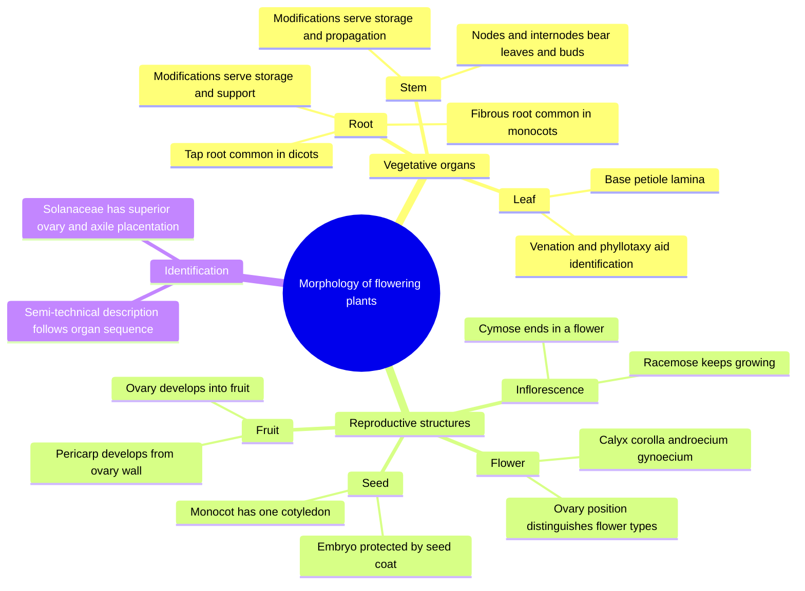

# Biology | Chapter 05 | Morphology of Flowering Plants | CNOTES

## Section-by-section key facts

- **5.1 The Root:** The radicle forms the primary root; dicots commonly have a tap-root system and monocots a fibrous-root system. Root hairs absorb water and minerals; roots may also be modified for storage, support or respiration.
- **5.2 The Stem:** The stem develops from the plumule and bears nodes, internodes, leaves, branches, flowers and fruits. Underground, subaerial and aerial modifications serve storage, perennation, vegetative propagation, support or protection.
- **5.3 The Leaf:** A typical leaf has a leaf base, petiole and lamina. Reticulate venation is common in dicots and parallel venation in monocots; phyllotaxy may be alternate, opposite or whorled. Simple and compound leaves differ by whether incisions reach the midrib or petiole.
- **5.4 The Inflorescence:** In racemose inflorescence the main axis continues to grow and flowers open acropetally; in cymose inflorescence it ends in a flower and opening is basipetal.
- **5.5 The Flower:** A typical flower has calyx, corolla, androecium and gynoecium. Flowers are classified by symmetry, number of floral whorls, ovary position and whether floral parts are free or united.
- **5.6 The Fruit:** A fruit develops from the ovary after fertilisation; the ovary wall forms the pericarp. A parthenocarpic fruit develops without fertilisation and is generally seedless.
- **5.7 The Seed:** A seed contains an embryo and protective seed coat. Dicot seeds generally have two cotyledons; a monocot embryo has one cotyledon (the scutellum), with coleoptile and coleorhiza protecting the shoot and root tips.
- **5.8 Semi-technical description:** Describe the plant habit, root, stem, leaves, inflorescence, flower, fruit and seed in a standard sequence, using precise botanical terms.
- **5.9 Solanaceae:** The family typically has pentamerous, bisexual, actinomorphic flowers, a superior bicarpellary ovary, axile placentation and a fruit that may be a berry or capsule.

