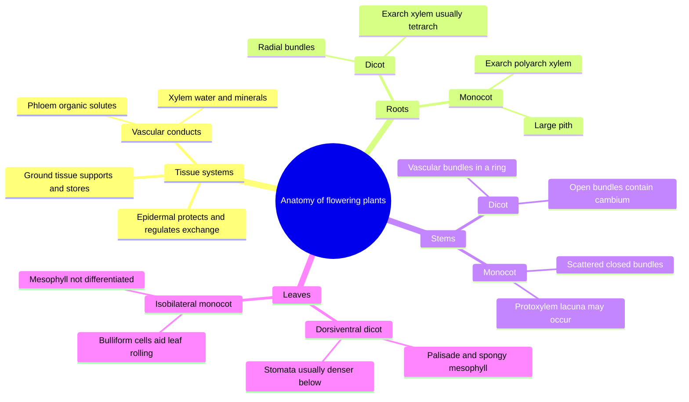

# Biology | Chapter 06 | Anatomy of Flowering Plants | CNOTES

## Section-by-section key facts

- **6.1 The Tissue System:** Plant tissues are organised into epidermal, ground and vascular systems. The epidermis protects the plant and may bear stomata or root hairs; ground tissue includes parenchyma, collenchyma and sclerenchyma; xylem and phloem conduct water/minerals and organic solutes.
- **6.2 Dicotyledonous and monocotyledonous anatomy:** Internal structure is compared across roots, stems and leaves. In roots, xylem is exarch; in stems, it is endarch. Dicot stems commonly have vascular bundles in a ring and open bundles; monocot stems have scattered, closed bundles.
- **6.2.1 Dicot root:** Vascular bundles are radial; xylem is usually tetrarch and exarch, with a small or inconspicuous pith.
- **6.2.2 Monocot root:** The radial bundles are polyarch, xylem is exarch, and the pith is large.
- **6.2.3 Dicot stem:** Collenchymatous hypodermis, distinct cortex and endodermis, and ring-arranged open vascular bundles with cambium are characteristic.
- **6.2.4 Monocot stem:** Sclerenchymatous hypodermis and scattered closed vascular bundles are characteristic; protoxylem lacuna may be present.
- **6.2.5 Dorsiventral leaf:** The typical dicot leaf has distinct upper and lower surfaces; mesophyll is differentiated into palisade and spongy parenchyma, and stomata are more numerous on the lower epidermis.
- **6.2.6 Isobilateral leaf:** The typical monocot leaf has similar upper and lower surfaces, undifferentiated mesophyll, stomata on both sides and bulliform cells in the upper epidermis.

