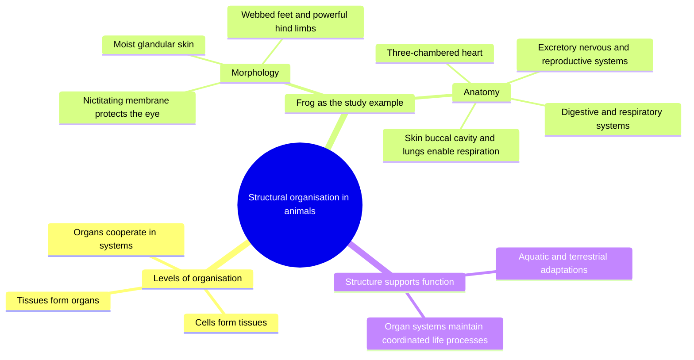

# Biology | Chapter 07 | Structural Organisation in Animals | CNOTES

## Section-by-section key facts

- **7.1 Organ and organ-system organisation:** Cells form tissues, tissues form organs, and organs work together in systems. The chapter uses the frog to connect external form with the internal organisation of organ systems.
- **7.2 Frogs — morphology:** The common Indian frog (*Rana tigrina* in the text) is adapted for aquatic and terrestrial life. Moist, glandular skin, powerful hind limbs, webbed feet and a nictitating membrane support its mode of life.
- **7.2 Frogs — anatomy:** The body systems include digestive, respiratory, circulatory, excretory, nervous and reproductive systems. Frogs are ectothermic; the heart has two atria and one ventricle, and respiration can occur through skin, buccal cavity and lungs.

