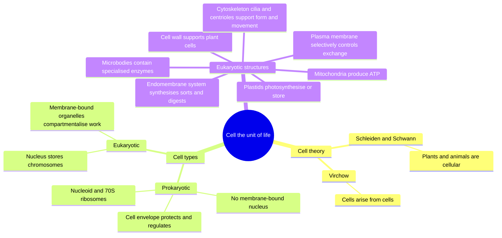

# Biology | Chapter 08 | Cell the Unit of Life | CNOTES

## Section-by-section key facts

- **8.1 What is a cell?:** Cells are the basic structural and functional units of life; organisms may be unicellular or multicellular.
- **8.2 Cell theory:** Schleiden and Schwann proposed that plants and animals are made of cells and cell products; Virchow added that cells arise from pre-existing cells.
- **8.3 Overview:** Cells are broadly prokaryotic or eukaryotic. A plasma membrane encloses the cell; eukaryotes additionally organise many functions in membrane-bound organelles.
- **8.4 Prokaryotic cells:** They lack a membrane-bound nucleus and organelles. The cell envelope includes glycocalyx, cell wall and plasma membrane; nucleoid contains the genetic material, while 70S ribosomes carry out protein synthesis.
- **8.5 Eukaryotic cells:** The membrane system includes ER, Golgi apparatus, lysosomes and vacuoles. Mitochondria and plastids are semiautonomous; ribosomes synthesise proteins; cytoskeleton, cilia/flagella and centrioles support movement and organisation; the nucleus stores chromosomes.
- **8.5.1–8.5.3 Membranes and endomembrane system:** The selectively permeable plasma membrane controls exchange; plant cell walls provide shape and support. ER, Golgi, lysosomes and vacuoles coordinate synthesis, processing, digestion and storage.
- **8.5.4–8.5.11 Organelles:** Mitochondria make ATP by aerobic respiration; plastids carry out photosynthesis or storage; the nucleus houses DNA; microbodies contain specialised enzymes.

