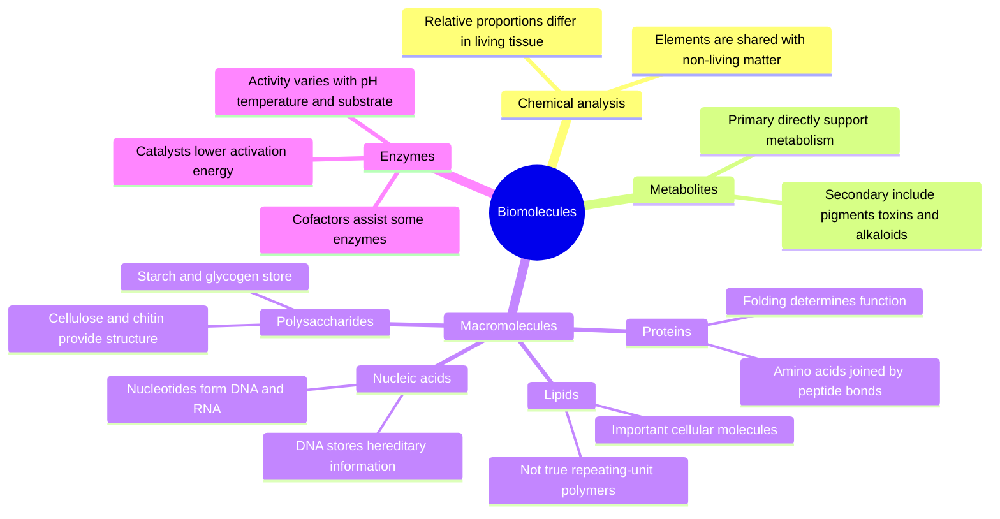

# Biology | Chapter 09 | Biomolecules | CNOTES

## Section-by-section key facts

- **9.1 Chemical composition:** Chemical analysis identifies elements and compounds in living matter. Living tissue contains the same elements as non-living matter, but their relative proportions differ; water is a major component.
- **9.2 Primary and secondary metabolites:** Primary metabolites participate directly in normal growth and metabolism; secondary metabolites include products such as alkaloids, pigments, essential oils, toxins and drugs.
- **9.3 Biomacromolecules:** Most cellular macromolecules are polymers of smaller units. Proteins, nucleic acids and polysaccharides are major macromolecules; lipids are generally not true polymers.
- **9.4 Proteins:** Proteins are amino-acid polymers joined by peptide bonds; their sequence and folding underpin their diverse functions.
- **9.5 Polysaccharides:** These are sugar polymers. Starch and glycogen are storage polysaccharides; cellulose is structural, while chitin occurs in fungal walls and arthropod exoskeletons.
- **9.6 Nucleic acids:** DNA and RNA are nucleotide polymers. A nucleotide contains a nitrogenous base, pentose sugar and phosphate; DNA stores hereditary information and RNA functions in its expression.
- **9.7 Protein structure:** Primary structure is amino-acid sequence; secondary, tertiary and quaternary structures describe progressively higher levels of folding and subunit association.
- **9.8 Enzymes:** Enzymes are biological catalysts that lower activation energy. Activity depends on factors such as temperature, pH and substrate concentration; many enzymes need non-protein cofactors.

