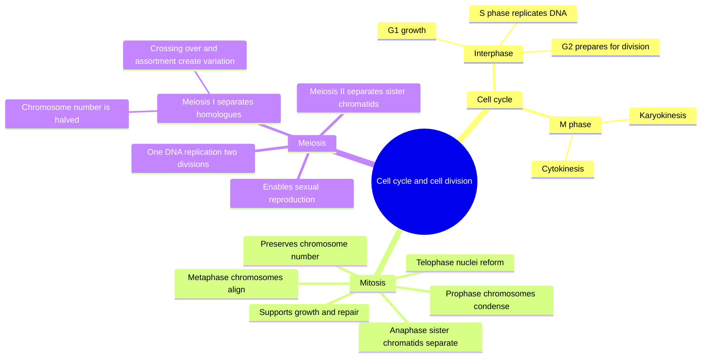

# Biology | Chapter 10 | Cell Cycle and Cell Division | CNOTES

## Section-by-section key facts

- **10.1 Cell cycle:** Interphase comprises G₁, S and G₂; DNA replication occurs during S phase. M phase comprises nuclear division and cytokinesis.
- **10.2 M phase — mitosis:** Prophase condenses chromosomes and assembles the spindle; metaphase aligns chromosomes; anaphase separates sister chromatids; telophase reforms nuclei; cytokinesis divides the cytoplasm. Mitosis generally maintains chromosome number.
- **10.3 Significance of mitosis:** It supports growth, repair and replacement, and enables asexual reproduction in some organisms while preserving genetic continuity.
- **10.4 Meiosis:** Two successive divisions follow one DNA replication. Meiosis I is reductional; homologous chromosomes pair and recombine in prophase I and separate in anaphase I. Meiosis II separates sister chromatids.
- **10.5 Significance of meiosis:** It halves chromosome number for sexual reproduction and generates variation through crossing over and independent assortment.

