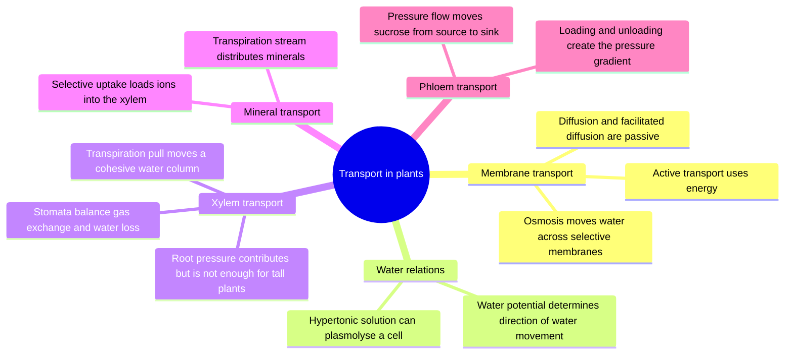

# Biology | Chapter 11 | Transport in Plants | CNOTES

## Section-by-section key facts

- **11.1 Means of transport:** Diffusion is passive and short-range; facilitated diffusion uses membrane proteins, while active transport uses energy to move substances against a gradient. Water moves by osmosis across a selectively permeable membrane.
- **11.2 Plant-water relations:** Water potential combines solute and pressure potentials; water moves from higher to lower water potential. Plasmolysis occurs when a plant cell loses water in a hypertonic solution.
- **11.3 Long-distance transport of water:** Root pressure and capillarity are insufficient to explain ascent in tall plants. The cohesion–adhesion–transpiration pull model explains the continuous xylem water column.
- **11.4 Transpiration:** Evaporation from leaves creates pull in xylem. Stomata regulate water loss; light, temperature, humidity and wind influence transpiration.
- **11.5 Mineral uptake and transport:** Ions enter roots selectively by passive or active uptake and move to the xylem; transpiration stream distributes dissolved minerals.
- **11.6 Phloem transport:** Pressure-flow explains source-to-sink translocation; sucrose is loaded at sources, water enters by osmosis, and solutes unload at sinks.

