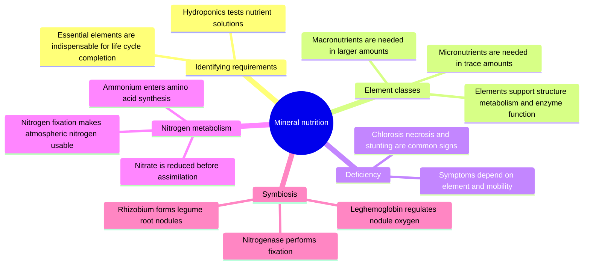

# Biology | Chapter 12 | Mineral Nutrition | CNOTES

## Section-by-section key facts

- **12.1 Methods to study mineral requirements:** Hydroponics allows a plant to grow in a defined nutrient solution and helps identify elements required for normal growth.
- **12.2 Essential mineral elements:** An element is essential when its absence prevents completion of the life cycle and its role cannot be replaced. Elements are classed as macronutrients or micronutrients by the amount required.
- **12.3 Absorption and functions:** Ions are absorbed selectively; essential elements serve structural, osmotic, enzymatic and metabolic roles. Deficiency symptoms can include chlorosis, necrosis, stunted growth and delayed flowering.
- **12.4 Nitrogen metabolism:** Plants assimilate nitrate through reduction to nitrite and then ammonium; ammonium is incorporated into amino acids. Nitrogen fixation converts atmospheric nitrogen into biologically usable forms.
- **12.5 Biological nitrogen fixation:** Nitrogenase in nitrogen-fixing prokaryotes reduces atmospheric nitrogen; legume root nodules house symbiotic *Rhizobium*, with leghemoglobin helping maintain suitable oxygen conditions.

