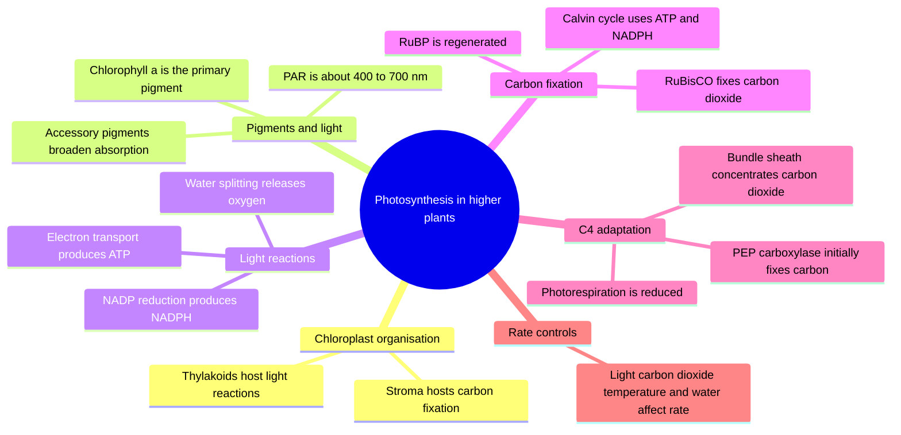

# Biology | Chapter 13 | Photosynthesis in Higher Plants | CNOTES

## Section-by-section key facts

- **13.1 Early experiments:** Experiments established that light, chlorophyll and carbon dioxide are required for photosynthesis; oxygen released originates from water.
- **13.2 Site of photosynthesis:** Chloroplasts house the photosynthetic machinery; thylakoid membranes contain pigments and reaction centres, while the stroma hosts carbon fixation.
- **13.3 Photosynthetic pigments:** Chlorophyll *a* is the primary reaction-centre pigment; accessory pigments broaden light absorption and protect against photo-oxidation. Photosynthetically active radiation is approximately 400–700 nm.
- **13.4 Light reaction:** Photosystems capture light; water splitting releases oxygen, electrons and protons. Electron transport generates ATP and reduces NADP⁺ to NADPH.
- **13.5 ATP and NADPH use:** The Calvin cycle fixes CO₂ through RuBisCO and uses ATP and NADPH to form carbohydrate precursors; RuBP is regenerated.
- **13.6 C₄ pathway:** PEP carboxylase first fixes CO₂ in mesophyll cells; C₄ acids deliver it to bundle-sheath cells, concentrating CO₂ around RuBisCO and reducing photorespiration.
- **13.7 Photorespiration and factors:** Photorespiration occurs when RuBisCO oxygenates RuBP and lowers photosynthetic efficiency. Light, CO₂, temperature and water affect the rate.

