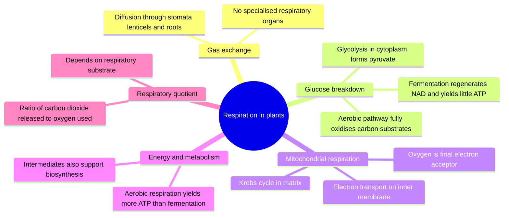

# Biology | Chapter 14 | Respiration in Plants | CNOTES

## Section-by-section key facts

- **14.1 Do plants breathe?:** Plants exchange gases by diffusion through stomata, lenticels and root surfaces; there is no specialised respiratory organ system.
- **14.2 Glycolysis:** In the cytoplasm, glucose is converted to pyruvate with a net gain of ATP and NADH; oxygen is not directly required for this stage.
- **14.3 Fermentation:** In the absence of oxygen, pyruvate forms ethanol and CO₂ in yeast or lactate in some cells; energy yield is low.
- **14.4 Aerobic respiration:** Pyruvate oxidation and the Krebs cycle occur in the mitochondrial matrix; the electron transport system on the inner membrane uses oxygen as the final electron acceptor and supports oxidative phosphorylation.
- **14.5 Respiratory balance sheet:** Complete oxidation yields far more ATP than fermentation; actual cellular yield can vary from the theoretical accounting.
- **14.6 Amphibolic pathway:** Respiratory intermediates also feed biosynthesis, so respiration is both catabolic and connected to anabolism.
- **14.7 Respiratory quotient:** RQ is the volume of CO₂ released divided by O₂ consumed; its value varies with the respiratory substrate.

