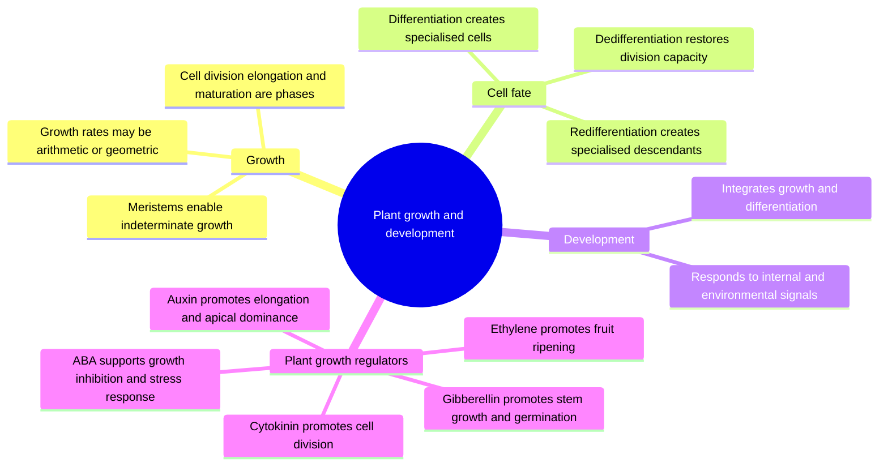

# Biology | Chapter 15 | Plant Growth and Development | CNOTES

## Section-by-section key facts

- **15.1 Growth:** Plant growth is generally indeterminate because meristems retain the ability to divide. Growth is measurable and proceeds through cell division, elongation and maturation; growth rates may be arithmetic or geometric.
- **15.2 Differentiation:** Differentiation produces specialised cells; dedifferentiation restores division capacity in mature cells, and redifferentiation specialises their descendants again.
- **15.3 Development:** Development combines growth, differentiation and maturation and is shaped by both internal and external factors.
- **15.4 Plant growth regulators:** Auxins promote cell elongation and apical dominance; gibberellins promote stem elongation and seed germination; cytokinins promote cell division; ethylene promotes fruit ripening; abscisic acid generally inhibits growth and promotes stress responses.

