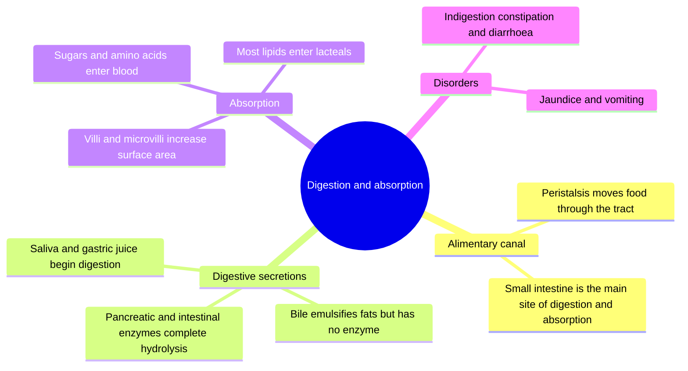

# Biology | Chapter 16 | Digestion and Absorption | CNOTES

## Section-by-section key facts

- **16.1 Alimentary canal:** Food passes from mouth through pharynx, oesophagus, stomach and small intestine to the large intestine; peristalsis moves it along the tract.
- **16.2 Digestive glands:** Salivary glands, gastric glands, liver and pancreas secrete fluids that support digestion. Bile emulsifies fats but contains no digestive enzyme.
- **16.3 Digestion:** Enzymes hydrolyse carbohydrates, proteins and fats into absorbable molecules; digestion is completed mainly in the small intestine.
- **16.4 Absorption and assimilation:** Villi and microvilli increase absorptive surface area. Sugars and amino acids enter blood capillaries; most absorbed lipids enter lacteals.
- **16.5 Disorders:** Digestive disorders include indigestion, constipation, diarrhoea, jaundice and vomiting; infections and diet can contribute.

