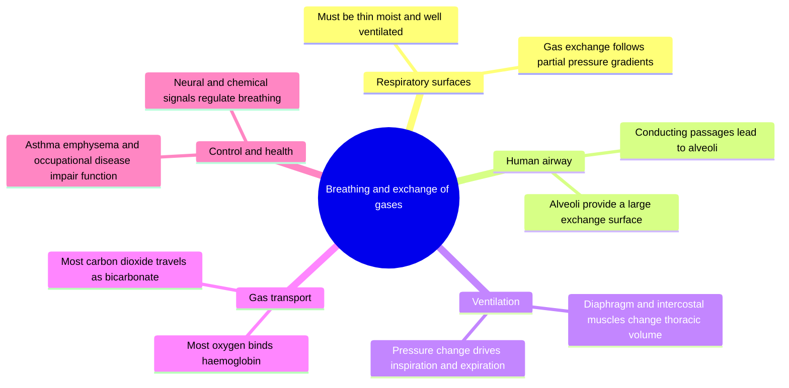

# Biology | Chapter 17 | Breathing and Exchange of Gases | CNOTES

## Section-by-section key facts

- **17.1 Respiratory organs:** Respiratory surfaces vary across animals; efficient exchange requires a moist, thin surface with a concentration gradient.
- **17.2 Human respiratory system:** Air travels through the nasal passage, pharynx, larynx, trachea, bronchi and bronchioles to alveoli, where gas exchange occurs.
- **17.3 Mechanism of breathing:** Diaphragm and intercostal muscle movements alter thoracic volume and pressure, driving inspiration and expiration.
- **17.4 Exchange of gases:** Oxygen and carbon dioxide diffuse down their partial-pressure gradients between alveoli, blood and tissues.
- **17.5 Transport of gases:** Most oxygen is carried bound to haemoglobin; most carbon dioxide is transported as bicarbonate ions in plasma.
- **17.6 Regulation and disorders:** Respiratory rhythm is regulated by neural centres and chemical signals; asthma, emphysema and occupational lung diseases impair breathing or gas exchange.

