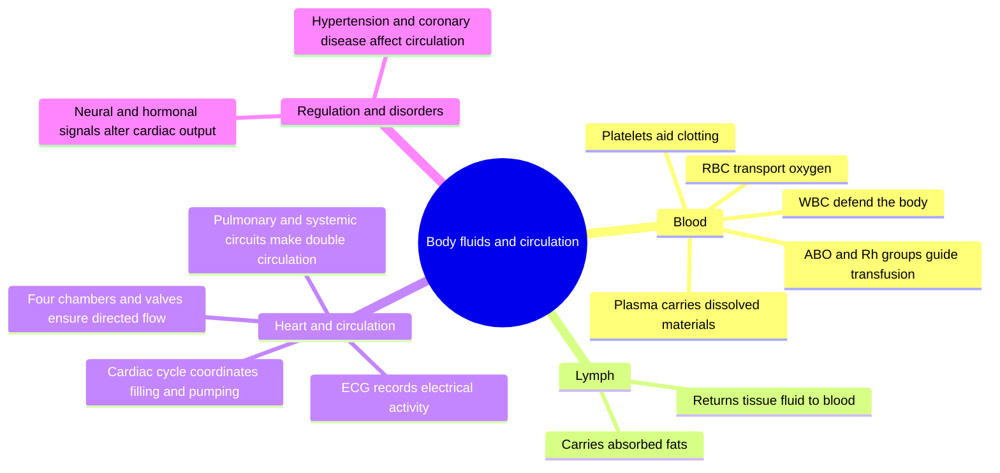

# Biology | Chapter 18 | Body Fluids and Circulation | CNOTES

## Section-by-section key facts

- **18.1 Blood:** Plasma transports dissolved substances; formed elements include erythrocytes, leukocytes and platelets. ABO and Rh groups matter for transfusion, and clotting prevents excessive blood loss.
- **18.2 Lymph:** Tissue fluid enters lymphatic vessels as lymph; it returns fluid to blood and transports absorbed fats from the intestine.
- **18.3–18.4 Circulatory pathways:** The human heart has four chambers and valves that maintain one-way flow. Pulmonary and systemic circuits form double circulation, keeping oxygenated and deoxygenated blood largely separate.
- **18.5 Cardiac cycle and ECG:** Coordinated atrial and ventricular events create the cardiac cycle; the ECG records electrical activity, with P, QRS and T waves associated with distinct cardiac events.
- **18.6 Regulation and disorders:** Cardiac output is regulated by neural and hormonal influences. Hypertension, coronary artery disease, angina and heart failure are circulatory disorders.

