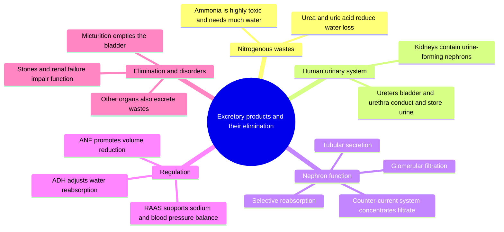

# Biology | Chapter 19 | Excretory Products and Their Elimination | CNOTES

## Section-by-section key facts

- **19.1 Excretory products:** Nitrogenous wastes include ammonia, urea and uric acid; their toxicity and water cost differ, so animals use different strategies.
- **19.2 Human excretory system:** Kidneys filter blood and form urine; ureters carry urine to the urinary bladder, and the urethra conducts it out.
- **19.3 Urine formation:** Nephrons form urine through glomerular filtration, selective tubular reabsorption and secretion.
- **19.4–19.5 Tubular function and concentration:** The loop of Henle and vasa recta establish a counter-current gradient; collecting ducts reabsorb water under hormonal control to concentrate urine.
- **19.6 Regulation:** ADH promotes water reabsorption; the renin–angiotensin–aldosterone system supports blood pressure and sodium/water balance; atrial natriuretic factor counteracts excessive volume retention.
- **19.7–19.8 Micturition and other organs:** The micturition reflex empties the bladder. Lungs, liver, skin and intestines also eliminate wastes or excess substances.
- **19.9 Disorders:** Renal failure may require dialysis or transplantation; kidney stones and urinary infections affect the urinary system.

