# Computer Science | Chapter 08 | Tuples and Dictionary | CNOTES

**Branch:** Strings, Lists, Tuples & Dictionaries · **Level:** Class XI (CBSE) · **Assumes:** Python 3.x

- Source: *Computer Science with Python – XI*, Chapter 9, "Tuples and Dictionary" (the only source supplied)
- Section numbers are **§10.x**, continuing CS07's §9.x (Lists), so no `§` is ever ambiguous across the two chapters
- Material beyond the textbook is marked **(New)**
- Textbook errors are flagged **Trap** at the point they arise and collected in §10.16
- Full explanations for every fact below live in `CS08-TUPLES_AND_DICTIONARY-NOTES.md`, same `§` numbers

---

## Concept Roadmap

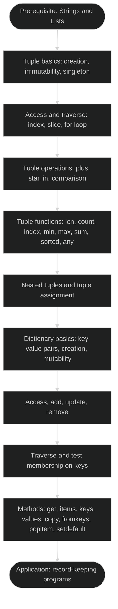

- A tuple is a list that cannot be changed after creation
- A dictionary is addressed by key, not by position
- Immutability explains tuple rules
- Key-to-value mapping explains dictionary rules

---

## §10.1 Introduction to Tuples

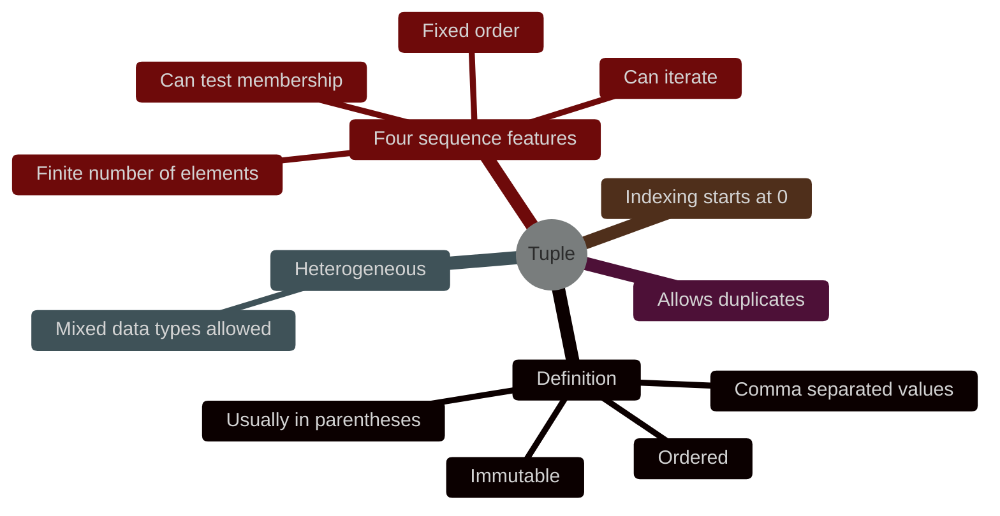

- A **tuple** is an immutable, ordered sequence of comma-separated values called **elements**
- Elements are usually enclosed in parentheses `( )`
- A tuple allows duplicate values
- A tuple is **heterogeneous** — elements can be of different types
- Tuple indices start at `0`
- A tuple is a **read-only list**
- Sequence features shared with lists and strings: finite elements, fixed order, iterable, membership testable

```python
>>> Fruits = ('Mango', 'Apple', 'Grapes')
>>> tup = ()                              #empty tuple
>>> tup = 10, 20, 30                      #parentheses are not compulsory
>>> tup = ((0,1,2,3), (4,5,6))            #nested tuple
>>> tup = ('a', 'b', 'c', [10,20,30])     #list inside a tuple
```

### §10.1.1 Tuples are Immutable

- No item assignment, no insert, no delete
- Item assignment raises `TypeError: 'tuple' object does not support item assignment`
- Typically a little faster to iterate than a list
- Typically smaller in memory — `(1,2,3)` is 64 bytes, `[1,2,3]` is 88 bytes on CPython 3.12
- Suited to data that must not change by accident

```python
>>> tup = ([1, 2, 3], [4, 5, 6])
>>> tup[0][1] = 99
>>> tup
([1, 99, 3], [4, 5, 6])
```

- **CTM:** a tuple is immutable but a member object may be mutable
- The tuple's slots keep pointing at the same objects
- Trap: a tuple holding a list is not frozen all the way down
- A tuple containing a list is unhashable — `{(1,[2]): 'a'}` raises `TypeError`

### §10.1.2 Creating a Tuple

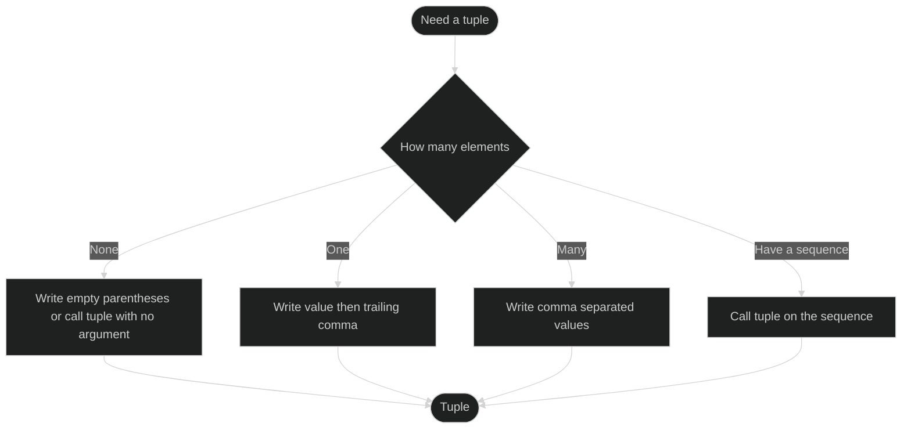

| Way | Example | Result |
|---|---|---|
| Parentheses (tuple display) | `('compsc', 2017)` | 2-element tuple |
| Empty, literal | `()` | `()` |
| Empty, constructor | `tuple()` | `()` |
| No parentheses | `10, 20, 30` | `(10, 20, 30)` |
| One element | `(70,)` or `70,` | `(70,)` |
| From a sequence | `tuple("string")` | `('s','t','r','i','n','g')` |

- The comma makes the tuple, not the parentheses
- A tuple with one element is a **singleton tuple**
- `(10)` is an `int`
- `('a')` is a `str`
- `(10,)` and `('a',)` are tuples
- `tuple()` takes one argument, a sequence or iterable
- `tuple(10)` raises `TypeError: 'int' object is not iterable`
- Building from input starts with `t = tuple()`
- Each pass rebinds `t = t + (a,)`
- `input()` returns strings, so the tuple holds strings unless converted
- Practical 1 uses `while`; Practical 2 uses `for i in range(n)`
- `t + a` without the comma raises `TypeError`
- Trap: every `t = t + (a,)` builds a brand-new tuple

---

## §10.2 Nested Tuples

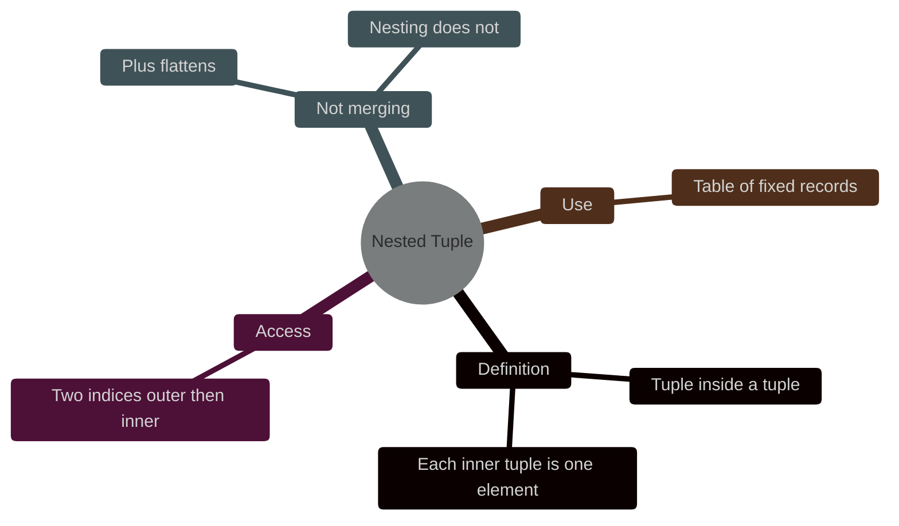

- A **nested tuple** is a tuple that contains another tuple as an element
- Each inner tuple stays **one element** of the outer tuple
- `tuple3 = (tuple1, tuple2)` has `len` `2`
- Access with two indices — `outer[i][j]`
- `tuple3[1][0]` → `'python'`
- Trap: the textbook says inner items are "combined to form a new tuple" — its own output shows they are not
- Only `+` flattens, not nesting
- Nested tuple of records suits fixed rows such as (roll number, name, marks)
- Practical 4 prints `st[i][0]`, `st[i][1]`, `st[i][2]` for roll number, name, marks
- Practical 3 stores `n` subject names with `t += (a,)`

---

## §10.3 Accessing and Traversing a Tuple

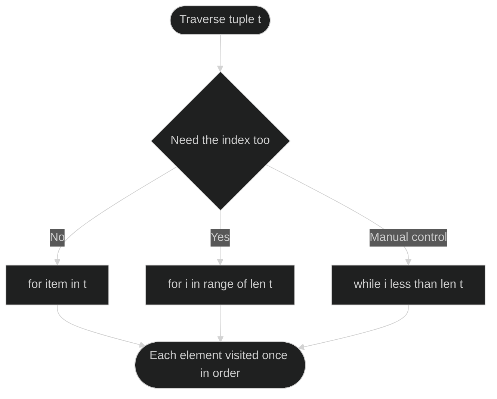

- Positive index counts from the left, starting at `0`
- Negative index counts from the right, starting at `-1`
- The index must be an integer or an expression evaluating to one
- Out-of-range index raises `IndexError: tuple index out of range`
- `t1 = (10,...,90)` → `t1[0]` is `10`, `t1[5]` is `60`, `t1[-5]` is `50`
- **Traversal** visits every element once, in order
- `for i in tup` — loop variable takes each element
- `for i in range(len(tup))` — loop variable takes each index `0` to `n-1`
- `while i < len(tup)` with `i += 1` — **(New)** manual form
- Trap: the textbook says tuples are "created using `range()`" — its code only traverses by index

---

## §10.4 Tuple Operations

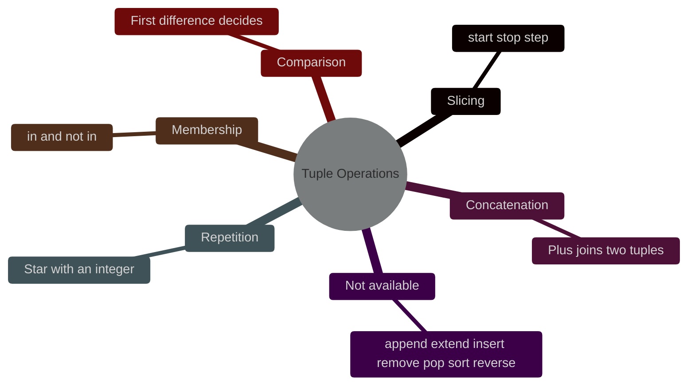

- Read-only operations work on tuples
- Operations that modify a sequence in place do not exist for tuples
- `+`, `*` and slicing always build a new tuple

### §10.4.1 Slicing

- `tuple_name[start:stop:step]`
- `start` is included
- `stop` is excluded
- `step` defaults to `1`
- Missing `start` → index `0`
- Missing `stop` → the end
- A slice is always a tuple
- Out-of-range bounds are clipped — slicing never raises `IndexError`

| Slice of `(10,20,30,40,50,60,70,80,90)` | Result |
|---|---|
| `[5:]` | `(60, 70, 80, 90)` |
| `[-7:-3]` | `(30, 40, 50, 60)` |
| `[-8:-5]` | `(20, 30, 40)` |
| `[::-1]` | `(90, 80, 70, 60, 50, 40, 30, 20, 10)` |
| `[0:10:2]` | `(10, 30, 50, 70, 90)` |
| `[1:10:3]` | `(20, 50, 80)` |
| `[::3]` | `(10, 40, 70)` |
| `[4::2]` | `(50, 70, 90)` |

- `T1[2:3]` on a mixed tuple → `('Z',)`, a singleton, not the bare element
- Trap: a negative step starts from the **end** — the textbook's "starts at index 0" wording is wrong
- `tuple1[2::-1]` → `(30, 20, 10)`

### §10.4.2 Concatenation

- `+` joins two tuples into a **new** tuple
- Both operands must be tuples
- Works with slices as operands — `tup1[1:3] + (5, 6)` → `(2, 3, 5, 6)`
- `t1[-3:-1] + t1[0]` raises `TypeError: can only concatenate tuple (not "int") to tuple`
- Fix: wrap the value — `t1[-3:-1] + (t1[0],)` → `(2, 'a', 1)`
- **CTM:** only a tuple can be added to a tuple
- Trap: the textbook says `+` "adds elements to a tuple" — it builds a separate tuple

### §10.4.3 Repetition

- `*` with an integer repeats the elements into a **new** tuple
- `(1,2,3,4) * 2` → `(1, 2, 3, 4, 1, 2, 3, 4)`
- `('BYE!',) * 4` → four copies of `'BYE!'` in a tuple
- `(1,2,3,4)[1:3] * 3` → `(2, 3, 2, 3, 2, 3)`
- Tuple × tuple raises `TypeError: can't multiply sequence by non-int of type 'tuple'`
- Trap: `('BYE!') * 4` is the string `'BYE!BYE!BYE!BYE!'`

### §10.4.4 Membership

- `in` → `True` if the element is present
- `not in` → `True` if the element is absent
- `4 in (2,4,6,8)` → `True`
- `5 in (2,4,6,8)` → `False`
- `10 not in (2,4,6,8)` → `True`
- `2 not in (2,4,6,8)` → `False`

### §10.4.5 Comparing Tuples

- Operators: `<`, `>`, `==`, `!=`, `<=`, `>=`
- Compare the first pair of elements
- If equal, move to the next pair
- Stop at the **first pair that differs**
- Later elements are never examined
- `(0,1,2) > (0,3,4)` → `False`
- `(0,1,2000000) < (0,3,4)` → `True`
- `(1,2,3) == (1.0,2.0,3.0)` → `True` — `int` and `float` compare by value
- `(1,2,3) != (10,20,30)` → `True`
- A prefix is smaller — `(1,2) < (1,2,0)` → `True`
- `==` between mismatched types → `False`, never an error
- `<` or `>` between incomparable types → `TypeError`

---

## §10.5 Built-in Functions and Methods for Tuples

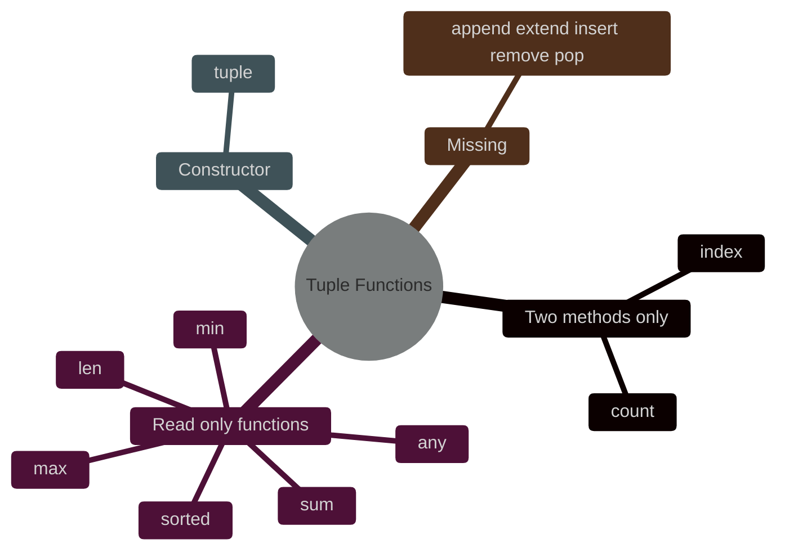

| Call | Kind | Returns |
|---|---|---|
| `len(t)` | function | number of elements |
| `t.count(x)` | method | occurrences of `x`; `0` if absent |
| `t.index(x[, start[, end]])` | method | first position; `ValueError` if absent |
| `any(t)` | function | `True` if at least one element is true-valued |
| `min(t)` / `max(t)` | function | smallest / largest element |
| `sum(t)` | function | total of numeric elements |
| `sorted(t)` | function | new **list**, sorted |
| `tuple(seq)` | constructor | tuple from a sequence |

- A tuple has exactly two methods — `count()` and `index()`
- Trap: the textbook lists `mean()` — no such function exists
- Mean is `sum(t) / len(t)`, or `statistics.mean(t)`
- `len()` counts top-level elements — a nested tuple counts as one
- `count()` matches a whole value
- `vote = ("yes","no","yes","yes","no")` → `vote.count("yes")` is `3`
- `vote.count("maybe")` is `0`
- `index()` → `vote.index("no")` is `1`
- `vote.index("yes", 1)` is `2`
- `vote.index("no", 2)` is `4`
- `vote.index("yes", 1, 4)` is `2`
- `vote.index('maybe')` raises `ValueError: tuple.index(x): x not in tuple`
- `any()` tests truthiness
- False values: `0`, `0.0`, `''`, `None`, `False`, empty containers
- `any((1,))` → `True`
- `any(())` → `False`
- `any((0,))` → `False`
- `any((0, 1))` → `True`
- Trap: `any()` is not "has at least one item" — `any((0,))` is `False`
- `max((10,'a',30))` raises `TypeError: '>' not supported between instances of 'str' and 'int'`
- `max((1, 2.5, 3))` → `3`
- Trap: the real rule is "mutually comparable", not "same type"
- String comparison is by ASCII value, first difference decides
- `max(('ALI','RAHUL','VIKAS'))` → `'VIKAS'`
- `max(('ALI','RAHUL','RAM'))` → `'RAM'` — third letter `'M'` beats `'H'`
- Trap: the textbook's `a = ('Apple')` is a string — `max(a)` is `'p'`
- `max(('Apple',))` → `'Apple'`
- `sum((10,22,55,18,8,77,30))` → `220`
- `sorted((6,7,4,2,1,5,3))` → `[1, 2, 3, 4, 5, 6, 7]`
- `sorted()` leaves the original tuple unchanged
- `tuple(sorted(a))` converts the result back

**Practical 5 — max, min, sum, mean of n numbers**

- `int(input())` converts each entry before it enters the tuple
- `numbers = numbers + (num,)` builds the tuple
- Output for `10 … 60`: max `60`, min `10`, sum `210`, mean `35.0`
- `/` always gives a float

---

## §10.6 Tuple Assignment: Packing and Unpacking

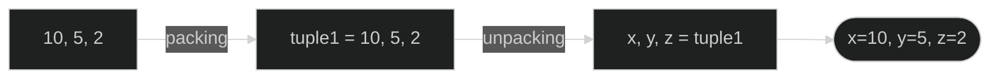

- **Packing** — forming a tuple from individual values: `tuple1 = 10, 5, 2`
- **Unpacking** — giving each element its own variable: `x, y, z = tuple1`
- Number of names on the left must equal number of elements on the right
- `x, y, z, p = tuple1` raises `ValueError: not enough values to unpack (expected 4, got 3)`
- `x, y = tuple1` raises `ValueError: too many values to unpack (expected 2)`
- Mismatch is a runtime error, not a syntax error
- Trap: unpacking fills separate variables, not "a single variable"
- Swap: `a, b = b, a`
- The right side is evaluated into a tuple before any name is assigned
- No temporary variable is needed
- Practical 8: `t1, t2 = t2, t1` swaps two tuples of different lengths
- Practical 8 output: `('10','20','30','40')` and `('100','200','300')` exchange places

---

## §10.7 Deleting and "Changing" a Tuple; Tuples vs. Lists

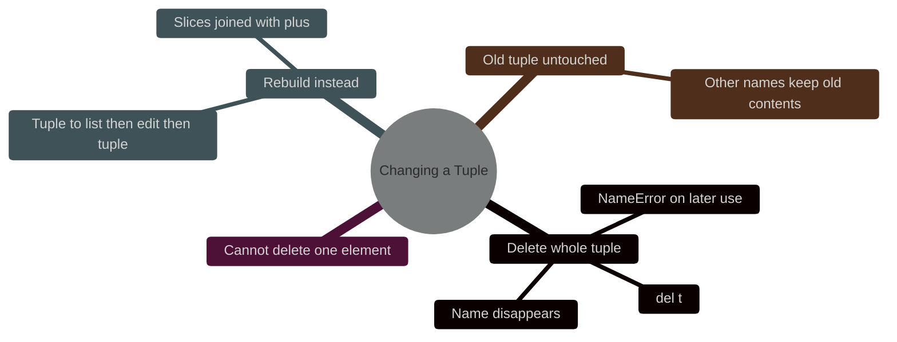

- `del t` removes the whole tuple
- Later use of `t` raises `NameError: name 'tup' is not defined`
- A single element can never be deleted
- "Changing" means building a replacement
- Method 1: `L = list(t)` → edit `L` → `t = tuple(L)`
- `(1,2,3,4,5)` → `L.remove(3)` → `(1, 2, 4, 5)`
- `L.pop(2)` works too — `2` is the index of element `3`
- Method 2: slices joined by `+` — `t1[0:3] + t1[-1:]` on `('w','o','r','d','s')` → `('w','o','r','s')`
- `b = a` then `a = a + (3,)` leaves `b` as the original tuple
- Trap: "unpack, change, pack" is the textbook's wording — it does not work
- Trap: `list()` and `tuple()` are functions that build new objects, not methods that edit a tuple

| Point | List | Tuple |
|---|---|---|
| Brackets | `[ ]` | `( )` |
| Mutable | Yes | No |
| Add / remove / replace | Yes | No |
| Sort in place | `list.sort()` | No — `sorted(t)` returns a list |
| Own methods | Many | `count()` and `index()` only |
| Indexing, slicing, `+`, `*`, `in`, `len` | Yes | Yes |
| Dictionary key | Never | Yes, if all elements hashable |
| Memory and speed | More memory | Less memory, slightly faster iteration |

- Advantages of tuples: less memory, usable as dictionary key, protected from accidental change, indexed like a list
- Disadvantages of tuples: cannot add, remove, replace or sort in place

---

## §10.8 Tuple Programs

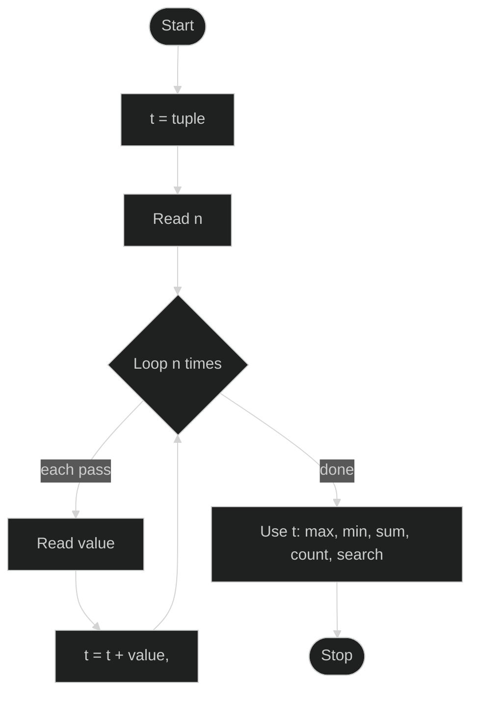

- **Practical 6 — frequency of elements**
- `t1 = tuple([int(e) for e in input().split(',')])`
- Print `e` only when `i == t1.index(e)`
- `t1.index(e)` is the first position of `e`
- Position and first position match only on the first visit
- `t1.count(e)` gives the total
- Input `10,20,30,30,20,10,10,40,50,40,10` → `10 - 4`, `20 - 2`, `30 - 2`, `40 - 2`, `50 - 1`
- **Practical 7 — linear search**
- `flag = False` set `True` on any match
- Test `flag` after the loop
- Search `5` in `(1,2,3,4,5,6)` → `Element found at index 4`, `Successful search`
- Variable `Tuple` is legal — Python is case-sensitive — but best avoided
- **(New) Drop by position:** `t1[0:3] + t1[-1:]`
- **(New) Drop by value:** `list(t)` → `remove()` → `tuple()`

---

## §10.9 Introduction to Dictionaries

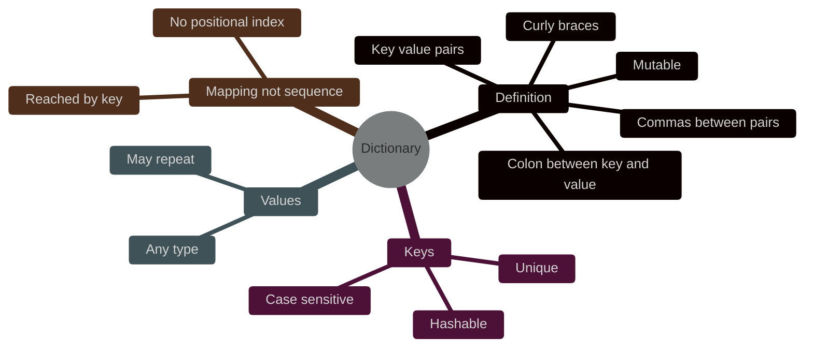

- A **dictionary** is a mutable collection of **key-value pairs** in curly braces `{ }`
- A colon separates each key from its value
- Commas separate the pairs
- A dictionary is a **mapping** from unique keys to values
- Each key maps to one value
- Keys are unique
- Values may repeat
- A value can be of any type
- A key must be hashable — string, number, or tuple of hashables
- A dictionary is mutable
- Keys are case-sensitive — `'Name'` and `'name'` differ
- Trap: a tuple containing a list cannot be a key
- Trap: `1`, `1.0` and `True` are the same key — `{1:'a', 1.0:'b', True:'c'}` is `{1: 'c'}`
- Trap: a repeated key silently overwrites, never errors
- Trap: textbook calls a dictionary "ordered" and "unordered" in different places
- Truth: insertion-ordered since Python 3.7, but not a sequence
- `{'a':1,'b':2} == {'b':2,'a':1}` → `True`
- Quote "unordered collection" when a question uses the textbook's wording

### §10.9.1 Creating a Dictionary

| Way | Example | Result |
|---|---|---|
| Literal | `{'R':'Rainy','S':'Summer'}` | 2-item dictionary |
| Empty, literal | `{}` | `{}` — type `dict` |
| Empty, constructor | `dict()` | `{}` |
| Copy | `dict(a)` | new, separate dictionary |
| From pairs | `dict([[1,"one"],[2,"two"]])` | `{1: 'one', 2: 'two'}` |
| Keyword arguments **(New)** | `dict(a=1, b=2)` | `{'a': 1, 'b': 2}` |
| From keys | `dict.fromkeys(keys, v)` | see §10.14 |
| Item by item | `D = {}` then `D[1] = "ONE"` | see §10.11 |

- `{}` is an empty dictionary, not an empty set
- `{1:"one", "two":2, (1,2,3):"numbers", 1.5:"float"}` has keys of four different types
- `dict(a)` is a shallow copy, not an alias

---

## §10.10 Accessing Elements in a Dictionary

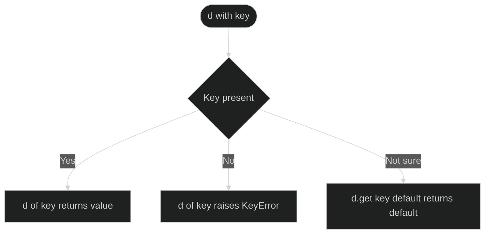

- Read a value with `dictionary[key]`
- `dict1 = {'Name':'Riya','Age':7,'Class':'second'}` → `dict1['Name']` is `'Riya'`
- Missing key raises `KeyError: 'Aman'`
- **CTM:** the thing inside `[ ]` is a key, not a position
- `dict1[0]` is a `KeyError` unless `0` is a key
- Safe read: `get()` or test with `in` first

---

## §10.11 Adding and Updating Items

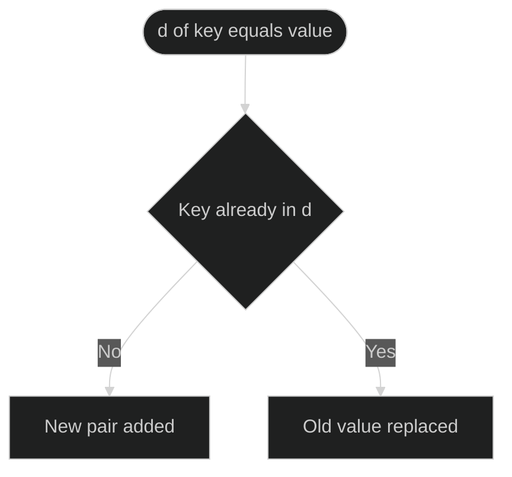

- One syntax does both jobs — `dictionary[key] = value`
- Key absent → new pair **added**
- Key present → value **replaced**
- `D = {}` then `D[1]="ONE"`, `D[2]="TWO"` → `{1: 'ONE', 2: 'TWO'}`
- `Dict['Riya'] = 28` updates
- `Dict['Priya'] = 60` adds
- **Merge** — `d1.update(d2)`
- Keys only in `d2` are added to `d1`
- Keys in both take `d2`'s value
- `d2` is unchanged
- `update()` returns `None`
- `{1:10,2:30,3:30,5:40,6:60}` updated with `{1:10,2:20,3:30}` → `{1: 10, 2: 20, 3: 30, 5: 40, 6: 60}`
- Trap: a reused key overwrites silently — the earlier value is lost

---

## §10.12 Removing Items

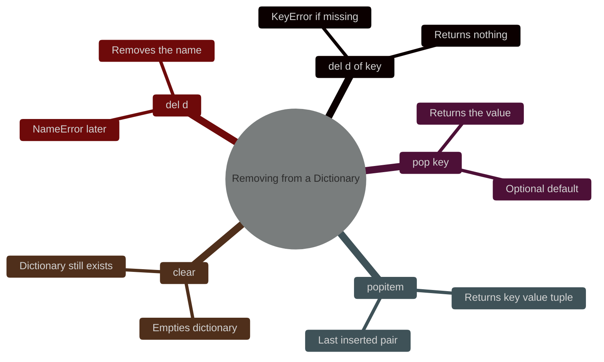

| I want to… | Use | Returns | Missing key |
|---|---|---|---|
| Delete one item | `del d[key]` | nothing | `KeyError` |
| Delete one item, get value | `d.pop(key)` | the value | `KeyError`, or default if given |
| Delete last-inserted item | `d.popitem()` | `(key, value)` tuple | `KeyError` if empty |
| Delete all items | `d.clear()` | nothing | — |
| Delete the dictionary | `del d` | nothing | `NameError` on later use |

- `del A['wed']` removes the pair
- `del A['fri']` on a missing key raises `KeyError: 'fri'`
- `A.pop('tue')` → `'tuesday'`
- `A.pop('zzz')` raises `KeyError`
- `A.pop('zzz', 'none')` → `'none'` — **(New)** default form
- `del A2` then `A2` raises `NameError: name 'A2' is not defined`
- Trap: `clear()` empties — `d` still exists as `{}`
- Trap: `del d` removes the name itself
- Same rule as lists — `pop` returns the value, `del` does not

---

## §10.13 Membership and Traversal

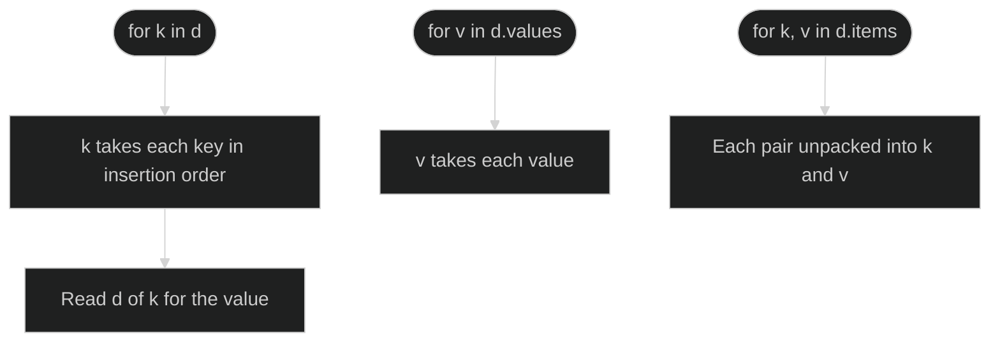

- `in` → `True` if a **key** is present
- `not in` → `True` if a key is absent
- `'thu' in A` → `True`
- `'fri' in A` → `False`
- `'fri' not in A` → `True`
- `'monday' in A` → `False` — it is a value, not a key
- **CTM:** `in`, `not in`, `min()`, `max()`, `sum()`, `sorted()` act on keys only
- `len()` counts pairs
- Search values with `'monday' in A.values()`
- A plain `for i in d` visits keys
- Value read as `d[i]`
- `for v in d.values()` visits values
- `for k, v in d.items()` visits pairs — tuple unpacking **(New)**

---

## §10.14 Dictionary Functions and Methods

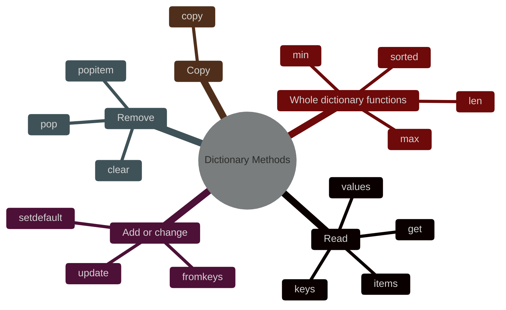

| Call | What it does |
|---|---|
| `len(d)` | number of pairs |
| `d.clear()` | empties; returns `None` |
| `d.get(key[, default])` | value or default; never raises |
| `d.items()` / `d.keys()` / `d.values()` | views |
| `d.copy()` | new shallow copy |
| `dict.fromkeys(keys[, value])` | new dictionary, one value for all keys |
| `d.pop(key[, default])` | removes `key`, returns value |
| `d.popitem()` | removes and returns last pair |
| `d.setdefault(key[, default])` | returns value; inserts if absent |
| `d.update(other)` | merges `other` into `d` |
| `max(d)` / `min(d)` | largest / smallest **key** |
| `sorted(d)` | new **list** of sorted keys |

**`len()`**

- `{1:10,2:30,3:30,5:40,6:60}` → `len` is `5`

**`get()`**

- `D1.get('wed')` → `'Wednesday'`
- `D1.get('fri')` → `None`
- `D1.get('fri','never')` → `'never'`
- `D1.get('mon','never')` → `'Monday'` — real value wins over default
- Never inserts
- Trap: `setdefault()` inserts, `get()` does not

**`items()`, `keys()`, `values()`**

- `items()` → `dict_items([('sun','Sunday'), …])`
- `keys()` → `dict_keys(['sun','mon', …])`
- `values()` → `dict_values(['Sunday', …])`
- Trap: the textbook says "list" — they are **views**
- A view follows later changes to the dictionary
- Wrap in `list(...)` for a real list
- Trap: the textbook's `D.keys()` output prints `dict_items` — a misprint

### §10.14.1 Copying a Dictionary

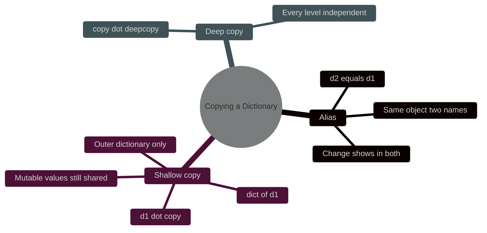

- `d2 = d1` makes an **alias** — one object, two names
- `d2["March"] = 31` also shows in `d1`
- `d3 = d1.copy()` builds a **new** dictionary
- `d1["April"] = 30` does not show in `d3`
- `copy()` and `dict(d)` are **shallow**
- A mutable value inside is still shared
- `nested = {'a':[1,2]}`, `sh = nested.copy()`, `nested['a'].append(3)` → `sh` is `{'a': [1, 2, 3]}`
- `copy.deepcopy()` duplicates every level

**`fromkeys()`**

- Builds a **new** dictionary from a collection of keys
- Every key gets the same value
- No value given → `None`
- `dict.fromkeys([1,2,3,4], 1000)` → `{1: 1000, 2: 1000, 3: 1000, 4: 1000}`
- `dict.fromkeys(['100','200'])` → `{'100': None, '200': None}`
- Trap: the textbook's `D.fromkeys(...)` does not edit `D`
- Call it as `dict.fromkeys(...)`
- Trap: `dict.fromkeys([1,2], [])` shares one list among all keys

**`popitem()`**

- Removes the last-inserted pair
- Returns it as a `(key, value)` tuple
- `{"Rollno":10,"Name":"Harsh","Stream":"Science"}` → returns `('Stream','Science')`
- Empty dictionary raises `KeyError`

**`setdefault(key, default)`**

- Key present → returns its value
- Key absent, no default → inserts `None`, returns `None`
- Key absent, default given → inserts default, returns default
- Absent key always ends up added

**`max()`, `min()`, `sorted()`** on `D = {'Student1':80,'Student2':78,'Student3':76}`

- `max(D)` → `'Student3'` — largest key
- `min(D)` → `'Student1'`
- `max(D.items())` → `('Student3', 76)`
- `max(D.values())` → `80`
- `min(D.values())` → `76`
- `sorted(D)` → `['Student1','Student2','Student3']`
- `dict(sorted(D.items()))` → dictionary in key order
- `sorted(D.values())` → `[76, 78, 80]`
- Trap: the textbook says `max(D)` gives "the key having maximum value" — it gives the largest key
- Key with largest value: `max(D, key=D.get)` → `'Student1'`
- Key with smallest value: `min(D, key=D.get)` → `'Student3'`
- `sorted()` returns a new list and leaves the dictionary unchanged

---

## §10.15 Dictionary Programs

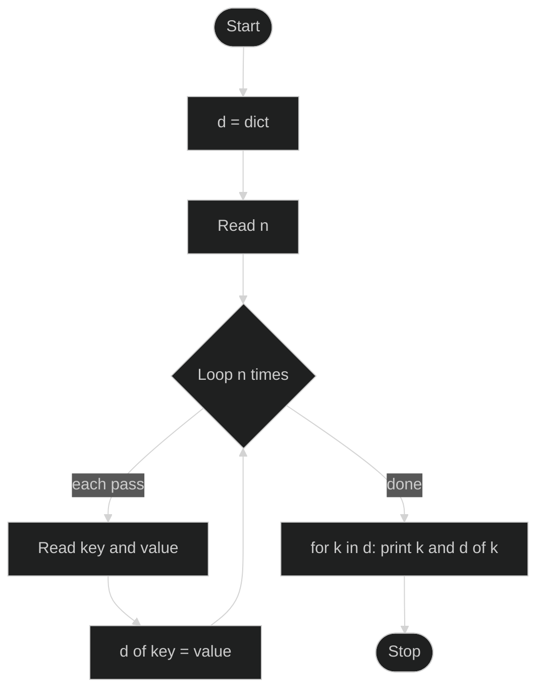

- Skeleton: empty dictionary → read `n` → loop reading key and value → loop over keys to print
- **Practical 15** — key is the section letter, value is the stream name
- **Practical 16** — key is the admission number string, value is a tuple `(name, section, percentage)`
- `float()` makes `98` print as `98.0`
- The textbook's `flag = 0` is unused
- **Practical 17** — key is the employee name, value is the salary as `int`
- **Practical 18** — count characters of a string
- Test `ch in dict1`; add `1` or start at `1`
- `Hello Python` → `l : 2`, `o : 2`, space `: 1`, all others `1`
- Trap: the textbook names a variable `str`, shadowing the built-in
- **(New)** shorter pattern — `dict1[ch] = dict1.get(ch, 0) + 1`
- **Q27 — number into words**
- Lookup dictionary from digit to word
- Keep `num` as a string
- `int(ch)` gives each key
- `985` → `Nine Eight Five`, with a leading space from `' ' + value`
- **(New) Phone book** — `x in phone` tests the key in one step
- Keep phone numbers as strings

---

## §10.16 Source Discrepancies and Corrections

| § | Textbook says | Actually | Use |
|---|---|---|---|
| 10.2 | Nested tuples "combine" into a new tuple | Each inner tuple stays one element | `len((t1, t2))` is `2` |
| 10.3 | Tuples "created using `range()`" | Code traverses by index | `range(len(t))` |
| 10.4.1 | `t[::-1]` "starts from index 0" | Negative step starts at the end | Reversed tuple |
| 10.4.2 | `+` "adds elements to a tuple" | Builds a new tuple | `t = t + (x,)` |
| 10.5 | `mean()` is a tuple method | No such function | `sum(t) / len(t)` |
| 10.5 | `any()` true if "at least one item" | True if at least one **true-valued** item | `any((0,))` is `False` |
| 10.5 | `min`/`max` need "same data type" | Need mutually comparable types | `max((1, 2.5))` → `2.5` |
| 10.5 | `a = ('Apple')` | A string, no comma | `('Apple',)` |
| 10.6 | Unpacking goes "into a single variable" | Each value to its own variable | Counts must match |
| 10.7 | "Unpack, change, pack" | Tuple → list → edit → tuple | `list()`, edit, `tuple()` |
| 10.9 | "Ordered" and "unordered" | Insertion-ordered since 3.7, not a sequence | Quote "unordered" if asked |
| 10.9 | Keys: strings, numbers, tuples | Keys must be hashable | `{(1,[2]): 0}` → `TypeError` |
| 10.14 | `keys()`, `values()`, `items()` return a list | Views | `list(d.keys())` |
| 10.14 | `D.keys()` shows `dict_items` | Misprint | `dict_keys` |
| 10.14 | `D.fromkeys(...)` edits `D` | Builds a new dictionary | `dict.fromkeys(...)` |
| 10.14 | `max(D)` is "key with maximum value" | Largest key | `max(D, key=D.get)` |
| 10.14 | `sorted()` "sorts a dictionary" | Returns a new list | `dict(sorted(D.items()))` |
| 10.15 | `str = input(...)` | Shadows built-in `str` | Another name |
| chapter end | Memory Bytes lists `mean()` | See §10.5 | — |

---

## Quick Reference

**Tuple operators and functions:**

| Form | Meaning | Example |
|---|---|---|
| `(a,)` | One-element tuple — comma required | `(70,)` |
| `t[i]` | Indexing; `IndexError` out of range | `(10,20,30)[-1]` → `30` |
| `t[a:b:c]` | Slice; `b` excluded; never `IndexError` | `(10,20,30,40)[1:3]` → `(20, 30)` |
| `t1 + t2` | Concatenation → new tuple; tuple only | `(1,2) + (3,)` → `(1, 2, 3)` |
| `t * n` | Repetition → new tuple | `(1,2) * 2` → `(1, 2, 1, 2)` |
| `x in t` / `not in` | Membership | `4 in (2,4,6)` → `True` |
| `<` `>` `==` `!=` | First-difference comparison | `(0,1,2) > (0,3,4)` → `False` |
| `len` `count` `index` | Size · occurrences · first position | `(5,6,5).count(5)` → `2` |
| `min` `max` `sum` `any` | Aggregates | `sum((1,2,3))` → `6` |
| `sorted(t)` | New **list** | `sorted((3,1,2))` → `[1, 2, 3]` |
| `a, b = t` | Unpacking; counts must match | `x, y = (1, 2)` |
| `del t` | Deletes the name | later use → `NameError` |

**Dictionary operations, by purpose:**

| Purpose | Syntax |
|---|---|
| Create | `{}` · `dict()` · `dict(d)` · `dict(list_of_pairs)` · `dict.fromkeys(keys, v)` |
| Read | `d[key]` (`KeyError` if absent) · `d.get(key, default)` (never raises) |
| Add / update one | `d[key] = value` |
| Merge | `d.update(other)` |
| Remove | `del d[key]` · `d.pop(key)` (returns value) · `d.popitem()` (returns pair) · `d.clear()` · `del d` |
| Test | `key in d` · `key not in d` (keys only) |
| Size | `len(d)` |
| Views | `d.keys()` · `d.values()` · `d.items()` |
| Insert-if-absent | `d.setdefault(key, default)` |
| Copy | `d.copy()` · `dict(d)` (shallow) · `d2 = d` (alias — not a copy) |
| Order | `sorted(d)` · `dict(sorted(d.items()))` · `max(d, key=d.get)` |

---

## Points to Ponder

- `(10)` is an `int` and `('a')` is a `str`
- `(10,)` and `('a',)` are tuples
- The comma makes the tuple
- A tuple is immutable
- A mutable element inside a tuple can still be changed in place
- `+` and `*` on a tuple build a new tuple
- `+` needs a tuple on both sides
- `count()` and `index()` are the only two tuple methods
- `any()`, `min()`, `max()`, `sum()`, `sorted()`, `len()` are functions
- `sorted(t)` returns a list
- The original tuple is untouched
- `any(t)` asks whether at least one element is true
- `any(t)` does not ask whether the tuple is non-empty
- `int` with `float` is comparable in `min`/`max`
- `str` with `int` raises `TypeError`
- Tuple assignment needs equal counts on both sides
- A mismatch raises `ValueError`
- `a, b = b, a` swaps with no temporary
- To change a tuple, go tuple → list → edit → tuple
- A dictionary maps keys to values
- Keys are unique and hashable
- Values can be anything and can repeat
- `1`, `1.0` and `True` are the same key
- `d[key]` raises `KeyError` for a missing key
- `d.get(key)` returns `None` instead
- `d[key] = value` adds or silently overwrites
- `in` on a dictionary tests keys, never values
- `pop(key)` returns a value
- `popitem()` returns a `(key, value)` tuple
- `del` returns nothing
- `clear()` empties the dictionary
- `del d` destroys the name
- `d2 = d1` is an alias
- `d1.copy()` and `dict(d1)` are shallow copies
- `keys()`, `values()` and `items()` return live views
- `max(d)`, `min(d)`, `sorted(d)` work on keys
- `key=d.get` ranks keys by value
- `dict.fromkeys(keys, [])` shares one list among all keys
- A plain `for` over a dictionary visits keys

## Problem-Solving Strategy

**Which container?**

1. Will the data change after it is built? No → tuple. Yes → list or dictionary
2. Is each item reached by position or by name? Position → list or tuple. Name or ID → dictionary
3. Must it be a dictionary key? It must be hashable — a tuple of immutables, never a list

**Word problem → working code, in four steps:**

1. Identify the inputs and the required output
2. Choose the structure, then the exact operation:
    - Key might be missing → `get(key, default)`
    - Remove an item and keep its value → `pop(key)`
    - Count occurrences → `d[k] = d.get(k, 0) + 1`
    - Add one tuple element → `t = t + (x,)`
    - Remove or replace a tuple element → list, edit, tuple
    - Maximum of a tuple of numbers → `max(t)`
    - Key with the largest value → `max(d, key=d.get)`
3. Guard the traps — singleton comma, `input()` returning strings, alias versus copy, `KeyError`
4. Trace the code by hand once before trusting its output

---

## Rapid Reference

| § | Fact | Value |
|---|---|---|
| 10.1 | Tuple defining properties | immutable, ordered, heterogeneous, allows duplicates |
| 10.1 | Tuple enclosure and separator | parentheses `( )`, comma-separated |
| 10.1 | Tuple index start | `0` |
| 10.1.1 | Item assignment on a tuple | `TypeError` |
| 10.1.1 | Tuple holding a list as dictionary key | `TypeError: unhashable type: 'list'` |
| 10.1.2 | One-element tuple | `(70,)` — trailing comma required |
| 10.1.2 | `(10)` and `('a')` | `int` and `str`, not tuples |
| 10.1.2 | `tuple(10)` | `TypeError` — not iterable |
| 10.2 | Nested tuple access | `t[i][j]` |
| 10.2 | `len((t1, t2))` | `2` |
| 10.3 | Out-of-range plain index | `IndexError` |
| 10.4.1 | `t[start:stop:step]` | `start` included, `stop` excluded, `step` default `1` |
| 10.4.1 | Slicing out of range | clipped, never `IndexError` |
| 10.4.2 | `+` | concatenation, new tuple, tuple operands only |
| 10.4.2 | `tuple + int` | `TypeError` |
| 10.4.3 | `*` | repetition, new tuple, needs an integer |
| 10.4.3 | `tuple * tuple` | `TypeError` |
| 10.4.4 | `in` / `not in` | membership, returns a bool |
| 10.4.5 | Tuple comparison rule | first difference decides |
| 10.4.5 | `(1,2,3) == (1.0,2.0,3.0)` | `True` |
| 10.4.5 | Prefix tuple | smaller |
| 10.5 | Tuple methods | `count()` and `index()` only |
| 10.5 | `index()` on a missing value | `ValueError` |
| 10.5 | `count()` on a missing value | `0` |
| 10.5 | `any(())` | `False` |
| 10.5 | `any((0,))` | `False` |
| 10.5 | `max` / `min` on `str` with `int` | `TypeError` |
| 10.5 | `sorted(t)` | new list, tuple unchanged |
| 10.5 | Mean of a tuple | `sum(t) / len(t)` — no `mean()` function |
| 10.6 | Packing | `t = 10, 5, 2` |
| 10.6 | Unpacking count mismatch | `ValueError` |
| 10.6 | Swap | `a, b = b, a` |
| 10.7 | `del t` | name removed, `NameError` on later use |
| 10.7 | Changing a tuple | tuple → list → edit → tuple |
| 10.7 | Tuple memory vs list | `(1,2,3)` 64 bytes vs `[1,2,3]` 88 bytes (CPython 3.12) |
| 10.9 | Dictionary enclosure | curly braces `{ }`, `key: value`, comma-separated |
| 10.9 | Dictionary keys | unique, hashable, case-sensitive |
| 10.9 | Dictionary values | any type, may repeat |
| 10.9 | `{}` | empty dictionary |
| 10.9 | `1`, `1.0`, `True` as keys | the same key |
| 10.9 | Dictionary order | insertion-ordered since 3.7, not a sequence |
| 10.9.1 | `dict(a)` | shallow copy |
| 10.10 | Missing key with `d[key]` | `KeyError` |
| 10.11 | `d[key] = value` | adds if absent, replaces if present |
| 10.11 | `d1.update(d2)` | merges; `d2` wins on shared keys; returns `None` |
| 10.12 | `del d[key]` | removes, returns nothing |
| 10.12 | `d.pop(key)` | removes, returns the value |
| 10.12 | `d.popitem()` | removes last-inserted pair, returns `(key, value)` |
| 10.12 | `d.clear()` | empties, `d` still exists |
| 10.12 | `del d` | removes the name, `NameError` later |
| 10.13 | `in` on a dictionary | tests keys only |
| 10.13 | Plain `for` over a dictionary | visits keys |
| 10.14 | `d.get(key, default)` | never raises, never inserts |
| 10.14 | `d.setdefault(key, default)` | returns value, inserts if absent |
| 10.14 | `keys()`, `values()`, `items()` | live views, not lists |
| 10.14 | `max(d)` / `min(d)` | largest / smallest key |
| 10.14 | Key with the largest value | `max(d, key=d.get)` |
| 10.14 | `sorted(d)` | new list of sorted keys |
| 10.14.1 | `d2 = d1` | alias |
| 10.14.1 | `d1.copy()` | new shallow copy |
| 10.14 | `dict.fromkeys(keys, v)` | new dictionary, one shared value |
| 10.15 | Counting pattern | `d[k] = d.get(k, 0) + 1` |

## Chapter Mindmap

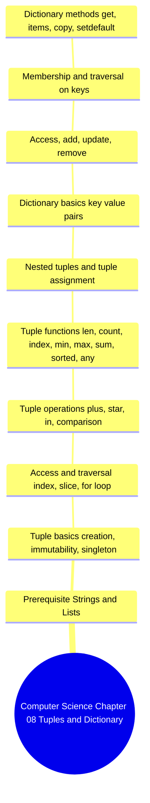
