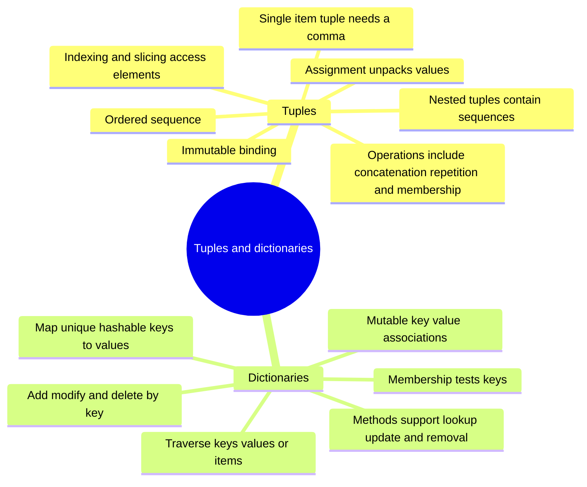

# Computer Science | Chapter 08 | Tuples and Dictionary | CNOTES

## Section-by-section key facts

- **Tuples:** A tuple is an ordered, immutable sequence; indexing and slicing access elements. A one-element tuple requires a trailing comma, for example `(20,)`.
- **Tuple operations:** Concatenation and repetition create tuples; membership tests, slicing and comparisons inspect them. Methods such as `count` and `index` and built-ins such as `len`, `min` and `max` support handling.
- **Assignment and nesting:** Tuple assignment unpacks corresponding values; nested tuples contain tuples as elements. Iteration traverses elements in order.
- **Dictionaries:** A dictionary maps unique, hashable keys to values; it is mutable. Create, access, add, modify and delete entries by key; membership tests keys, not values.
- **Traversal and methods:** `keys`, `values` and `items` expose dictionary views; `get`, `update`, `pop` and `clear` support common operations. Iteration over a dictionary visits keys by default.

