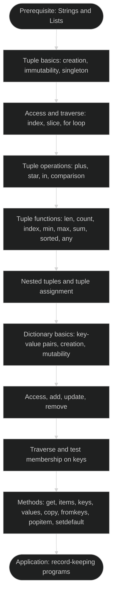

# Computer Science | Chapter 08 | Tuples and Dictionary | NOTES

**Branch:** Strings, Lists, Tuples & Dictionaries · **Level:** Class XI (CBSE) · **Assumes:** Python 3.x (outputs traced on Python 3.12)

> [!info] Sources
> The only source supplied for this chapter is *Computer Science with Python – XI*, Chapter 9, "Tuples and Dictionary". Section numbers here are written **§10.x** — they continue straight on from CS07, where Lists occupy §9.x — so no `§` reference in any CS07 or CS08 file can ever be ambiguous. The table below maps every §10.x back to the textbook's own §9.x. No NCERT text was supplied for this chapter, so nothing here is marked *(Supplementary)*; anything added beyond the textbook is marked **(New)**, and every place where the textbook is wrong or imprecise is flagged and collected in §10.16.
>
> This is the **NOTES** file of the CS08-TUPLES_AND_DICTIONARY triad — the full explanation, read once to learn the chapter. `CS08-TUPLES_AND_DICTIONARY-GLOSSARY.md` is for fast lookup of one term; `CS08-TUPLES_AND_DICTIONARY-CNOTES.md` is the condensed, point-wise re-read for revision. Every `§` in the other two files points back to a numbered section here.

| This file | Textbook (Ch. 9) |
|---|---|
| §10.1 Introduction to Tuples, §10.1.1 Immutable, §10.1.2 Creating | 9.1, 9.2, 9.3 |
| §10.2 Nested Tuples | 9.4 |
| §10.3 Accessing and Traversing | 9.5 |
| §10.4 Tuple Operations (§10.4.1–10.4.5) | 9.6.1–9.6.4, 9.7 |
| §10.5 Built-in Functions and Methods | "Tuple Functions" under 9.6 |
| §10.6 Tuple Assignment | text following 9.8 |
| §10.7 Deleting and "Changing" a Tuple; Tuples vs. Lists | 9.8, chapter nutshell |
| §10.8 Tuple Programs | Practical Implementation 1–8, solved questions |
| §10.9 Introduction to Dictionaries (§10.9.1 Creating) | 9.9, 9.10 |
| §10.10 Accessing Elements | 9.11 |
| §10.11 Adding and Updating | 9.13, 9.14 |
| §10.12 Removing Items | 9.15 |
| §10.13 Membership and Traversal | 9.16, 9.12 |
| §10.14 Dictionary Functions and Methods | 9.17 |
| §10.15 Dictionary Programs | Practical Implementation 15–18, solved questions |
| §10.16 Source Discrepancies and Corrections | (new — collects every flag) |

## Chapter brief

Lists, in CS07, gave you a sequence you can change freely. This chapter adds the two structures that sit on either side of it: the **tuple**, a sequence that *cannot* change after it is built, and the **dictionary**, a collection reached by *meaning* (a key) instead of by *position* (an index). Everything below follows from those two ideas — immutability for tuples, key-to-value mapping for dictionaries. After the chapter you should be able to pick the right one of list, tuple or dictionary for a given job, and write the short input-process-output programs that CBSE papers ask for.

**Prerequisites:** Strings, Lists (CS07 — indexing, slicing, mutability, aliasing), `for`/`while` loops, `input()`.

**Key outcomes**

- Create tuples (including the one-element case) and dictionaries in every standard way
- Predict the result of tuple slicing, `+`, `*`, `in`, and comparison, and the error each misuse raises
- Choose correctly between `len`, `count`, `index`, `any`, `min`, `max`, `sum`, `sorted` on a tuple
- Pack, unpack and swap with tuple assignment, and explain why it errors on a count mismatch
- Add, update, merge, read and remove dictionary items with the right operation (`[]`, `get`, `update`, `del`, `pop`, `popitem`, `setdefault`)
- Distinguish a dictionary alias from a copy, and a view (`keys()`) from a list

**Scope note:** sets, `*`-unpacking, dictionary comprehensions and `collections.Counter` are beyond this chapter. `copy.deepcopy` is only named (as in CS07 §9.6).

## Table of contents

- §10.1 Introduction to Tuples — §10.1.1 Tuples are Immutable · §10.1.2 Creating a Tuple
- §10.2 Nested Tuples
- §10.3 Accessing and Traversing a Tuple
- §10.4 Tuple Operations — §10.4.1 Slicing · §10.4.2 Concatenation · §10.4.3 Repetition · §10.4.4 Membership · §10.4.5 Comparing Tuples
- §10.5 Built-in Functions and Methods for Tuples
- §10.6 Tuple Assignment: Packing and Unpacking
- §10.7 Deleting and "Changing" a Tuple; Tuples vs. Lists
- §10.8 Tuple Programs
- §10.9 Introduction to Dictionaries — §10.9.1 Creating a Dictionary
- §10.10 Accessing Elements in a Dictionary
- §10.11 Adding and Updating Items
- §10.12 Removing Items
- §10.13 Membership and Traversal
- §10.14 Dictionary Functions and Methods — §10.14.1 Copying a Dictionary
- §10.15 Dictionary Programs
- §10.16 Source Discrepancies and Corrections
- Quick Reference · Points to Ponder · Problem-Solving Strategy

## Concept Roadmap



A tuple is a list that has been locked; a dictionary is a list whose positions have been replaced by names. Read the chapter with those two sentences in mind and most rules stop looking arbitrary.

---

## 10.1 Introduction to Tuples ⭐

Every programmer eventually meets the **data structure** — a structure that holds and organises related data. Strings and lists were the first two; a **tuple** is the third sequence in the family. A sequence, in Python's sense, has four shared features: it holds a finite number of elements, the elements are in a fixed order, you can iterate over them in that order, and you can test whether an element is present.

> **Key idea:** A **tuple** is an *immutable*, *ordered* sequence of comma-separated values (called **elements**), usually enclosed in parentheses `( )`. It allows duplicate values, and its elements can be of different data types (it is **heterogeneous**, exactly like a list). Tuple indices start at `0`.

```python
>>> Fruits = ('Mango', 'Apple', 'Grapes')
>>> Fruits[0]
'Mango'
>>> digits = (0, 1, 2, 3, 4, 5, 6, 7)          #tuple of integers
>>> tup = ('hello', 1, 5, 6.5, 'Python')       #heterogeneous tuple
>>> tup = ()                                    #an empty tuple
>>> tup = (10, 20, 30)
>>> tup = 10, 20, 30                            #parentheses are not compulsory
>>> tup = ((0,1,2,3), (4,5,6))                  #nested tuple: tuples inside a tuple
>>> tup = ((0,1,2,3), ['hello','world'])        #a tuple and a list inside a tuple
>>> tup = ('a', 'b', 'c', [10,20,30])           #strings and a list
```

```svg
<svg viewBox="0 0 400 130" xmlns="http://www.w3.org/2000/svg" style="max-width:100%;height:auto" font-family="sans-serif">
  <rect x="20" y="45" width="56" height="40" fill="#ffffff" stroke="#262626" stroke-width="1.5"/>
  <text x="48" y="70" font-size="13" text-anchor="middle" fill="#262626">10</text>
  <text x="48" y="35" font-size="11" text-anchor="middle" fill="#1565c0">0</text>
  <text x="48" y="105" font-size="11" text-anchor="middle" fill="#b71c1c">-6</text>
  <rect x="80" y="45" width="56" height="40" fill="#ffffff" stroke="#262626" stroke-width="1.5"/>
  <text x="108" y="70" font-size="13" text-anchor="middle" fill="#262626">20</text>
  <text x="108" y="35" font-size="11" text-anchor="middle" fill="#1565c0">1</text>
  <text x="108" y="105" font-size="11" text-anchor="middle" fill="#b71c1c">-5</text>
  <rect x="140" y="45" width="56" height="40" fill="#ffffff" stroke="#262626" stroke-width="1.5"/>
  <text x="168" y="70" font-size="13" text-anchor="middle" fill="#262626">30</text>
  <text x="168" y="35" font-size="11" text-anchor="middle" fill="#1565c0">2</text>
  <text x="168" y="105" font-size="11" text-anchor="middle" fill="#b71c1c">-4</text>
  <rect x="200" y="45" width="56" height="40" fill="#ffffff" stroke="#262626" stroke-width="1.5"/>
  <text x="228" y="70" font-size="13" text-anchor="middle" fill="#262626">40</text>
  <text x="228" y="35" font-size="11" text-anchor="middle" fill="#1565c0">3</text>
  <text x="228" y="105" font-size="11" text-anchor="middle" fill="#b71c1c">-3</text>
  <rect x="260" y="45" width="56" height="40" fill="#ffffff" stroke="#262626" stroke-width="1.5"/>
  <text x="288" y="70" font-size="13" text-anchor="middle" fill="#262626">50</text>
  <text x="288" y="35" font-size="11" text-anchor="middle" fill="#1565c0">4</text>
  <text x="288" y="105" font-size="11" text-anchor="middle" fill="#b71c1c">-2</text>
  <rect x="320" y="45" width="56" height="40" fill="#e3f2fd" stroke="#1565c0" stroke-width="1.5"/>
  <text x="348" y="70" font-size="13" text-anchor="middle" fill="#1565c0">60</text>
  <text x="348" y="35" font-size="11" text-anchor="middle" fill="#1565c0">5</text>
  <text x="348" y="105" font-size="11" text-anchor="middle" fill="#b71c1c">-1</text>
  <text x="200" y="122" font-size="11" text-anchor="middle" fill="#555555">t1 = (10, 20, 30, 40, 50, 60) — positive index above, negative index below</text>
</svg>
```

The picture is identical to a list's — indexing works the same way. The difference is invisible here: once built, none of these boxes can be reassigned (§10.1.1).

### 10.1.1 Tuples are Immutable

Immutable means an element of a tuple cannot be changed *in place*: no item assignment, no insert, no delete. Python enforces this at run time.

```python
>>> tup = (10, 20, 30, 40)
>>> tup[2] = 100
TypeError: 'tuple' object does not support item assignment
```

A tuple can be thought of as a **read-only list**. That is why a tuple is the right container for data that must not be changed by accident — days of the week, coordinates, a record's fixed fields — and why it is typically a little faster to iterate and smaller in memory than the equivalent list (on CPython 3.12, `(1,2,3)` takes 64 bytes against 88 for `[1,2,3]`).

> **CTM (Concept That Matters):** Tuples are immutable, but a *member object* may be mutable. The tuple holds **references**; it never promises anything about what those objects do.

```python
>>> tup = ([1, 2, 3], [4, 5, 6])
>>> tup[0][1] = 99          #changes the list inside — the tuple's own slots are untouched
>>> tup
([1, 99, 3], [4, 5, 6])
```

The reasoning is the same as CS07 §9.6 on references: the tuple's slot 0 still points at the *same list object*; only that list's content changed. This also explains why a tuple is usable as a dictionary key **only if every element inside it is itself immutable** (§10.9) — `{(1, [2]): 'a'}` raises `TypeError: unhashable type: 'list'`.

> [!warning] ⚠️ "Immutable" does not mean "nothing inside can ever change"
> Putting a list inside a tuple does not freeze the list. If you need genuinely unchangeable data, keep every element immutable too (numbers, strings, further tuples).

### 10.1.2 Creating a Tuple

| Way | Example | Result |
|---|---|---|
| Parentheses (the **tuple display** construct) | `tup1 = ('compsc', 'infopractices', 2017, 2018)` | a 4-element tuple |
| Empty tuple, literal | `T = ()` | `()` |
| Empty tuple, constructor | `T = tuple()` | `()` |
| Without parentheses | `tup = 10, 20, 30` | `(10, 20, 30)` — the *commas* make the tuple |
| One element | `t = (70,)` or `t = 70,` | `(70,)` — the trailing comma is mandatory |
| Converting a sequence | `tuple("string")`, `tuple(['apple','banana'])` | one element per character / item |

```python
>>> tuple("string")
('s', 't', 'r', 'i', 'n', 'g')
>>> tuple(["apple", "banana", "cherry"])
('apple', 'banana', 'cherry')
>>> type(tuple(["apple"]))
<class 'tuple'>
```

`tuple()` accepts one argument that must be a sequence (or any iterable); it converts it into a tuple. `tuple(10)` raises `TypeError: 'int' object is not iterable`, which is why a one-element tuple must be written with a comma, not built by `tuple(10)`.

**The singleton rule.** A tuple with a single element is called a **singleton tuple**. The final comma is what makes it a tuple; without it the parentheses are only brackets around an expression.

```python
>>> t1 = (5,)
>>> type(t1)
<class 'tuple'>
>>> t2 = (5)
>>> type(t2)
<class 'int'>
>>> t3 = ('a')
>>> type(t3)
<class 'str'>
```

> [!warning] ⚠️ `(10)` is an integer, `('a')` is a string, `(10,)` and `('a',)` are tuples
> Python needs *some* way to tell `(2 + 3) * 4` (parentheses for grouping) from a one-element tuple. The comma is that signal. A tuple that is syntactically "a comma-separated list of values" is the more fundamental definition than "something in parentheses".

**Creating by user input (textbook Practical 1–3).** A tuple cannot be appended to, so a tuple built from input starts empty and is *rebuilt* each pass by concatenating a one-element tuple: `t = t + (a,)`.

> [!example]
> ### Practical 1 — build a tuple from input with `while` (Textbook)
> ```python
> t = tuple()
> n = int(input("Enter any number: "))
> i = 1
> while (i <= n):
>     a = input("Enter Number: ")
>     t = t + (a,)
>     i = i + 1
> print("output is")
> print(t)
> ```
> Output (inputs `3`, `100`, `200`, `300`):
> ```text
> Enter any number: 3
> Enter Number: 100
> Enter Number: 200
> Enter Number: 300
> output is
> ('100', '200', '300')
> ```
> **Approach:** `input()` returns strings, so the tuple holds `'100'`, not `100` (CS07's `input()` trap again). `(a,)` — with the comma — is what lets `+` work; `t + a` would raise `TypeError`. Practical 2 is the same program with `for i in range(n):` replacing the `while`, because the loop count is known in advance.

> [!warning] ⚠️ Each `t = t + (a,)` builds a brand-new tuple
> The name `t` is re-bound to a new object every pass; the old tuple is not modified. This is how "adding" to a tuple works — it is never truly adding (§10.4.2, §10.7).

---

## 10.2 Nested Tuples ⭐

A tuple can contain other tuples. When tuples are placed inside another tuple, each inner tuple stays **one element** of the outer tuple — they are *not* merged into a flat tuple.

```python
>>> tuple1 = (0, 1, 2, 3)
>>> tuple2 = ('python', 'book')
>>> tuple3 = (tuple1, tuple2)
>>> print(tuple3)
((0, 1, 2, 3), ('python', 'book'))
>>> len(tuple3)
2
>>> tuple3[1][0]
'python'
```

> [!warning] ⚠️ The textbook says the items of the nested tuples "are combined together to form a new tuple"
> The output shown directly beneath that sentence contradicts it: `tuple3` has **2** elements, each a tuple. Nesting keeps the inner structure; *concatenation* (`tuple1 + tuple2`, §10.4.2) is what flattens. Access an inner element with two indices, `outer[i][j]`, exactly like a nested list (CS07 §9.5).

> [!example]
> ### Practical 4 — records as a nested tuple (Textbook)
> ```python
> st = ((200, "Harmeet", 88), (201, "Deepika", 98), (202, "Radhika", 78), (204, "Shaurya", 90))
> print("S_No", "Roll_No", "Name", "Marks")
> for i in range(0, len(st)):
>     print((i+1), '\t', st[i][0], '\t', st[i][1], '\t', st[i][2])
> ```
> Output:
> ```text
> S_No Roll_No Name Marks
> 1 	 200 	 Harmeet 	 88
> 2 	 201 	 Deepika 	 98
> 3 	 202 	 Radhika 	 78
> 4 	 204 	 Shaurya 	 90
> ```
> **Approach:** `st[i]` is one student's record (a tuple); `st[i][0]`, `st[i][1]`, `st[i][2]` are its roll number, name and marks. A nested tuple is the natural container for a table of fixed records — rows cannot be altered by accident. The output above is traced by running the code, not copied from the textbook's screenshot.

Practical 3 stores *n* subject names the same way as Practical 1 (an empty tuple extended with `t += (a,)`, and the output is `('English', 'Hindi', 'Maths', 'Science', 'French')` for those five inputs).

---

## 10.3 Accessing and Traversing a Tuple ⭐

Elements are reached by **indexing**, with the same rules as lists and strings: positive indices count from the left starting at `0`, negative indices count from the right starting at `-1`, and the index must be an integer or an expression that evaluates to one.

```python
>>> t1 = (10, 20, 30, 40, 50, 60, 70, 80, 90)
>>> t1[0]
10
>>> t1[5]
60
>>> t1[-5]
50
```

An out-of-range index raises `IndexError: tuple index out of range`, exactly as for a list. A *slice* does not (§10.4.1).

**Traversing** means visiting every element once, in order. There are three ways, each the direct counterpart of CS07 §9.3.

```python
>>> tup = ('p', 'y', 't', 'h', 'o', 'n')
>>> for i in tup:               #the loop variable takes each ELEMENT in turn
...     print(i)
p
y
t
h
o
n
```

```python
>>> n = len(tup)                #n = 6
>>> for i in range(n):          #i takes each INDEX, 0 to n-1
...     print(tup[i])
```

```python
>>> i = 0                       #(New) the while form
>>> while i < len(tup):
...     print(tup[i])
...     i += 1
```

Use `for … in tup` when only the value matters, and `for i in range(len(tup))` when the index is needed as well.

> [!warning] ⚠️ The textbook says "tuples also can be created using `range()`"
> The code shown beneath that sentence does not create anything — it *traverses* an existing tuple by index. `range()` generates the indices `0 … n-1`; it is not a tuple-creation method here. (`tuple(range(5))` *would* create `(0, 1, 2, 3, 4)`, which is a different thing.)

---

## 10.4 Tuple Operations ⭐⭐

Everything that works on lists and does **not** modify the sequence works on tuples: slicing, concatenation, repetition, membership, comparison, and the non-modifying functions of §10.5. Anything that would change the tuple in place (`append`, `extend`, `insert`, `remove`, `pop`, `sort`, `reverse`, item assignment) does not exist for tuples.

### 10.4.1 Slicing

A **slice** is a sub-tuple. `tuple_name[start:stop:step]` — `start` is included, `stop` is **excluded**, `step` (default `1`) is the stride. Omitting `start` begins at index `0`; omitting `stop` runs to the end.

```python
>>> tuple1 = (10, 20, 30, 40, 50, 60, 70, 80, 90)
>>> tuple1[5:]
(60, 70, 80, 90)
>>> tuple1[-7:-3]          #index 2 up to, not including, index 6
(30, 40, 50, 60)
>>> tuple1[-8:-5]
(20, 30, 40)
>>> tuple1[::-1]           #whole tuple, reversed
(90, 80, 70, 60, 50, 40, 30, 20, 10)
```

| Slice of `tuple1` | Result | Meaning |
|---|---|---|
| `tuple1[0:10:2]` | `(10, 30, 50, 70, 90)` | every 2nd element |
| `tuple1[1:10:3]` | `(20, 50, 80)` | every 3rd element, from index 1 |
| `tuple1[::3]` | `(10, 40, 70)` | step only |
| `tuple1[::2]` | `(10, 30, 50, 70, 90)` | step only |
| `tuple1[4::2]` | `(50, 70, 90)` | from index 4 to the end, step 2 |

Slicing a tuple that holds mixed elements returns a tuple, never the bare element:

```python
>>> T1 = ('MY BOOK', [1, 2, 3], 'Z', (3, 4, 6), 'DESK', 50)
>>> T1[2:3]
('Z',)               #a slice is always a tuple — here a singleton
>>> T1[1:2]
([1, 2, 3],)
>>> T1[3][1]         #indexing into the nested tuple (3,4,6)
4
```

> [!warning] ⚠️ Slicing never raises `IndexError`; indexing does
> As with lists (CS07 §9.2.4), an out-of-range `start` or `stop` is silently clipped. `tuple1[2:200]` is valid; `tuple1[200]` is an `IndexError`.

> [!warning] ⚠️ `tuple1[::-1]` starts from the *end*
> The textbook explains it as extracting "from index 0 to the last index, but in reverse order". More precisely, a **negative step** walks *backward*, so with `start` and `stop` omitted the traversal begins at the last element and ends at the first. The result is the reversed tuple either way, but the "starts at index 0" wording would give the wrong answer for something like `tuple1[2::-1]` (which is `(30, 20, 10)`).

### 10.4.2 Concatenation

The `+` operator joins two tuples and returns a **new** tuple; both operands are left unchanged. Both operands must be tuples.

```python
>>> x = (1, 2, 3, 4)
>>> y = (5, 6, 7, 8)
>>> z = x + y
>>> print(z)
(1, 2, 3, 4, 5, 6, 7, 8)
>>> tup1 = (1, 2, 3, 4)
>>> tup1[1:3] + (5, 6)          #slices work as operands too
(2, 3, 5, 6)
```

```python
>>> t1 = (1, 2, 'a', 4)
>>> t1[-3:-1] + t1[0]           #t1[0] is the int 1, not a tuple
TypeError: can only concatenate tuple (not "int") to tuple
>>> t1[-3:-1] + (t1[0],)        #wrap it as a singleton tuple
(2, 'a', 1)
```

> **CTM:** `+` joins only a tuple to a tuple. To add a single value, wrap it with a trailing comma: `t + (value,)`.

> [!warning] ⚠️ The textbook says "new elements can be added to a tuple using `+`"
> No tuple is modified. `+` builds a *separate* tuple; to keep it you must re-bind the name (`t = t + (60,)`), and any other name still pointing at the old tuple still sees the old contents (§10.7).

### 10.4.3 Repetition

`*` repeats a tuple's elements a given number of times and returns a **new** tuple. It needs a tuple and an integer.

```python
>>> x = (1, 2, 3, 4)
>>> x * 2
(1, 2, 3, 4, 1, 2, 3, 4)
>>> ('BYE!',) * 4
('BYE!', 'BYE!', 'BYE!', 'BYE!')
>>> (1, 2, 3, 4)[1:3] * 3        #repeats the slice, not the whole tuple
(2, 3, 2, 3, 2, 3)
```

Tuple × tuple is undefined: `(1,2) * (2,)` raises `TypeError: can't multiply sequence by non-int of type 'tuple'`. The singleton `('BYE!',)` again needs its comma: `('BYE!') * 4` is the *string* `'BYE!BYE!BYE!BYE!'`.

### 10.4.4 Membership

`in` is `True` when the element is present in the tuple; `not in` is `True` when it is absent.

```python
>>> 4 in (2, 4, 6, 8)
True
>>> 5 in (2, 4, 6, 8)
False
>>> 10 not in (2, 4, 6, 8)
True
>>> 2 not in (2, 4, 6, 8)
False
```

### 10.4.5 Comparing Tuples

Tuples are compared with `<`, `>`, `==`, `!=`, `<=`, `>=`. The rule is the one from CS07 §9.2.5: compare the first pair of elements; if they are equal move to the next pair; stop at the **first pair that differs**, and let that pair alone decide. Elements after it are never examined, however large.

```python
>>> (0, 1, 2) > (0, 3, 4)
False             #index 0 ties; index 1 decides: 1 > 3 is False
>>> (0, 1, 2000000) < (0, 3, 4)
True              #index 1 decides: 1 < 3; the 2000000 is never looked at
>>> (1, 2, 3) == (1.0, 2.0, 3.0)
True              #int and float compare equal by value
>>> (1, 2, 3) != (10, 20, 30)
True
```

If one tuple is a prefix of the other, the **shorter** is smaller: `(1, 2) < (1, 2, 0)` is `True`. As with lists, `==` between mismatched non-numeric types is just `False` (`(1,'a') == (1,2)`), but an *ordering* comparison between incomparable types raises `TypeError` (`(1,'a') < (1,2)` → `'<' not supported between instances of 'str' and 'int'`).

---

## 10.5 Built-in Functions and Methods for Tuples ⭐⭐

Because a tuple is immutable, it has **no** methods that modify it: no `append()`, `extend()`, `insert()`, `remove()`, `pop()`, `sort()` or `reverse()`. A tuple has exactly **two** methods of its own — `count()` and `index()` — and works with several built-in *functions* that only read it.

| Call | Kind | Returns |
|---|---|---|
| `len(t)` | function | number of elements |
| `t.count(x)` | method | how many times `x` occurs (`0` if absent) |
| `t.index(x[, start[, end]])` | method | position of the first occurrence; `ValueError` if absent |
| `any(t)` | function | `True` if **at least one element is true-valued**; `False` for an empty tuple |
| `min(t)` / `max(t)` | function | smallest / largest element |
| `sum(t)` | function | total of numeric elements |
| `sorted(t)` | function | a **new list**, sorted; `t` is unchanged |
| `tuple(seq)` | function / constructor | a tuple built from a sequence |

> [!warning] ⚠️ The textbook lists `mean()` among tuple methods
> No such function exists in Python. The mean is computed as `sum(t) / len(t)` (Practical 5 does exactly this), or with `statistics.mean(t)` after `import statistics`.

**`len()`** counts top-level elements only — a nested tuple counts as one:

```python
>>> a = (5, 'book', 4, 8, 'new')
>>> print(len(a))
5
>>> a = ([1,2,3], [5,6], 'a', 10.5)
>>> len(a)
4
```

**`count()`** returns the number of occurrences of a whole value; `0`, not an error, if it is absent.

```python
>>> vote = ("yes", "no", "yes", "yes", "no")
>>> vote.count("yes")
3
>>> vote.count("maybe")
0
```

**`index()`** returns the position of the **first** match. The optional `start` and `end` narrow the search. A missing value raises `ValueError`.

```python
>>> vote.index("no")
1
>>> vote.index("yes")
0
>>> vote.index("yes", 1)          #search from index 1 onward
2
>>> vote.index("no", 2)
4
>>> vote.index("yes", 1, 4)       #search indices 1 to 3
2
>>> vote.index('maybe')
ValueError: tuple.index(x): x not in tuple
```

**`any()`** tests *truthiness*, not mere presence. The values that count as **false** are `0`, `0.0`, `''`, `None`, `False`, and empty containers; every other value is true.

```python
>>> any((1,))
True
>>> any(())            #empty tuple
False
>>> any((0,))          #one element, but it is false-valued
False
>>> any((0, '', None))
False
>>> any((0, 1))
True
```

> [!warning] ⚠️ `any()` is not "has at least one item"
> The textbook says `any()` returns `True` if the tuple has at least one item. That is only right when that item is true-valued: `any((0,))` is `False` even though the tuple is not empty. To test "is the tuple non-empty", use `len(t) > 0` (or just `if t:`).

**`min()` / `max()`** need elements that can be ordered against each other. `int` and `float` mix freely; a `str` against an `int` fails.

```python
>>> max((1, 2.5, 3))
3
>>> max((10, 'a', 30))
TypeError: '>' not supported between instances of 'str' and 'int'
```

> [!warning] ⚠️ The textbook's "all values must be of the same type" is stricter than the real rule
> The real requirement is that the elements be *mutually comparable*. `max((1, 2.5, 3))` works although `1` and `2.5` are different types. What fails is mixing types that Python will not order, such as `str` with `int`.

For strings, comparison is by ASCII value, character by character, left to right — the same first-difference rule as §10.4.5:

```python
>>> max(('ALI', 'RAHUL', 'VIKAS'))
'VIKAS'           #'V' has the highest ASCII value among the first letters
>>> max(('ALI', 'RAHUL', 'RAM'))
'RAM'             #'R','A' tie in RAHUL and RAM; third letter 'M' beats 'H'
```

> [!warning] ⚠️ The textbook's `a = ('Apple')` is a *string*, not a tuple
> Its `max(a)` example returns `'p'` because `('Apple')` has no trailing comma, so `a` is the string `'Apple'` and `max` compares its characters — which the textbook explains as "the string gets converted into individual characters". With a real one-element tuple, `max(('Apple',))` is `'Apple'`. This is the singleton trap (§10.1.2) in disguise.

**`sum()`** adds numeric elements: `sum((10, 22, 55, 18, 8, 77, 30))` → `220`.

**`sorted()`** always returns a **list**, whatever it is given, and leaves the original alone — a tuple cannot be sorted in place.

```python
>>> a = (6, 7, 4, 2, 1, 5, 3)
>>> sorted(a)
[1, 2, 3, 4, 5, 6, 7]
>>> a
(6, 7, 4, 2, 1, 5, 3)           #unchanged, and still a tuple
>>> tuple(sorted(a))            #convert back if a tuple is wanted
(1, 2, 3, 4, 5, 6, 7)
```

> [!example]
> ### Practical 5 — max, min, sum and mean of *n* numbers (Textbook)
> ```python
> numbers = tuple()
> n = int(input("How many numbers you want to enter? : "))
> for i in range(0, n):
>     num = int(input())
>     numbers = numbers + (num,)
> print("\nThe numbers in the tuple are:")
> print(numbers)
> print("\nThe maximum number is:")
> print(max(numbers))
> print("The minimum number is:")
> print(min(numbers))
> print("The sum of the tuple elements :")
> print(sum(numbers))
> mean = sum(numbers) / len(numbers)
> print("The mean of values in the tuple is:")
> print(mean)
> ```
> Output (inputs `6`, then `10 20 30 40 50 60`):
> ```text
> How many numbers you want to enter? : 6
> 10
> 20
> 30
> 40
> 50
> 60
>
> The numbers in the tuple are:
> (10, 20, 30, 40, 50, 60)
>
> The maximum number is:
> 60
> The minimum number is:
> 10
> The sum of the tuple elements :
> 210
> The mean of values in the tuple is:
> 35.0
> ```
> **Approach:** `int(input())` converts each entry *before* it enters the tuple, so `max`/`min`/`sum` see numbers. `/` always gives a float, hence `35.0`, not `35`.

---

## 10.6 Tuple Assignment: Packing and Unpacking ⭐⭐

Python can assign a whole tuple of values to a whole tuple of names in one statement. Forming a tuple from individual values is **packing**; splitting a tuple's elements out into separate variables is **unpacking**.

```python
>>> tuple1 = 10, 5, 2            #packing: three values become one tuple
>>> tuple1
(10, 5, 2)
>>> x, y, z = tuple1             #unpacking: one tuple becomes three variables
>>> print(x, y, z, x + y + z)
10 5 2 17
>>> color = ('red', 'green', 'yellow')
>>> (apple, orange, mango) = color
>>> print(apple, orange, mango)
red green yellow
```

> **CTM:** The number of names on the left must **equal** the number of elements on the right.

```python
>>> x, y, z, p = tuple1
ValueError: not enough values to unpack (expected 4, got 3)
>>> x, y = tuple1
ValueError: too many values to unpack (expected 2)
```

> [!warning] ⚠️ Unpacking gives *separate variables*, not "a single variable"
> The textbook describes unpacking as extracting values "into a single variable". It is the reverse: each element goes into its **own** variable. A mismatch in count is a `ValueError` — a runtime error, not a syntax error.

**The swap.** Because the whole right-hand side is evaluated into a tuple *before* any name on the left is assigned, two names can exchange values with no temporary variable:

```python
>>> a, b = 1, 2
>>> a, b = b, a
>>> print(a, b)
2 1
```

This is exactly how Practical 8 swaps two entire tuples with `t1, t2 = t2, t1`.

> [!example]
> ### Practical 8 — swap two tuples entered by the user (Textbook)
> ```python
> t1 = tuple()
> n = int(input("Total no of values in first tuple: "))
> for i in range(n):
>     a = input("Enter elements :")
>     t1 = t1 + (a,)
> t2 = tuple()
> m = int(input("Total no of values in second tuple: "))
> for i in range(m):
>     a = input("Enter elements :")
>     t2 = t2 + (a,)
> print("First tuple :")
> print(t1)
> print("Second tuple :")
> print(t2)
> t1, t2 = t2, t1
> print("After swapping :")
> print("First tuple:")
> print(t1)
> print("Second tuple:")
> print(t2)
> ```
> Output (first tuple `10,20,30,40`, second `100,200,300`):
> ```text
> First tuple :
> ('10', '20', '30', '40')
> Second tuple :
> ('100', '200', '300')
> After swapping :
> First tuple:
> ('100', '200', '300')
> Second tuple:
> ('10', '20', '30', '40')
> ```
> **Approach:** the two tuples may have different lengths — only the *names* are swapped, so no count mismatch arises. Elements are strings because `input()` was not converted.

---

## 10.7 Deleting and "Changing" a Tuple; Tuples vs. Lists ⭐⭐

**Deleting.** Single elements cannot be deleted from a tuple, but the whole tuple can be removed with `del`, after which the *name* no longer exists:

```python
>>> tup = (1, 2, 3)
>>> print(tup)
(1, 2, 3)
>>> del tup
>>> print(tup)
NameError: name 'tup' is not defined
```

**"Changing" a tuple.** Since nothing can be edited, "change" always means *build a replacement*. The reliable technique is to convert to a list, edit, and convert back — this is what the textbook's solved questions actually use:

```python
>>> t1 = (1, 2, 3, 4, 5)
>>> L = list(t1)
>>> L.remove(3)             #or L.pop(2)
>>> t1 = tuple(L)
>>> print(t1)
(1, 2, 4, 5)
```

Slicing and `+` give a second technique for dropping an element by position:

```python
>>> t1 = ('w', 'o', 'r', 'd', 's')
>>> t1[0:3] + t1[-1:]            #everything except 'd'
('w', 'o', 'r', 's')
```

The old tuple is not altered by any of this; `t1 = …` merely re-points the name.

```python
>>> a = (1, 2)
>>> b = a
>>> a = a + (3,)
>>> print(a, b)
(1, 2, 3) (1, 2)          #b still names the original, unchanged tuple
```

> [!warning] ⚠️ The textbook says to change a tuple "unpack it first, then change the value and pack it again"
> Unpacking (§10.6) does not make anything editable; you still cannot assign into a tuple. The working method is *tuple → list → edit → tuple*. Also, `list()` and `tuple()` are built-in **functions**/constructors that build new objects, not "methods that change the values of a tuple".

**Tuples versus lists**

| Point | List | Tuple |
|---|---|---|
| Brackets | `[ ]` | `( )` |
| Mutable | Yes | No |
| Add / remove / replace an element | Yes (`append`, `remove`, item assignment, …) | No |
| Sort in place | Yes (`list.sort()`) | No — `sorted(t)` returns a new list |
| Methods of its own | Many | Only `count()` and `index()` |
| Indexing, slicing, `+`, `*`, `in`, `len` | Yes | Yes |
| Use as a dictionary key | Never (unhashable) | Yes, if every element is immutable |
| Memory / speed | Uses more memory | Typically less memory, slightly faster to iterate |

**Advantages of a tuple:** less memory than a list; usable as a dictionary key; protects data from accidental change; indexed exactly like a list. **Disadvantages:** nothing can be added, removed, replaced or sorted in place.

---

## 10.8 Tuple Programs ⭐⭐

Three more of the textbook's programs, each a direct use of §10.4–§10.5.

> [!example]
> ### Practical 6 — frequency of each element (Textbook)
> ```python
> print("Enter numbers separated by comma :")
> t1 = tuple([int(e) for e in input().split(',')])
> i = 0
> for e in t1:
>     if i == t1.index(e):
>         print(e, ' - ', t1.count(e))
>     i += 1
> ```
> Output (input `10,20,30,30,20,10,10,40,50,40,10`):
> ```text
> Enter numbers separated by comma :
> 10,20,30,30,20,10,10,40,50,40,10
> 10  -  4
> 20  -  2
> 30  -  2
> 40  -  2
> 50  -  1
> ```
> **Approach:** `input().split(',')` gives a list of strings, the comprehension (a preview — full treatment in a later chapter) turns each into an `int`, and `tuple()` converts the list. A value is printed **only at its first occurrence**: `i` is the current position and `t1.index(e)` is the *first* position of `e`; they are equal only on that first visit, so each distinct value is reported once, with `t1.count(e)` giving its total.

> [!example]
> ### Practical 7 — linear search in a tuple (Textbook)
> ```python
> Tuple = (1, 2, 3, 4, 5, 6)
> n = int(input("Enter the element to be searched: "))
> flag = False
> for i in range(len(Tuple)):
>     if Tuple[i] == n:
>         print("Element found at index", i)
>         flag = True
> if flag == True:
>     print("Successful search")
> else:
>     print("Not Found")
> ```
> Output (input `5`):
> ```text
> Enter the element to be searched: 5
> Element found at index 4
> Successful search
> ```
> **Approach:** `flag` starts `False` and is switched on if *any* position matches; testing it after the loop distinguishes "found" from "not found". Naming a variable `Tuple` is legal (Python is case-sensitive, so it is not the same as `tuple`) but best avoided.

> [!example]
> ### (New) Exclude one element, and remove one element, by value
> Textbook solved questions 16–17, traced:
> ```python
> t1 = ('w', 'o', 'r', 'd', 's')
> t1 = t1[0:3] + t1[-1:]            #drop 'd' by position
> print(t1)
> t2 = (1, 2, 3, 4, 5)
> L = list(t2)
> L.remove(3)                        #drop the value 3
> t2 = tuple(L)
> print(t2)
> ```
> Output:
> ```text
> ('w', 'o', 'r', 's')
> (1, 2, 4, 5)
> ```
> **Approach:** drop by *position* with two slices joined by `+`; drop by *value* by round-tripping through a list, where `remove()` is available.

---

## 10.9 Introduction to Dictionaries ⭐⭐

A telephone directory is the standard picture: you look up a **name** and get a **number**. The name is the *key*; the number is the *value*. A Python **dictionary** works the same way — it stores **key-value pairs** and finds a value by its key, not by a numeric position. That one change (names instead of positions) is what makes dictionaries the right tool for records, lookups and counting.

> **Key idea:** A **dictionary** is a mutable collection of **key-value pairs**, written inside curly braces `{ }`, with a colon between each key and its value and commas between pairs. It is a **mapping** from a set of unique keys to a set of values: `{"Python": "Dictionaries"}`.

```svg
<svg viewBox="0 0 420 200" xmlns="http://www.w3.org/2000/svg" style="max-width:100%;height:auto" font-family="sans-serif">
  <defs>
    <marker id="dk" viewBox="0 0 10 10" refX="9" refY="5" markerWidth="6" markerHeight="6" orient="auto-start-reverse">
      <path d="M0,0 L10,5 L0,10 z" fill="#262626"/>
    </marker>
  </defs>
  <text x="70" y="20" font-size="12" text-anchor="middle" fill="#1565c0">KEYS (unique, immutable)</text>
  <text x="330" y="20" font-size="12" text-anchor="middle" fill="#b71c1c">VALUES (any type)</text>
  <rect x="30" y="35" width="80" height="30" fill="#e3f2fd" stroke="#1565c0" stroke-width="1.5"/>
  <text x="70" y="55" font-size="13" text-anchor="middle" fill="#1565c0">'R'</text>
  <rect x="30" y="80" width="80" height="30" fill="#e3f2fd" stroke="#1565c0" stroke-width="1.5"/>
  <text x="70" y="100" font-size="13" text-anchor="middle" fill="#1565c0">'S'</text>
  <rect x="30" y="125" width="80" height="30" fill="#e3f2fd" stroke="#1565c0" stroke-width="1.5"/>
  <text x="70" y="145" font-size="13" text-anchor="middle" fill="#1565c0">'W'</text>
  <rect x="290" y="35" width="80" height="30" fill="#ffffff" stroke="#262626" stroke-width="1.5"/>
  <text x="330" y="55" font-size="13" text-anchor="middle" fill="#262626">'Rainy'</text>
  <rect x="290" y="80" width="80" height="30" fill="#ffffff" stroke="#262626" stroke-width="1.5"/>
  <text x="330" y="100" font-size="13" text-anchor="middle" fill="#262626">'Summer'</text>
  <rect x="290" y="125" width="80" height="30" fill="#ffffff" stroke="#262626" stroke-width="1.5"/>
  <text x="330" y="145" font-size="13" text-anchor="middle" fill="#262626">'Winter'</text>
  <line x1="110" y1="50" x2="285" y2="50" stroke="#262626" stroke-width="1.5" marker-end="url(#dk)"/>
  <line x1="110" y1="95" x2="285" y2="95" stroke="#262626" stroke-width="1.5" marker-end="url(#dk)"/>
  <line x1="110" y1="140" x2="285" y2="140" stroke="#262626" stroke-width="1.5" marker-end="url(#dk)"/>
  <text x="210" y="185" font-size="11" text-anchor="middle" fill="#555555">d = {'R':'Rainy', 'S':'Summer', 'W':'Winter'} — each key maps to one value</text>
</svg>
```

Each arrow is one **key-value pair** (also called an *item*). Reading `d['S']` follows the arrow from key `'S'` to `'Summer'`.

**Features of a dictionary**

1. Each key maps to one value; the association is a **key-value pair**.
2. A colon separates a key from its value; commas separate items; the whole dictionary is in curly braces.
3. **Keys are unique** within a dictionary; **values may repeat**.
4. A value can be of **any** type; a key must be of an **immutable** type — a string, a number or a tuple.
5. A dictionary is **mutable**: items can be added, and the value of an existing key can be changed.
6. Keys are **case-sensitive**: `'Name'` and `'name'` are two different keys.

> [!warning] ⚠️ "Immutable" is really "hashable"
> Python's actual rule is that a key must be **hashable**. Strings, numbers and tuples whose elements are all hashable qualify. A list does not (`{[1,2]: 'a'}` → `TypeError: unhashable type: 'list'`), and neither does a tuple that *contains* a list (`{(1, [2]): 'a'}` raises the same error). The textbook's "tuples are allowed" is true only for tuples of immutable elements (§10.1.1).

> [!warning] ⚠️ Keys that are *equal* are the same key
> `1`, `1.0` and `True` compare equal and hash alike, so they collide: `{1: 'a', 1.0: 'b', True: 'c'}` is just `{1: 'c'}` — one key, the original `1`, with the last value assigned. Duplicate keys never raise an error; the later one silently overwrites the earlier.

> [!warning] ⚠️ "Ordered", "unordered" and "sequence" — the textbook disagrees with itself
> Its introduction calls a dictionary "an ordered sequence/collection"; §9.9 calls it "an unordered collection"; §9.14 says a new key is added "at the end". The facts: since Python 3.7 a dictionary **remembers insertion order** (a language guarantee), yet it is **not a sequence** — items are reached by key, never by position, and two dictionaries with the same pairs in a different order are equal (`{'a':1,'b':2} == {'b':2,'a':1}` → `True`). When an exam question quotes the textbook ("unordered collection of key-value pairs"), use its wording; know the real behaviour for everything else.

### 10.9.1 Creating a Dictionary

| Way | Example | Result |
|---|---|---|
| Literal, with items | `dict1 = {'R':'Rainy', 'S':'Summer'}` | a 2-item dictionary |
| Empty, literal | `d = {}` | `{}` — type `<class 'dict'>` |
| Empty, constructor | `D = dict()` | `{}` |
| Copy of another dictionary | `b = dict(a)` | a new, separate dictionary |
| From a nested list of pairs | `dict([[1,"one"],[2,"two"],[3,"three"]])` | `{1: 'one', 2: 'two', 3: 'three'}` |
| From keyword arguments **(New)** | `dict(a=1, b=2)` | `{'a': 1, 'b': 2}` — keys become strings |
| From a collection of keys | `dict.fromkeys(keys, value)` | see §10.14 |
| Item by item | `D = {}` then `D[1] = "ONE"` | see §10.11 |

```python
>>> d = {}                                          #empty dictionary
>>> dict1 = {'R':'Rainy', 'S':'Summer', 'W':'Winter', 'A':'Autumn'}
>>> print(dict1)
{'R': 'Rainy', 'S': 'Summer', 'W': 'Winter', 'A': 'Autumn'}
>>> d1 = {1:'one', 2:'two', 3:'Three', 4:'four'}    #integer keys, string values
>>> d2 = {1:10, 2:20, 3:30, 4:40}                   #integer keys, integer values
>>> d3 = {1: "one", "two": 2, (1,2,3): "numbers", 1.5: "float"}
>>> d3                                               #keys of four different types
{1: 'one', 'two': 2, (1, 2, 3): 'numbers', 1.5: 'float'}
>>> a = {1:1, 2:2}
>>> b = dict(a)                                      #a separate copy
>>> b
{1: 1, 2: 2}
>>> dict([[1,"one"],[2,"two"],[3,"three"]])          #each inner list is one [key, value] pair
{1: 'one', 2: 'two', 3: 'three'}
```

`{}` is an **empty dictionary**, not an empty set. `dict(a)` builds a new dictionary with the same pairs — it is a copy (shallow; §10.14.1), not an alias.

---

## 10.10 Accessing Elements in a Dictionary ⭐

A value is read with square brackets around its **key**: `dictionary[key]`.

```python
>>> dict1 = {'Name': 'Riya', 'Age': 7, 'Class': 'second'}
>>> print("dict1['Name']: ", dict1['Name'])
dict1['Name']:  Riya
>>> dict1['Age']
7
```

A key that is not in the dictionary raises `KeyError` — the dictionary counterpart of `IndexError`.

```python
>>> dict1['Aman']
KeyError: 'Aman'
```

> **CTM:** In a dictionary the thing inside `[ ]` is a **key**, not a position. `dict1[0]` is a `KeyError` unless `0` is actually a key. To read a value *without* the risk of `KeyError`, use `get()` (§10.14), or test with `in` first (§10.13).

---

## 10.11 Adding and Updating Items ⭐⭐

One syntax does both jobs: `dictionary[key] = value`.

- If `key` **is not** in the dictionary, a new key-value pair is **added**.
- If `key` **is** in the dictionary, its value is **replaced**.

```python
>>> D = {}
>>> D[1] = "ONE"
>>> D[2] = "TWO"
>>> D[3] = "THREE"
>>> D[4] = "FOUR"
>>> print(D)
{1: 'ONE', 2: 'TWO', 3: 'THREE', 4: 'FOUR'}
```

```python
>>> Dict = {'Teena': 18, 'Riya': 12, 'Alya': 22, 'Ravi': 25}
>>> Dict['Riya'] = 28            #key exists: value updated
>>> Dict['Priya'] = 60           #key absent: new pair added
>>> print(Dict)
{'Teena': 18, 'Riya': 28, 'Alya': 22, 'Ravi': 25, 'Priya': 60}
```

**Merging with `update()`.** `d1.update(d2)` copies every pair of `d2` into `d1`. A key present in both takes the value from `d2`; a key only in `d2` is added; `d2` itself is not changed. The method returns `None`.

```python
>>> d1 = {1: 10, 2: 20, 3: 30}
>>> d2 = {4: 40, 5: 50}
>>> d1.update(d2)
>>> print(d1)
{1: 10, 2: 20, 3: 30, 4: 40, 5: 50}
>>> print(d2)
{4: 40, 5: 50}                      #unchanged
```

```python
>>> d1 = {1: 10, 2: 30, 3: 30, 5: 40, 6: 60}
>>> d2 = {1: 10, 2: 20, 3: 30}
>>> d1.update(d2)
>>> print(d1)
{1: 10, 2: 20, 3: 30, 5: 40, 6: 60}  #the value of key 2 was replaced: 30 -> 20
```

> [!warning] ⚠️ The same key twice means *update*, never an error
> Assigning to an existing key never raises; it silently overwrites. If an input loop reuses a key (say, the same name typed twice), the earlier value is lost without warning.

---

## 10.12 Removing Items ⭐⭐

| I want to… | Use | Returns | If the key is missing |
|---|---|---|---|
| Delete one item, ignore its value | `del d[key]` | nothing | `KeyError` |
| Delete one item **and get its value** | `d.pop(key)` | the removed **value** | `KeyError` (or the default, if one is given) |
| Delete the **last-inserted** item | `d.popitem()` | the removed `(key, value)` **tuple** | `KeyError` if the dictionary is empty |
| Delete **all** items | `d.clear()` | nothing | — (the dictionary stays, now `{}`) |
| Delete the **dictionary itself** | `del d` | nothing | `NameError` on later use |

```python
>>> A = {"mon": "monday", "tue": "tuesday", "wed": "wednesday", "thu": "thursday"}
>>> del A['wed']
>>> print(A)
{'mon': 'monday', 'tue': 'tuesday', 'thu': 'thursday'}
>>> del A['fri']                    #no such key
KeyError: 'fri'
>>> A.pop('tue')                    #removes AND returns the value
'tuesday'
>>> print(A)
{'mon': 'monday', 'thu': 'thursday'}
```

```python
>>> A.pop('zzz')
KeyError: 'zzz'
>>> A.pop('zzz', 'none')            #(New) pop with a default: no error
'none'
```

```python
>>> A2 = {'mon': 1}
>>> del A2                           #the whole dictionary is gone, not emptied
>>> A2
NameError: name 'A2' is not defined
```

> [!warning] ⚠️ `del d` vs. `d.clear()`
> `d.clear()` empties the dictionary — `d` still exists and is `{}`. `del d` removes the *name*, so the very next use of `d` is a `NameError`. The textbook's note that "the dictionary named A no longer exists in the memory" refers to `del A`, not `clear()`.

`pop()` and the other removal tools mirror the list rules in CS07 §9.4.1: `pop` gives the value back, `del` does not. The difference is that a list is addressed by *position* and a dictionary by *key*. `popitem()` and `clear()` are detailed in §10.14.

---

## 10.13 Membership and Traversal ⭐⭐

**Membership.** `in` tests whether a **key** is present; `not in` tests that it is absent. Values are never searched.

```python
>>> A = {"mon": "monday", "tue": "tuesday", "wed": "wednesday", "thu": "thursday"}
>>> 'thu' in A
True
>>> 'fri' in A
False
>>> 'fri' not in A
True
>>> 'monday' in A              #'monday' is a VALUE, not a key
False
```

> **CTM:** `in`, `not in` and the functions `min()`, `max()`, `sum()`, `sorted()` all work on a dictionary's **keys** only (`len()` counts pairs). To search the *values*, use `'monday' in A.values()` (§10.14).

**Traversal.** A `for` loop over a dictionary visits each **key**, in insertion order; the value is then read as `d[key]`.

```python
>>> d = {1: 'one', 2: 'two', 3: 'three', 4: 'four'}
>>> for i in d:
...     print(i, ':', d[i])
1 : one
2 : two
3 : three
4 : four
```

| To loop over… | Write | Each pass gives |
|---|---|---|
| Keys | `for k in d:` or `for k in d.keys():` | one key |
| Values | `for v in d.values():` | one value |
| Pairs **(New)** | `for k, v in d.items():` | a `(key, value)` tuple, unpacked into `k` and `v` (§10.6) |

The `for k, v in d.items()` form is the one the textbook's own solved question 23 uses, and it is tuple unpacking at work.

---

## 10.14 Dictionary Functions and Methods ⭐⭐⭐

| Call | Kind | What it does |
|---|---|---|
| `len(d)` | function | number of key-value pairs |
| `d.clear()` | method | removes every item; returns `None` |
| `d.get(key[, default])` | method | value for `key`, or `default` (`None` if omitted) — never raises |
| `d.items()` | method | a view of `(key, value)` tuples |
| `d.keys()` | method | a view of the keys |
| `d.values()` | method | a view of the values |
| `d.copy()` | method | a new, shallow copy |
| `dict.fromkeys(keys[, value])` | class method | a new dictionary, every key set to the same `value` |
| `d.pop(key[, default])` | method | removes `key`, returns its value |
| `d.popitem()` | method | removes and returns the last-inserted `(key, value)` |
| `d.setdefault(key[, default])` | method | returns the value of `key`; if absent, inserts it first |
| `d.update(other)` | method | merges `other` into `d` |
| `max(d)` / `min(d)` | function | largest / smallest **key** |
| `sorted(d)` | function | a new **list** of the keys, sorted |

**`len()`**

```python
>>> d1 = {1: 10, 2: 30, 3: 30, 5: 40, 6: 60}
>>> len(d1)
5
```

**`get()`.** Unlike `d[key]`, `get` never raises a `KeyError`. A missing key gives `None`, or the default you supply; an existing key always gives its real value.

```python
>>> D1 = {'sun':'Sunday', 'mon':'Monday', 'tue':'Tuesday', 'wed':'Wednesday', 'thu':'Thursday'}
>>> D1.get('wed')
'Wednesday'
>>> print(D1.get('fri'))             #key absent, no default: None
None
>>> D1.get('fri', 'never')           #key absent: the default
'never'
>>> D1.get('mon', 'never')           #key present: its real value, default ignored
'Monday'
```

> [!warning] ⚠️ `get()` does not insert; `setdefault()` does
> `D1.get('fri', 'never')` leaves `D1` exactly as it was. `setdefault('fri', 'never')` would **add** `'fri': 'never'`. Pick by whether you want the dictionary changed.

**`items()`, `keys()`, `values()`.**

```python
>>> D1.items()
dict_items([('sun', 'Sunday'), ('mon', 'Monday'), ('tue', 'Tuesday'), ('wed', 'Wednesday'), ('thu', 'Thursday')])
>>> D1.keys()
dict_keys(['sun', 'mon', 'tue', 'wed', 'thu'])
>>> D1.values()
dict_values(['Sunday', 'Monday', 'Tuesday', 'Wednesday', 'Thursday'])
```

> [!warning] ⚠️ These return *views*, not lists — and the textbook prints one wrongly
> The textbook describes all three as returning "a list". In Python 3 each returns a **view object** (`dict_items`, `dict_keys`, `dict_values`) that stays linked to the dictionary: if the dictionary later changes, a view taken earlier shows the change. Wrap in `list(...)` for a real list. Its printed output for `D.keys()` also shows `dict_items([...])` — that is a misprint; `keys()` gives `dict_keys([...])`.
>
> ```python
> >>> k = D1.keys()
> >>> D1['fri'] = 'Friday'
> >>> k
> dict_keys(['sun', 'mon', 'tue', 'wed', 'thu', 'fri'])     #the view followed the change
> >>> list(D1.items())[0]
> ('sun', 'Sunday')
> ```

### 10.14.1 Copying a Dictionary

Assignment copies nothing. `d2 = d1` makes `d2` another name for the **same** dictionary object, exactly as with lists (CS07 §9.6). `d1.copy()` builds a **new** dictionary.

```python
>>> d1 = {"January": 31, "February": 28}
>>> d2 = d1                       #alias
>>> d2["March"] = 31
>>> d1
{'January': 31, 'February': 28, 'March': 31}     #d1 changed too
>>> d3 = d1.copy()                #independent copy
>>> d1["April"] = 30
>>> d3
{'January': 31, 'February': 28, 'March': 31}     #d3 is unaffected
>>> d1
{'January': 31, 'February': 28, 'March': 31, 'April': 30}
```

```svg
<svg viewBox="0 0 520 200" xmlns="http://www.w3.org/2000/svg" style="max-width:100%;height:auto" font-family="sans-serif">
  <defs>
    <marker id="ca" viewBox="0 0 10 10" refX="9" refY="5" markerWidth="6" markerHeight="6" orient="auto-start-reverse">
      <path d="M0,0 L10,5 L0,10 z" fill="#262626"/>
    </marker>
  </defs>
  <text x="130" y="18" font-size="12" text-anchor="middle" fill="#b71c1c">Alias: d2 = d1</text>
  <rect x="20" y="40" width="60" height="28" fill="#ffffff" stroke="#262626" stroke-width="1.5"/>
  <text x="50" y="59" font-size="13" text-anchor="middle" fill="#262626">d1</text>
  <rect x="20" y="110" width="60" height="28" fill="#ffffff" stroke="#262626" stroke-width="1.5"/>
  <text x="50" y="129" font-size="13" text-anchor="middle" fill="#262626">d2</text>
  <rect x="160" y="72" width="120" height="40" fill="#e3f2fd" stroke="#1565c0" stroke-width="1.5"/>
  <text x="220" y="97" font-size="12" text-anchor="middle" fill="#1565c0">one dict object</text>
  <line x1="80" y1="54" x2="155" y2="86" stroke="#262626" stroke-width="1.5" marker-end="url(#ca)"/>
  <line x1="80" y1="124" x2="155" y2="98" stroke="#262626" stroke-width="1.5" marker-end="url(#ca)"/>
  <text x="400" y="18" font-size="12" text-anchor="middle" fill="#1565c0">Copy: d3 = d1.copy()</text>
  <rect x="330" y="40" width="60" height="28" fill="#ffffff" stroke="#262626" stroke-width="1.5"/>
  <text x="360" y="59" font-size="13" text-anchor="middle" fill="#262626">d1</text>
  <rect x="330" y="140" width="60" height="28" fill="#ffffff" stroke="#262626" stroke-width="1.5"/>
  <text x="360" y="159" font-size="13" text-anchor="middle" fill="#262626">d3</text>
  <rect x="430" y="36" width="80" height="36" fill="#e3f2fd" stroke="#1565c0" stroke-width="1.5"/>
  <text x="470" y="58" font-size="11" text-anchor="middle" fill="#1565c0">dict object A</text>
  <rect x="430" y="136" width="80" height="36" fill="#e3f2fd" stroke="#1565c0" stroke-width="1.5"/>
  <text x="470" y="158" font-size="11" text-anchor="middle" fill="#1565c0">dict object B</text>
  <line x1="390" y1="54" x2="425" y2="54" stroke="#262626" stroke-width="1.5" marker-end="url(#ca)"/>
  <line x1="390" y1="154" x2="425" y2="154" stroke="#262626" stroke-width="1.5" marker-end="url(#ca)"/>
  <text x="260" y="192" font-size="11" text-anchor="middle" fill="#555555">left: two names, one object — right: two names, two objects</text>
</svg>
```

> [!warning] ⚠️ `copy()` is **shallow**, same as for lists
> Only the outer dictionary is duplicated. A *mutable value* inside it (a list, say) is still the same shared object in both: after `sh = nested.copy()` with `nested = {'a': [1, 2]}`, running `nested['a'].append(3)` makes `sh` show `{'a': [1, 2, 3]}`. `dict(d)` is also a shallow copy; `copy.deepcopy()` (named in CS07 §9.6) duplicates every level.

**`fromkeys()`.** Builds a new dictionary from a collection of keys (a tuple or list), giving **every** key the same value; if no value is given, each gets `None`.

```python
>>> keys1 = [1, 2, 3, 4]
>>> dict.fromkeys(keys1, 1000)
{1: 1000, 2: 1000, 3: 1000, 4: 1000}
>>> dict.fromkeys(('A', 'B', 'C', 'D'), 'undefined')
{'A': 'undefined', 'B': 'undefined', 'C': 'undefined', 'D': 'undefined'}
>>> dict.fromkeys(['100', '200'])               #no value: None
{'100': None, '200': None}
```

> [!warning] ⚠️ `fromkeys()` builds a *new* dictionary — and shares one value among all keys
> The textbook writes `D.fromkeys(<ck>, <v>)` as though it edited `D`. It does not: `base = {'x': 0}; base.fromkeys([1, 2])` returns a new `{1: None, 2: None}` and leaves `base` untouched, so it is conventionally called as `dict.fromkeys(...)`. Also, with a **mutable** value such as `[]` all keys point at the *same* list: `fk = dict.fromkeys([1, 2], []); fk[1].append('x')` makes `fk` equal `{1: ['x'], 2: ['x']}`.

**`popitem()`.** Removes and returns the **last-inserted** pair as a `(key, value)` tuple. On an empty dictionary it raises `KeyError`.

```python
>>> Student = {"Rollno": 10, "Name": "Harsh", "Stream": "Science"}
>>> S = Student.popitem()
>>> S
('Stream', 'Science')
>>> Student
{'Rollno': 10, 'Name': 'Harsh'}
```

**`setdefault(key, default)`.** Returns the value of `key` if it is present; otherwise inserts `key` with `default` (or `None`) **and** returns that.

```python
>>> D = {'Name': 'Shaurya', 'Gender': 'Male'}
>>> D.setdefault('Name', 'Name not Available')        #present: value returned
'Shaurya'
>>> D.setdefault('DOB', 'Date not Available')         #absent: inserted, default returned
'Date not Available'
>>> D.setdefault('Gender')                             #present: value returned
'Male'
>>> D.setdefault('Mobile')                             #absent, no default: None inserted
>>> D
{'Name': 'Shaurya', 'Gender': 'Male', 'DOB': 'Date not Available', 'Mobile': None}
```

The three outcomes are: the key's value if it exists; `None` if it is absent and no default was given; the default if it is absent and one was given. Either way an absent key ends up **added**.

**`max()`, `min()`, `sorted()`.** Applied to a dictionary these work on the **keys**.

```python
>>> D = {'Student1': 80, 'Student2': 78, 'Student3': 76}
>>> max(D)                      #largest KEY
'Student3'
>>> min(D)
'Student1'
>>> max(D.items())              #largest (key, value) pair, compared key first
('Student3', 76)
>>> max(D.values())
80
>>> min(D.values())
76
>>> sorted(D)                   #sorted keys, as a LIST
['Student1', 'Student2', 'Student3']
>>> dict(sorted(D.items()))     #a dictionary rebuilt in key order
{'Student1': 80, 'Student2': 78, 'Student3': 76}
>>> sorted(D.values())
[76, 78, 80]
```

> [!warning] ⚠️ `max(D)` is *not* "the key with the maximum value"
> The textbook says `max()` "returns the key having maximum value". It returns the **largest key**. Here that happens to be `'Student3'` (value `76`, the *smallest* value). The key with the largest value is found with `max(D, key=D.get)` → `'Student1'`; the key with the smallest value with `min(D, key=D.get)` → `'Student3'`. Likewise `sorted()` is a function that returns a new list and leaves the dictionary unchanged; `sorted(D, key=D.get)` orders the *keys* by their values.

---

## 10.15 Dictionary Programs ⭐⭐

The textbook's record-keeping programs share one skeleton: create an empty dictionary, loop *n* times reading a key and a value (or a tuple/list as the value), then loop over the keys to print.

> [!example]
> ### Practical 15 — sections and streams of class XI (Textbook)
> ```python
> classxi = dict()
> n = int(input("Enter total number of sections in xi class: "))
> i = 1
> while i <= n:
>     a = input("Enter Section: ")
>     b = input("Enter stream name: ")
>     classxi[a] = b
>     i = i + 1
> print("Class", '\t', "Section", '\t', "Stream name")
> for i in classxi:
>     print("XI", '\t', i, '\t', classxi[i])
> ```
> Output (3 sections):
> ```text
> Enter total number of sections in xi class: 3
> Enter Section: A
> Enter stream name: SCIENCE WITH ECO
> Enter Section: B
> Enter stream name: SCIENCE WITH BIO
> Enter Section: C
> Enter stream name: COMMERCE WITH IP
> Class 	 Section 	 Stream name
> XI 	 A 	 SCIENCE WITH ECO
> XI 	 B 	 SCIENCE WITH BIO
> XI 	 C 	 COMMERCE WITH IP
> ```
> **Approach:** the section letter is the **key** and the stream is the **value**. `for i in classxi` walks the keys, `classxi[i]` fetches each value.

> [!example]
> ### Practical 16 — student records keyed by admission number (Textbook)
> ```python
> SCL = dict()
> i = 1
> n = int(input("Enter number of entries:"))
> while i <= n:
>     Adm = input("Enter admission no of a student:")
>     nm = input("Enter name of the student:")
>     section = input("Enter class and section:")
>     per = float(input("Enter percentage of a student:"))
>     b = (nm, section, per)
>     SCL[Adm] = b
>     i = i + 1
> l = SCL.keys()
> for i in l:
>     print("Admno-", i, ":")
>     z = SCL[i]
>     print("Name\t", "class\t", "per\t")
>     for j in z:
>         print(j, end="\t")
>     print()
> ```
> Output (2 students):
> ```text
> Enter number of entries:2
> Enter admission no of a student:100
> Enter name of the student:AUSHIM
> Enter class and section:XIA
> Enter percentage of a student:98
> Enter admission no of a student:200
> Enter name of the student:NISHANT
> Enter class and section:XIB
> Enter percentage of a student:97
> Admno- 100 :
> Name	 class	 per	
> AUSHIM	XIA	98.0	
> Admno- 200 :
> Name	 class	 per	
> NISHANT	XIB	97.0	
> ```
> **Approach:** the key is a *string* (the admission number); the value is a **tuple** `(name, section, percentage)`, so each record is protected from accidental change. `float()` is why `98` prints as `98.0`. Two small changes from the textbook's code: its unused variable `flag = 0` is dropped, and the final `print()` ends each record's line (without it the next `Admno-` heading would continue on the same line).

> [!example]
> ### Practical 17 — employee names and salaries (Textbook)
> ```python
> num = int(input("Enter the number of employees whose data to be stored: "))
> count = 1
> employee = dict()
> while count <= num:
>     name = input("Enter the name of the Employee: ")
>     salary = int(input("Enter the salary: "))
>     employee[name] = salary
>     count += 1
> print("\n\nEMPLOYEE_NAME\tSALARY")
> for k in employee:
>     print(k, '\t\t', employee[k])
> ```
> Output (`Teena` 45000, `Ritu` 55000):
> ```text
> Enter the number of employees whose data to be stored: 2
> Enter the name of the Employee: Teena
> Enter the salary: 45000
> Enter the name of the Employee: Ritu
> Enter the salary: 55000
>
>
> EMPLOYEE_NAME	SALARY
> Teena 		 45000
> Ritu 		 55000
> ```
> **Approach:** name → salary, one pair per employee; `int()` makes the salary numeric so it could be summed later.

> [!example]
> ### Practical 18 — count each character of a string (Textbook)
> ```python
> text = input("Enter a string: ")
> dict1 = {}
> for ch in text:
>     if ch in dict1:
>         dict1[ch] += 1
>     else:
>         dict1[ch] = 1
> for key in dict1:
>     print(key, ':', dict1[key])
> ```
> Output (input `Hello Python`):
> ```text
> Enter a string: Hello Python
> H : 1
> e : 1
> l : 2
> o : 2
>   : 1
> P : 1
> y : 1
> t : 1
> h : 1
> n : 1
> ```
> **Approach:** the *counting pattern* — test membership (`ch in dict1`); if present, increase the count, otherwise start it at `1`. The line with a blank key is the space character. The textbook's variable name `str` shadows the built-in `str()` function; `text` is used above instead.
>
> **(New) The same pattern, shorter, with `get()`:** `dict1[ch] = dict1.get(ch, 0) + 1` replaces the whole `if/else`, because `get` supplies `0` for a key not yet seen. Applied to words: `freq[word] = freq.get(word, 0) + 1`.

> [!example]
> ### Textbook Q27 — a number into words (Textbook)
> ```python
> numberNames = {0:'Zero', 1:'One', 2:'Two', 3:'Three', 4:'Four',
>                5:'Five', 6:'Six', 7:'Seven', 8:'Eight', 9:'Nine'}
> num = input("Enter any number: ")
> result = ''
> for ch in num:
>     key = int(ch)
>     value = numberNames[key]
>     result = result + ' ' + value
> print("The number is:", num)
> print("The numberName is:", result)
> ```
> Output (input `985`):
> ```text
> Enter any number: 985
> The number is: 985
> The numberName is:  Nine Eight Five
> ```
> **Approach:** the dictionary is a lookup table from digit (key) to word (value). `num` stays a *string* so the loop sees one character per digit; `int(ch)` turns each character into the integer key. The double space after `is:` is real — `result` starts with a leading space from `' ' + value`.

> [!example]
> ### (New) Phone-book lookup with `in`
> ```python
> phone = {}
> n = int(input("Enter number of entries: "))
> for _ in range(n):
>     name = input("Enter name: ")
>     phone[name] = input("Enter phone no: ")
> x = input("Enter name to be searched: ")
> if x in phone:
>     print(x, ": phone no is:", phone[x])
> else:
>     print(x, "does not exist")
> ```
> Output (`Aman` 9811, `Riya` 9822; search `Riya`):
> ```text
> Enter number of entries: 2
> Enter name: Aman
> Enter phone no: 9811
> Enter name: Riya
> Enter phone no: 9822
> Enter name to be searched: Riya
> Riya : phone no is: 9822
> ```
> **Approach:** `x in phone` tests the *key* directly in one step — no loop over the keys is needed, which is the whole point of a dictionary over a list of pairs. Phone numbers are kept as strings so a leading `0` survives.

---

## 10.16 Source Discrepancies and Corrections

Every flag raised in the sections above, in one place, so none is memorised as fact. "Use" is the version to write in your own code and answers.

| § | Textbook says | Actually | Use |
|---|---|---|---|
| 10.2 | Nested tuples' items "are combined together to form a new tuple" | Each inner tuple stays **one element**; only `+` flattens | `len((t1, t2))` is `2` |
| 10.3 | Tuples "can be created using `range()`" | The code shown *traverses* by index | `range(len(t))` gives indices |
| 10.4.1 | `t[::-1]` "starts from index 0" | A negative step starts from the **end** | Result is the reversed tuple |
| 10.4.2 | `+` "adds new elements to a tuple" | `+` builds a **new** tuple | Re-bind: `t = t + (x,)` |
| 10.5 | `mean()` is a tuple method | No such function | `sum(t) / len(t)` |
| 10.5 | `any()` is `True` if the tuple has "at least one item" | `True` only if at least one item is **true-valued** | `any((0,))` is `False` |
| 10.5 | `min`/`max` need "the same data type" | Need *mutually comparable* types (`int` + `float` is fine) | `max((1, 2.5))` → `2.5` |
| 10.5 | `a = ('Apple')` in the `max` example | That is a **string** (no comma) | `('Apple',)` is the tuple |
| 10.6 | Unpacking extracts values "into a single variable" | Each value goes to its **own** variable | Counts must match |
| 10.7 | Change a tuple by "unpack, change, pack" | Convert **tuple → list → edit → tuple** | `list()`, edit, `tuple()` |
| 10.9 | Dictionary is "ordered" (intro) and "unordered" (§9.9) | Insertion-ordered since 3.7, but **not a sequence** | Quote "unordered" if the question does |
| 10.9 | Keys must be strings, numbers or tuples | Must be **hashable** (tuple only if its elements are) | `{(1,[2]): 0}` → `TypeError` |
| 10.14 | `keys()`, `values()`, `items()` return "a list" | Return **views** | `list(d.keys())` |
| 10.14 | `D.keys()` output shows `dict_items(...)` | Misprint — `dict_keys(...)` | — |
| 10.14 | `D.fromkeys(...)` edits `D` | Builds a **new** dictionary | `dict.fromkeys(...)` |
| 10.14 | `max(D)` returns "the key having maximum value" | Returns the **largest key** | `max(D, key=D.get)` |
| 10.14 | `sorted()` "sorts the elements of a dictionary" | Returns a new **list**; dictionary unchanged | `dict(sorted(D.items()))` |
| 10.15 | `str = input(...)` | Shadows the built-in `str` | Use another name |
| chapter end | "Memory Bytes" lists `mean()` | See §10.5 | — |

---

## Quick Reference

**Tuple operators and functions**

| Form | Meaning | Example |
|---|---|---|
| `(a,)` | One-element tuple — comma required | `(70,)` |
| `t[i]` | Indexing; `IndexError` out of range | `(10,20,30)[-1]` → `30` |
| `t[a:b:c]` | Slice; `b` excluded; never `IndexError` | `(10,20,30,40)[1:3]` → `(20, 30)` |
| `t1 + t2` | Concatenation → new tuple; tuple only | `(1,2) + (3,)` → `(1, 2, 3)` |
| `t * n` | Repetition → new tuple | `(1,2) * 2` → `(1, 2, 1, 2)` |
| `x in t` / `not in` | Membership | `4 in (2,4,6)` → `True` |
| `<` `>` `==` `!=` | First-difference comparison | `(0,1,2) > (0,3,4)` → `False` |
| `len` `count` `index` | Size · occurrences · first position | `(5,6,5).count(5)` → `2` |
| `min` `max` `sum` `any` | Aggregates on comparable / numeric / true-valued elements | `sum((1,2,3))` → `6` |
| `sorted(t)` | New **list** | `sorted((3,1,2))` → `[1, 2, 3]` |
| `a, b = t` | Unpacking; counts must match | `x, y = (1, 2)` |
| `del t` | Deletes the name | later use → `NameError` |

**Dictionary operations, by purpose**

| Purpose | Syntax |
|---|---|
| Create | `{}` · `dict()` · `dict(d)` · `dict(list_of_pairs)` · `dict.fromkeys(keys, v)` |
| Read | `d[key]` (`KeyError` if absent) · `d.get(key, default)` (never raises) |
| Add / update one | `d[key] = value` |
| Merge | `d.update(other)` |
| Remove | `del d[key]` · `d.pop(key)` *(returns value)* · `d.popitem()` *(returns pair)* · `d.clear()` · `del d` |
| Test | `key in d` · `key not in d` *(keys only)* |
| Size | `len(d)` |
| Views | `d.keys()` · `d.values()` · `d.items()` |
| Insert-if-absent | `d.setdefault(key, default)` |
| Copy | `d.copy()` · `dict(d)` *(shallow)* · `d2 = d` *(alias — not a copy)* |
| Order | `sorted(d)` · `dict(sorted(d.items()))` · `max(d, key=d.get)` |

---

## Points to Ponder

- `(10)` is an `int` and `('a')` is a `str`; `(10,)` and `('a',)` are tuples — the comma makes the tuple.
- A tuple is immutable, but a mutable element inside it (a list) can still be changed in place.
- `+` and `*` on a tuple build a **new** tuple; they never modify the original. `+` needs a tuple on both sides.
- `tuple.index()` and `tuple.count()` are the only two tuple methods; `any()`, `min()`, `max()`, `sum()`, `sorted()`, `len()` are **functions**.
- `sorted(t)` returns a **list**, not a tuple; the original tuple is untouched.
- `any(t)` asks "is at least one element *true*", not "is the tuple non-empty".
- `min`/`max` need comparable elements: `int` with `float` works, `str` with `int` raises `TypeError`.
- Tuple assignment needs equal counts on both sides, or `ValueError`; `a, b = b, a` swaps with no temporary.
- To "change" a tuple, build a new one: `tuple → list → edit → tuple`, or slices joined with `+`.
- A dictionary maps **keys** to values; keys are unique and hashable, values can be anything and can repeat.
- `1`, `1.0` and `True` are the *same* key.
- `d[key]` raises `KeyError` for a missing key; `d.get(key)` does not and returns `None`.
- `d[key] = value` adds a new pair or silently overwrites an existing one.
- `in` on a dictionary tests **keys**, never values.
- `pop(key)` returns a **value**, `popitem()` returns a **(key, value) tuple**, `del` returns nothing; `clear()` empties, `del d` destroys the name.
- `d2 = d1` is an alias; `d1.copy()` and `dict(d1)` are **shallow** copies.
- `keys()`, `values()` and `items()` return live **views**, not lists.
- `max(d)` / `min(d)` / `sorted(d)` work on **keys**; use `key=d.get` to rank keys by value.
- `dict.fromkeys(keys, [])` makes every key share the *same* list.
- Iterating a dictionary with a plain `for` visits its keys.

## Problem-Solving Strategy

**Which container?**

1. Will the data change after it is built? **No** → a tuple (or a tuple of tuples for records). **Yes** → a list or a dictionary.
2. Is each item reached by *position* or by a *name/ID*? Position → list or tuple. Name or ID → dictionary.
3. Does it need to be a dictionary key? It must be hashable → a tuple of immutables, never a list.

**Word problem → working code, in four steps:**

1. **Identify the inputs and the required output** — a value, a count, or a modified collection?
2. **Choose the structure** (above), then the exact operation:
    - Know the key, want its value, key might be missing → `get(key, default)`
    - Know the key, want the value and the pair removed → `pop(key)`
    - Count occurrences → `d[k] = d.get(k, 0) + 1`
    - Add one tuple element → `t = t + (x,)`
    - Remove or replace a tuple element → convert to a list, edit, convert back
    - Max of a tuple of numbers → `max(t)`; the *key with the largest value* → `max(d, key=d.get)`
3. **Guard the traps** — the singleton comma, `input()` returning strings, the alias-vs-copy question, `KeyError` on a missing key.
4. **Trace the code by hand once** before trusting the output — this is how every example in this note was verified.
