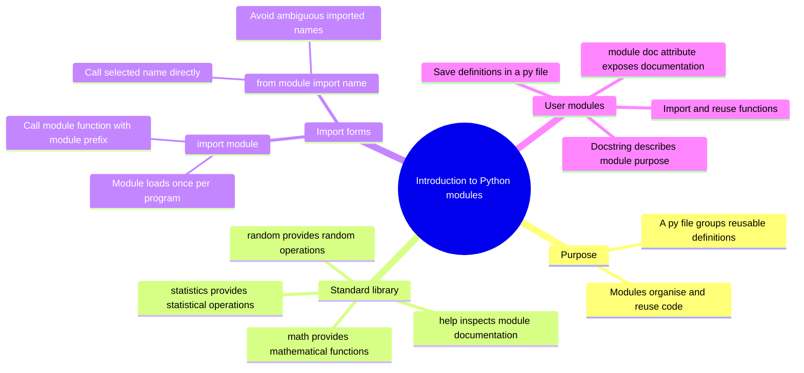

# Computer Science | Chapter 09 | Introduction to Python Modules | CNOTES

## Section-by-section key facts

- **What a module is:** A module is a `.py` file that groups reusable definitions; it helps organise programs and share functions.
- **Importing a module:** `import module` loads the module and functions are called with the module prefix, such as `module.function()`. An imported module is loaded once per program.
- **Selective imports:** `from module import name` imports selected names so they can be called without the prefix; use it when the imported names are clear and unambiguous.
- **Standard-library modules:** Modules such as `math`, `random` and `statistics` provide ready-made functions; `help("math")` can inspect available help.
- **Creating a module:** Save function definitions in a `.py` file, then import it. A module docstring describes its purpose and is available through `module.__doc__`.

