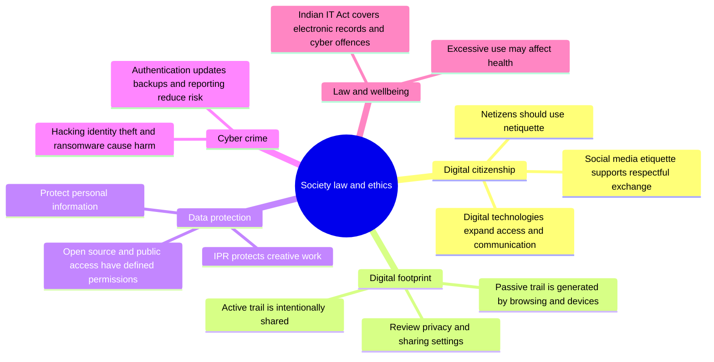

# Computer Science | Chapter 10 | Society Law and Ethics | CNOTES

## Section-by-section key facts

- **Introduction:** Digital technologies support communication and services but also create social, privacy and safety responsibilities.
- **Digital footprint:** Active footprints are intentionally shared; passive footprints are collected through online activity and device or browsing data.
- **Digital society and netizen:** A netizen is a responsible digital citizen; netiquette and social-media etiquette guide respectful, safe participation.
- **Data protection:** Personal data should be handled securely and shared cautiously. Intellectual-property rights protect creative work; copyright violations are unlawful, while public-access and open-source licences define permitted reuse.
- **Cyber crime:** Hacking, identity misuse and ransomware threaten people and systems; prevention includes strong authentication, updates, backups and reporting.
- **Indian IT Act and health:** The IT Act provides a legal framework for electronic records and specified cyber offences. Excessive or unsafe technology use can affect physical and mental health.

