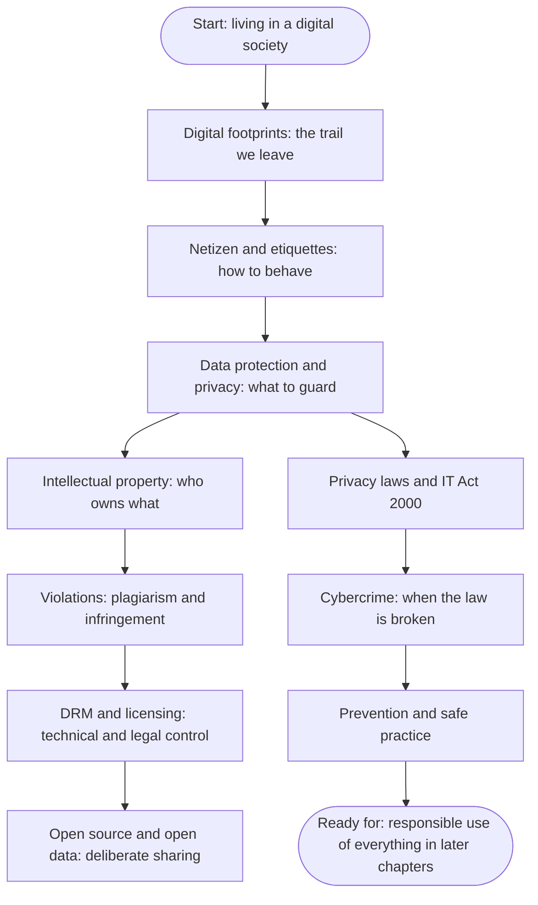
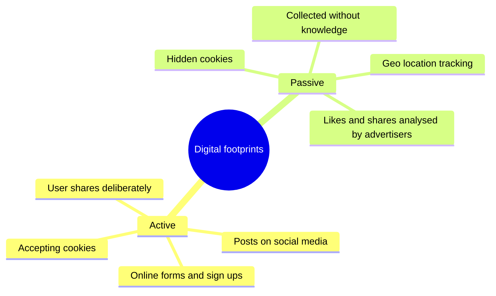
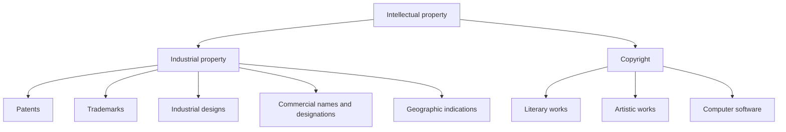
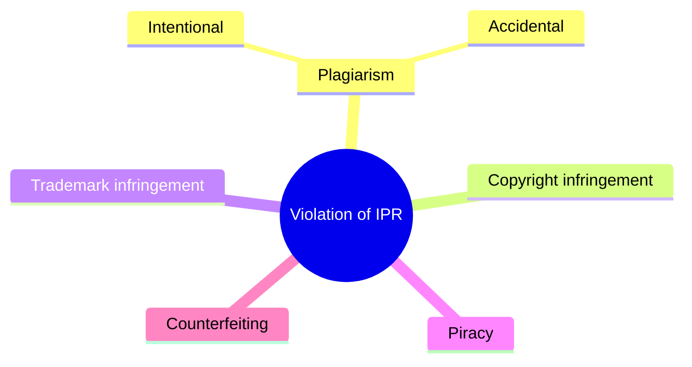
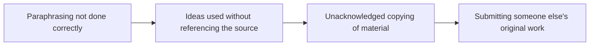
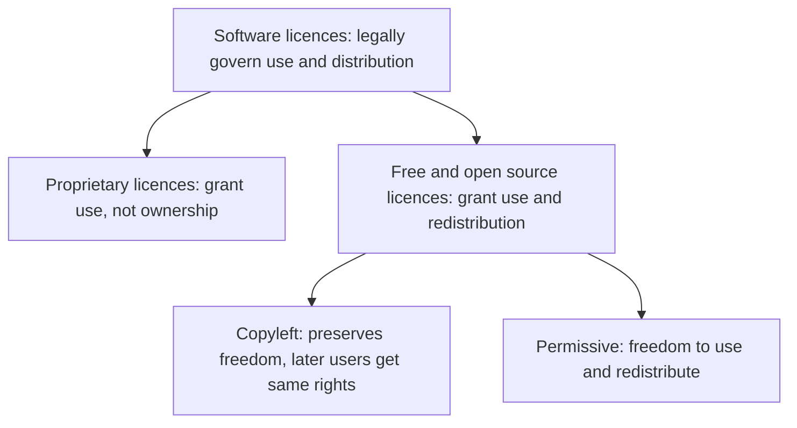
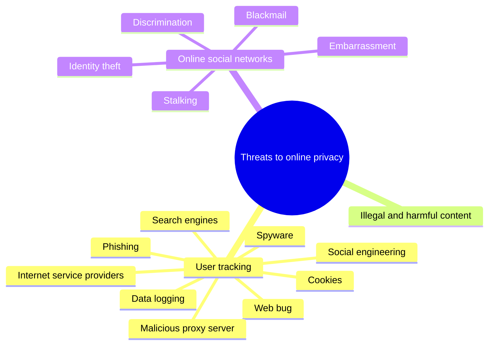
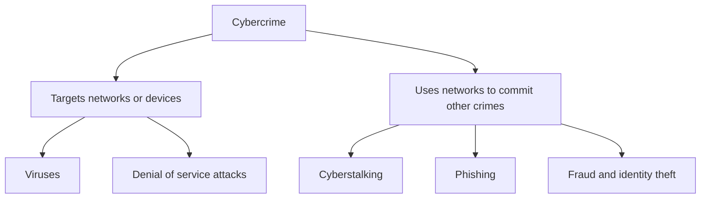

# Computer Science | Chapter 10 | Society, Law and Ethics | CNOTES

**Chapter:** *Computer Science with Python — XI*, "Society, Law and Ethics" (printed as Chapter 11, filed as CS10). Section numbers are the book's own.
**Companion files:** `CS10-SOCIETY_LAW_AND_ETHICS-NOTES.md` (full explanation) · `CS10-SOCIETY_LAW_AND_ETHICS-GLOSSARY.md` (term-by-term lookup).
**This file:** the same chapter, same content, same breadth, reformatted as bullets, tables and diagrams for fast scanning. Every fact in NOTES appears here. Items marked *(beyond the chapter body)* are standard additions explained in NOTES §11.12.

---

## Chapter Roadmap

- Chapter starts with what you leave behind online — footprints. §Roadmap
- Then how you should behave — etiquettes. §Roadmap
- Then what is owned and protected — data, IP, licences. §Roadmap
- Ends with what happens when protection fails — cybercrime — and how to prevent it. §Roadmap

---

## §11.1 Introduction

- Digital world changes fast; new communication technologies open possibilities and expose you and others to risk. §11.1
- Many people struggle to assess those risks, especially for safe digital communication. §11.1
- Data can be used or misused by governments, companies or other individuals, sometimes unintentionally. §11.1
- IT plays a central role in commerce, industry, government, education, entertainment, society. §11.1
- IT also has adverse effects and raises ethical problems. §11.1

| # | Three main types of ethical issue |
| - | --------------------------------- |
| 1 | Personal privacy |
| 2 | Access right |
| 3 | Harmful actions |

§11.1

- Chapter aims: protect yourself, your sources, your friends; secure personal data; know the laws that protect you online. §11.1
- Chapter also covers computer ethics — standards of conduct pertaining to computers. §11.1
- It also covers how computing professionals decide on professional and social conduct. §11.1
- Computer ethics describes the difference between ethical and unethical. §11.1
- Example: duplicating copyrighted digital content is easy, but computer ethics says it is wrong without the author's approval. §11.1
- Example: accessing someone's personal information on a computer system may be possible, but computer ethics says it is unethical. §11.1
- Unethical is not the same as illegal — see §11.12.1. §11.1

---

## §11.2 Digital Footprints

- Digital footprint = the trail, traces or "footprints" people leave online using smartphones, tablets, computers etc. §11.2
- Recorded with every online activity: social media interaction, chatting, online shopping, location check-ins. §11.2
- Beach analogy: a footprint on a beach is washed away, a digital footprint stays and cannot be done away with. §11.2
- Hence digital footprints are also called digital tattoos. §11.2
- Analogy holds for "leaves a mark others can follow"; fails for "fades with time". §11.2
- Created and used with or without our knowledge. §11.2
- Includes websites visited, emails sent, information shared online. §11.2
- Includes the computer's IP address, location and other device-specific details. §11.2
- Data may be used for targeted advertisements or misused or exploited. §11.2
- Awareness should make us cautious about what we write, upload, download or browse. §11.2

### 11.2.1 Active vs passive

| | Active | Passive |
| --- | --- | --- |
| Created when | User intentionally shares personal information | Information collected without the user's knowledge |
| Example (a) | Sharing personal information on Facebook, Instagram, Twitter and other social platforms | Websites installing cookies without disclosing it |
| Example (b) | Online forms, e.g. signing up or logging into mail accounts to send or receive messages | Apps and websites using geo-location to detect location |
| Example (c) | Accidentally or intentionally accepting cookies when the browser prompts | Social media, news channels and advertisers using comments, likes and shares to profile interests and send ads |
| Discriminator | You chose to give it | It was taken without you noticing |

§11.2.1

- ⚠ A cookie can be either kind. §11.2.1
- Accepting a cookie when prompted → active. §11.2.1
- A cookie installed without disclosure → passive. §11.2.1
- What decides it: whether you were told and agreed. §11.2.1

### 11.2.2 Why footprints can't be fully erased

- Most footprints are stored on the servers where the application is hosted, besides the browser. §11.2.2
- You may have no access to remove that data. §11.2.2
- You have no control over how that data will be used. §11.2.2
- Even if you later erase your own record, footprints still remain. §11.2.2
- No guarantee they are fully eliminated from the internet. §11.2.2
- Activities leave traces on the internet and on your device. §11.2.2
- Traces can be used to trace the user, location, device and usage details. §11.2.2
- Read "cannot be done away with" as "cannot rely on removal". §11.2.2
- Practical rule: think before you post, not after. §11.2.2

---

## §11.3 Digital Society and Netizen

- Digital society: every aspect of life is profoundly affected by digitalisation of data. §11.3
- Activities done through technology: shopping, education, social networking, entertainment, health care, paying bills. §11.3
- Netizen = internet + citizen (a contraction). §11.3
- Netizen refers to a person who uses the internet to participate in society. §11.3
- Netizen also means someone who accepts the responsibility of using the internet productively and in socially responsible ways. §11.3
- A responsible netizen respects everyone using the internet. §11.3
- Must follow net etiquettes, communication etiquettes and social media etiquettes. §11.3

### 11.3.1 Netiquettes

- Netiquette = short form of "internet etiquette". §11.3.1
- Etiquette is a code of polite behaviour in society; netiquette is a code of good behaviour online. §11.3.1
- Covers social media, email, online chat, web forums, website comments, multiplayer gaming and other online communication. §11.3.1
- Core idea: respect others online. §11.3.1

| Do's | Don'ts |
| --- | --- |
| Keep messages and posts brief | Don't post inflammatory or offensive comments |
| Reread posts or emails to say what you intend | Don't write in ALL CAPS — it is shouting |
| Remember you leave a digital footprint; be careful what you write | Don't respond to internet trolls or personal attacks |
| Use discretion | Avoid posting private or embarrassing images or comments |
| Include a subject line in an email | Don't use sarcasm — it may be misinterpreted |
| Protect personal information | Don't violate copyright; make sure your work is your own or properly cited |
| Obey copyright laws | Don't exclude people or talk behind their backs |
| Stay focused and stick to the topic | Don't spam others with large numbers of unsolicited emails |

§11.3.1

- Spam = unsolicited commercial email, sent in large numbers (objective Q3(h)). §11.3.1

### 11.3.2 Communication etiquettes

- Apply to email, texting, instant messaging, phone calls, audio/video conferencing, forums, social networking sites. §11.3.2

| Rule | Meaning |
| --- | --- |
| Be Precise | Respect time; avoid useless forwards or replies; don't expect an instant reply; avoid large attachments — send a cloud-storage link (Google Drive, OneDrive, Dropbox) instead |
| Be Polite | Polite whether or not you agree; reply without aggression or abuse |
| Be Credible | Sound credible on forums; before commenting on somebody, read their previous comments and judge their credibility |

§11.3.2

### 11.3.3 Social media etiquettes

- Social media = websites or applications that let users take part in social networking by creating and sharing content. §11.3.3
- Book's examples: Facebook, Google+, Twitter, Instagram, Pinterest, YouTube. §11.3.3
- Impact has begun to shape politics, business, culture, education. §11.3.3

| Group | Rule | Detail |
| --- | --- | --- |
| (a) Be Secure | Choose password wisely | Data-breach news is common; use a strong password, change it frequently, never share username and password |
| | Know who you befriend | Sites encourage connecting with strangers; their intentions may be malicious |
| | Beware of fake information | Fake news, messages and posts are common; use knowledge and experience to validate |
| (b) Be Reliable | Think before uploading | Uploaded files stay on the remote server even if you delete them; be careful with sensitive or confidential files |

§11.3.3

---

## §11.4 Data Protection

- Data protection = practices, safeguards and binding rules that protect personal information and keep it safe online. §11.4
- We should be able to decide what information is shared. §11.4
- We should be able to decide who has access to it. §11.4
- We should be able to decide for how long and for what reason. §11.4
- We should be able to decide whether rights to modify it are given. §11.4
- Sensitive data = data that can cause substantial harm, embarrassment, inconvenience or unfairness if breached. §11.4
- Examples: biometric information, health information, financial information, other personal documents, images, audio, video. §11.4
- Privacy of sensitive data is implemented by encryption, authentication and other secure methods. §11.4
- Aim: data accessible only to the authorised user, for a legitimate purpose. §11.4

| # | Issues caused by unprotected data or a breach |
| - | --------------------------------------------- |
| 1 | Physical data loss |
| 2 | Attack by a virus, worm or malicious code |
| 3 | Targeted by hackers |
| 4 | DDoS (Distributed Denial of Service) attacks |
| 5 | Loss of money |
| 6 | Intellectual property at risk |

§11.4

| # | Ways to protect data |
| - | -------------------- |
| 1 | Data encryption |
| 2 | Don't share private information — passwords, credit-card credentials |
| 3 | Don't overshare on social networking sites in the public domain |
| 4 | Adopt a complete security mechanism against possible threats |
| 5 | Avoid opening phishing emails |
| 6 | Be careful with Wi-Fi connections |
| 7 | Be alert to impersonators |

§11.4

---

## §11.5 Intellectual Property Rights

- Property = a possession; specifically something in which the owner has legal rights. §11.5
- Intellectual property (IP) = creations of the intellect (hence the name). §11.5
- IP includes inventions, literary and artistic works, symbols, names, images and designs used in commerce. §11.5
- IPR = specific legal rights letting the owner completely benefit from their creation for a certain period. §11.5
- IPR let the owner prevent others from using or dealing with it without prior permission. §11.5
- IPR let the owner force others to stop and compensate for damages. §11.5

- Two branches: industrial property (broadly protects inventions) and copyright (protects literary and artistic works). §11.5

### (a) Industrial property

- Includes inventions (patents), trademarks, industrial designs, commercial names, designations, geographic indications. §11.5(a)
- Geographic indications = location-specific brands. §11.5(a)

**Patent**
- Usually granted for inventions. §11.5(a)
- Unlike copyright, the inventor must apply (file). §11.5(a)
- Owner gets an exclusive right to prevent others from using, selling or distributing the invention. §11.5(a)
- Patentee decides whether or how others may use it. §11.5(a)
- Encourages inventors to share scientific or technological findings. §11.5(a)
- Term in India: 20 years from the date of filing; then freely usable. §11.5(a)

**Trademark**
- Any visual symbol, word, name, design, slogan, label etc. that distinguishes a brand or commercial enterprise from others. §11.5(a)
- Example: no company other than Reebok can use the Reebok brand for shoes or clothes. §11.5(a)
- Blocks confusingly similar marks, e.g. "Reebokk". §11.5(a)
- May be possible to apply for the Reebok trademark for unrelated goods like textbooks. §11.5(a)

### (b) Copyright

- Covers literary works: novels, poems, plays, films, musical works. §11.5(b)
- Covers artistic works: drawings, paintings, photographs, sculptures, architectural designs. §11.5(b)
- Covers computer software. §11.5(b)
- Legal concept, enacted by most governments. §11.5(b)
- Gives the creator of an original work exclusive rights, usually for a limited period. §11.5(b)
- Provides exclusive publication, distribution and usage rights to the holder. §11.5(b)
- Content cannot be used or published by anyone else without the author's consent. §11.5(b)

| Right | Meaning |
| --- | --- |
| Reproduce | Make copies of the work |
| Derivative works | Create works based on it |
| Distribute | Distribute copies to the public |
| Display / perform | Publicly display or perform the work |

§11.5(b)

- ⚠ Copyright protects only the form of expression of ideas, not the ideas themselves. §11.5(b)
- Patents protect the invention itself. §11.5(b)

| | Patent | Copyright | Trademark |
| --- | --- | --- | --- |
| Protects | An invention | Original creative work | A brand identifier |
| How obtained | Must apply / file | Arises with the work | Applied for |
| Term (book) | 20 years in India from filing | "A limited period" | No figure given |
| Branch | Industrial property | Copyright | Industrial property |

§11.5

---

## §11.6 Violation of IPR

- IP infringement = any violation or breach of protected IP rights. §11.6
- Ranges from piracy (unauthorised use, copying, reproduction or distribution) to counterfeiting. §11.6
- Counterfeiting = replicating genuine goods with the intent to mislead the recipient. §11.6

### 11.6.1 Plagiarism

- Plagiarism = copying someone else's work and passing it off as one's own. §11.6.1
- Morally bad because it is an act of stealing. §11.6.1
- It is copying information and not giving the author credit. §11.6.1
- Copying other programmers' programs and claiming them as yours is plagiarism. §11.6.1
- Involves lying, cheating, theft and dishonesty. §11.6.1

| | Intentional / deliberate | Unintentional / accidental |
| --- | --- | --- |
| What | Copying someone's work; cutting and pasting text or media (audio, video, movie clips) from electronic sources without documenting; publishing on the web without creators' permission | Careless paraphrasing (changing words or sentence construction of a copied text), excessive quoting, poor documentation |
| Seriousness | May have serious implications | Usually less serious |

§11.6.1

- Left end of the scale = Minor; right end = Extremely Serious. §11.6.1

| # | How to avoid plagiarism |
| - | ----------------------- |
| 1 | Use your own words and ideas |
| 2 | Always reference or give credit to the source |
| 3 | If you must use exact words, put them in quotes and give in-text citations |
| 4 | Include the source with page number where possible |
| 5 | Cite website name, URL or author names; acknowledge them even if you rearranged sentences and changed words |
| 6 | Take notes as bullet points in your own words |
| 7 | Use online plagiarism-checking tools |

§11.6.1

### 11.6.2 Copyright infringement

- Copyright infringement = use or production of copyrighted material without the permission of the copyright holder. §11.6.2
- Downloading an image from the internet and using it in your project. §11.6.2
- Recording a film in a movie theatre. §11.6.2
- Using copyrighted images on your website. §11.6.2
- Modifying an image and then displaying it on your company's website. §11.6.2
- Downloading music or films without paying for their use. §11.6.2
- Copying any literary or artistic work without a licence or written agreement. §11.6.2
- ⚠ Plagiarism = honesty wrong (passing off as your own). §11.6.2
- ⚠ Copyright infringement = legal wrong (using protected work without permission, even if credited). §11.6.2
- One act can be both. §11.6.2

### 11.6.3 Trademark infringement

- Unauthorised use of a trademark or service mark on or in connection with goods or services. §11.6.3
- In a manner likely to cause confusion, deception or mistake about the source. §11.6.3
- Trademark owners can take legal action. §11.6.3

**Worked Example 10-1 (Sabhya's edited clip, Case-based Q1)**
- Sabhya downloads a 2-minute clip, adds "Prepared by Sabhya", emails it. §11.6
- Test 1: used someone else's protected work without permission → copyright infringement. §11.6
- Test 2: claimed it as his own → also plagiarism. §11.6
- Not fair use; not hacking. §11.6
- Book's key: (c) copyright infringement. §11.6

---

## §11.7 Digital Rights Management (DRM)

- DRM = access-control technologies used by hardware manufacturers, publishers, copyright holders and individuals. §11.7
- Used to limit the use of digital content and devices. §11.7
- Describes any technology that inhibits use of digital content not desired or intended by the content provider. §11.7
- Controls use of digital media by preventing access, copying or conversion to other formats. §11.7
- Trying to save or copy protected content gives an error (Fig. 11.3(a): "Sorry, this file is read-only"). §11.7
- DRM removes usage control from the person holding the content and puts it in a computer program's hands. §11.7
- Most commonly used by the entertainment industry (film and recording). §11.7
- Used by many online music stores (e.g. Apple's iTunes Store) and many e-book publishers. §11.7

| | DRM-technology-based | System-based |
| --- | --- | --- |
| Restriction stays with data? | Yes — remains attached while migrating, moving, saving, copying | No — records and information can be migrated, moved, saved, copied |
| Portability | Cannot be saved even to another location | Portable — can be copied to a different location than its destination computer |
| Strength | Stronger and wider; contributes to data privacy and security | Weaker |

§11.7

- An organisation using DRM-based data should consider: IP rights, Copyright, Payment mechanisms, Security, E-commerce and ERP systems, and — most important — Licensing. §11.7
- ⚠ Tension in the book: DRM "protects rights of producers while enabling access to fair use", yet it can prevent lawful fair use and restrict non-copyrighted works. §11.7
- Write the definition; the criticism is the honest limitation. §11.7

---

## §11.8 Licensing

- Software licensing = the legal right to run, or the privilege given by a company to access, its application. §11.8
- Everyday example: buying a licence for proprietary software like Windows OS to install it. §11.8
- Fig. 11.4: the system screen shows a Microsoft copyright; a licensed product that must be legally purchased. §11.8
- It comes with a licensing agreement, read through "Read the Microsoft Software License Terms". §11.8
- A licensing agreement governs the use of licensed software. §11.8
- Typically allows running on a limited number of computers. §11.8
- Typically allows copies for backup purposes only. §11.8

| # | Advantages of licensed software |
| - | ------------------------------- |
| 1 | Contributes to further development of the program; helps the economy create computer-related jobs and opportunities for other businesses |
| 2 | Legal obligation met, plus outright support not found in pirated software |

§11.8

- Licences give rules and guidelines for others to use your work. §11.8
- Open source licences help others contribute without seeking special individual permission. §11.8

### 11.8.1 Proprietary licences

- Exclusive rights stay with owner, developer or publisher. §11.8.1
- They reserve all freedoms to use and distribute. §11.8.1
- Violating a proprietary licence = copyright infringement. §11.8.1
- Restrict inspection, modification of source code and further distribution. §11.8.1
- Freeware (no-cost software) can be distributed under a proprietary licence. §11.8.1
- Most commercially available software is under proprietary licences. §11.8.1

### 11.8.2 Free and Open Source licences

- Free and Open Source Licence = software users can safely run, adapt and redistribute without legal restraint; emphasises freedom. §11.8.2
- Open source software = source code publicly available under a licence giving the right to study, change and distribute. §11.8.2
- OSS emphasises security, cost-saving and transparency. §11.8.2
- FOSS allows using, copying, studying and modifying; source code openly shared; people encouraged to improve it. §11.8.2
- CTM: OSS = freedom to use, share and/or modify source code and allow copyrights to other users. §11.8.2

| | Permissive | Copyleft |
| --- | --- | --- |
| Idea | Royalty-free licence to do virtually anything with the source code | Source code has to be provided; distribution and modification permitted; later users keep same rights |
| Permits | Using, copying, modifying, merging, publishing, distributing, sublicensing, selling | Using, copying, modifying, distributing under the same freedoms |
| Book's examples | Apache, W3C | GPL, Creative Commons, LGPL, MPL |

§11.8.2

- ⚠ Book says permissive distribution "can only be made without the source code" — misleading; permissive licences don't require source, they don't forbid it. §11.8.2
- ⚠ Creative Commons is listed under copyleft; only the ShareAlike variant behaves like copyleft. §11.8.2

| GPL feature | Meaning |
| --- | --- |
| Copying | No limit — own server, client's server, local workstations, as many times as you want |
| Distribution | Any form — thumb or hard drive, download link on your site, printed on paper |
| Charge a fee | May charge, but give the buyer a copy of the GNU GPL (telling them it is available free elsewhere) |

§11.8.2

| # | CC (Creative Commons) part | Meaning |
| - | --- | --- |
| 1 | Accreditation | Author must be acknowledged; work may then be modified, distributed, copied and used |
| 2 | Shared with CC | Modify and distribute, but only under a CC licence |
| 3 | Non-commercial | Modify and distribute, not for commercial purposes ("commercial" is vague) |
| 4 | No Derivative Works | Copy and distribute, but cannot modify or create work based on it |

§11.8.2

| # | Apache feature | Meaning |
| - | --- | --- |
| 1 | Rights are never-ending | Use forever, no renewal |
| 2 | Worldwide authority | Rights granted in one country are automatically granted to all |
| 3 | No fee or royalty | No charge — not upfront, not per usage, not otherwise |
| 4 | Rights are irrevocable | Cannot be taken back — except suing someone for patent infringement under it terminates your own licence (patented work only) |

§11.8.2

- ⚠ "GPL code cannot be used for paid and proprietary software" (Memory Byte): GPL code can be sold, but derivative works must stay GPL, so cannot be proprietary. §11.8.2

**Worked Example 10-2 (choosing a licence, new)**
- A wants free use and improvement, with improved versions staying free → copyleft (GPL or CC ShareAlike). §11.8.2
- B wants anyone to use the library, even in closed commercial products → permissive (Apache). §11.8.2
- C wants pictures shared but never edited → CC No Derivative Works with Accreditation. §11.8.2
- Deciding question: what may a later user do with my work? §11.8.2

---

## §11.9 Open Source and Open Data

- Open source software = freedom to work with, use, distribute and modify source code. §11.9
- Open data runs conceptually parallel to open source. §11.9
- Open data = all stored data that could be made accessible in public interest without restrictions on usage and distribution. §11.9

| Feature | Requirement |
| --- | --- |
| Availability and Access | Available as a whole, at no more than reasonable reproduction cost, preferably downloadable, in a convenient and modifiable form |
| Reuse and Redistribution | Terms permit reuse and redistribution, including intermixing with other datasets |
| Universal Participation | Everyone can use, reuse and redistribute; no discrimination against fields of endeavour, persons or groups; "non-commercial" or "only education" restrictions not allowed |

§11.9

- Fig. 11.5(a) also names the values: participation, opportunity, empowerment, transparency, no restrictions, availability, access, digital convenience. §11.9
- Fig. 11.5(b) applications: smart-city hub using open data. §11.9
- Applications: smart parking, smart waste management, smart street light, smart public transportation, citizen reporting. §11.9
- Hub uses real-time and static data storage and links to other smart-city hubs. §11.9
- Open data and accountability (Solved Q21): easier to analyse, process and combine; new level of public scrutiny; citizens engage with government and add value to data. §11.9

---

## §11.10 Privacy Laws

- Privacy = ability to control what information one reveals about oneself over the internet. §11.10
- Also the ability to control who can access that information. §11.10

### 11.10.1 Threats to privacy

| Threat | Detail |
| --- | --- |
| User tracking | ISPs (can observe any internet activity); cookies (parcels of text sent by a server, maintaining user-specific information); data logging (times the computer is in use or sites visited); spyware; web bug; social engineering; phishing; malicious proxy server; search engines |
| Illegal and harmful content | Needs to be fought with legal tools |
| Online social networks | Risks range from identity theft to online and physical stalking, embarrassment, discrimination, blackmailing |

§11.10.1

- Privacy laws were made to prohibit disclosure or misuse of information about private individuals. §11.10.1
- Privacy laws = laws regulating storing and using personally identifiable information about individuals. §11.10.1
- That information can be collected by governments, public or private organisations, or other individuals. §11.10.1
- Considered within privacy rights or reasonable expectation of privacy. §11.10.1
- Privacy of data (Solved Q1) = ethical and legal rights of individuals to control the use of their personal information. §11.10.1
- Consumer consent is an important factor of privacy (objective Q2(b), True). §11.10.1

### 11.10.2 IT Act, 2000 and privacy

| Section | What it provides |
| --- | --- |
| 43A | Reasonable security practices for sensitive personal data or information; compensation to a person affected by wrongful loss or wrongful gain |
| 72A | Imprisonment up to 3 years and/or fine up to ₹5,00,000 for disclosing personal information about another person while providing services under a lawful contract, causing wrongful loss or gain |

§11.10.2

- IT Act has provisions permitting interception, monitoring and decryption of digital communication. §11.10.2
- Provides for collection and monitoring of traffic data. §11.10.2
- Allows the government to set a national encryption standard. §11.10.2
- Government of India measures named: Central Monitoring System, NATGRID, phone and internet interception by police. §11.10.2
- Section 43A is still in force; the DPDP Act, 2023 omits it from 13 May 2027. §11.10.2

---

## §11.11 Cybercrime

- Cybercrime = a crime in which a computer is the object of the crime (hacking, phishing, spamming). §11.11
- Or the computer is used as a tool to commit an offence (child pornography, hate crimes etc.). §11.11
- Carried out against an individual, a group, an organisation or a country. §11.11
- Intent: directly or indirectly cause physical harm, financial loss or mental harassment. §11.11
- A cybercriminal attacks a computer or network to reach other computers and disable or damage data or services. §11.11
- May access personal information or business trade secrets, or use the internet for exploitative or malicious purposes. §11.11
- Criminals may also use computers for communication and document or data storage. §11.11
- Such criminals are "often referred to as hackers" (see §11.11.1 for the distinction). §11.11
- Common types: online banking information theft, identity theft, online predatory crimes, unauthorised computer access. §11.11
- More serious: cyber terrorism. §11.11

### 11.11.1 Hacking

- Hacking = unauthorised access to a computer, computer network or any digital system. §11.11.1
- Hackers usually have technical expertise in hardware and software. §11.11.1
- They look for bugs to exploit and break in. §11.11.1

| | Ethical hacker (white hat) | Non-ethical hacker (black hat / cracker) |
| --- | --- | --- |
| Intent | Positive | Gain unauthorised access to steal data, damage or bring down systems |
| What they do | Explore vulnerabilities during software testing; may exploit a website to find weaknesses, then report to the owner | Security cracking and data stealing — identity theft, monetary gain, bringing a rival site down, leaking sensitive information |
| Effect | Improves security; prepares the owner against cyber attack | Illegal and malicious |

§11.11.1

- Eavesdropping attack (also sniffing or snooping): hacker intercepts, deletes or modifies data transmitted between two devices. §11.11.1
- Relies on unsecured network communications. §11.11.1
- Typically occurs on a network whose traffic is not secured or encrypted. §11.11.1

### 11.11.2 Phishing / fraud emails

- Phishing = attempt to acquire usernames, passwords, credit-card details (sometimes indirectly money). §11.11.2
- Done by masquerading as a trustworthy entity in an electronic communication. §11.11.2
- Unlawful: fake websites or emails that look authentic are presented to the user. §11.11.2
- Typically carried out by email spoofing or instant messaging. §11.11.2
- Directs users to enter personal information on a fake website identical in look and feel. §11.11.2
- Only difference: the URL. §11.11.2
- Lures: messages purporting to be from social websites, auction sites, banks, online payment processors, IT administrators. §11.11.2
- May contain links to sites that distribute malware. §11.11.2

| # | Protective measures |
| - | ------------------- |
| 1 | Never open or download a file from an unsolicited email, even from someone you know — call or email them to check |
| 2 | Keep the operating system updated |
| 3 | Use a reputable antivirus program |
| 4 | Enable two-factor authentication whenever available |
| 5 | Confirm a website's authenticity before entering login credentials, or look for a reputable security trust mark |
| 6 | Look for HTTPS in the address bar before entering sensitive information — data will be encrypted |

§11.11.2

- Phishing email looks like (Solved Q16): appears to come from a financial institution, large company, chain store, social network or government agency. §11.11.2
- Mimics colours, logos, fonts and layout. §11.11.2
- Includes a link to a legitimate-looking but phony page. §11.11.2
- Phrases like "Verify your account" or "Your account will be closed". §11.11.2
- Lottery or prize promises if you pay money upfront. §11.11.2
- A legitimate business never asks for personal information by email. §11.11.2
- If you already responded (Solved Q17): change the password immediately. §11.11.2
- Notify the fraud department of the institution that was mimicked. §11.11.2
- Review credit reports for unfamiliar accounts. §11.11.2
- Consider a security freeze — no new credit without your approval. §11.11.2

**Worked Example 10-3 (Ravi's bank email, Case-based Q3)**
- Fake sender posing as a bank → spoofing. §11.11.2
- 48-hour threat → pressure tactic. §11.11.2
- Link to imitation website to collect information → phishing, a form of spoofing. §11.11.2
- Book's key: phishing. §11.11.2
- Giveaway: link in the book's figure is `http://www.firstgenericbank.com.account-updateinfo.com`. §11.11.2
- Real domain = part before the first single `/` → `account-updateinfo.com`, not `firstgenericbank.com`; also `http`, not `https`. §11.11.2
- Type the bank's address yourself (Solved Q7). §11.11.2

### 11.11.3 Ransomware

- Malicious software that infects the computer and displays messages demanding a fee for access. §11.11.3
- A criminal money-making scheme. §11.11.3
- Installed through deceptive links in an email, instant message or website. §11.11.3
- Can lock the computer screen or encrypt important, predetermined files with a password. §11.11.3
- Uses scare tactics or intimidation to trick victims into paying. §11.11.3
- May appear as fake antivirus software claiming your computer has issues and payment is needed. §11.11.3

### 11.11.4 Illegal downloading

- Obtaining files from the internet that you do not have the right to use. §11.11.4
- Root cause of digital piracy. §11.11.4
- Digital piracy = illegally sharing copyrighted media: games, music, movies, TV shows, software. §11.11.4
- Doesn't matter whether you upload to share or download for free or at a bargain price. §11.11.4
- Anyone involved is treated as a law-breaker. §11.11.4
- Example: belonging to a site sharing music without the labels' permission = piracy, even if you paid the site a fee. §11.11.4
- Free or very cheap movies and TV shows are usually illegal copies. §11.11.4
- Avoid by obtaining media from reputed dealers with the rights to sell it. §11.11.4
- Consequences: heavy losses to developers and producers; punishment or fine for the downloader. §11.11.4
- Link (Solved Q25): illegal downloads violate copyright law → illegal downloads result in digital piracy. §11.11.4

### 11.11.5 Child pornography

- Book's term: publishing and transmitting obscene material about children in electronic form. §11.11.5
- Called the most heinous crime; increased with easy internet access. §11.11.5
- Has led to other crimes such as sex tourism and sexual abuse of children. §11.11.5

| Conviction | Imprisonment | Fine |
| --- | --- | --- |
| 1st (book) | 2 to 5 years | ₹1 lakh |
| 2nd or subsequent (book) | up to 7–10 years | up to ₹10 lakh |

§11.11.5

- ⚠ Statute (IT Act §67B): 1st up to 5 years + up to ₹10 lakh; subsequent up to 7 years + up to ₹10 lakh. §11.11.5
- Write the book's figures for this book's paper; know the statute reads differently. §11.11.5
- Modern legal usage prefers "child sexual abuse material (CSAM)". §11.11.5
- Child-pornography laws give severe penalties for producers and distributors in almost all Western societies. §11.11.5
- Shorter sentences for non-commercial distribution. §11.11.5
- Possession convictions usually carry prison, often converted to probation for first-time offenders (Western practice, not India). §11.11.5

### 11.11.6 Cyber scams and frauds

- Internet fraud = any scheme using chat rooms, email, message boards or websites. §11.11.6
- To present fraudulent solicitations, conduct fraudulent transactions, or transmit proceeds of fraud. §11.11.6

| Fraud | What happens |
| --- | --- |
| Credit / debit card fraud | Card used to obtain money or property without authorisation; numbers taken from unsecured web media |
| Non-delivery of goods/service fraud | Payment through a web portal; nothing is delivered |
| Spoofing / phishing scam | Spoofing: fraudster masquerades as another person to get bank, card and password details. Phishing: a form of spoofing — an entity's web page is duplicated and positioned with a URL to lure people |
| Identity theft | Using another person's personal information without consent for fraud — name, login details — and posing as that person online; information may be leaked online or stolen during web surfing |
| Auction fraud | Payment made in an online auction; fraudster sends a lower-standard item or a counterfeit |

§11.11.6

- Identity theft (Memory Byte): someone, without your knowledge, acquires a piece of your personal information and uses it to commit fraud. §11.11.6
- Using someone else's Twitter handle to post = identity theft (objective Q3(a)). §11.11.6

**Worked Example 10-4 (classify the scenario, Solved Q5 and Q10, Unsolved Q42)**
- Malini steals a credit card and buys a laptop → fraud (card fraud). §11.11.6
- Theft of a sealed laptop → ordinary theft, not cybercrime. §11.11.6
- Unauthorised bank transaction → cybercrime (computer as tool). §11.11.6
- Unauthorised modification of company data → cybercrime (data as target). §11.11.6
- Photocopying a printed report → not cybercrime. §11.11.6
- Book's key for Q10: (2) and (3). §11.11.6
- Rajni renames a presentation "made by Rajni" → plagiarism (and copyright infringement if protected). §11.11.6
- Deciding fact: the role of the computer, not the money or harm. §11.11.6

### 11.11.7 Preventing cybercrime

| Group | Precautions |
| --- | --- |
| Keep systems healthy | 1. Keep system up to date; regular backups · 3. Update antivirus regularly · 12. Adjust browser settings (may limit some functionality; best protection from malicious content) |
| Guard identity and passwords | 2. Manage social media privacy settings · 4. Strong password (letters, numbers, symbols, special characters), changed periodically, not the same on all sites · 6. On someone else's computer, don't let the browser save passwords or autofill; use a private window |
| Browse and transact safely | 5. Check HTTPS or lock symbol before downloading · 7. For an unknown site, refuse cookies · 8. Transact only on well-known, secure sites |
| Network and downloads | 9. Secure home wireless with a strong password, changed regularly · 10. Don't download songs, videos or software from untrusted sites — hidden ransomware or Trojan · 11. Never download attachments from suspicious emails |

§11.11.7

---

## §11.12 Topics the exercises assume — beyond the chapter body

- ⚠ Standard material added from general knowledge; the book's chapter text never explains it. §11.12

### 11.12.1 Ethics vs law (Unsolved Q16–18)

| | Ethics | Law |
| --- | --- | --- |
| Source | Shared moral principles of a community or profession | Rules made by the state |
| Enforced by | Conscience, social pressure, professional codes | Courts and penalties |
| Overlap | Many laws codify ethics | Some legal acts remain unethical |
| Example | Copying a friend's project and presenting it as yours — wrong even if no one sues | Copyright infringement — punishable |

§11.12.1

- Law says what you must or must not do; ethics says what you should or should not do. §11.12.1

### 11.12.2 The malware family (Unsolved Q26–32)

- Malware = umbrella term for malicious software made to damage, disrupt or gain unauthorised access. §11.12.2

| Type | What it is | Key difference |
| --- | --- | --- |
| Virus | Malicious code attaching to a host file; replicates when the host runs | Needs a host program and user action |
| Worm | Standalone self-replicating malware | Spreads across networks on its own |
| Trojan horse | Malware disguised as legitimate software | Does not self-replicate; relies on the user installing it |
| Spyware | Secretly collects information about the user | Runs hidden; sends data to a third party |
| Adware | Displays unwanted advertisements | May also track browsing |
| Ransomware | Locks or encrypts files and demands payment | See §11.11.3 |

§11.12.2

- Worm vs Trojan: worm replicates itself and spreads on its own; Trojan tricks you into installing it. §11.12.2
- Malware vs worm: malware is the category; worm is one kind. §11.12.2

### 11.12.3 Firewall and network security (Solved Q11, Unsolved Q46)

- Firewall = hardware or software barrier monitoring and filtering network traffic by rules. §11.12.3
- Blocks unauthorised access while allowing permitted traffic. §11.12.3
- Book's three network-security components (HOTS): anti-virus and anti-spyware; firewall; Intrusion Prevention Systems (IPS). §11.12.3
- IPS identifies fast-spreading threats such as zero-day or zero-hour attacks. §11.12.3

### 11.12.4 Information security (Unsolved Q20–21, Q45)

- Goal of information security = protect the CIA triad. §11.12.4
- Confidentiality: only authorised people see it. §11.12.4
- Integrity: it is not altered improperly. §11.12.4
- Availability: accessible when needed. §11.12.4
- Threat = something that could cause harm (a hacker, a virus). §11.12.4
- Vulnerability = a weakness a threat can exploit (unpatched system, weak password). §11.12.4
- Risk = chance and impact of a threat exploiting a vulnerability. §11.12.4
- Confidentiality of information = accessible only to those authorised. §11.12.4

### 11.12.5 Authentication and biometrics (Solved Q18, Unsolved Q15, Q23)

| Method | What it is |
| --- | --- |
| Password | Something the user knows |
| Token | Something the user is given and must have |
| Biometrics | Biological characteristics registered for verification |
| OTP | One-time pin/password sent to verify identity |

§11.12.5

- Advantages of biometrics in a school: accurate attendance; no proxy attendance; nothing to lose unlike cards; controlled entry to labs and offices. §11.12.5
- How secure: strong but not foolproof. §11.12.5
- Can wrongly accept or reject people. §11.12.5
- Can sometimes be spoofed. §11.12.5
- Unlike a password, cannot be changed if compromised. §11.12.5
- The stored biometric database is itself sensitive data and must be protected. §11.12.5
- Data in a biometric database can be updated (objective Q2(f), True). §11.12.5
- Identity verification service (Memory Byte): ensures users provide information associated with a real person's identity. §11.12.5

### 11.12.6 Cyberbullying (Case-based Q2)

- Cyberbullying = using digital means to harass, threaten, embarrass or target someone. §11.12.6
- Threatening message ("Do not try to call or talk to me") → cyberbullying. §11.12.6
- Embarrassing picture uploaded on a social site → cyberbullying. §11.12.6
- Email saying "I am sorry" → not cyberbullying. §11.12.6

### 11.12.7 Software categories and security terms used in objective questions

| Term | Meaning |
| --- | --- |
| Shareware | Free to try for a limited time or with limited functionality, then pay |
| Freeware | No-cost software; source may not be available |
| Public domain software | No copyright restrictions — usable by anyone for any purpose (objective Q2(a) "with restrictions" is False) |
| Open source | Source code available and may be modified |

§11.12.7

- Free software vs freeware vs FOSS: freeware costs nothing but code may be closed; free (libre) software = freedom to use, study, modify, share; FOSS emphasises those freedoms with open source. §11.12.7
- Digital signature = electronic means of verifying the sender and that the document was not altered. §11.12.7
- Digital certificate = binds an identity to a public key. §11.12.7
- An e-document is legally valid once digitally signed (objective Q2(e), True) — IT Act recognises digital signatures. §11.12.7
- SSL = Secure Sockets Layer, creating encrypted links between a web server and a browser (objective Q3(b)). §11.12.7
- Modern sites use the successor TLS, shown as HTTPS. §11.12.7

### 11.12.8 ICT, society and social media (Solved Q8–9, Unsolved Q13, Q33–35)

- Technology for students with disabilities (book): talking word processors; screen readers; conversion of local language to Braille; eye-tracking mouse. §11.12.8

| Term | Meaning |
| --- | --- |
| Social media campaign | Focused on one business goal — feedback, email lists, website traffic |
| Crowdsourcing | Engaging a crowd for a common goal — innovation, problem solving, efficiency; powered by new tech, social media, Web 2.0 |
| Smart mob | Each person uses technology to learn where to go and what to do; staying on top of current events makes them effective |

§11.12.8

- Gender discrimination = treating people unequally because of gender. §11.12.8
- In computer classes it reduces participation and learning. §11.12.8
- Book's remedy: proper ICT training for teachers. §11.12.8
- Drawbacks of social media: time loss and addiction; cyberbullying; loss of privacy; fake news; self-comparison. §11.12.8
- Popular sites (book): Facebook, Twitter, Instagram, Pinterest, YouTube. §11.12.8
- Google+ was shut down in 2019 — don't treat it as current. §11.12.8
- E-waste (Memory Byte): contains lead, cadmium, beryllium, mercury, brominated flame retardants. §11.12.8
- "All electronic waste is made up of" is overstated; read as "contains hazardous substances". §11.12.8
- The chapter body never discusses e-waste. §11.12.8

### 11.12.9 IT Act, 2000 — sections, forensics, reporting

- IT Act is the primary law for cybercrime and e-commerce (Solved Q6). §11.12.9
- Cyber laws enforced strictly for: cybercrimes; electronic and digital signatures; intellectual property; data protection and privacy (Solved Q12). §11.12.9
- A hacked website → complain to the police under the IT Act (Solved Q2). §11.12.9

| Section | Subject | Penalty (verified) |
| --- | --- | --- |
| 43 | Penalty and compensation for damage to computer systems | — |
| 43A | Sensitive personal data security | Compensation |
| 66C | Identity theft | Up to 3 years and fine up to ₹1 lakh |
| 66D | Cheating by personation using a computer resource | Up to 3 years and fine up to ₹1 lakh |
| 67 | Obscene material | 1st: up to 3 yrs + up to ₹5 lakh; subsequent: up to 5 yrs + up to ₹10 lakh |
| 67B | Children in sexually explicit acts | 1st: up to 5 yrs + up to ₹10 lakh; subsequent: up to 7 yrs + up to ₹10 lakh |
| 72A | Disclosure in breach of lawful contract | Up to 3 yrs and/or up to ₹5 lakh |

§11.12.9

- Sections exist for hacking, tampering with source documents, privacy violation, cyber terrorism; penalties not verified here. §11.12.9
- DPDP Act, 2023: notified in phases from 13 November 2025. §11.12.9
- DPDP omission of Section 43A takes effect 13 May 2027; until then 43A applies. §11.12.9
- Don't write "43A has been repealed". §11.12.9
- Cyber forensics = collecting, preserving and analysing digital evidence for court without altering it. §11.12.9
- Report on cybercrime.gov.in, helpline 1930 (financial fraud), or local police/cyber cell. §11.12.9
- Investigators typically preserve evidence, trace logs and IP addresses, seize devices, carry out forensic examination (general outline only). §11.12.9
- So students don't commit cybercrime unknowingly: don't copy others' work; no pirated media; don't share unverified or harmful content; don't use others' accounts; understand licences; ask before sharing someone's photo. §11.12.9

### 11.12.10 Cyber law, risks, web beacons, prevention answers

- Cyber law = legal issues related to use of communications technology, particularly cyberspace. §11.12.10
- Addresses cybercrime, e-commerce, IP, data protection and data privacy. §11.12.10
- Protects people from online frauds and scams; helps prevent financial crimes and identity theft. §11.12.10
- Applications (Solved Q4): intellectual property, privacy, freedom of expression, jurisdiction. §11.12.10

| Risk (Solved Q15) | Examples |
| --- | --- |
| Inappropriate or unwanted contact | Cyberbullying, spamming |
| Inappropriate or inaccurate content | Pornography, hate sites |
| Deceptive or fraudulent commerce | Counterfeit and malicious sites |

§11.12.10

- Web beacons = pictures in email that secretly send a message back to the sender. §11.12.10
- Spammers use the returned information to locate active email addresses. §11.12.10
- Images can also contain harmful code and deliver a spammer's message despite filters. §11.12.10
- Block: prevent pictures downloading until you've reviewed the message. §11.12.10
- Block: beware malware disguised as holiday greetings. §11.12.10
- Block: approach links in email, social sites, instant messages with caution. §11.12.10
- Preventing identity theft (Solved Q19): strong unique password; avoid posting confidential information; no personal information on social media; shop from trusted sites; latest browsers; advanced malware and spyware tools; security solutions for financial data; update system and software; protect national identity numbers; download only well-known apps. §11.12.10
- The book says "social security number" (US term) — think Aadhaar and PAN. §11.12.10
- Identity theft is the most common type of fraud; it can lead to financial loss and even criminal action against the victim. §11.12.10
- Extra phishing precautions (Solved Q24): updated antivirus, anti-spyware, firewall. §11.12.10
- Never open unknown attachments; never divulge personal information requested by email. §11.12.10
- Type the actual web address to check legitimacy. §11.12.10
- Verify the site's phone number independently before calling a number from an email. §11.12.10

**Remaining Memory Bytes and Solved Q20**
- All software is protected under copyright; copyright is owned by the developer or the publisher. §11.12.10
- Set up privacy settings for a social media site on your own. §11.12.10
- FOSS lets users not only access freely available software but also modify (improve) it. §11.12.10
- Cybercrimes include hacking, spreading viruses or malware, phishing or fraudulent emails, ransomware — to steal data or break down important services. §11.12.10
- Open data (Solved Q20): freely available to everyone to use and republish, without restrictions of copyright, patents or other control mechanisms. §11.12.10
- Its goals resemble open source, open hardware, open content, open education, open government, open access, open science, open web. §11.12.10

---

## Points to Ponder

1. Active vs passive is about knowledge, not technology: accepted a cookie → active; hidden cookie → passive. §Points to Ponder
2. Deleting a post does not delete the footprint — copies sit on remote servers. §Points to Ponder
3. ALL CAPS means shouting. §Points to Ponder
4. Plagiarism ≠ copyright infringement: honesty wrong vs legal wrong; one act can be both. §Points to Ponder
5. Copyright protects expression, not ideas; patents protect the invention. §Points to Ponder
6. A patent must be applied for; copyright arises with the work; Indian patent term is 20 years from filing. §Points to Ponder
7. A trademark protects a brand identifier — Reebok / "Reebokk" is the confusing-similarity test. §Points to Ponder
8. DRM travels with the data; system-based restrictions don't. §Points to Ponder
9. Freeware is not open source; freeware can sit under a proprietary licence. §Points to Ponder
10. Violating a proprietary licence is copyright infringement. §Points to Ponder
11. GPL code can be sold but not made proprietary. §Points to Ponder
12. Permissive lets you do almost anything; copyleft keeps later users' freedoms. §Points to Ponder
13. Apache rights are irrevocable — except if you sue over patents. §Points to Ponder
14. Open data forbids non-commercial-only restrictions. §Points to Ponder
15. Section 43A = security practices and compensation; Section 72A = punishment for disclosure (3 years, ₹5 lakh). §Points to Ponder
16. Hacking is unauthorised access; ethical hacking is authorised and reported to the owner. §Points to Ponder
17. Phishing is a form of spoofing; the look-alike page differs only by URL. §Points to Ponder
18. Cybercrime = computer is target or tool; a stolen sealed laptop is just theft. §Points to Ponder
19. Illegal downloading → piracy even if you paid a site with no right to sell. §Points to Ponder
20. "Installing antivirus for protection" is not a cybercrime (objective Q3(i)). §Points to Ponder
21. Never respond to a "you have won something" message (objective Q2(i), True). §Points to Ponder
22. Cookies are parcels of text sent by a server — one of the nine user-tracking methods. §Points to Ponder

---

## Problem-Solving Strategy

**Type 1 — "Identify the cybercrime in this scenario"**
1. Is a computer the target or the tool? If neither, it is not a cybercrime. §Problem-Solving Strategy
2. Find the marker: fake sender + urgent link → phishing; locked files + payment demand → ransomware; using another's login → identity theft; paying for goods never delivered → non-delivery fraud; copying someone's work and claiming it → plagiarism. §Problem-Solving Strategy
3. Name the category and one reason from the scenario. §Problem-Solving Strategy

**Type 2 — "Differentiate between X and Y"**
1. State the one discriminating fact first (who chose it / what it protects / needs filing). §Problem-Solving Strategy
2. Give 3–4 rows: what, example, effect, legal outcome. §Problem-Solving Strategy
3. Close with one example each. §Problem-Solving Strategy

**Type 3 — "Which licence / which IP right?"**
1. Invention, creative work, or brand identifier? → patent / copyright / trademark. §Problem-Solving Strategy
2. For software: must later users keep the same freedoms? → copyleft. May they do anything? → permissive. May they not modify? → CC No Derivatives. §Problem-Solving Strategy

**Type 4 — "What precautions…?"**
1. Group into system, identity, browsing, network (§11.11.7) rather than listing at random. §Problem-Solving Strategy
2. Include HTTPS check, updated antivirus, strong unique password, no unknown attachments. §Problem-Solving Strategy

**Type 5 — "Explain the term…"**
1. Definition, then the book's example, then the related term (e.g. phishing → spoofing). §Problem-Solving Strategy

---

## Appendix A — Discrepancies and cautions

| # | Point | The book says | Verified / safer position | What to write |
| --- | --- | --- | --- | --- |
| 1 | Child-pornography penalty | 1st: 2–5 yrs + ₹1 lakh; 2nd: up to 7–10 yrs + ₹10 lakh | IT Act §67B: 1st up to 5 yrs + up to ₹10 lakh; subsequent up to 7 yrs + up to ₹10 lakh | Book's figures for this book's paper; statute's if the question cites the Act |
| 2 | GPL and "paid and proprietary" | "cannot be used for paid and proprietary software" | GPL code can be sold; derivatives must stay GPL, so cannot be proprietary | "Cannot be made proprietary; selling is allowed" |
| 3 | Permissive licences and source | "distribution can only be made without the source code" | They don't require source release; they don't forbid it | Book's wording if quoted; otherwise "need not provide source" |
| 4 | Creative Commons as copyleft | Listed under copyleft | Only ShareAlike CC licences are copyleft | Book's grouping for the board |
| 5 | DRM and fair use | Both "prevents lawful fair use" and "enables access to fair use" | DRM can over-restrict lawful use | Definition + the criticism |
| 6 | Section 43A | Described as in force | In force; omitted from 13 May 2027 under the DPDP Act, 2023 | Describe it as the book does; don't say "repealed" |
| 7 | E-waste Memory Byte | "All electronic waste is made up of deadly chemicals" | E-waste contains hazardous substances | "Contains hazardous substances" |
| 8 | "Hackers" for all criminals | Criminals "often referred to as hackers" | Ethical (white hat) hackers help security | Use white hat / black hat |
| 9 | Open-data heading number | Printed "1.9" | It is 11.9 (typo in the book) | 11.9 |
| 10 | Google+ | Listed as social platform | Shut down in 2019 | Mention but don't rely on it |
| 11 | Phishing "only difference being the URL" | As stated | A simplification | Book's statement |
| 12 | Identity-theft list | "Protect your social security number" | US term; in India Aadhaar and PAN | Book's list; note local equivalent |
| 13 | Objective Q2(c) | "IPR are the rights of owners to decide how much information/data is to be shared or exchanged" | Describes data privacy/consent, not IPR | False (inferred; book prints no key) |
| 14 | Objective Q1(a) | "Any information about you or created by you that exists in digital form" | Best fit: digital property (compare Q3(g)) | Digital property |

---

## Appendix B — Objective questions and exercises, worked

- The book prints no answer key; answers derived from the chapter; (inferred) marks ambiguous wording. §Appendix B

| Q1 blank | Answer |
| --- | --- |
| (a) | Digital property (inferred) |
| (b) | Plagiarism |
| (c) | Intellectual |
| (d) | Scam (internet fraud) |
| (e) | Shareware |
| (f) | Identity theft |
| (g) | Cybercrime |
| (h) | Phishing |
| (i) | Copyright infringement (book's wording; piracy is the related term) |

| Q2 | Answer | Reason |
| --- | --- | --- |
| (a) | False | Public domain software has no restrictions |
| (b) | True | Consent is a key factor of privacy |
| (c) | False (inferred) | IPR protect creations of the mind; statement describes data privacy |
| (d) | False | Copy-pasting without credit is plagiarism or infringement |
| (e) | True | Digitally signed e-documents are legally valid |
| (f) | True | Biometric data can be updated |
| (g) | False | Proprietary source code is not normally available |
| (h) | False | Free software ≠ freeware |
| (i) | True | Such messages are typical phishing |

| Q3 | Answer |
| --- | --- |
| (a) | (ii) Identity theft |
| (b) | (iv) Secure Sockets Layer technology |
| (c) | (iv) Commercial value |
| (d) | (ii) Unauthorised and illegal use of credit card (inferred) |
| (e) | (iv) All of these |
| (f) | (iii) MySQL |
| (g) | (ii) Digital property |
| (h) | (i) Spam |
| (i) | (iv) Installing antivirus for protection |

| Unsolved Q37 match | Column B |
| --- | --- |
| Plagiarism | Copy and paste information from the internet into your report and then organise it |
| Hacking | Breaking into computers to read private emails and other files |
| Credit card fraud | Fakers, by offering special rewards or money prizes, ask for personal information such as bank-account information |
| Digital footprint | The trail created when a person uses the internet |

| Scenario | Answer |
| --- | --- |
| Solved Q28 — Jagdish submits a downloaded "Digital India" document as his own | Wrong — book's answer: a cyber crime and IPR infringement; also plagiarism |
| Unsolved Q41 — Ravi's "IRS" email | Phishing (spoofing) |
| Unsolved Q42 — Rajni renames a presentation | Plagiarism |
| Case-based Q1 — Sabhya's edited clip | (c) Copyright infringement |
| Case-based Q2 — not cyberbullying | (a) the "I am sorry" email |
| Solved Q2 — website hacked | Complain to the police under the IT Act |

| Unsolved Q38 pair | Discriminator |
| --- | --- |
| Copyright vs patent | Creative expression vs an invention; patent must be filed (20 years in India) |
| Plagiarism vs copyright infringement | Passing off as your own vs using protected work without permission |
| Non-ethical vs ethical hacking | Unauthorised and malicious vs authorised and reported to the owner |
| Active vs passive footprint | You shared it vs collected without your knowledge |
| Free software vs FOSS | Free to use vs free to use and source open to study and modify |
| Proprietary vs open-source licence (Q14) | Owner keeps rights, closed source, no modification vs open source, use, change, redistribute |
| Hacker vs cracker (Q24) | Skilled expert (may be ethical) vs hacker with malicious intent (black hat) |

---

## Rapid Reference

| Fact | Value |
| --- | --- |
| Ethical issues | Personal privacy · Access right · Harmful actions |
| Footprint types | Active · Passive |
| Communication etiquettes | Be precise · Be polite · Be credible |
| Social media etiquettes | Be secure · Be reliable |
| IP branches | Industrial property · Copyright |
| Plagiarism types | Intentional · Accidental |
| Licence families | Proprietary · Free and open source |
| OSS licence kinds | Permissive · Copyleft |
| Open-data features | Availability and access · Reuse and redistribution · Universal participation |
| IT Act privacy sections | 43A · 72A |
| Cybercrime categories | Target networks or devices · Use networks to commit other crimes |
| Hacker types | White hat · Black hat (cracker) |
| Authentication methods | Password · Token · Biometrics · OTP |
| Patent term in India | 20 years from filing |
| §72A | Up to 3 years and/or up to ₹5,00,000 |
| Book's child-pornography penalty | 1st: 2–5 years, ₹1 lakh; 2nd: up to 7–10 years, up to ₹10 lakh |
| Statute (§67B) | 5 years / ₹10 lakh, then 7 years / ₹10 lakh |
| HTTPS in address bar | Data will be encrypted |
| Counts | 12 cyber-prevention tips · 7 plagiarism-avoidance measures · 7 data-protection measures · 6 phishing precautions · 6 unprotected-data issues |
| Digital footprint | Trail left online with every activity; also called digital tattoo |
| Netizen | Internet + citizen |
| Netiquette | Internet etiquette |
| Intellectual property | Creations of the intellect |
| IPR | Legal rights over IP for a period, with power to stop use and claim compensation |
| Plagiarism | Passing off someone else's work as your own |
| Copyright infringement | Using copyrighted material without the holder's permission |
| DRM | Access-control technologies limiting use of digital content and devices |
| Open data | Stored data accessible in public interest without restriction |
| Privacy | Control over what you reveal and who can access it |
| Cybercrime | Computer is the object or the tool of a crime |
| Phishing | Masquerading as a trustworthy entity to obtain sensitive information |
| Ransomware | Malware demanding a fee to restore access |
| Digital piracy | Illegally sharing copyrighted media |
| Identity theft | Using someone's personal information without consent to commit fraud |
| CC | Creative Commons |
| CIA | Confidentiality, Integrity, Availability |
| CMS | Central Monitoring System |
| DDoS | Distributed Denial of Service |
| DoS | Denial of Service |
| DRM | Digital Rights Management |
| FOSS | Free and Open Source Software |
| GPL | General Public Licence |
| HTTPS | Hypertext Transfer Protocol Secure |
| ICT | Information and Communication Technology |
| IPR | Intellectual Property Rights |
| IPS | Intrusion Prevention System |
| ISP | Internet Service Provider |
| LGPL | Lesser General Public Licence |
| MPL | Mozilla Public Licence |
| OSS | Open Source Software |
| OTP | One-Time Password |
| SSL | Secure Sockets Layer |
| URL | Uniform Resource Locator |
| W3C | World Wide Web Consortium |
