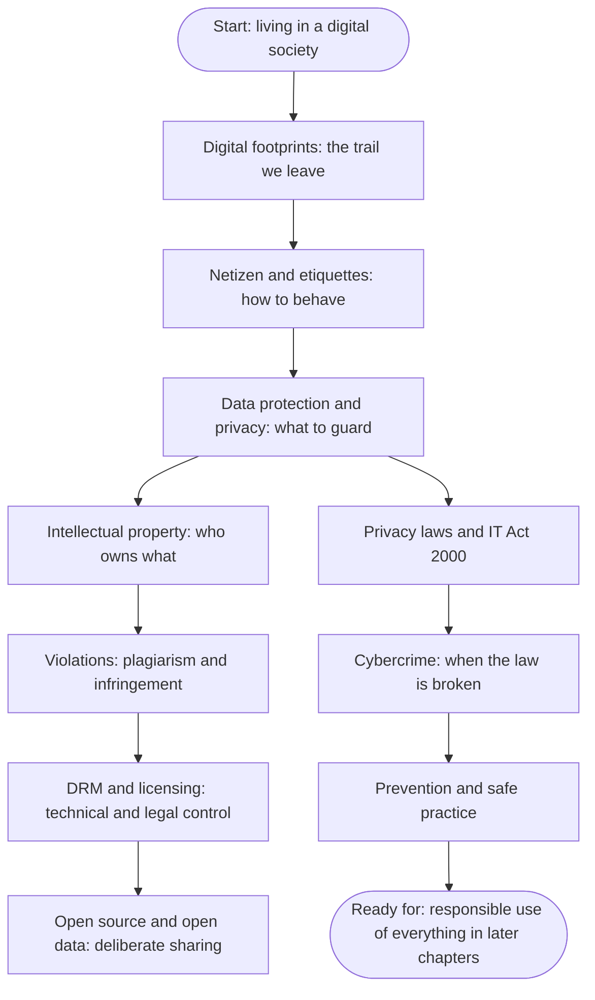
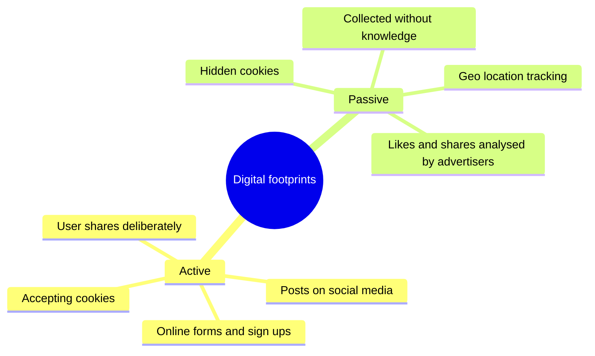
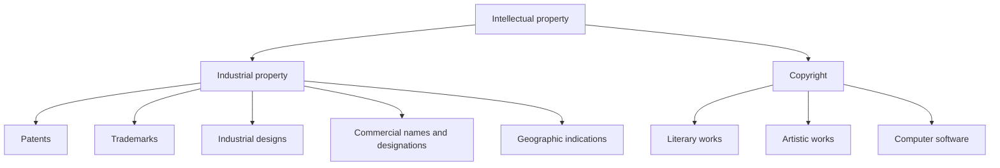
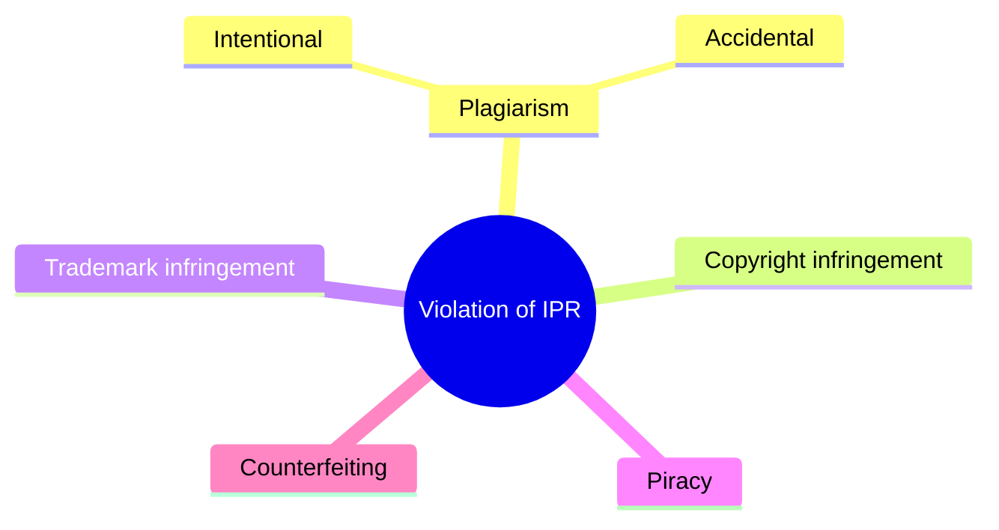
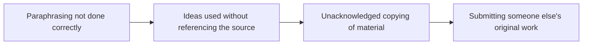
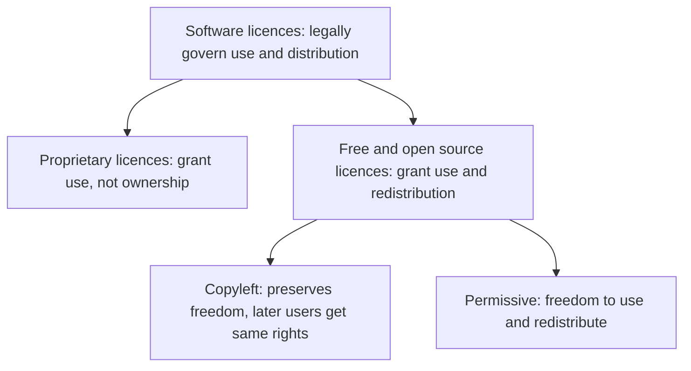
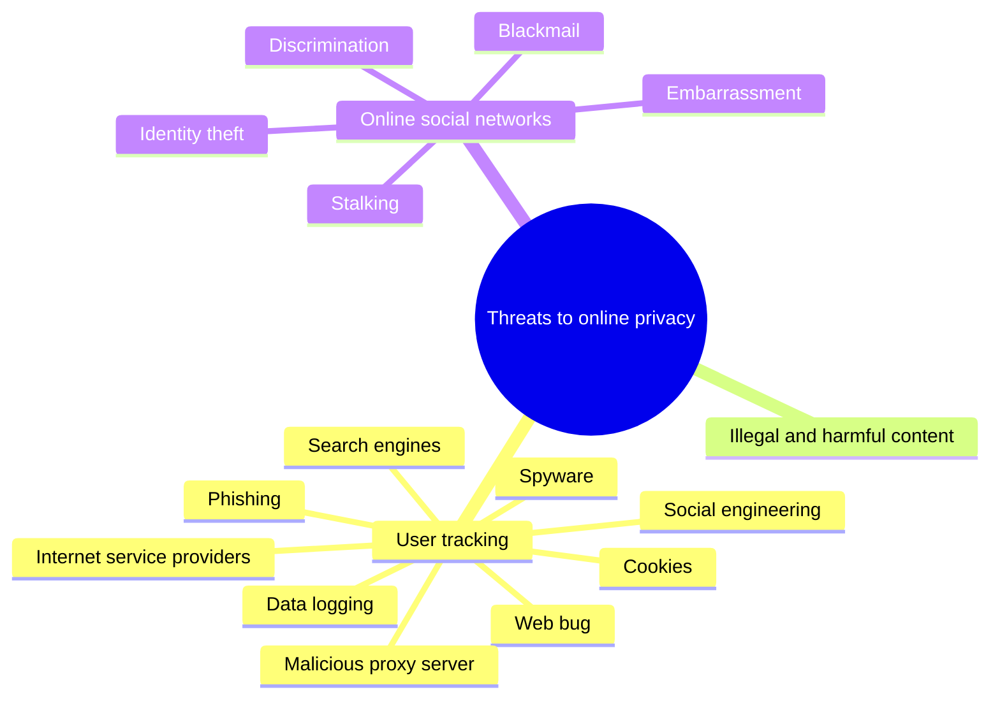
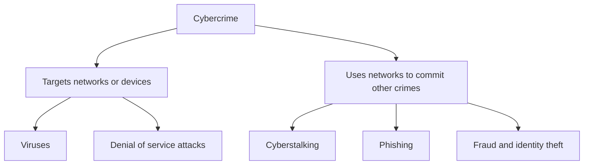

# Computer Science | Chapter 10 | Society, Law and Ethics | NOTES

**Branch:** Society, Law & Ethics — digital footprints, netiquette, data protection, intellectual property, licensing, privacy law, cybercrime
**Level:** Class XI · CBSE Board
**Python version assumed:** Python 3.x (this chapter contains no code; it is purely descriptive)

**Primary source:** *Computer Science with Python — XI*, Chapter "Society, Law and Ethics" (printed as Chapter 11 in that book, filed here as **CS10**). The section numbering `11.1`–`11.11` below is the book's own and is preserved exactly.
**Not supplied:** the NCERT chapter on the same theme (*Societal Impact*) was not provided, so nothing here is reconciled against it. Where the book is silent but its exercises assume the knowledge, the material is added in §11.12, clearly labelled as **beyond the chapter body**.
**Companion files:** `CS10-SOCIETY_LAW_AND_ETHICS-GLOSSARY.md` (term lookup) · `CS10-SOCIETY_LAW_AND_ETHICS-CNOTES.md` (same chapter, point-wise, for fast revision).

> [!note] Renderer check
> `mermaid` blocks render live in the current NoteBooks build. This chapter is descriptive, so no `svg`, `tikz` or `desmos` block is used — a diagram only appears where it genuinely classifies something.

> [!warning] Legal content: read the dates
> Penalties and section numbers below are quoted **as the book prints them**, then checked against the statute where they differ (Appendix A). Law changes; for an exam, write the book's version unless the question is clearly asking for the statute.

---

## Concept Roadmap

Read it top-down: the chapter starts with what you *leave behind* online, moves to how you *should behave*, then to what is *owned* and *protected*, and ends with what happens when protection fails — cybercrime — and how to prevent it.

---

## 11.1 Introduction ⭐

The digital world changes fast, and new communication technologies open up possibilities **and** expose you, and others, to risk. Many people struggle to judge those risks, especially when it comes to safe digital communication. Your data can be used or misused by governments, companies or other individuals — sometimes unintentionally.

**Information Technology (IT)** plays a central role in commerce, industry, government, education, entertainment and society at large. Like any technology it also has adverse effects. It raises ethical problems, which the book groups into **three main types of ethical issue**:

| # | Ethical issue |
| - | ------------- |
| 1 | **Personal privacy** |
| 2 | **Access right** |
| 3 | **Harmful actions** |

The chapter then covers how to protect yourself, your sources and your friends; which laws protect you online; and **computer ethics** — standards of conduct pertaining to computers, including how computing professionals should decide on professional and social conduct.

> **Key idea — computer ethics:** it describes the difference between *ethical* and *unethical* conduct with computers.
> *Example (book's own):* it is technically easy to duplicate copyrighted digital content, but computer ethics says doing so without the author's approval is wrong. It may be technically possible to access someone's personal information on a computer system, but computer ethics says that is unethical.

> [!note] Ethics is not the same as law
> Something can be *unethical without being illegal*, and the reverse. The book asks "relationship between ethics and law?" in its unsolved questions without answering it — see §11.12.1.

---

## 11.2 Digital Footprints ⭐⭐⭐

**Digital footprint** — the trail, traces or "footprints" people leave online while using smartphones, tablets, computers and similar devices. A footprint is recorded with *every* online activity: social-media interaction, chatting, online shopping, location check-ins.

**Analogy (with its limit):** a footprint on a beach is washed away with time; a digital footprint **stays and cannot be done away with**. Hence digital footprints are also called **digital tattoos**. The analogy holds for "leaves a mark others can follow" and fails on "fades away".

What a footprint can contain: websites visited, emails sent, any information shared online, plus the computer's **IP address**, location and other device-specific details. This data can be used for **targeted advertisements** or **misused or exploited**, so be cautious about what you write, upload, download or browse.

### 11.2.1 Active and passive footprints ⭐⭐⭐

| | **Active digital footprint** | **Passive digital footprint** |
| - | ---------------------------- | ----------------------------- |
| Created when | The user **intentionally** shares personal information | Information is collected **without the user's knowledge** |
| Examples (book) | (a) Sharing personal information on Facebook, Instagram, Twitter and other social platforms · (b) Filling online forms, e.g. signing up for or logging into mail accounts to send or receive messages · (c) Accidentally or intentionally accepting cookies when the browser prompts | (a) Websites installing cookies on your device without disclosing it · (b) Apps and websites using geo-location to detect where you are · (c) Social media, news channels and advertisers using your comments, likes and shares to profile your interests and send matching ads |
| Discriminator | *You chose to give it* | *It was taken without you noticing* |

> [!warning] ⚠️ Accepting a cookie is *active*; a hidden cookie is *passive*
> The same object (a cookie) lands in both columns. What decides it is **whether you were told and agreed**.

### 11.2.2 Why you cannot fully erase a footprint

- Besides the browser, most footprints are stored on the **servers** where the application is hosted.
- You may have **no access to remove** that data and **no control over how it is used**.
- Therefore, even if you later erase your own record of an activity, the footprint **still remains**.
- There is **no guarantee** it will ever be fully eliminated from the internet.
- Online activity leaves traces on the internet *and* on your own device — usable to trace the **user, location, device and usage details**.

> [!note] A balanced reading
> The book says footprints "cannot be done away with". Read that as *you cannot rely on removal*, not as a technical absolute — which is why the practical rule is to think **before** you post, not after.

---

## 11.3 Digital Society and Netizen ⭐⭐

We live in a **digital society** — every aspect of life is profoundly affected by the digitalisation of data: shopping, education, social networking, entertainment, health care, paying bills.

**Netizen** is a contraction of **internet + citizen**. It refers both to a person who uses the internet to participate in society *and* to an individual who has accepted the responsibility of using it in **productive and socially responsible** ways. A responsible netizen respects everyone using the internet and follows **net etiquettes, communication etiquettes and social media etiquettes**.

### 11.3.1 Netiquettes ⭐⭐⭐

**Netiquette** = "internet etiquette" — a code of good behaviour on the internet, just as etiquette is a code of polite behaviour in society. It applies to social media, email, online chat, web forums, website comments, multiplayer gaming and other online communication. The core idea: **respect others online**.

| **Do's** | **Don'ts** |
| -------- | ---------- |
| Keep messages and posts brief | Don't post inflammatory or offensive comments |
| Reread posts/emails to make sure they say what you intend | Don't write in ALL CAPS — it is read as **shouting** |
| Remember you leave a digital footprint; be careful what you write | Don't respond to internet trolls or personal attacks |
| Use discretion | Avoid posting private or embarrassing images or comments |
| Include a subject line in an email | Don't use sarcasm — it can be misinterpreted |
| Protect personal information | Don't violate copyright; make sure your work is your own or properly cited |
| Obey copyright laws | Don't exclude people or talk behind their backs |
| Stay focused and stick to the topic | Don't **spam** — mass unsolicited email |

> **Spam** (from the book's last "Don't" and objective Q3(h)): **unsolicited commercial email**, sent in large numbers.

### 11.3.2 Communication etiquettes ⭐⭐

These apply to email, texting, instant messaging, phone calls, audio/video conferencing and posting on forums or social networking sites. Three rules:

| Rule | What it means |
| ---- | ------------- |
| **Be Precise** | Respect the other person's time; avoid forwarding or replying with useless messages; **do not expect an instant reply**; avoid large attachments — if needed, share a **cloud-storage link** (Google Drive, OneDrive, Dropbox) |
| **Be Polite** | Be polite whether or not you agree; reply without aggression or abuse |
| **Be Credible** | Sound credible when commenting on a forum; before commenting *on somebody*, read their previous comments and judge their credibility |

### 11.3.3 Social media etiquettes ⭐⭐

**Social media** — websites or applications that let users take part in social networking by creating and sharing content with a community. The book's examples: Facebook, Google+, Twitter, Instagram, Pinterest, YouTube. Its impact has begun to shape politics, business, culture and education.

| Group | Rule | Detail |
| ----- | ---- | ------ |
| **(a) Be Secure** | Choose passwords wisely | Data-breach news often makes headlines; at minimum use a **strong password**, **change it frequently**, never share username/password |
| | Know who you befriend | Sites encourage connecting with people you've never met; be careful — intentions may be **malicious** |
| | Beware of fake information | Fake news, messages and posts are common; apply your knowledge and experience to **validate** before believing |
| **(b) Be Reliable** | Think before uploading | Anything you upload stays on the **remote server even after you delete the file**; be careful with sensitive or confidential files that affect your privacy |

---

## 11.4 Data Protection ⭐⭐⭐

**Data protection** — the practices, safeguards and binding rules that protect our personal information and keep it safe online. In short, we should be able to decide **what** information is shared, **who** has access, **for how long**, **for what reason**, and **whether rights to modify it are given**.

**Sensitive data** — elements of data that can cause substantial **harm, embarrassment, inconvenience or unfairness** to an individual if breached or compromised. Examples: **biometric information, health information, financial information**, other personal documents, images, audios or videos.

Privacy of sensitive data is implemented by **encryption, authentication** and other secure methods, so that only the **authorised user** can access it and only for a **legitimate purpose**.

**Consequences of unprotected data or a data breach (six, as printed):**

1. Physical data loss
2. Attack by a virus, worm or malicious code
3. Being targeted by hackers
4. **DDoS** (Distributed Denial of Service) attacks
5. Loss of money
6. Intellectual property at risk

**Seven ways to protect data (as printed):**

| # | Measure |
| - | ------- |
| 1 | Use **data encryption** |
| 2 | Don't share private information — passwords, credit-card credentials |
| 3 | Don't **overshare** on social networking sites in the public domain |
| 4 | Adopt a complete security mechanism against possible threats |
| 5 | Avoid opening **phishing** emails |
| 6 | Be careful with **Wi-Fi** connections |
| 7 | Be alert to **impersonators** |

---

## 11.5 Intellectual Property Rights ⭐⭐⭐

**Property** generally means a possession, specifically something in which the owner has legal rights. **Intellectual property (IP)** refers to **creations of the intellect** (hence the name): inventions, literary and artistic works, symbols, names, images and designs used in commerce.

**Intellectual Property Rights (IPR)** — specific legal rights that let the owner **completely benefit** from their creation **for a certain period**, prevent others from using or dealing with it without prior permission, and force them to stop and **compensate for damages**.

IP is usually divided into **two branches**: **industrial property** (broadly protects inventions) and **copyright** (protects literary and artistic works).

### (a) Industrial property ⭐⭐

Includes inventions (**patents**), **trademarks**, **industrial designs**, commercial names, designations and **geographic indications** (location-specific brands).

**Patent**
- Usually granted for **inventions**.
- Unlike copyright, the inventor must **apply (file)** for it.
- The owner gets an **exclusive right** to prevent others from using, selling or distributing the invention, and decides whether or how others may use it.
- It encourages inventors to share their scientific or technological findings.
- **Term in India: 20 years from the date of filing**; after that the invention can be freely used.

**Trademark**
- Any visual **symbol, word, name, design, slogan, label** etc. that distinguishes one brand or commercial enterprise from others.
- *Example (book):* no company other than Reebok can use the Reebok brand to sell shoes or clothes.
- Also blocks **confusingly similar** marks, e.g. "Reebokk".
- A trademark may still be obtainable for **unrelated goods** — e.g. a Reebok trademark for textbooks.

### (b) Copyright ⭐⭐⭐

**Copyright** covers literary and artistic works: novels, poems, plays, films, musical works; drawings, paintings, photographs, sculptures, architectural designs; and **computer software**. It is a legal concept, enacted by most governments, giving the **creator of an original work exclusive rights** to it, usually for a **limited period**.

The rights include:

| Right | Meaning |
| ----- | ------- |
| Reproduce | Make copies of the work |
| Derivative works | Create works based on it |
| Distribute | Distribute copies to the public |
| Display / perform | Publicly display or perform the work |

It prevents others from **copying, using or selling** the work, and whatever the author created cannot be used or published by anyone else without the author's consent.

> [!warning] ⚠️ Copyright protects *expression*, not *ideas*
> Unlike patents (which protect the invention itself), copyright law protects **only the form of expression** of ideas — not the ideas themselves.

| | **Patent** | **Copyright** | **Trademark** |
| - | ---------- | ------------- | ------------- |
| Protects | An **invention** | Original **creative work** — literary, artistic, software | A **brand identifier** — name, symbol, slogan |
| How obtained | Must **apply / file** | Arises with the work (book contrasts: patent *needs* filing, copyright *doesn't*) | Applied for (to stop confusing marks) |
| Term (book) | **20 years in India** from filing | "A limited period" (no figure given) | (no figure given) |
| Branch | Industrial property | Copyright | Industrial property |

---

## 11.6 Violation of IPR ⭐⭐⭐

**IP infringement** — any violation or breach of protected IP rights. It ranges from **piracy** (unauthorised use, copying, reproduction or distribution of protected material) to **counterfeiting** (replicating genuine goods with the intent to mislead the recipient).

### 11.6.1 Plagiarism ⭐⭐⭐

**Plagiarism** — copying someone else's work and passing it off as your own. It is **morally bad** because it is an act of stealing: copying information and **not giving the author credit**. Copying programs written by other programmers and claiming them as yours is plagiarism. It involves lying, cheating, theft and dishonesty.

| | **Intentional / deliberate** | **Unintentional / accidental** |
| - | ---------------------------- | ------------------------------ |
| What | Copying someone's work; cutting and pasting text or media (audio, video, movie clips) from electronic sources **without documenting**, and publishing it on the web without the creators' permission | **Careless paraphrasing** (changing words or sentence construction of a copied text), **excessive quoting**, and **poor documentation** |
| Seriousness | May have **serious implications** | Usually **less serious** |

**Severity scale (book's figure 11.2), minor → extremely serious:**

The left end is *Minor*; the right end is *Extremely Serious*.

**How to avoid plagiarism (seven measures, as printed):**

1. Use your own words and ideas.
2. Always reference or give credit to the source of your information.
3. If you must use someone's exact words, put them **in quotes** and give credit with **in-text citations**.
4. Where possible, cite the source with **page number**.
5. Cite the website name, URL or author names — and acknowledge them even if you rearranged sentences and changed some words.
6. Take notes as **bullet points in your own words**, not whole copied sentences.
7. Use **online plagiarism-checking tools**.

### 11.6.2 Copyright infringement ⭐⭐

**Copyright infringement** — the **use or production of copyrighted material without the permission of the copyright holder**. Book examples:

- Downloading an image from the internet and using it in your project
- Recording a film in a movie theatre
- Using copyrighted images on your website
- Modifying an image and then displaying it on your company's website
- Downloading music or films without paying for them
- Copying any literary or artistic work without a licence or written agreement

> [!warning] ⚠️ Plagiarism and copyright infringement overlap but are not the same
> **Plagiarism** is an *honesty* wrong — passing off work as your own, even when the work might be unprotected or you have permission to use it. **Copyright infringement** is a *legal* wrong — using protected work without permission, even if you openly credit the author. One act can be both (e.g. Worked Example 10-1). Asked as a difference in unsolved Q38(b).

### 11.6.3 Trademark infringement ⭐

**Trademark infringement** — the **unauthorised use of a trademark or service mark** on or in connection with goods or services **in a manner likely to cause confusion, deception or mistake** about the source of the goods or services. Trademark owners can take **legal action**.

> [!example]
> ### Worked Example 10-1 — Which wrong is it? (Case-based Q1, Supplementary book)
>
> **Given.** Ahaana is absent. Her classmate Sabhya downloads a 2-minute clip from the internet explaining Python dictionaries, uses a video editor to add the text "Prepared by Sabhya", and emails it to her. Options: (a) fair use (b) hacking (c) copyright infringement (d) cybercrime.
> **Find.** The category of Sabhya's act.
> **Concept.** Test two questions in order: (1) Did he use someone else's protected work **without permission**? (2) Did he **claim it as his own**?
> **Work.**
> 1. The clip was created by someone else and Sabhya had no permission → **copyright infringement**.
> 2. Adding "Prepared by Sabhya" claims authorship → it is **also plagiarism** (§11.6.1).
> 3. Not (a): he did not stay within fair use. Not (b): nothing was broken into.
> **Check.** The book's key is **(c) copyright infringement**. Writing "and plagiarism, because he took credit" shows the second layer, and is the sort of reason that earns the mark.

---

## 11.7 Digital Rights Management (DRM) ⭐⭐

**Digital Rights Management (DRM)** — **access-control technologies** used by hardware manufacturers, publishers, copyright holders and individuals to **limit the use of digital content and devices**. It describes any technology that inhibits uses of digital content that the content provider does not want or intend.

- It controls use of digital media by preventing **access, copying or conversion to other formats** by end users.
- When you try to save or copy protected content, you typically get an **error** showing the restriction (book's Fig. 11.3(a): "Sorry, this file is read-only").
- In essence, DRM **removes usage control from the person holding the content and gives it to a computer program**.
- Most commonly used by the **entertainment industry** (film, recording). Many online music stores (e.g. Apple's iTunes Store) and many **e-book publishers** use DRM.

**DRM restrictions vs system-based restrictions (book's Fig. 11.3(b)):**

| | **DRM-technology-based** | **System-based** |
| - | ------------------------ | ---------------- |
| Restriction stays with the data? | **Yes** — remains attached while migrating, moving, saving, copying | **No** — records and information can be migrated, moved, saved, copied |
| Portability of data | Cannot be saved even to another location | **Portable** — can be copied to a different location than its destination computer |
| Strength | Stronger and wider; contributes to data privacy and security | Weaker |

**An organisation that intends to use DRM-based data should consider:** Intellectual Property rights, Copyright, Payment mechanisms, Security, E-commerce and ERP systems, and — most important — **Licensing**.

> [!warning] ⚠️ A tension inside the book
> DRM "protects the rights of digital media producers **while enabling access to fair use**" (the book's closing line) — yet two paragraphs earlier it says DRM lets publishers **prevent lawful, fair use**, and even restrict **non-copyrighted** works. Both statements are in the text. Write the book's definition, and you may add the criticism as the honest limitation: DRM protects producers but can over-restrict lawful use.

---

## 11.8 Licensing ⭐⭐⭐

**Software licensing** — the **legal right to run**, or the privilege given by a company, to access their application (or program).

*Everyday example (book's Fig. 11.4):* buying a licence for proprietary software such as **Windows OS** to install it. The system screen shows it as a **copyright of Microsoft** — a licensed product that must be legally purchased, accompanied by a **licensing agreement** you read (via "Read the Microsoft Software License Terms") and agree to for successful installation and use.

A **licensing agreement governs the use of licensed software**. It typically allows the software to run on a **limited number of computers**, and allows copies to be made **only for backup purposes**.

**Advantages of using licensed software (two, as printed):**

1. You **contribute to the further development** of the program, and help the economy create computer-related jobs and opportunities for other businesses.
2. Apart from the legal obligation, it comes with **outright support** not found in **pirated** software.

Licences give rules and guidelines for others to use your work. Software licences are classified on the basis of how they may be used:

### 11.8.1 Proprietary licences ⭐⭐

- **Exclusive rights** stay with the **owner / developer / publisher**.
- They reserve all freedoms to use and distribute.
- **Violating a proprietary licence amounts to copyright infringement.**
- They **restrict inspection, modification of source code and further distribution**.
- **Freeware** (no-cost software) can still be distributed under a proprietary licence.
- Most commercially available software is covered by proprietary licences.

### 11.8.2 Free and Open Source licences ⭐⭐⭐

- **Free and Open Source Licence** — software users can safely **run, adapt and redistribute without legal restraint**; emphasises **freedom**.
- **Open source software (OSS)** — source code is **publicly available** under a licence giving users the right to **study, change and distribute** it; emphasises **security, cost-saving and transparency**.
- **FOSS** allows using, copying, studying and modifying the software, with source code openly shared so people are encouraged to voluntarily improve it.
- **CTM (the book's "Commit To Memory"):** OSS refers to freedom to use, share and/or modify the source code, and to allow copyrights to other users.

OSS licences are further divided:

| | **Permissive** | **Copyleft** |
| - | -------------- | ------------ |
| Idea | Royalty-free licence to do **virtually anything** with the source code | Source code **has to be provided**; **distribution and modification** of source code permitted; later users keep the same rights |
| Permits | Using, copying, modifying, merging, publishing, distributing, sublicensing and/or **selling** | Using, copying, modifying, distributing — **under the same freedoms** |
| Book's examples | **Apache, W3C** | **GPL, Creative Commons, LGPL, MPL** |

> [!warning] ⚠️ Two claims in the book's paragraph need care (Appendix A #3 and #4)
> (i) The book says permissive distribution "can only be made **without** the source code". As worded that is misleading — permissive licences **do not require** you to release source; they don't forbid it. (ii) Creative Commons is listed under copyleft, but only the **ShareAlike** variant behaves like copyleft. Write the book's grouping for the board; know the nuance.

**GPL (General Public Licence) — three characteristics:**

| Feature | Meaning |
| ------- | ------- |
| **Copying** | **No limit** — copy it on your server, a client's server, local workstations, as many times as you want |
| **Distribution** | Any form — thumb/hard drive, download link on your site, or print the code on paper |
| **Charge a fee** | You *may* charge for the software, but give the buyer a copy of the **GNU GPL**, which tells them they can get it free elsewhere (and lets you explain why you charge) |

**CC (Creative Commons) licence — four basic parts:**

| # | Part | Meaning |
| - | ---- | ------- |
| 1 | **Accreditation** | Author must be **acknowledged** as creator; the work may then be modified, distributed, copied and used otherwise |
| 2 | **Shared with CC** | Work can be modified and distributed, but **only under a CC licence** |
| 3 | **Non-commercial** | Can be modified and distributed, but **not for commercial purposes** ("commercial" is vague — no firm definition exists) |
| 4 | **No Derivative Works** | You can copy and distribute it, but **cannot modify it** or create work based on it |

**Apache licence — four salient features:**

| # | Feature | Meaning |
| - | ------- | ------- |
| 1 | **Rights are never-ending** | Once granted, use them forever; no renewal |
| 2 | **Worldwide authority** | Rights granted in one country are **automatically** treated as granted to all |
| 3 | **No fee or royalty** | No charge — not upfront, per usage, or otherwise |
| 4 | **Rights are irrevocable** | No one can later say your derivative can't be used. *Exception:* if you **sue someone for patent infringement** over anything under the licence, **your own licence is terminated** — but only for patented work |

> [!warning] ⚠️ "GPL code cannot be used for paid and proprietary software" — read it precisely
> The book's Memory Byte says this, yet its own GPL section says you **can charge a fee**. Reconcile: GPL code **can be sold**, but a work built on it must stay **GPL** (so it cannot become closed, proprietary software). "Paid" is allowed; "proprietary" is not.

> [!example]
> ### Worked Example 10-2 — Choosing a licence (New)
>
> **Given.** Three people want to release their work: (A) a student who wants others to freely use *and improve* her program, and for any improved version to stay free; (B) a company that wants anyone to use its library, even inside closed commercial products, with no paperwork; (C) a photographer who wants his pictures shared but never edited.
> **Find.** A fitting licence family for each.
> **Concept.** Ask: must later users keep the *same* freedoms (copyleft)? Or may they do anything (permissive)? Or are modifications to be blocked (CC No Derivatives)?
> **Work.**
> 1. A → **copyleft** (e.g. GPL, or CC ShareAlike): improved versions must carry the same rights.
> 2. B → **permissive** (e.g. Apache): use freely, including in proprietary products.
> 3. C → **CC No Derivative Works** (with Accreditation): copy and distribute allowed, modification not.
> **Check.** Each answer follows the one deciding question — *what may a later user do with my work?* — rather than a memorised licence name.

---

## 11.9 Open Source and Open Data ⭐⭐

**Open source software** gives the freedom to work with, use, distribute and modify the source code (§11.8.2). Running parallel to it is **Open Data**.

**Open data** — all stored data that could be made accessible **in public interest without any restrictions on its usage and distribution**.

**Three features of open data (book's Fig. 11.5(a)):**

| Feature | Requirement |
| ------- | ----------- |
| **Availability and Access** | Available **as a whole**, at **no more than a reasonable reproduction cost**, preferably **downloadable** from the internet, in a **convenient and modifiable form** |
| **Reuse and Redistribution** | Provided under terms that permit **reuse and redistribution**, including **intermixing with other datasets** |
| **Universal Participation** | **Everyone** must be able to use, reuse and redistribute — no discrimination against fields of endeavour or persons or groups. *Example:* "non-commercial" restrictions, or "use only in education", are **not allowed** |

The figure also names the values behind open data: participation, opportunity, empowerment, transparency, no restrictions, availability, access, digital convenience.

**Applications of open data (book's Fig. 11.5(b))** — a **smart-city hub** drawing on open data for: **smart parking, smart waste management, smart street light, smart public transportation, citizen reporting** (with real-time and static data storage and links to other smart-city hubs).

> **Open data and accountability (Solved Q21):** open data makes existing information easier to **analyse, process and combine**, allowing a new level of **public scrutiny** and helping citizens engage with government and "add value to that data".

---

## 11.10 Privacy Laws ⭐⭐⭐

**Privacy** — the ability to **control what information one reveals about oneself over the internet**, and to **control who can access** it.

### 11.10.1 Threats to privacy

| Threat | Detail |
| ------ | ------ |
| **User tracking** | Done through: **ISPs** (can observe any internet activity) · **cookies** (parcels of text sent by a server, tracking and maintaining user-specific information) · **data logging** (recording times the computer is in use or sites visited) · **spyware** · **web bug** · **social engineering** · **phishing** · **malicious proxy server** · **search engines** |
| **Illegal and harmful content** | Needs to be fought with **legal tools** |
| **Online social networks** | Risks range from **identity theft** to online and physical **stalking**, embarrassment, discrimination and **blackmailing** |

**Privacy laws** — laws that regulate the **storing, regulating and using of personally identifiable information** about individuals, which can be collected by governments, public or private organisations, or other individuals. They are considered within the context of an individual's **privacy rights** or **reasonable expectation of privacy**. They prohibit disclosure or misuse of information about private individuals.

> **Privacy of data (Solved Q1):** the ethical and legal rights individuals have to control the use of their personal information. A key factor is **consumer consent** (objective Q2(b), True).

### 11.10.2 The Information Technology Act, 2000 and privacy ⭐⭐⭐

The IT Act, 2000 has **two sections** about privacy:

| Section | What it provides |
| ------- | ---------------- |
| **43A** | Implementation of **reasonable security practices** for **sensitive personal data or information**; provides **compensation** to a person affected by wrongful loss or wrongful gain |
| **72A** | **Imprisonment up to 3 years and/or fine up to ₹5,00,000** for a person who causes wrongful loss or wrongful gain by **disclosing personal information about another person** while providing services under a lawful contract |

Other IT Act provisions (as the book lists):
- Permit **interception, monitoring and decryption** of digital communication.
- Provide for collection and monitoring of **traffic data**.
- Allow the government to set a **national encryption standard**.
- Government of India measures named: **Central Monitoring System (CMS)**, **NATGRID**, and **phone and internet interception** by police.

> [!note] Section 43A is on its way out
> Section 43A is still in force as the book describes. The **Digital Personal Data Protection Act, 2023** provides (in its Section 44(2)) for 43A to be **omitted**; per the government's commencement notification that omission takes effect **13 May 2027**. Write the book's version for the exam; see §11.12.9.

---

## 11.11 Cybercrime ⭐⭐⭐

**Cybercrime** — a crime in which a **computer is the object of the crime** (hacking, phishing, spamming) **or is used as a tool** to commit an offence (child pornography, hate crimes, etc.).

- Carried out against an **individual, a group, an organisation or even a country**.
- Intent: directly or indirectly cause **physical harm, financial loss or mental harassment**.
- A cybercriminal attacks a computer or network to reach other computers and **disable or damage data or services**.
- Cybercriminals may access personal information or business trade secrets, or use the internet for exploitative or malicious purposes; criminals may also use computers for communication and document or data storage.
- Criminals who do this are "often referred to as **hackers**" (book) — but see §11.11.1 for the distinction.
- Common types: **online banking information theft, identity theft, online predatory crimes, unauthorised computer access**; more serious: **cyber terrorism**.

**Two categories:**

| Category | Includes |
| -------- | -------- |
| **1. Crimes that target computer networks or devices** | Viruses, **denial-of-service (DoS)** attacks |
| **2. Crimes that use computer networks to advance other criminal activities** | **Cyberstalking, phishing, fraud or identity theft** |

### 11.11.1 Hacking ⭐⭐⭐

**Hacking** — an act of **unauthorised access** to a computer, computer network or any digital system. Hackers usually have technical expertise in hardware and software; they look for **bugs to exploit** and break in.

| | **Ethical hacker (white hat)** | **Non-ethical hacker (black hat / cracker)** |
| - | ------------------------------ | -------------------------------------------- |
| Intent | **Positive** | Gain unauthorised access to steal sensitive data, damage or **bring down systems** |
| What they do | Explore vulnerabilities or loopholes during **testing of software**; may exploit a website to find weaknesses, then **report to the owner** | Focus on **security cracking and data stealing** — for identity theft, monetary gain, bringing a rival site down, leaking sensitive information |
| Effect | Improves security; **prepares the owner against cyber attack** | Illegal and malicious |

> **Eavesdropping attack** (also *sniffing* or *snooping*): a hacker **intercepts, deletes or modifies data** transmitted between two devices. It relies on **unsecured network communications** and typically happens when a user connects to a network whose traffic is **not secured or encrypted**.

### 11.11.2 Phishing / fraud emails ⭐⭐⭐

**Phishing** — an attempt to acquire sensitive information (**usernames, passwords, credit-card details**, sometimes indirectly money) by **masquerading as a trustworthy entity** in an electronic communication. It is an **unlawful** activity where **fake websites or emails that look authentic** are presented to the user.

- Typically carried out by **email spoofing** or **instant messaging**.
- It directs users to enter personal information on a **fake website** whose look and feel are identical to the real one — the **only difference being the URL**.
- Messages purporting to come from social websites, auction sites, banks, online payment processors or IT administrators are often used to lure victims; they may carry **links to sites that distribute malware**.

**Protective measures (six, as printed):**

1. Never open or download a file from an **unsolicited email**, even from someone you know — **call or email them to check** it really came from them.
2. Keep the **operating system updated**.
3. Use a reputable **antivirus** program.
4. Enable **two-factor authentication** whenever available.
5. **Confirm the authenticity** of a website before entering login credentials, or look for a reputable **security trust mark**.
6. Look for **HTTPS** in the address bar before entering sensitive personal information — it indicates data will be **encrypted**.

**What a phishing email looks like (Solved Q16):** appears to come from a financial institution, large company, chain store, social network or government agency; **mimics colours, logos, fonts and layout**; includes a link to a **legitimate-looking but phony page**; uses phrases like "Verify your account" or "Your account will be closed"; promises lottery winnings or prizes if you **pay money upfront**. *A legitimate business never asks for such personal information by email.*

**If you already responded (Solved Q17):** immediately **change your password**; **notify the fraud department** of the institution that was mimicked; review your credit reports for unfamiliar accounts; consider a **security freeze** on each report, so no new credit can be extended without your approval.

> [!example]
> ### Worked Example 10-3 — Identify the crime (Case-based Q3, Supplementary book)
>
> **Given.** Ravi receives an email "from First Generic Bank" asking him to verify his account within 48 hours, with a link. The link opens an official-looking site, where he uploads important information.
> **Find.** The cybercrime and why.
> **Concept.** Look for the four phishing markers: *fake sender identity*, *urgency or threat*, *a link to a look-alike site*, *request for sensitive data*. The look-alike page's **URL** is the one thing that differs.
> **Work.**
> 1. Fake sender posing as a bank → **spoofing** (impersonation).
> 2. Threat ("not able to use your account for 30 days") → pressure tactic.
> 3. Link to an imitation website to collect information → **phishing**, a form of spoofing.
> **Check.** Book's key: **phishing**. In the book's figure the link reads `http://www.firstgenericbank.com.account-updateinfo.com`. The real domain is the part just before the first single `/` — here `account-updateinfo.com`, not `firstgenericbank.com` — and the link is `http`, not `https`. Ravi should have typed the bank's own address himself (Solved Q7).

### 11.11.3 Ransomware ⭐⭐

**Ransomware** — **malicious software that infects your computer and displays messages demanding a fee** to give you access to your system again.
- A **criminal money-making scheme**.
- Installed through **deceptive links** in an email, instant message or website.
- Can **lock the computer screen** or **encrypt important, predetermined files** with a password.
- Uses **scare tactics** or intimidation to trick victims into paying.
- May appear as **fake antivirus software**: a message suddenly claims your computer has various issues and that an online payment is needed to fix them.

### 11.11.4 Illegal downloading ⭐⭐

**Illegal downloading** — obtaining files from the internet that **you do not have the right to use**. It is the **root cause of digital piracy**.

**Digital piracy** — illegally sharing copyrighted media such as games, music, movies, TV shows and software.
- It does **not matter** whether you *upload* to share without permission or *download* for free or at a bargain price — anyone involved is treated as a **law-breaker**.
- *Example (book):* belonging to a website that shares music files without the labels' permission = piracy, **even if you paid the site a fee**. Free or very cheap movies and TV shows are usually illegal copies.
- To avoid it, obtain media from **reputed dealers who have the rights to sell it**.
- Consequences: heavy losses to developers/producers, and **punishment or fine** for the downloader.

> **Link (Solved Q25):** illegal downloads violate copyright law (downloading without properly purchasing or without the holder's permission) → hence **illegal downloads result in digital piracy**.

### 11.11.5 Child pornography ⭐

**Child pornography** (the book's term) — **publishing and transmitting obscene material about children in electronic form**. The book calls it the **most heinous crime**; easy internet access has increased it, and it has led to other crimes such as sex tourism and sexual abuse of children.

**Penalties as the book prints them:**

| Conviction | Imprisonment | Fine |
| ---------- | ------------ | ---- |
| **1st** | **2 to 5 years** | **₹1 lakh** |
| **2nd or subsequent** | **up to 7–10 years** | up to **₹10 lakh** |

> [!warning] ⚠️ The printed figures differ from the statute (Appendix A #1)
> The IT Act, 2000 **Section 67B** provides, on first conviction, imprisonment up to **5 years** and fine up to **₹10 lakh**; on second or subsequent conviction, up to **7 years** and fine up to **₹10 lakh**. **For the board exam, write the book's figures if the question comes from this book; know that the statute reads differently.**
> Also note: modern legal usage increasingly prefers **child sexual abuse material (CSAM)** to "child pornography", because the material is evidence of abuse. The book's term is used here only because the exam does.

Further book points: child-pornography laws give **severe penalties for producers and distributors** in almost all Western societies, with shorter sentences for non-commercial distribution; possession convictions usually carry prison, but sentences are often converted to **probation for first-time offenders** (this describes Western practice, not India).

### 11.11.6 Cyber scams and frauds ⭐⭐⭐

**Internet fraud** — any scheme that uses one or more components of the internet (**chat rooms, email, message boards, websites**) to present fraudulent solicitations to prospective victims, conduct fraudulent transactions, or transmit the proceeds of fraud to financial institutions or others connected with the scheme.

| Fraud | What happens |
| ----- | ------------ |
| **Credit / debit card fraud** | Use of a card to obtain money or property **without authorisation**; fraudsters get card numbers from **unsecured web media** |
| **Non-delivery of goods/service fraud** | People pay for goods/services through a web portal and **nothing is delivered** |
| **Spoofing / phishing scam** | **Spoofing** — a fraudster **masquerades as another person**, using their identity to transact business and get bank-account/card numbers and passwords. **Phishing** — a form of spoofing where an entity's **web page is duplicated** and positioned with a URL to lure people into divulging financial information |
| **Identity theft** | Using another person's **personal information without consent** for fraud — name, login details, etc. — and **posing as that person online**; information may be leaked online or stolen during web surfing |
| **Auction fraud** | People pay in an online auction and the fraudster sends a **lower-standard item or a counterfeit** |

> **Identity theft (Memory Byte):** occurs when someone, **without your knowledge**, acquires a piece of your personal information and uses it to commit fraud.
> **Using someone else's Twitter handle to post** (objective Q3(a)) is **identity theft**.

> [!example]
> ### Worked Example 10-4 — Classify the scenario (Solved Q5, Q10 and Unsolved Q42, Supplementary book)
>
> **Given.** (1) Malini steals a credit card and buys a laptop with it. (2) Theft of a sealed laptop; unauthorised money transfer from a bank account; unauthorised modification of a company's data; photocopying a printed report — which are cybercrimes? (3) Rajni emails a downloaded presentation to Shreya after renaming it "made by Rajni".
> **Find.** The category of each.
> **Concept.** Ask: *is a computer the target or the tool?* If yes, it is cybercrime; if the crime is only about a physical object or a paper, it is not.
> **Work.**
> 1. Malini → **fraud** (credit/debit card fraud; the card is used without authorisation).
> 2. Sealed laptop theft → ordinary **theft** (a physical object). Unauthorised bank transaction → **cybercrime** (computer used as the tool). Unauthorised modification of data → **cybercrime** (data is the target). Photocopying a printed report → **not** cybercrime (no computer). Book's key: **(2) and (3)**.
> 3. Rajni → **plagiarism** (passing off someone else's work as her own), and also copyright infringement if the original was protected.
> **Check.** In each case the deciding fact was *role of the computer*, not *money or harm* — a laptop theft is just as costly, but it is not a cybercrime.

### 11.11.7 Preventing cybercrime ⭐⭐⭐

Twelve precautions, as printed — group them to remember:

| Group | Precautions |
| ----- | ----------- |
| **Keep systems healthy** | 1. Keep the system **up to date** and take **regular backups** · 3. Update **antivirus** regularly · 12. Adjust **browser settings** (may limit some functionality but gives best protection from malicious content) |
| **Guard identity and passwords** | 2. Manage **social media privacy settings** · 4. Strong password (**letters, numbers, symbols, special characters**), changed periodically, **not the same on all sites** · 6. On someone else's computer, don't let the browser **save passwords or autofill**; use a **private window** |
| **Browse and transact safely** | 5. Check **HTTPS or lock symbol** before downloading · 7. For an unknown site, **refuse cookies** when asked · 8. Do online transactions only on **well-known, secure sites** |
| **Network and downloads** | 9. Secure **home wireless** with a strong password and change it regularly · 10. Don't download songs, videos or software from **untrusted sites** — hidden **ransomware or Trojan** · 11. Never download attachments from **suspicious emails** |

---

## 11.12 Topics the exercises assume — beyond the chapter body ⭐⭐

> [!warning] Read this before you trust it
> The book's **Solved**, **Unsolved** and **Memory Bytes** sections ask about things its chapter body never explains. What follows is **standard material added from general knowledge**, not from the book. It is labelled so you know which parts are the book's own. Indian legal details were checked against current statute text; they are accurate for the date of writing but laws change.

### 11.12.1 Ethics versus law (Unsolved Q16–18)

| | **Ethics** | **Law** |
| - | ---------- | ------- |
| Source | Shared **moral principles** of a community or profession | Rules made by the **state** |
| Enforced by | Conscience, social pressure, professional codes | **Courts and penalties** |
| Overlap | Many laws codify ethics | Some legal acts remain unethical |
| Example | Copying a friend's project and presenting it as yours — wrong even if no one sues | Copyright infringement — punishable |

A short answer: **law says what you must or must not do; ethics says what you should or should not do.** Something can be legal and still unethical.

### 11.12.2 The malware family (Unsolved Q26–32) ⭐⭐

**Malware** is the umbrella term for **malicious software** made to damage, disrupt or gain unauthorised access.

| Type | What it is | How it spreads / key difference |
| ---- | ---------- | ------------------------------- |
| **Virus** | Malicious code that **attaches to a host file** and replicates when the host is run | Needs a **host program** and user action to run it |
| **Worm** | **Standalone** self-replicating malware | Spreads **across networks on its own**, without a host file or user action |
| **Trojan horse** | Malware **disguised as legitimate software** | Does **not self-replicate**; relies on the user installing it |
| **Spyware** | Secretly **collects information** about the user | Runs hidden; sends data to a third party |
| **Adware** | Software that **displays unwanted advertisements** | May also track browsing |
| **Ransomware** | Locks or encrypts files and **demands payment** (§11.11.3) | — |

- **Worm vs Trojan:** a worm **replicates itself** and spreads on its own; a Trojan **tricks you into installing it** and does not copy itself.
- **Malware vs worm:** malware is the **category**; a worm is **one kind** of malware.

### 11.12.3 Firewall and network security (Solved Q11, Unsolved Q46)

**Firewall** — a hardware or software barrier that **monitors and filters network traffic by rules**, blocking unauthorised access to a network while allowing permitted traffic.

The book's three network-security components (Solved Q11, HOTS): **anti-virus and anti-spyware**; a **firewall**; **intrusion prevention systems (IPS)** to identify fast-spreading threats such as **zero-day or zero-hour attacks**.

### 11.12.4 Information security goals; threat, vulnerability, risk (Unsolved Q20–21)

- **Goal of information security:** protect the **CIA triad** — **Confidentiality** (only authorised people see it), **Integrity** (it is not altered improperly), **Availability** (it is accessible when needed).
- **Threat** — something that *could cause harm* (a hacker, a virus).
- **Vulnerability** — a *weakness* that a threat could exploit (an unpatched system, a weak password).
- **Risk** — the *chance and impact* of a threat exploiting a vulnerability.

*Confidentiality of information* (Unsolved Q45): ensuring information is accessible **only to those authorised** to see it.

### 11.12.5 Authentication and biometrics (Solved Q18, Unsolved Q15, Q23) ⭐⭐

**Four methods of user identification (book):**

| Method | What it is |
| ------ | ---------- |
| **Password** | Something the user **knows** |
| **Token** | Something the user is **given and must have** |
| **Biometrics** | **Biological characteristics** of a person registered for verification |
| **OTP** | A **one-time pin/password** sent to the user to verify identity |

**Biometric authentication** (beyond the book):
- *Advantages in a school:* accurate **attendance**; no **proxy** attendance; nothing to lose (unlike cards); controlled entry to labs and offices.
- *How secure is it?* Strong, but **not foolproof**: it can wrongly accept or reject people, can sometimes be **spoofed**, and — unlike a password — **cannot be changed if compromised**. The stored biometric database is itself **sensitive data** (§11.4) and must be protected.
- Objective Q2(f): data in a biometric database **can be updated** (True).

**Identity-verification service** (Memory Byte): ensures users or customers provide information that is **associated with a real person's identity**.

### 11.12.6 Cyberbullying (Case-based Q2)

**Cyberbullying** — using digital means to **harass, threaten, embarrass or target** someone. In the book's case: a threatening message ("Do not try to call or talk to me") and uploading an embarrassing picture **are** cyberbullying; an email saying "I am sorry" is **not**.

### 11.12.7 Software categories the objective questions use

| Term | Meaning |
| ---- | ------- |
| **Shareware** | Software you may **try free for a limited time or with limited functionality**, then pay (objective Q1(e)) |
| **Freeware** | **No-cost** software; source code may not be available (see CS01 §1.7.5) |
| **Public domain software** | Software with **no copyright restrictions** — usable by anyone for any purpose (so objective Q2(a), "with restrictions", is **False**) |
| **Open source** | **Source code available** and may be modified (§11.8.2) |

**Free software vs freeware vs FOSS** (Unsolved Q38(e), objective Q2(h) False): freeware costs nothing but its code may be closed; **free (libre) software** means freedom to use, study, modify and share; **FOSS** emphasises those freedoms with source open.

**Digital signature / digital certificate** (objective Q3(g), Q2(e)): a **digital signature** is an electronic way of **verifying who sent a document and that it was not altered**; a **digital certificate** binds an identity to a public key. Objective Q2(e): an e-document becomes **legally valid once digitally signed** — **True**, because the IT Act, 2000 recognises digital signatures. **SSL** (objective Q3(b)) — **Secure Sockets Layer**, the protocol that creates **encrypted links** between a web server and a browser; modern sites use its successor TLS, shown as **HTTPS**.

### 11.12.8 ICT, society and social media topics (Solved Q8, Q9; Unsolved Q13, Q33–35; Memory Bytes)

**Technology for students with disabilities (book):** talking word processors · screen readers · conversion of local language to **Braille** · eye-tracking mouse.

**Social media campaigns, crowdsourcing, smart mobs (book, Solved Q9):**

| Term | Meaning |
| ---- | ------- |
| **Social media campaign** | Focused on **one business goal** — e.g. getting user feedback, **building email lists**, increasing website traffic |
| **Crowdsourcing** | Engaging a **crowd** for a common goal — often innovation, problem solving or efficiency; powered by new technology, social media and Web 2.0 |
| **Smart mob** | A group where each person uses technology to learn **where to go and what to do**; staying on top of current events makes them effective |

**Gender bias in computing classrooms** (Memory Byte, Unsolved Q13): **gender discrimination** is treating people unequally because of gender — in a computer class, for instance, assuming one gender is "better at computers" or giving unequal access to lab time. It **reduces participation and learning**. The book's remedy: proper **ICT training for teachers**.

**Drawbacks of social media** (Unsolved Q34, beyond the book): time loss and addiction, **cyberbullying**, loss of privacy, **fake news**, comparing oneself with others. **Popular sites** (Q35): the book names **Facebook, Twitter, Instagram, Pinterest, YouTube** (and Google+, which Google shut down in 2019 — don't treat it as a current example).

**E-waste** (Memory Byte): the book says electronic waste contains deadly chemicals — **lead, cadmium, beryllium, mercury, brominated flame retardants**. The chapter body never discusses e-waste; the safe reading is *e-waste contains hazardous substances and needs proper recycling, not dumping*. "All electronic waste is made up of" is overstated.

### 11.12.9 The IT Act, 2000 — sections you may meet ⭐⭐

The book names the IT Act as "the primary law" for cybercrime and e-commerce (Solved Q6) and says cyber laws are enforced strictly for **cybercrimes, electronic and digital signatures, intellectual property, and data protection and privacy** (Solved Q12). Complaint for a hacked website goes **to the police under the IT Act** (Solved Q2).

| Section | Subject | Penalty (verified) |
| ------- | ------- | ------------------ |
| **43** | Penalty and compensation for damage to computer systems | — |
| **43A** | Compensation for failure to protect **sensitive personal data** (book, §11.10.2) | Compensation |
| **66C** | **Identity theft** — fraudulent or dishonest use of another's electronic signature, password or other unique identification | Up to **3 years** and fine up to **₹1 lakh** |
| **66D** | **Cheating by personation** using a computer resource | Up to **3 years** and fine up to **₹1 lakh** |
| **67** | Publishing or transmitting **obscene material** | 1st: up to 3 years + up to ₹5 lakh; subsequent: up to 5 years + up to ₹10 lakh |
| **67B** | Material depicting **children in sexually explicit acts** | 1st: up to **5 years** + up to **₹10 lakh**; subsequent: up to **7 years** + up to **₹10 lakh** |
| **72A** | Disclosure of personal information in breach of lawful contract (book, §11.10.2) | Up to 3 years and/or up to ₹5 lakh |

Other sections exist for hacking, tampering with source documents, privacy violation and cyber terrorism; their penalties are not given here because they were not verified for this note.

> [!note] Data-protection law is changing
> The **Digital Personal Data Protection Act, 2023** moves data protection into its own law. It was notified in phases starting **13 November 2025**; the provision omitting IT Act **Section 43A** takes effect **13 May 2027**. Until then 43A still applies. Don't write "43A has been repealed".

**Procedure and forensics (Unsolved Q10–11, beyond the book):**
- **Cyber forensics** — collecting, preserving and analysing **digital evidence** so it can be used in court, without altering it.
- A victim may report on the national portal **cybercrime.gov.in**, or the helpline **1930** for financial cyber-fraud, or to the local police/cyber cell. Investigators typically **preserve evidence, trace logs and IP addresses**, seize devices and carry out forensic examination. (A general outline, not the legal procedure in detail.)
- **Precautions so students don't commit cybercrime unknowingly** (Unsolved Q12): don't copy and submit others' work; don't download pirated media; don't share or forward unverified or harmful content; don't use others' accounts; understand licences before reusing software or images; ask before sharing someone's photo.

---

### 11.12.10 Cyber law, risks, web beacons and prevention answers (Solved Q3, Q4, Q15, Q19, Q24, Q26, Q27) ⭐⭐

These are the book's own model answers; they sit here because the chapter body only touches them in passing.

**Cyber law** — a term for the **legal issues related to the use of communications technology, particularly cyberspace (the internet)**. It addresses **cybercrime, electronic commerce, intellectual property, data protection and data privacy**, and protects people from online frauds and scams and helps prevent financial crimes and identity theft. *Two applications (Solved Q4, CBSE Delhi 2015):* intellectual property, privacy, freedom of expression and jurisdiction are the book's examples of what cyber law covers.

**Main risks internet users face (Solved Q15):**

| Risk | Examples |
| ---- | -------- |
| Inappropriate or unwanted contact | Cyberbullying, spamming |
| Inappropriate or inaccurate content | Pornography, hate sites |
| Deceptive or fraudulent commerce | Counterfeit and malicious sites |

**Web beacons (Solved Q26–27, HOTS)** — pictures in email messages that can be adapted to **secretly send a message back to the sender**. Spammers use the information returned to **locate active email addresses**; the images can also carry **harmful code** and deliver a spammer's message despite filters.
*How to block them:* (a) **prevent pictures from downloading** until you have reviewed the message; (b) beware of malware disguised as holiday greetings in email; (c) approach links in email, social sites or instant messages with caution.

**Preventing identity theft (Solved Q19)** — use a strong, unique password · avoid posting confidential information online · don't post personal information on social media · shop only from known, trusted sites · use the latest browser versions · install advanced malware and spyware tools · use specialised security solutions for financial data · keep the system and software updated · protect your national identity numbers (the book says "social security number", a US term — think **Aadhaar and PAN**) · download only well-known apps and share limited details. Identity theft is the most common type of fraud and can lead to **financial loss and even criminal action against the victim**, who may be impersonated.

**Extra phishing precautions (Solved Q24):** use updated security tools (antivirus, anti-spyware, firewall) · never open unknown or suspicious attachments · never divulge personal information requested by email · **type the actual web address** in the browser to check legitimacy · verify the website's phone number independently before calling a number given in the email.

**Remaining Memory Bytes and Solved Q20 (book's own points):**

- All software is protected under copyright; copyright is owned by the developer or the publisher.
- Set up privacy settings for a social media site on your own.
- FOSS lets users not only access freely available software but also modify (improve) it.
- Cybercrimes include hacking, spreading viruses or malware, phishing or fraudulent emails and ransomware — activities carried out to steal data or break down important services.
- **Open data (Solved Q20):** data freely available to everyone to use and republish as they wish, without restrictions of copyright, patents or other mechanisms of control. Its goals resemble those of open source, open hardware, open content, open education, open government, open access, open science and open web.

---

## Quick Reference

### A. Classification cheat-sheet

| Group | Items |
| ----- | ----- |
| Three ethical issues | Personal privacy · Access right · Harmful actions |
| Two footprint types | Active · Passive |
| Three communication etiquettes | Be precise · Be polite · Be credible |
| Social media etiquettes | Be secure · Be reliable |
| Two IP branches | Industrial property · Copyright |
| Industrial property includes | Patents · Trademarks · Industrial designs · Commercial names · Geographic indications |
| Two plagiarism types | Intentional · Accidental |
| Two licence families | Proprietary · Free and open source |
| OSS licence kinds | Permissive · Copyleft |
| Three open-data features | Availability and access · Reuse and redistribution · Universal participation |
| Two IT Act privacy sections | 43A · 72A |
| Two cybercrime categories | Target networks or devices · Use networks to commit other crimes |
| Two hacker types | White hat (ethical) · Black hat (cracker) |
| Four authentication methods | Password · Token · Biometrics · OTP |

### B. Number and fact sheet

| Fact | Value |
| ---- | ----- |
| Patent term in India | 20 years from filing |
| IT Act, 2000 §72A | Up to 3 years and/or up to ₹5,00,000 |
| Book's child-pornography penalty, 1st conviction | 2–5 years, ₹1 lakh |
| Book's penalty, 2nd or subsequent | up to 7–10 years, up to ₹10 lakh |
| Statute (§67B) | 5 years / ₹10 lakh, then 7 years / ₹10 lakh |
| HTTPS in the address bar | Indicates the data will be encrypted |
| Number of cyber-prevention tips (book) | 12 |
| Number of plagiarism-avoidance measures | 7 |
| Number of data-protection measures | 7 |
| Number of phishing precautions | 6 |

### C. Abbreviations

`CC` Creative Commons · `CIA` Confidentiality, Integrity, Availability · `CMS` Central Monitoring System · `DDoS` Distributed Denial of Service · `DoS` Denial of Service · `DRM` Digital Rights Management · `FOSS` Free and Open Source Software · `GPL` General Public Licence · `HTTPS` Hypertext Transfer Protocol Secure · `ICT` Information and Communication Technology · `IP` Intellectual Property (or Internet Protocol, as the context shows) · `IPR` Intellectual Property Rights · `IPS` Intrusion Prevention System · `ISP` Internet Service Provider · `IT` Information Technology · `LGPL` Lesser General Public Licence · `MPL` Mozilla Public Licence · `OSS` Open Source Software · `OTP` One-Time Password · `SSL` Secure Sockets Layer · `URL` Uniform Resource Locator · `W3C` World Wide Web Consortium

---

## Points to Ponder

1. **Active vs passive is about knowledge, not the technology.** Accepted a cookie → active. Hidden cookie → passive.
2. **Deleting a post does not delete the footprint.** Copies sit on remote servers.
3. **ALL CAPS means shouting.** Don't write in it.
4. **Plagiarism ≠ copyright infringement.** Honesty wrong vs legal wrong; one act can be both.
5. **Copyright protects expression, not ideas.** Patents protect the invention.
6. **A patent must be applied for; copyright arises with the work.** Patent term in India: 20 years from filing.
7. **A trademark protects a brand identifier** — the Reebok / "Reebokk" example is the confusing-similarity test.
8. **DRM vs system-based restrictions:** DRM travels with the data; system-based restrictions don't, so the data can be copied elsewhere.
9. **Freeware is not open source.** Freeware can sit under a proprietary licence.
10. **Violating a proprietary licence is copyright infringement.**
11. **GPL code can be sold but not made proprietary.** Don't write "GPL can't be used for paid software" bare.
12. **Permissive vs copyleft:** permissive lets you do almost anything; copyleft keeps later users' freedoms.
13. **Apache rights are irrevocable — except if you sue over patents.**
14. **Open data forbids non-commercial-only restrictions.** Universal participation.
15. **Cookies are text parcels sent by a server** — one of the nine tracking methods.
16. **Section 43A = security practices and compensation; Section 72A = disclosure punishment (3 years, ₹5 lakh).** Don't swap them.
17. **Hacking is unauthorised access** — ethical hacking is *authorised* and reported to the owner.
18. **Phishing is a form of spoofing.** The look-alike page differs only by URL.
19. **Cybercrime = computer is target or tool.** A stolen sealed laptop is just theft.
20. **Illegal downloading → piracy even if you paid** a site that has no right to sell.
21. **Not a cybercrime:** "installing antivirus for protection" (objective Q3(i)).
22. **Never respond to a "you have won something" message** (objective Q2(i), True).

---

## Problem-Solving Strategy

**Type 1 — "Identify the cybercrime in this scenario"**
1. Is a **computer the target or the tool**? If neither, it is not a cybercrime.
2. Find the **marker**: fake sender + urgent link → phishing; locked files + payment demand → ransomware; using another's login → identity theft; paying for goods never delivered → non-delivery fraud; copying someone's work and claiming it → plagiarism.
3. Name the category **and one reason from the scenario**.

**Type 2 — "Differentiate between X and Y"**
1. State the **one discriminating fact** first (who chose it / protects what / needs filing).
2. Give 3–4 rows: what, example, effect, legal outcome.
3. Close with one example each.

**Type 3 — "Which licence / which IP right?"**
1. Is it an **invention**, a **creative work**, or a **brand identifier**? → patent / copyright / trademark.
2. For software: must later users **keep the same freedoms**? → copyleft. May they do anything? → permissive. May they not modify? → CC No Derivatives.

**Type 4 — "What precautions…?" (phishing, identity theft, cybercrime)**
1. Group into **system, identity, browsing, network** (§11.11.7) rather than listing at random.
2. Include **HTTPS check**, **updated antivirus**, **strong unique password**, **no unknown attachments**.

**Type 5 — "Explain the term…"**
1. Give the **definition**, then the **book's example**, then the **related term** (e.g. phishing → spoofing).

---

## Appendix A — Discrepancies and cautions

| # | Point | The book says | Verified / safer position | What to write |
| - | ----- | ------------- | ------------------------- | ------------- |
| 1 | Child-pornography penalty | 1st: 2–5 yrs + ₹1 lakh; 2nd: up to 7–10 yrs + ₹10 lakh | IT Act §67B: 1st up to 5 yrs + up to ₹10 lakh; subsequent up to 7 yrs + up to ₹10 lakh | The book's figures for this book's paper; the statute's if the question cites the Act |
| 2 | GPL and "paid and proprietary" | "GPL licensed code cannot be used for paid and proprietary software" | GPL code **can be sold**; derivative works must stay GPL, so cannot be proprietary | "Cannot be made proprietary; selling is allowed" |
| 3 | Permissive licences and source | "distribution can only be made without the source code" | Permissive licences **don't require** source release; they don't forbid it | Book's wording only if quoted; otherwise "need not provide source" |
| 4 | Creative Commons as copyleft | Listed under copyleft | Only **ShareAlike** CC licences are copyleft; others are permissive-style or restricted (NC, ND) | Book's grouping for the board |
| 5 | DRM and fair use | Both "prevents lawful fair use" and "enables access to fair use" | DRM can over-restrict lawful use | Definition + the criticism |
| 6 | Section 43A | Described as in force | In force today; omitted from **13 May 2027** under the DPDP Act, 2023 | Describe it as the book does; don't say "repealed" |
| 7 | E-waste Memory Byte | "All electronic waste is made up of deadly chemicals" | E-waste **contains** hazardous substances | "Contains hazardous substances" |
| 8 | "Hackers" for all criminals | Criminals "often referred to as hackers" | Hacker ≠ criminal; ethical (white hat) hackers help security | Use white hat / black hat |
| 9 | Heading number of the open-data section | Printed as "1.9" | It is **11.9** (a typo in the book) | 11.9 |
| 10 | Google+ | Listed as a social platform | Shut down in 2019 | Mention but don't rely on it |
| 11 | Phishing "only difference being the URL" | As stated | A simplification; look-alikes differ in other ways too | Book's statement |
| 12 | Identity-theft prevention list | "Protect your social security number" | US term; in India think **Aadhaar and PAN** | Book's list; note the local equivalent |
| 13 | Objective Q2(c) | "IPR are the rights of owners to decide how much information/data is to be shared or exchanged" | This describes **data privacy / consent**, not IPR (rights over creations of the mind) | **False**, with this reading (the book prints no key) |
| 14 | Objective Q1(a) | "Any information about you or created by you that exists in digital form" | Best fit is **digital property** (compare objective Q3(g)); the book prints no key | Digital property |

---

## Appendix B — Objective questions and exercises, worked

The book prints **no answer key** for its objective questions. The answers below are derived from the chapter; **(inferred)** marks a key where the printed wording is ambiguous.

**Fill in the blanks (Q1)**

| | Answer |
| - | ------ |
| (a) | **Digital property** *(inferred)* |
| (b) | **Plagiarism** |
| (c) | **Intellectual** |
| (d) | **Scam** (internet fraud) |
| (e) | **Shareware** (trial-limited software, §11.12.7) |
| (f) | **Identity theft** |
| (g) | **Cybercrime** |
| (h) | **Phishing** |
| (i) | **Copyright infringement** (the book's own wording in Case-based Q1; piracy is the related term) |

**True / False (Q2)**

| | Answer | Reason |
| - | ------ | ------ |
| (a) | **False** | Public domain software has **no** restrictions |
| (b) | **True** | Consent is a key factor of privacy |
| (c) | **False** *(inferred)* | IPR protect creations of the mind; the statement describes data privacy |
| (d) | **False** | Copying and pasting without credit is plagiarism or infringement |
| (e) | **True** | Digitally signed e-documents are legally valid |
| (f) | **True** | Biometric data can be updated |
| (g) | **False** | Proprietary source code is **not** normally available |
| (h) | **False** | Free software ≠ freeware |
| (i) | **True** | Such messages are typical phishing |

**MCQs (Q3)**

| | Answer |
| - | ------ |
| (a) | **(ii) Identity theft** |
| (b) | **(iv) Secure Sockets Layer technology** |
| (c) | **(iv) Commercial value** |
| (d) | **(ii) Unauthorised and illegal use of credit card** *(inferred — the other options also describe parts of card fraud)* |
| (e) | **(iv) All of these** |
| (f) | **(iii) MySQL** |
| (g) | **(ii) Digital property** |
| (h) | **(i) Spam** |
| (i) | **(iv) Installing antivirus for protection** |

**Match the following (Unsolved Q37)**

| Column A | Column B |
| -------- | -------- |
| Plagiarism | Copy and paste information from the internet into your report and then organise it |
| Hacking | Breaking into computers to read private emails and other files |
| Credit card fraud | Fakers, by offering special rewards or money prizes, ask for personal information such as bank-account information |
| Digital footprint | The trail created when a person uses the internet |

**Scenario questions**

| Question | Answer |
| -------- | ------ |
| Solved Q28 — Jagdish downloads a document on "Digital India" and submits it as his own | **Wrong** — the book's answer: "a cyber crime and IPR infringement". It is also plagiarism, since he submitted it as his own |
| Unsolved Q41 — Ravi's "IRS" email and look-alike site | **Phishing** (spoofing) — same pattern as Worked Example 10-3 |
| Unsolved Q42 — Rajni renames a downloaded presentation | **Plagiarism** |
| Case-based Q1 — Sabhya's edited clip | **(c) Copyright infringement** |
| Case-based Q2 — not cyberbullying | **(a)** the "I am sorry" email |
| Solved Q2 — website hacked | Complain to the **police under the IT Act** |

**Differences asked in Unsolved Q38 — one-line discriminators**

| Pair | Discriminator |
| ---- | ------------- |
| Copyright vs patent | Protects **creative expression** vs protects an **invention**; patent must be filed (20 years in India) |
| Plagiarism vs copyright infringement | **Passing off** as your own vs **using protected work without permission** |
| Non-ethical vs ethical hacking | **Unauthorised, malicious** vs **authorised, reported to the owner** |
| Active vs passive footprint | **You shared it** vs **collected without your knowledge** |
| Free software vs FOSS | Free to use vs free to use **and source open to study and modify** |
| Proprietary vs open-source licence (Q14) | **Owner keeps rights; source closed; no modification** vs **source open; use, change, redistribute** |
| Hacker vs cracker (Q24) | **Skilled computer expert** (may be ethical) vs **hacker with malicious intent** (black hat) |

---

*Built with the `cs-generator` and `notes-triad` skills; primary source: Computer Science with Python — XI, Society, Law and Ethics. No code appears in this chapter, so there is no output to trace. IT Act penalty figures and the DPDP commencement date were checked against published sources on 24 Nov 2026; the reporting channels in §11.12.9 are from general knowledge and were not checked. Book-sourced content was spot-checked against the chapter PDF on 25 Nov 2026.*
