# Computer Science | Chapter 12 | Cyber Safety | CNOTES

**Chapter:** *Computer Science with Python — XI*, Chapter 12 "Cyber Safety".
**Companion files:** `CS12-CYBER_SAFETY-NOTES.md` (full explanation) · `CS12-CYBER_SAFETY-GLOSSARY.md` (term-by-term lookup).
**This file:** the same chapter, same breadth, as bullets, tables and diagrams for fast scanning. Every fact in NOTES appears here.

---

## Chapter Roadmap

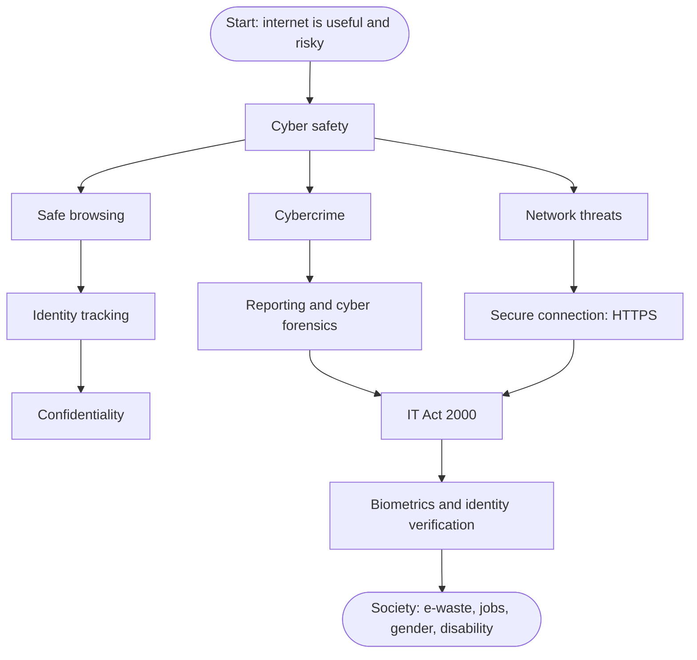

- Chapter defines safe use first. §Roadmap
- Then individual precautions: browsing, tracking, confidentiality. §Roadmap
- Then criminal behaviour: cybercrime, threats. §Roadmap
- Then defences: secure connections, law, biometrics. §Roadmap
- Ends with wider social impact. §Roadmap

---

## §12.1 Introduction

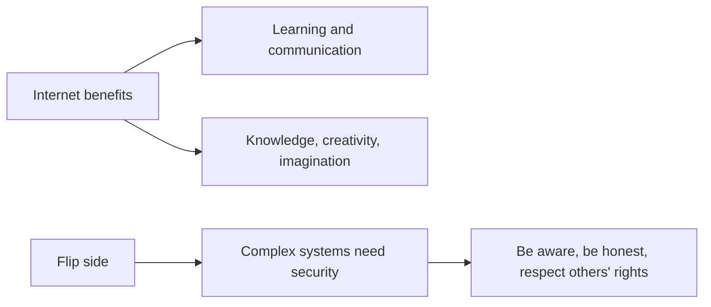

- Technology brings minds together in ways unthinkable fifty years ago. §12.1
- Internet is called the greatest platform and technology of this century. §12.1
- Internet ethics = our behaviour while using the internet for various purposes. §12.1
- Bigger, more complex infrastructure makes secure, always-on systems critical. §12.1
- Be aware of risks. §12.1
- Be honest. §12.1
- Respect rights and intellectual property of others on the web. §12.1

---

## §12.2 Cyber Safety

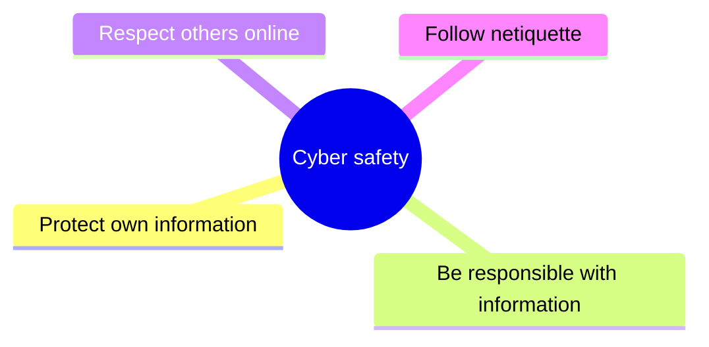

- **Cyber safety** — safe and responsible use of information and communication technology. §12.2
- Covers keeping information safe and secure. §12.2
- Covers being responsible with that information. §12.2
- Covers being respectful of other people online. §12.2
- Covers using netiquette (internet etiquette). §12.2
- Branch of computer technology applied to networks and corresponding computers. §12.2
- Objective: gain knowledge to limit computer crimes. §12.2
- Crimes targeted: hacking and identity theft. §12.2
- Method: ensure security and safety of personal information. §12.2
- Collective mechanism and process protecting valuable information and services. §12.2
- Protects from publication, tampering, or unauthorised activities. §12.2
- Threats come from untrustworthy individuals or unplanned events. §12.2
- Memory byte: safe and responsible use of internet, ensuring safety of personal information, not posing threat to others' information. §12.2

### §12.2a Terms from the Solved Questions

| Term | Meaning |
| --- | --- |
| Personal information | Information that identifies you or could identify you, e.g. name or address |
| IT security | Protection of an organisation's hardware, software and network from disaster and external attacks (virus, hacking) |
| Hacker | Expert programmer exploring inner workings of systems; some use the skill to break illegally into secure programs |
| Data-security concepts | Encryption, user authentication, data backup |

§12.2a

- Trap: "hacker" has a neutral sense and a criminal sense; cybercrime answers use the criminal sense. §12.2a

---

## §12.3 Safely Browsing the Web

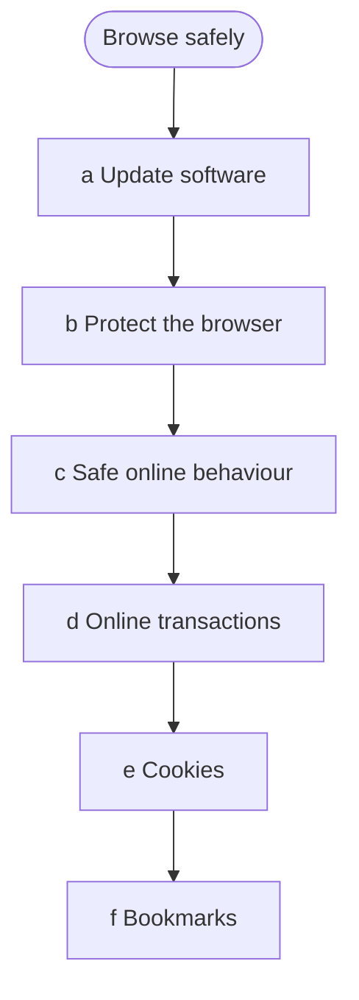

### (a) Update your software

- Update the operating system. §12.3a
- Update the web browser. §12.3a
- Update security software. §12.3a
- Update browser plug-ins such as Java or Adobe products. §12.3a
- Update other applications. §12.3a

### (b) Protect your web browser

- Browser settings can be adjusted to be more or less secure. §12.3b
- Most secure settings may limit functionality. §12.3b
- Most secure settings give best protection from malicious content. §12.3b
- Browsers warn when a site is malicious or content may be malicious. §12.3b
- Warnings protect against malware, phishing and identity theft. §12.3b

### (c) Safe online behaviour

- Use strong unique passwords online. §12.3c
- Download only from trusted sources: official app stores, legitimate organisations such as your bank. §12.3c
- Pause before clicking links in email, messages, social sites. §12.3c
- Do not click if sender unknown or message unexpected. §12.3c
- Hover over a suspicious link to see the real address, usually at the bottom of the browser window. §12.3c
- If the address is untrusted, search key terms in a browser instead of clicking. §12.3c
- Beware offers that seem too good to be true. §12.3c
- Leave sites asking for personal or banking details in return for money — scams. §12.3c

### (d) Online transaction handling

- Check the site is reputed. §12.3d
- Check the site has a refund policy. §12.3d
- Secure payment URL uses `https` not `http`. §12.3d
- Browser shows a padlock icon on a secure page. §12.3d
- Suspicious site or doubt: do not proceed. §12.3d
- **Malvertising** — malware delivered through malicious advertising. §12.3d
- Ad blocker can stop malvertising malware; some browsers include Ad Block. §12.3d
- Avoid public computers or Wi-Fi hotspots for personal information. §12.3d
- No online banking or credit card payments on public computers or Wi-Fi. §12.3d

### (e) Cookies and security

- **Cookie** — small text file left on your computer by a visited website; lets it "remember" things about you. §12.3e
- Websites use cookies to gather visitor information. §12.3e
- Cookies store preferences and settings per website. §12.3e
- Experience can be customised from past behaviour. §12.3e
- Cookies unlikely to be used maliciously: just text read by the browser. §12.3e
- Cookies contain no executable code. §12.3e
- Websites can still gather much information about you through cookies. §12.3e
- Privacy concern: clear cookies regularly. §12.3e
- Trap: a cookie is a privacy risk, not an infection risk. §12.3e

### (f) Bookmark important sites

- Bookmark regularly visited sites. §12.3f
- Mistyped address can reach a false site mirroring the real one. §12.3f
- False site may carry malicious code. §12.3f
- Bookmarks take you to the same site every time. §12.3f

### Closing advice

- Everyday care extends to online life. §12.3
- Share personal information only if absolutely certain it will not be compromised. §12.3
- Information over a public wireless hotspot is not secure. §12.3
- Book's analogy: do not leave a debit card on the dashboard of an unlocked car. §12.3

### §12.3a The web browser (Solved Questions)

- Purpose: application software to retrieve, present and traverse information. §12.3a
- Provides resources through the World Wide Web. §12.3a
- Resources identified by URI (Uniform Resource Identifier). §12.3a
- Fetches page, image, video or other content from a server and displays it. §12.3a
- Hyperlinks let users navigate between resources. §12.3a
- Privacy and security features: remove cache, cookies, history. §12.3a
- Privacy and security features: blockers against unwanted access. §12.3a
- Privacy and security features: disable JavaScript and block pop-ups. §12.3a
- Privacy and security features: block access to secure sites offering money transfer. §12.3a
- Privacy and security features: supports HTTP secure method for transaction sites. §12.3a
- Support features: HTML for simple website creation. §12.3a
- Support features: rapid development of websites and tools. §12.3a
- Support features: non-standard HTML dialects for interoperability. §12.3a
- Support features: standard libraries for standard-based HTML pages. §12.3a
- Support features: JavaScript, HTML, XHTML rendering. §12.3a

---

## §12.4 Identity Protection While Using Internet

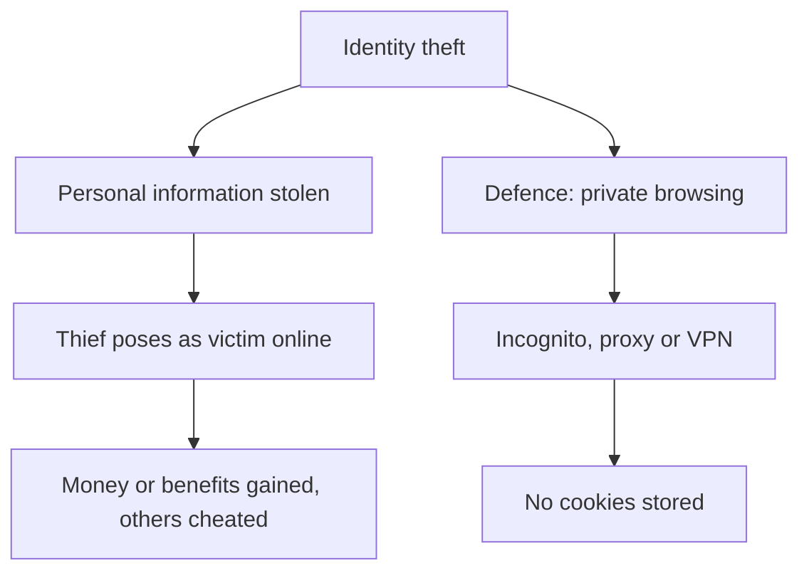

- **Identity theft** — fraud using someone else's identity to steal money or gain benefits. §12.4
- **Online identity theft** — stealing name, login details, credit card details, then posing as that person online. §12.4
- Intent: personal gain, generally to cheat others. §12.4
- Memory byte: someone, without your knowledge, acquires a piece of your personal information and uses it to commit fraud. §12.4
- Defence: **Private Browsing** or **Anonymous Browsing**. §12.4
- Private browsing = browser in incognito mode or through proxy or VPN. §12.4
- VPN = Virtual Private Network. §12.4
- Private browsing does not store cookies. §12.4
- Trap: incognito stops local storage; proxy or VPN changes what the website sees. §12.4

### §12.4.1 Ways of Tracking Your Identity

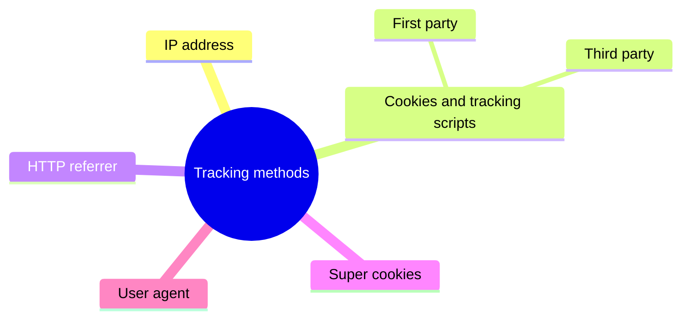

- Browser may reveal location through the device IP address. §12.4.1
- Browser may reveal search and browsing history. §12.4.1
- Advertisers or criminals can use this information. §12.4.1
- Five methods: IP address, cookies and tracking scripts, HTTP referrer, super cookies, user agent. §12.4.1

**1. IP address**

- Unique address of your device when connected to the internet. §12.4.1
- Sharing it on the network lets a website determine your geographical location. §12.4.1
- Allows a computer or digital device to communicate through the internet. §12.4.1
- Internet protocol = set of rules governing internet activity. §12.4.1
- Format: four numbers separated by single dots. §12.4.1
- Each number has one to three digits. §12.4.1
- Each number ranges from 0 to 255. §12.4.1
- Example: `78.125.0.209`. §12.4.1
- Every machine on the internet has a unique IP number. §12.4.1

**2. Cookies and tracking scripts**

- Cookies identify you and track browsing activity. §12.4.1

| Type | Stores | Purpose |
| --- | --- | --- |
| First-party cookie | Your login id, password, auto-fill for frequently visited sites | Convenience to you |
| Third-party cookie | Your search and browsing history | Advertisements matching your interests |

§12.4.1

**3. HTTP referrer**

- HTTP header field identifying the URL of the page that links to the requested resource. §12.4.1
- New page sees where the request originated. §12.4.1
- Can pass details such as IP address, mail id, password to linked sites. §12.4.1
- Book's example: click a search result for microsoft.com, and the site learns the URL you came from. §12.4.1

**4. Super cookies**

- Persistent cookies: come back after deletion. §12.4.1
- Store data in multiple places. §12.4.1
- Places: Flash cookies, Silverlight storage, browsing history, HTML5 local storage. §12.4.1
- Website notices a deleted part and repopulates it from another location. §12.4.1
- Example: browser cookies cleared but Flash cookies not; site copies Flash value back. §12.4.1

**5. User agent**

- Sent by the browser every time it connects to a website. §12.4.1
- Tells sites your browser and operating system. §12.4.1
- Can be stored and used to target ads. §12.4.1

- Trap: third-party = who sets it and why; super = how hard to remove; one cookie can be both. §12.4.1

---

## §12.5 Confidentiality of Information

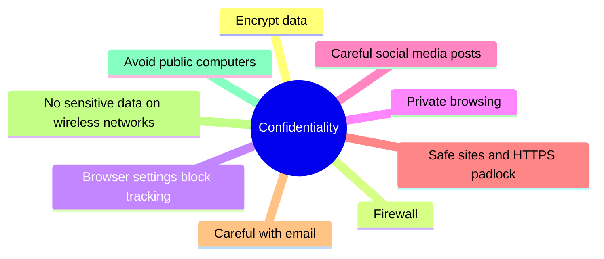

- **Confidentiality** — preventing disclosure of information to unauthorised individuals or systems. §12.5
- Data should be kept secret. §12.5
- The owner decides who can and cannot access data. §12.5
- A common threat now: password hacking in online money transaction systems. §12.5
- Memory byte: only authorised users get access to sensitive and protected data. §12.5

Ten practices:

1. Encrypt data and limit the places it might appear. §12.5
2. Use a firewall wherever possible. §12.5
3. Control browser settings to block tracking. §12.5
4. Browse privately wherever possible. §12.5
5. Take care while posting on social media. §12.5
6. Ensure safe sites while entering crucial information. §12.5
7. Ensure the address has HTTPS and a padlock sign. §12.5
8. Handle emails carefully. §12.5
9. Do not give sensitive information on wireless networks. §12.5
10. Avoid using public computers. §12.5

---

## §12.6 Cybercrime

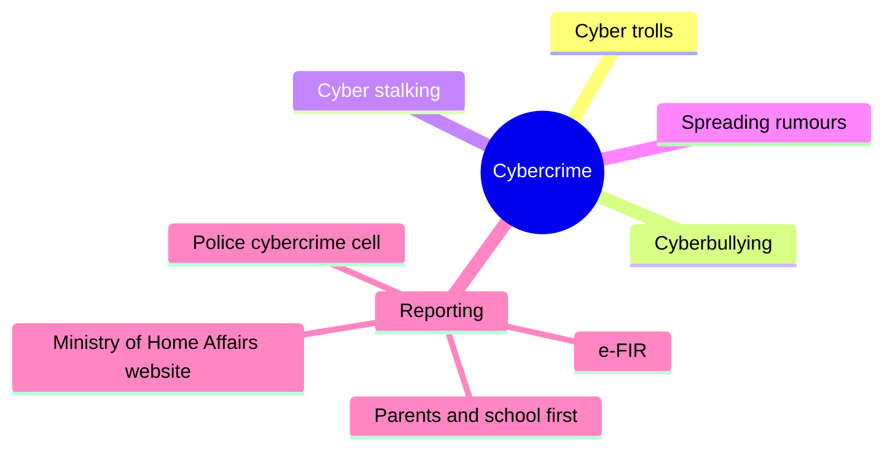

- **Cybercrime** — any criminal act facilitated by electronic gadgets (computer, smartphone, laptop). §12.6
- Involves communications or information systems through the internet. §12.6

### §12.6.1 Cyber Trolls

- **Cyber troll** — person who starts quarrels or upsets people on the internet. §12.6.1
- Method: inflammatory, digressive, extraneous or off-topic messages. §12.6.1
- Target: an online community such as newsgroup, forum, chat room, blog. §12.6.1
- Intent: provoke emotional responses and normalise tangential discussion. §12.6.1
- Motive: the troll's amusement or a specific gain. §12.6.1
- Trolls often end up as cyber bullies. §12.6.1
- Cyber trolling is a form of cyberbullying. §12.6.1
- Ways of trolling: YouTube comments, blog comments, forums, email, Facebook, Twitter, Instagram, social sites, anonymous networking. §12.6.1
- Why people troll: to annoy others. §12.6.1
- Why people troll: temporary feeling of power, ego boost, look "cool". §12.6.1

### §12.6.2 Cyberbullying

- **Cyberbullying** — attack on an individual or group through electronic means. §12.6.2
- Means: instant messaging, social media, email, other online communication. §12.6.2
- Intent: abuse, intimidate or overpower. §12.6.2

| Types of cyberbullying |
| --- |
| Posting humiliating content about the victim |
| Hacking the victim's account |
| Sending or posting vulgar messages online |
| Threatening to commit acts of violence |
| Stalking by calls, messages and so on |
| Threats of child pornography |

§12.6.2

### §12.6.3 Cyber Stalking

- **Cyber stalking** — use of the internet or electronic means to stalk or harass an individual, group or organisation. §12.6.3
- May include false accusations or statements of fact (defamation). §12.6.3
- May include monitoring. §12.6.3
- May include making threats. §12.6.3
- May include identity theft. §12.6.3
- May include damage to data or equipment. §12.6.3
- May include solicitation of minors for objectionable activities. §12.6.3
- May include gathering information that may be used to harass. §12.6.3
- Short form (Solved Q): unlawful harassment or collecting private information using an electronic network. §12.6.3

### §12.6.4 Spreading Rumours Online

- People post under fake email ids and masked identities, believing they will not be caught. §12.6.4
- Fake profiles post false information. §12.6.4
- Rumours and comments can hurt others. §12.6.4
- Result: quarrels, sometimes communal tension. §12.6.4
- Comes under cybercrime. §12.6.4
- Punishable under the Information Technology Act. §12.6.4

### §12.6.5 Reporting Cybercrime

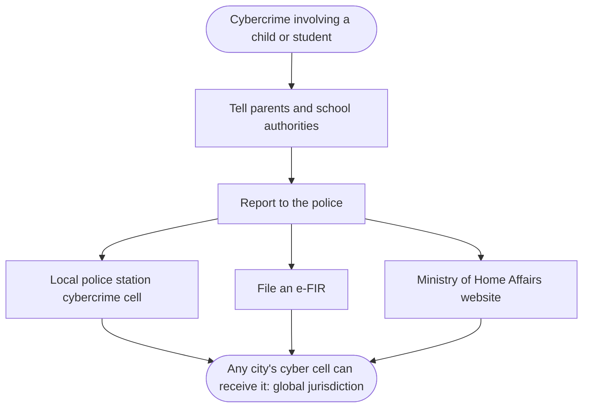

- Order: parents and school authorities first, then police. §12.6.5
- Procedure is the same as for any other offence. §12.6.5
- Local police stations have designated cybercrime cells. §12.6.5
- **e-FIR** — online complaint, available in many states. §12.6.5
- Ministry of Home Affairs launched a website to register crimes against women and children online, including cybercrimes. §12.6.5
- IT Act feature: cybercrime has global jurisdiction. §12.6.5
- Report in the cyber cell or unit of any city. §12.6.5
- Place where the act was committed does not matter. §12.6.5

| Trolling | Bullying | Stalking |
| --- | --- | --- |
| Provokes a community | Targets and intimidates a person or group | Persistent harassment and monitoring |

§12.6

---

## §12.7 Cyber Forensics

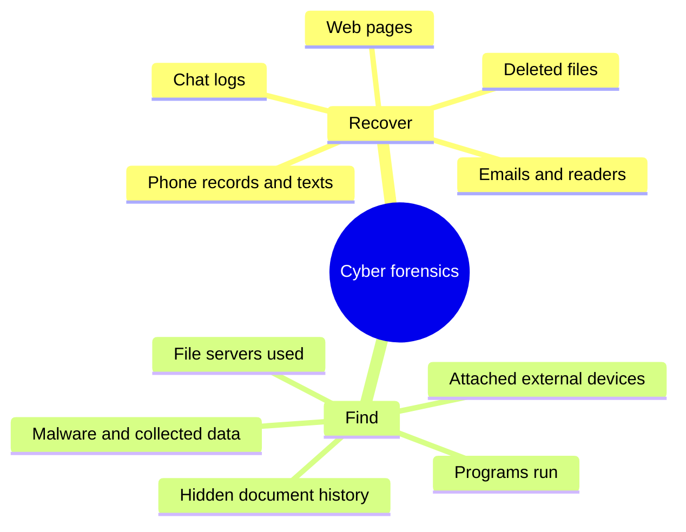

- **Cyber forensics** — electronic discovery technique to determine and reveal technical criminal evidence. §12.7
- Often involves extracting data from electronic storage for legal purposes. §12.7
- Still in its infancy. §12.7
- Gaining traction as a viable way of interpreting evidence. §12.7
- Also called computer forensics. §12.7
- Capability: recover deleted files. §12.7
- Capability: find external devices attached and who has access. §12.7
- Capability: determine programs run. §12.7
- Capability: recover web pages. §12.7
- Capability: recover emails and the users who read them. §12.7
- Capability: recover chat logs. §12.7
- Capability: determine file servers used. §12.7
- Capability: discover a document's hidden history. §12.7
- Capability: recover phone records and text messages from mobile devices. §12.7
- Capability: find malware and data collected. §12.7

---

## §12.8 Appropriate Usage of Social Media

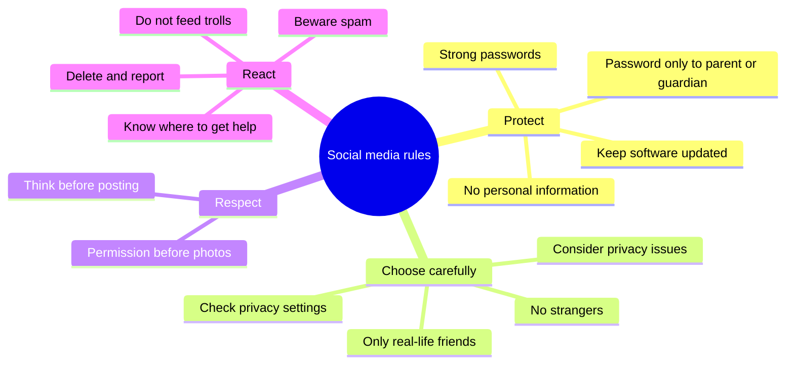

- **Social media** — web and mobile technologies and practices for sharing content, opinions, insights, experiences, perspectives online. §12.8
- Supports participation, collaboration, community building. §12.8
- Useful for team-based projects and joint problem-solving. §12.8
- Extends to peer mentoring and informal student interaction. §12.8
- Extends to online discussion, promotion of events, pooling of resources. §12.8

| Platform | What it is |
| --- | --- |
| Facebook | Post comments, share photos, links, live chat, short videos; socialising with existing friends |
| Twitter | News and social site; short messages called tweets to followers |
| YouTube | Video sharing: share, watch, like, comment; on PCs, laptops, tablets, mobiles |
| LinkedIn | Business social network, founded 2003; connect with colleagues, network, jobs, hires |
| Blogging sites | Blog = weblog, online journal in reverse chronological order; WordPress, Blogger, Tumblr |

§12.8

Rules:

- Do not give or post personal information. §12.8
- Give your password only to your parent or guardian. §12.8
- Consider privacy issues when choosing a site. §12.8
- Add only people you know in real life. §12.8
- Delete unwanted messages and inappropriate comments. §12.8
- Report inappropriate comments to the site immediately. §12.8
- Share but with care: never share passwords, personal information, location. §12.8
- Use strong passwords that are hard to guess. §12.8
- Privacy matters: check privacy settings regularly. §12.8
- Think before posting; posts spread across the internet. §12.8
- Respect privacy of others: ask friends before uploading their photos and videos. §12.8
- Keep everything updated: most breaches happen on out-of-date software. §12.8
- Update apps, anti-viruses, browsers. §12.8
- Be aware of spam: modern junk mail. §12.8
- Learn real mail vs dodgy messages with unreliable links. §12.8
- Be suspicious of emails with hyperlinks. §12.8
- Cyberbullying and harassment: know what to do and where to get help. §12.8
- Book names the National Centre Against Bullying website. §12.8
- Keep friends close and strangers at arm's length. §12.8
- Never accept friend requests from strangers. §12.8
- Do not react angrily to trolls; that is what they want. §12.8
- Block or report trolls. §12.8
- Memory byte: take care of password security, fake information, befriending unknown persons. §12.8
- Memory byte: set up privacy settings on your own. §12.8

### §12.8a Merits and demerits of social networking

- **Social networking** — expanding business or social contacts by making connections through individuals. §12.8a

| Merits | Demerits |
| --- | --- |
| Lowest-cost form of marketing | Unreliable information |
| Huge potential audience, messages can go viral | Lack of control |
| Closer connection with clients | Can be addictive |
| Source of instant feedback | |

§12.8a

| Twitter | LinkedIn |
| --- | --- |
| Followers; short posts called tweets | Connect people for business |
| Hashtags to reach a wider audience | Profile: CV, credentials, publications, colleagues |
| Character limit, book gives 280 | Paid Premium shows who viewed your profile |
| Abbreviations used | Shows skills recruiters seek |

§12.8a

### §12.8b Plagiarism

- Ten forms students commit (University of Illinois, Chicago study cited). §12.8b
- Submitting someone else's work as their own. §12.8b
- Taking passages from their own earlier work without citation. §12.8b
- Rewriting someone else's work without proper citation. §12.8b
- Using quotations without citing the source. §12.8b
- Interweaving various sources without citations. §12.8b
- Citing some passages that should be cited, but not all. §12.8b
- Melding cited and uncited sections. §12.8b
- Proper citations without changing the structure and language of borrowed ideas. §12.8b
- Citing the source inaccurately. §12.8b
- Relying too much on others' work, with no original ideas. §12.8b

---

## §12.9 Network Security Threats

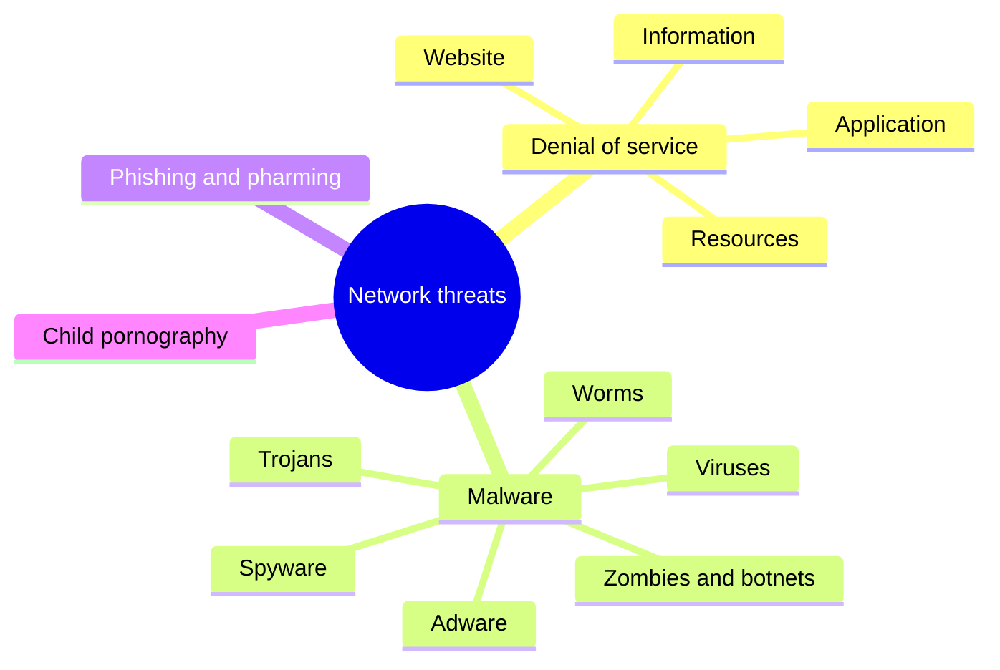

- **Threat** — anything with potential to cause serious harm to a computer system. §12.9
- Threats = potentials for vulnerabilities to turn into attacks. §12.9
- Targets: computer systems, networks, individuals, business computers. §12.9
- Vulnerabilities must be fixed so attackers cannot infiltrate. §12.9
- Network security protects data during transmission. §12.9
- Network security guarantees transmissions are authentic. §12.9

### §12.9.1 Denial of Service (DoS) Attacks

- **DoS** — prevents legitimate users from accessing or using resources and information. §12.9.1
- May eat up all system resources. §12.9.1
- May bring the computer to a halt. §12.9.1

| Form | What happens |
| --- | --- |
| Denial of access to information | Information corrupted, encrypted or status changed so legitimate user cannot access it |
| Denial of access to application | Application forcibly shut as soon as the user opens it |
| Denial of access to resources | A printer, scanner or USB port blocked; computer cannot work properly |
| Denial of access to a website | Bulk requests sent continuously so no one else can reach the site |

§12.9.1

- Exercise: flooding a system with junk mail is a Denial of Service type of attack. §12.9.1

### §12.9.2 Malware

- **Malware** — short for malicious software. §12.9.2
- A file or code, typically delivered over a network. §12.9.2
- Infects, explores, steals, or conducts any behaviour an attacker wants. §12.9.2
- Objective: remote control of an infected machine. §12.9.2
- Objective: send spam from the infected machine. §12.9.2
- Objective: investigate the infected user's local network. §12.9.2
- Objective: steal sensitive data. §12.9.2
- Inclusive term: viruses, worms, Trojans, spyware, adware and more. §12.9.2
- Trap: Cyber Bullying, Stranger Danger and Digital Footprint are printed after the malware list but are not malware. §12.9.2

**§12.9.2a Three concepts printed beside malware**

| Term | Meaning |
| --- | --- |
| Cyber bullying | Using technology to tease, humiliate, threaten, harass someone |
| Stranger danger | Danger presented to children and adults by strangers |
| Digital footprint | Trail of data left by online activity; also called digital tattoo |

§12.9.2a

- Digital footprints are recorded with every online activity. §12.9.2a
- Includes: social media interactions, chatting, sites visited, online shopping, Facebook check-in locations. §12.9.2a
- Analogy: footprints on a beach; each step leaves a mark another can follow. §12.9.2a
- Beach footprint washes away after some time. §12.9.2a
- Digital footprint stays forever and cannot be done away with. §12.9.2a
- Memory byte: trail of data left when visiting any website, using any online application or portal, to fill in data or perform a transaction. §12.9.2a

### §12.9.3 Viruses

- **Virus** — program that copies itself throughout a computer or network. §12.9.3
- Activated only when a user opens the program. §12.9.3
- Worst case: corrupt or delete data. §12.9.3
- Worst case: use the user's email to spread. §12.9.3
- Worst case: erase everything on the hard disk. §12.9.3
- Unchecked, can damage system files important to the operating system. §12.9.3
- May slow the computer through background replication. §12.9.3
- Replication is not visible on screen. §12.9.3

### §12.9.4 Worms

- **Worm** — self-replicating virus exploiting security vulnerabilities. §12.9.4
- Spreads automatically across computers and networks. §12.9.4
- Does not attach to existing programs. §12.9.4
- Does not alter files. §12.9.4
- Goes unnoticed until replication consumes significant resources or bandwidth. §12.9.4
- Memory byte: a computer program that copies itself across a network. §12.9.4

### §12.9.5 Trojans

- **Trojan** — malware disguised as legitimate software. §12.9.5
- Once activated, does whatever it was programmed to do. §12.9.5
- Does not replicate or reproduce through infection. §12.9.5
- Unlike viruses and worms. §12.9.5
- Memory byte: program intended to carry out malicious operations without the user's knowledge. §12.9.5

| | Virus | Worm | Trojan |
| --- | --- | --- | --- |
| Replicates | Yes | Yes | No |
| Needs user to open | Yes | No — spreads by itself | Yes — appears legitimate |
| Attaches to programs | Yes | No | Not applicable |
| Spreads over network automatically | No | Yes | No |

§12.9.3–12.9.5

### §12.9.6 Zombie Computers and Botnets

- **Zombie** — internet-connected computer compromised by a hacker, virus or Trojan. §12.9.6
- Can be used for malicious tasks under remote direction. §12.9.6
- Examples named: Zeus, Koobface, TidServ, Monkif, Hamweq, Swizzor, Gammima. §12.9.6
- Used for: DDoS attacks, spam, phishing, information theft, distributing malware. §12.9.6
- DDoS = Distributed Denial-of-Service. §12.9.6
- **Botnet** — "robot network". §12.9.6
- Botnets spread email spam and launch DoS attacks. §12.9.6
- Most zombie owners are unaware their system is used this way. §12.9.6
- Source typo: heading printed "2.9.6". §12.9.6

### §12.9.7 Spyware

- **Spyware** — malware that collects usage information and sends it to the attacker. §12.9.7
- Mostly installed without your consent. §12.9.7
- Enters by piggybacking onto a file. §12.9.7
- Enters by download when visiting a particular website. §12.9.7
- Monitors internet activity. §12.9.7
- Tracks login and password information. §12.9.7
- Spies on sensitive information. §12.9.7
- Not one program but an entire category. §12.9.7
- Category includes adware, keyboard loggers, Trojans, mobile information-stealing programs. §12.9.7
- Exercise: software installed on your computer to spy on your activities = spyware. §12.9.7

### §12.9.8 Phishing and Pharming

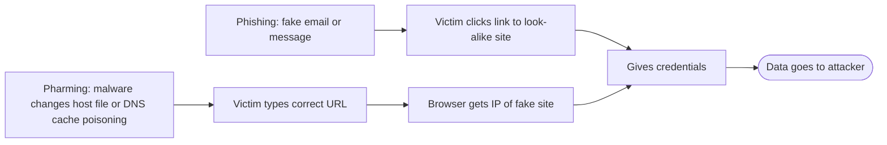

| | Phishing | Pharming |
| --- | --- | --- |
| Definition | Acquiring usernames, passwords, card details by masquerading as a trustworthy entity | Redirecting a website's traffic to a fake or bogus site |
| Channel | Emails, instant messaging, links | Malware changes host file, or DNS cache poisoning |
| User action | Lured by a message | Types the correct URL |
| Result | Private information shared on a fake site | Lands on a fake site anyway |

§12.9.8

- Fake sites are designed to look identical to legitimate ones. §12.9.8
- Phishing can obtain money indirectly. §12.9.8
- Memory byte: phishing = attempt to acquire usernames, passwords, credit card details. §12.9.8

### §12.9.9 Adware

- **Adware** — malware displaying unwanted advertisements. §12.9.9
- Commonly activated unknowingly during installation of a legitimate application it is bundled with. §12.9.9
- Common form: pop-up windows and banners. §12.9.9
- Can track movement and activities online to tailor adverts, like spyware. §12.9.9
- Can act as middleman and redirect activities to share adverts. §12.9.9
- Uses up data with each pop-up download. §12.9.9
- Uses up power and affects device performance. §12.9.9

| | Spyware | Adware |
| --- | --- | --- |
| Main output | Collects information for the attacker | Shows unwanted advertisements |
| Relationship | Category that includes adware | Can behave like spyware |

§12.9.7, §12.9.9

### §12.9.10 Child Pornography

- **Child pornography** — publishing and transmitting obscene material about children in electronic form. §12.9.10
- Increased due to easy internet access and easy availability of videos. §12.9.10
- Book calls it the most heinous crime. §12.9.10
- Leads to other crimes: sex tourism, child abuse. §12.9.10
- Severe penalties for producers and distributors in almost all Western societies. §12.9.10
- Includes incarceration; shorter sentences for non-commercial distribution. §12.9.10
- Sentences often converted to probation for first-time offenders. §12.9.10
- India: Section 67B of the IT Act. §12.13

| For | Safeguards |
| --- | --- |
| Students | Never share your address with unknown people |
| | Never publish personal information on public or social sites |
| | Best Facebook safety option: "only friends" |
| | Do not open suspicious emails |
| Parents | Talk about keeping personal information private |
| | Explain identity theft and how to prevent it |
| | Set rules on websites a child may access |
| | Obtain an identity-theft program protecting computer privacy |
| Educators | Teach the importance of keeping personal information private |
| | Monitor websites students access |
| | Teach dangers of viruses and suspicious emails |

§12.9.10

**Complete network security solution**

1. Never open or download a file from an unsolicited email or website. §12.9.10
2. Keep your operating system updated. §12.9.10
3. Use an authentic antivirus program. §12.9.10
4. Enable two-factor authentication whenever available. §12.9.10
5. Confirm a website's authenticity before entering login credentials. §12.9.10
6. Look for HTTPS in the address bar for sensitive information, so data is encrypted. §12.9.10

---

## §12.10 Communicating Data Safely — Secure Connection

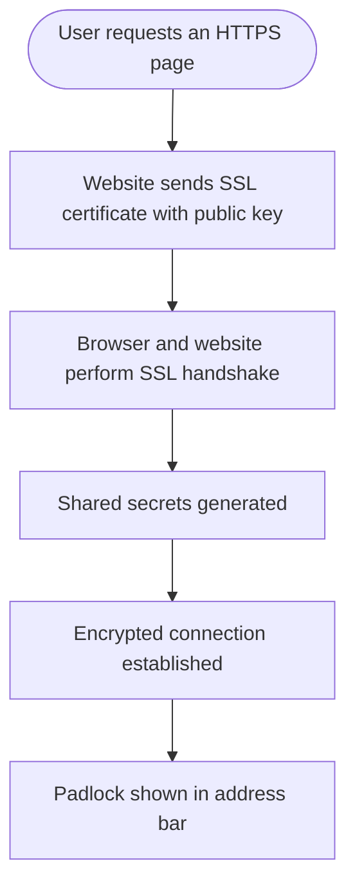

- **Secure connection** — connection encrypted by one or more security protocols. §12.10
- Protects data flowing between two or more nodes. §12.10
- Unencrypted connection can be listened to by anyone. §12.10
- Unencrypted connection is prone to malicious software and rogue events. §12.10
- Logins, passwords and private information can be taken. §12.10

Three tasks of a secure connection:

1. Prevent third parties from getting confidential data. §12.10
2. Validate the identity of the person wishing to access and exchange data. §12.10
3. Protect information from being viewed or altered by unknown parties. §12.10

- Most methods involve data encryption. §12.10
- **Data encryption** — method that hides information from unauthorised parties. §12.10
- Usually needs a program on both computers to encrypt and decrypt. §12.10
- Basic security protocols are embedded in TCP/IP, HTTPS, POP3, IMAP. §12.10
- Firewalls and antivirus software may help create secure connections. §12.10

| Who needs a secure connection | Reasons |
| --- | --- |
| Business industry | Protect customer data (health care, legal, financial, tax advisors, private banking) |
| | Protect intellectual property against industrial espionage (pharmaceutical, automotive, industrial) |
| | Protect internal communication (government institutions, large corporate houses) |
| Financial and banking industry | Primary target of crime: where the money is |
| | Client data can be used for identity theft and fraud |
| | Widely used mechanism: access sites only with HTTPS for transactions |

§12.10

### HTTP vs HTTPS

| | HTTP | HTTPS |
| --- | --- | --- |
| Data | Plain text | Encrypted |
| Port in book's figure | 80 | 443 |
| Certificate | None | SSL certificate with public key |
| Browser sign | None, or "Not secure" | Padlock; green bar with Extended Validation Certificate |
| If intercepted | Readable by a hacker | Cannot be decrypted |

§12.10

- Plain-text danger: order forms with credit card details or social security number. §12.10
- SSL = Secure Socket Layer. §12.10
- Trusted SSL certificate: padlock icon. §12.10
- Extended Validation Certificate: green address bar. §12.10

Checking a site (Chrome example):

- Padlock = Secure. §12.10
- Info icon = Info or Not secure. §12.10
- Warning triangle = Not secure or Dangerous. §12.10
- Browser alerts you if a site cannot be visited safely or privately. §12.10

End-to-end encryption:

- Only sender and recipient can read the message. §12.10
- Special software keys unlock the encryption. §12.10
- Service provider keeps no copies of messages on its servers. §12.10
- WhatsApp added end-to-end encryption. §12.10
- Other apps listed: Signal, Viber, Telegram, Dust. §12.10
- Available free on iOS, Android, Windows, macOS, Linux. §12.10

---

## §12.11 Identity Verification

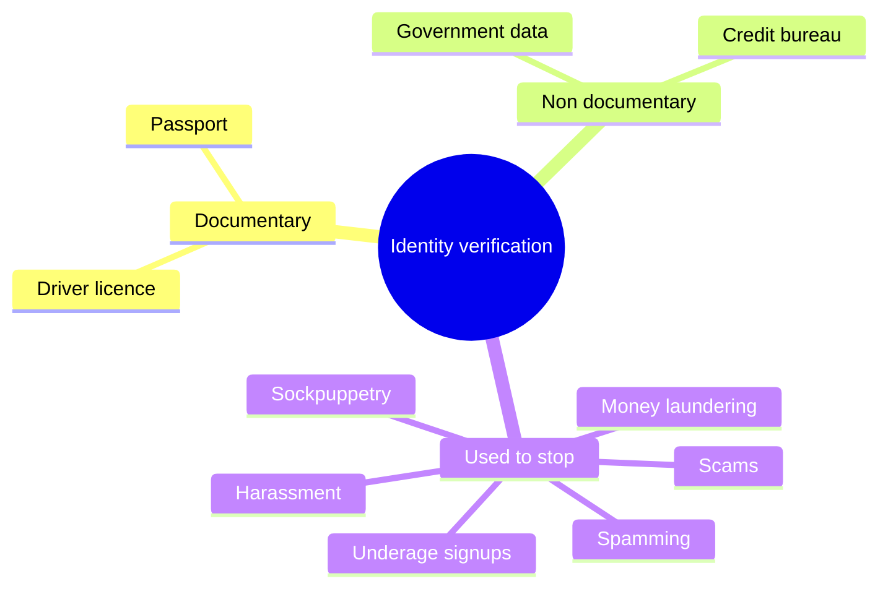

- **Identity verification service** — ensures users or customers provide information associated with a real person. §12.11
- **Documentary verification** — checks authenticity of physical identity documents. §12.11
- Documents: driver's licence, passport. §12.11
- **Non-documentary verification** — checks identity information from authoritative sources. §12.11
- Sources: credit bureau, government data. §12.11
- Used online and in person. §12.11
- Used by social networking sites, internet forums, wikis. §12.11
- Purpose: stop sockpuppetry, underage signups, spamming, harassment, scams, money laundering. §12.11
- Required to establish bank and financial accounts in many jurisdictions. §12.11
- Memory byte: ensures users provide information associated with the identity of a real person. §12.11

---

## §12.12 Cyber Safety in a Nutshell

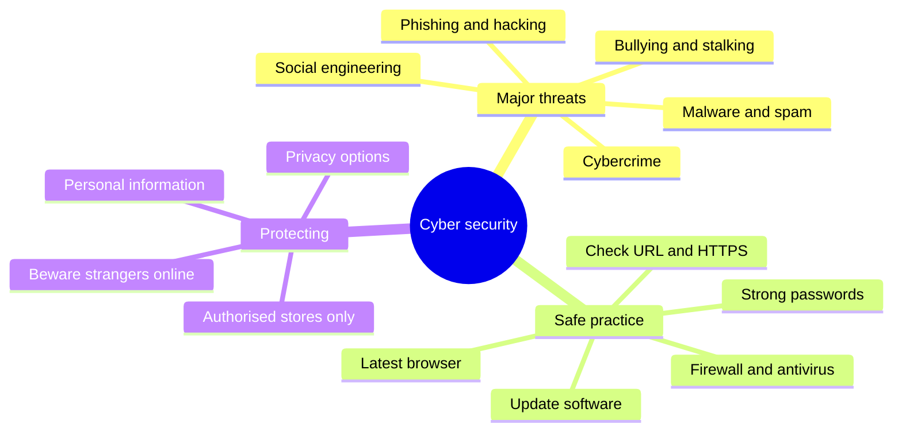

- Fig. 12.11 is a concept map with Cyber Security at the centre. §12.12
- Three branches: Major Threats, Safe Practice, Protecting. §12.12
- Introduces no new content beyond earlier sections. §12.12
- Some small labels are not legible in the printed scan. §12.12

---

## §12.13 Information Technology Act, 2000

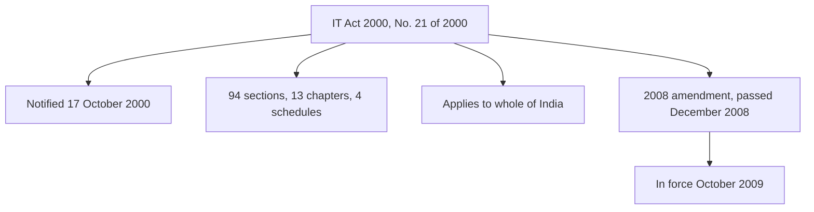

- Names: IT Act, ITA-2000, Information Technology Act, 2000. §12.13
- Act of the Indian Parliament, No. 21 of 2000. §12.13
- Notified 17 October 2000. §12.13
- Primary law in India on cybercrime and electronic commerce. §12.13
- Original: 94 sections. §12.13
- Original: 13 chapters. §12.13
- Original: 4 schedules. §12.13
- Laws apply to the whole of India. §12.13
- Other nationalities can be indicted if the crime involves a computer or network located in India. §12.13
- Legal support for computer users against cybercrime. §12.13
- Cyber police detect cybercrimes. §12.13
- Cyber police have authority over offences under the Act and intellectual-property crimes. §12.13

| Section | Offence | Penalty |
| --- | --- | --- |
| 67A | Publishing images containing sexual acts | Up to 7 years and/or fine up to ₹10,00,000 |
| 67B | Publishing child porn or predating children online | 1st conviction: up to 5 years and/or fine up to ₹10,00,000. 2nd: up to 7 years and/or fine up to ₹10,00,000 |
| 67C | Failure to maintain records | Up to 3 years and/or fine up to ₹2,00,000 |
| 68 | Failure or refusal to comply with orders | Up to 7 years and/or possible fine |
| 69 | Failure or refusal to decrypt data | Up to 3 years and/or fine up to ₹1,00,000 |
| 70 | Securing or attempting to secure access to a protected system | Up to 10 years and/or fine |
| 71 | Misrepresentation | Up to 3 years and/or fine up to ₹1,00,000 |

§12.13

Amendments:

- Major amendment in 2008. §12.13
- Introduced Section 66A: penalised sending "offensive messages". §12.13
- Introduced Section 69 powers: "interception or monitoring or decryption of any information through any computer resource". §12.13
- Added penalties for child pornography, cyberterrorism, voyeurism. §12.13
- Passed December 2008. §12.13
- In force October 2009. §12.13
- Caution: the book presents Section 66A as law; it has since been struck down by the Supreme Court of India (2015). §App. A

---

## §12.14 Unique IDs and Biometrics

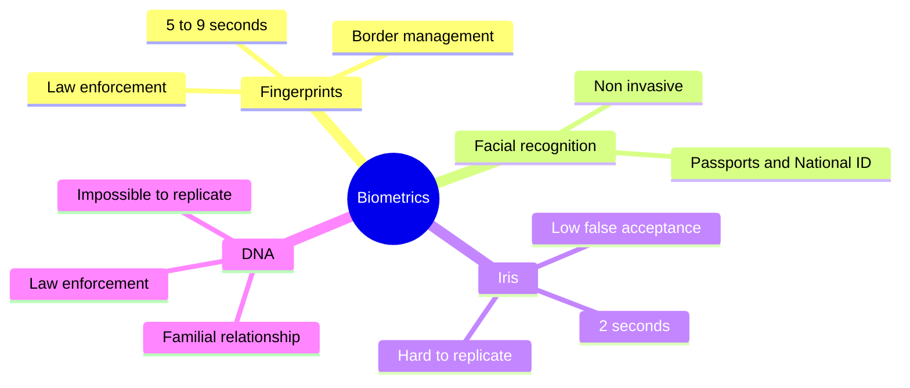

- **Biometrics** — science and technology of measuring and analysing biological data. §12.14
- Measures human body characteristics for authentication. §12.14
- Characteristics: DNA, fingerprints, retinas and irises, voice patterns, facial patterns, hand measurements. §12.14
- Most accurate and unique method of identification. §12.14

| Method | Points |
| --- | --- |
| Fingerprints | 5–9 seconds processing; border management; law enforcement |
| Facial recognition | Non-invasive collection; passports and National ID documents |
| Iris | Low false acceptance; difficult to replicate; two-second processing |
| DNA | Establishes familial relationship; law enforcement; highly unique, impossible to replicate |

§12.14

How a biometric system works:

1. Individual's identifying features are **enrolled** as a reference. §12.14
2. Reference stored in a central database, on a card, or both. §12.14
3. When recognition is required, features are recorded again. §12.14
4. System compares them with the stored reference for a close match. §12.14

- Aadhaar card: best available combination of unique ID and biometrics. §12.14
- Aadhaar gives identification and authentication via an ID number plus thumb impressions and iris patterns. §12.14
- Biometric authentication = identification and access control. §12.14
- Also used to identify individuals in groups under surveillance. §12.14

### §12.14a Choosing a biometric trait

| Factor | Meaning |
| --- | --- |
| Universality | Every person using the system has the trait |
| Uniqueness | Trait differs enough between individuals |
| Permanence | Trait stays reasonably unchanged over time |
| Measurability (collectability) | Easy to acquire; data usable for later processing |
| Performance | Accuracy, speed, robustness |
| Acceptability | Population willing to have the trait captured |
| Circumvention | Ease of imitation with an artefact or substitute |

§12.14a

---

## §12.15 Impact of Technology Change on Society

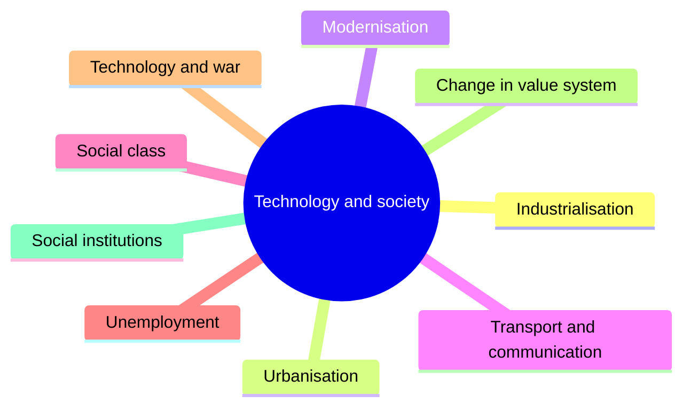

- Technology changes society by changing the environment we adapt to. §12.15
- Change is usually in the material environment. §12.15
- Adjustments modify customs and social institutions. §12.15
- Fig. 12.14 links: industrialisation, urbanisation, modernisation, transport and communication, social class, unemployment, technology and war, value system, social institutions. §12.15
- Industrialisation: associated with the factory system. §12.15
- Factories lowered prices, improved quality, maximised output. §12.15
- Production mechanised; traditional skills declined; artisans lost jobs. §12.15
- Big factories employ thousands and affect the economy. §12.15
- Urbanisation: becoming urban, moving to cities, leaving agriculture. §12.15
- People moved to industrial areas for jobs; areas grew into towns and cities. §12.15
- Unemployment accompanies rapid advance. §12.15
- Machines give jobs and remove jobs through labour-saving devices. §12.15
- Result: technological unemployment. §12.15
- Social institutions altered: family, religion, morality, marriage, state, property. §12.15
- Modern technology took industry out of the household; family organisation changed. §12.15
- Book states: marriage treated more as a civil contract; divorce, desertion, separation increasing. §12.15
- Book states: technology elevated women's status but added stress at home. §12.15
- Book states: people more secular, rational, scientific, less religious. §12.15
- State's functions widened: protect the aged, weaker sections, minorities; provide education, health care. §12.15

---

## §12.16 E-Waste Management

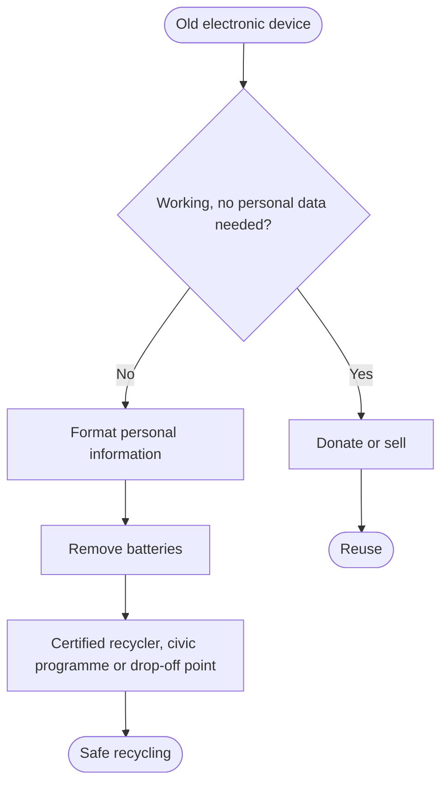

- **E-waste** — discarded electronic devices. §12.16
- Made of lead, cadmium, beryllium, mercury, brominated flame retardants. §12.16
- Improper disposal contaminates soil, pollutes air, leaches into water. §12.16
- Landfill water leaches trace elements; reaches groundwater with increased toxicity. §12.16
- Harmful if it enters any drinking water source. §12.16
- Types: mouse and keyboards; personal electronic devices; monitors and laptops; cell phones; audio/video equipment; televisions; scanners and copiers. §12.16
- Recycling often leads to overseas shipping and dumping in pits. §12.16
- Some companies ship e-waste to third-world countries. §12.16
- Children scavenge gold, silver, iron, copper; harmful to health. §12.16
- Dumping-ground countries often have high cybercrime; salvaged hard drives expose personal files. §12.16

| Technique | Points |
| --- | --- |
| Certified e-waste recycler | Certified by Basel Action Network (BAN); non-profit of recycling companies; members take the Pledge of Responsible Recycling; certified recyclers are e-Stewards |
| Sell outdated technology | Online sites such as craigslist, eBay; garage sale |
| Donate outdated technology | Check: is it working; does it hold personal information; donation programmes exist |
| Civic institutions | Government, universities, schools assign a day and place |
| Companies and drop-off points | Exchange policies; discounts; drop-off points for phones and tablets |
| Safeguard environment and information | Format devices before proper disposal |

§12.16

- Before donating or recycling: upgrade instead of replacing. §12.16
- Before donating or recycling: format personal information. §12.16
- Before donating or recycling: remove batteries. §12.16
- Three best ways (Solved Q): certified recycler, donate, drop-off points. §12.16
- Reusing is always better than recycling. §12.16
- Retail example items: cell phones, power cords, speakers, paper shredders, desktops, notebooks, TVs, GPS devices, DVD players, memory cards, laptops. §12.16
- Memory byte: e-waste contains lead, cadmium, beryllium, mercury, brominated flame retardants. §12.16

---

## §12.17 Gender and Disability Issues While Teaching and Using Computers

```mermaid
mindmap
  root((Equity in ICT))
    Gender
      Gender divide
      Causes
        Parental support
        Restricted access
        Few role models
        Casual approach in school
    Disability
      Cognitive categories
      Functional perspective
      ICT benefits
        Improved writing
        Multimedia
        Sensory stimulation
```

- ICT is a tool for gender equality and women's empowerment. §12.17
- **Gender divide** — fewer women than men access and use ICT. §12.17
- Unaddressed, ICT may worsen inequalities and create new ones. §12.17
- If access, capacity building, employment, empowerment are addressed, ICT becomes a catalyst. §12.17
- Studies: school computer use dominated by men in many countries. §12.17
- Female teachers have less regard for their own skills than male counterparts. §12.17
- Females know less about IT, enjoy computers less, see more software problems. §12.17
- Causes: differences in parental support. §12.17
- Causes: restricted access to computers. §12.17
- Causes: fewer female role models. §12.17
- Causes: casual approach to computer activities in school. §12.17
- Teachers and parents must be made aware before remedial measures. §12.17
- Same applies to people with disabilities. §12.17
- Clinical cognitive disabilities: autism, Down's syndrome. §12.17
- Less severe: learning disabilities. §12.17
- Dyslexia = reading. §12.17
- Dyscalculia = mathematics. §12.17
- Functional perspective: ignores medical and behavioural causes. §12.17
- Functional perspective: focuses on abilities and challenges. §12.17
- Difficulties: problem-solving, attention, memory, math comprehension, visual comprehension, reading, linguistic (speech), verbal comprehension. §12.17

| ICT benefit | How |
| --- | --- |
| Improved writing | Grammar and spell check, predictive typing; Clicker 5 with symbols, pictures, speech-supported grids |
| Multimedia | Graphics, sound, video stimulate interaction; useful for profound impairments and pre-literate children; software freely available |
| Sensory stimulation | Switches plus specialised games for cause-and-effect play; augmentative and alternative communication devices, especially symbol-based |

§12.17

---

## Rapid Reference

| Fact | Value |
| ---- | ----- |
| Cyber safety | Safe and responsible use of information and communication technology |
| Three data-security concepts | Encryption, user authentication, data backup |
| IP address format | Four numbers, each 0 to 255, separated by dots; e.g. `78.125.0.209` |
| Tracking methods | IP address, cookies and tracking scripts, HTTP referrer, super cookies, user agent |
| Cookie types | First-party (your logins) and third-party (history for ads) |
| Super cookie | Persistent; returns after deletion; stored in Flash, Silverlight, history, HTML5 local storage |
| Safe-browsing tips | Update, protect browser, safe behaviour, transaction care, cookies, bookmarks |
| Secure payment page sign | `https` plus padlock |
| Confidentiality practices | 10 listed |
| Cybercrime | Criminal act facilitated by electronic gadgets through the internet |
| Reporting order (child or student) | Parents and school authorities, then police |
| Reporting routes | Local cybercrime cell, e-FIR, Ministry of Home Affairs website |
| Jurisdiction | Global — any city's cyber cell |
| Cyber forensics | Also called computer forensics; recovers evidence |
| Platforms named | Facebook, Twitter, YouTube, LinkedIn, blogging sites (WordPress, Blogger, Tumblr) |
| LinkedIn founded | 2003 |
| Twitter character limit (book) | 280 |
| DoS forms | Information, application, resources, website |
| Malware objectives | Remote control, spam, investigate local network, steal data |
| Virus | Copies itself; activated when a user opens it |
| Worm | Self-replicating; spreads automatically; does not attach to programs |
| Trojan | Disguised as legitimate software; does not replicate |
| Zombie examples | Zeus, Koobface, TidServ, Monkif, Hamweq, Swizzor, Gammima |
| Botnet | "Robot network" of zombies; spam and DoS |
| Spyware includes | Adware, keyboard loggers, Trojans, mobile information-stealing programs |
| Phishing vs pharming | Lured by message vs redirected despite correct URL |
| Network security solution | 6 steps listed |
| HTTP port in figure | 80 |
| HTTPS port in figure | 443 |
| SSL certificate contains | Public key |
| Extended Validation Certificate | Green address bar |
| Identity verification types | Documentary and non-documentary |
| IT Act | No. 21 of 2000; notified 17 October 2000 |
| IT Act original size | 94 sections, 13 chapters, 4 schedules |
| 2008 amendment | Passed December 2008; in force October 2009 |
| Section 67A | Up to 7 years and/or fine up to ₹10,00,000 |
| Section 67B | 1st: up to 5 years, fine up to ₹10,00,000; 2nd: up to 7 years, fine up to ₹10,00,000 |
| Section 67C | Up to 3 years and/or fine up to ₹2,00,000 |
| Section 68 | Up to 7 years and/or possible fine |
| Section 69 | Up to 3 years and/or fine up to ₹1,00,000 |
| Section 70 | Up to 10 years and/or fine |
| Section 71 | Up to 3 years and/or fine up to ₹1,00,000 |
| Biometric methods | Fingerprints, facial recognition, iris, DNA |
| Fingerprint processing time | 5–9 seconds |
| Iris processing time | 2 seconds |
| Biometric selection factors | Universality, uniqueness, permanence, measurability, performance, acceptability, circumvention |
| E-waste chemicals | Lead, cadmium, beryllium, mercury, brominated flame retardants |
| Recycler certification body | Basel Action Network (BAN) |
| Disposal order of preference | Reuse over recycling |
| Learning disabilities named | Dyslexia (reading), dyscalculia (mathematics) |
| ICT benefits for learning disabilities | Improved writing, multimedia, sensory stimulation |
