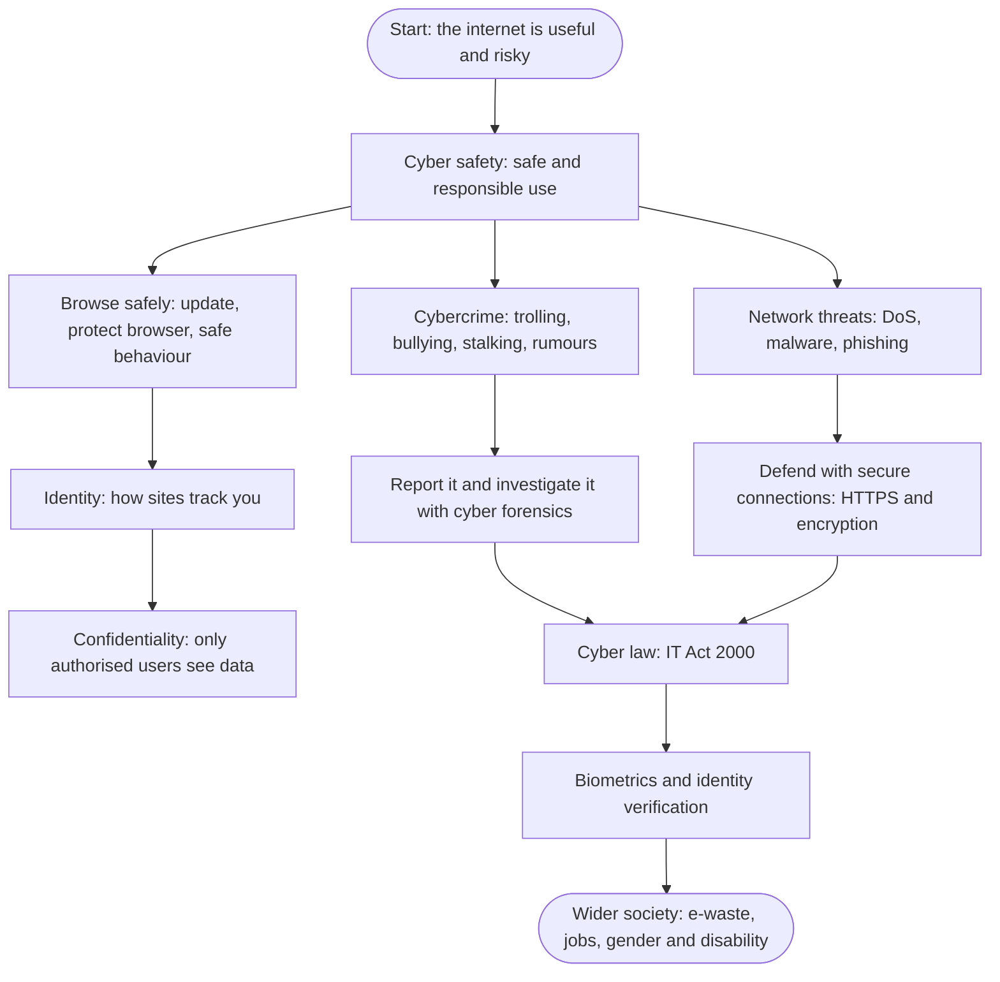
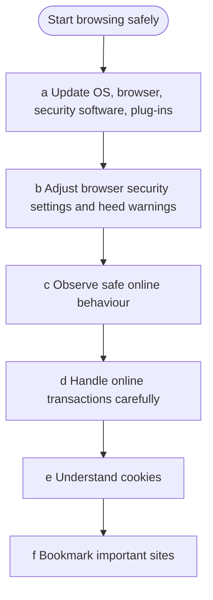
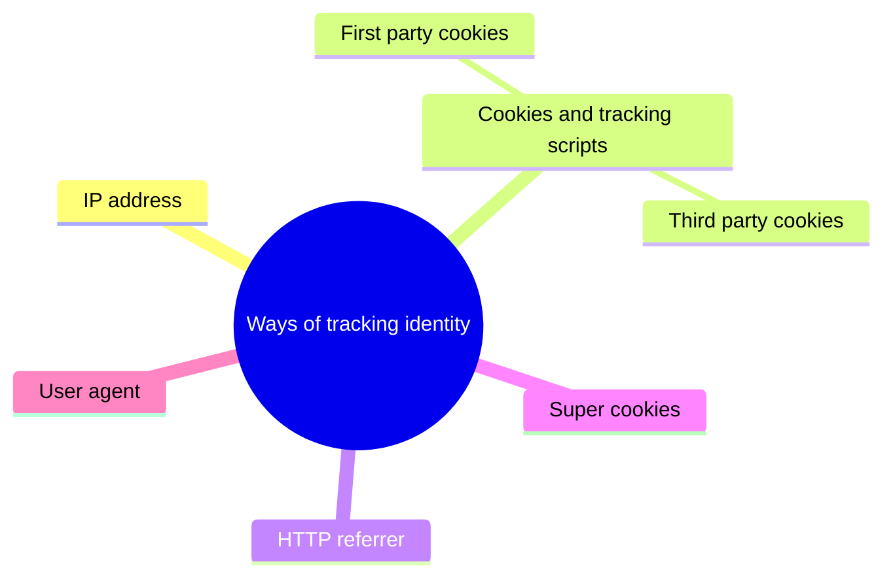
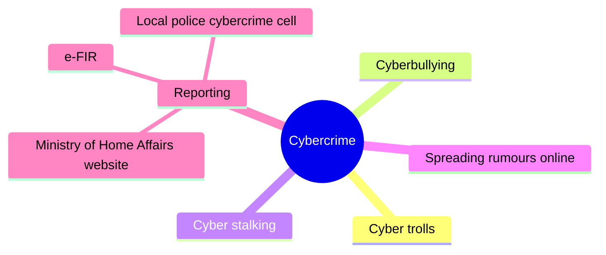
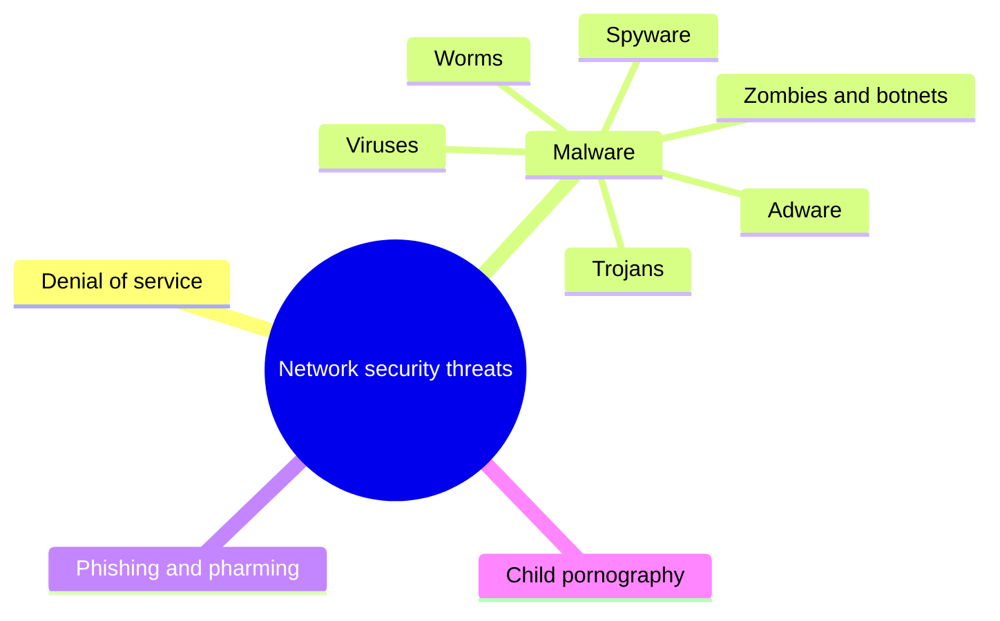
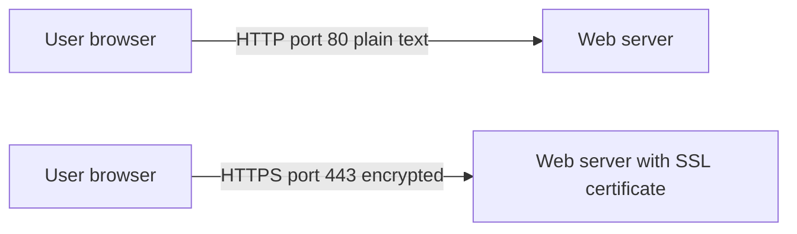
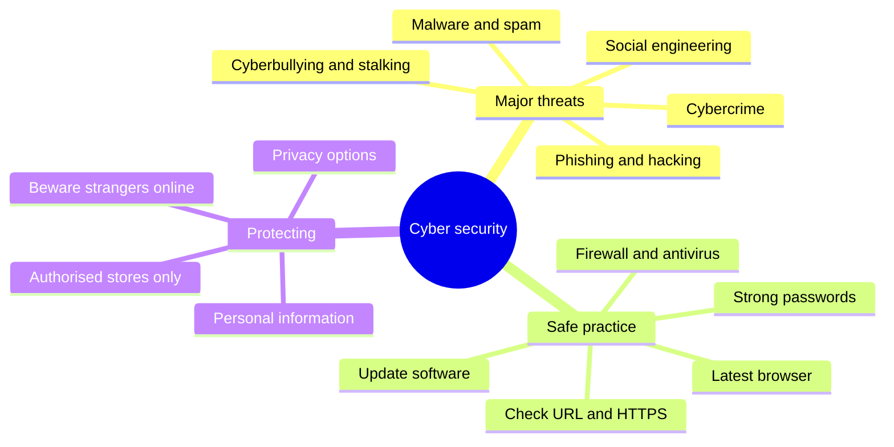
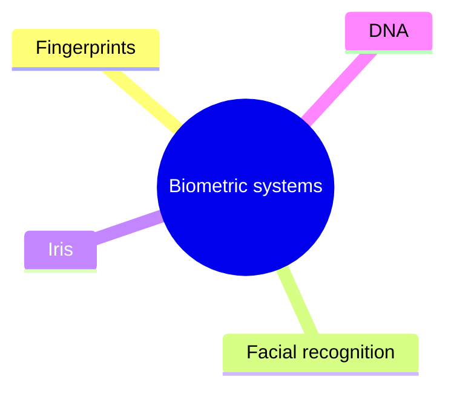
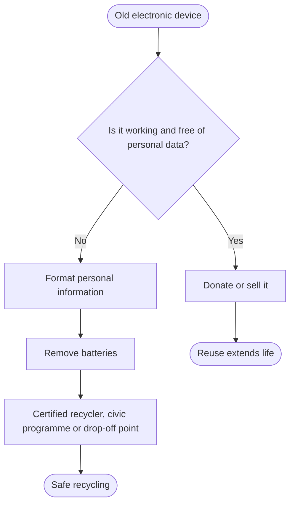

# Computer Science | Chapter 12 | Cyber Safety | NOTES

**Branch:** Society, Law & Ethics — safe and responsible use of the internet, threats to networks, and cyber law
**Level:** Class XI · CBSE Board
**Python version assumed:** not applicable — this chapter contains no code

**Primary source:** *Computer Science with Python — XI*, Chapter 12 "Cyber Safety". Section numbering `12.1`–`12.17` below is the book's own and is preserved exactly. Material that appears only in the book's Solved Questions or Memory Bytes is folded in as lettered subsections (`12.2a`, `12.3a`, `12.8a`, `12.8b`, `12.14a`) so no section is renumbered.
**Companion files:** `CS12-CYBER_SAFETY-GLOSSARY.md` (fast lookup, one term at a time) · `CS12-CYBER_SAFETY-CNOTES.md` (the same chapter as bullets, tables and diagrams for fast scanning).

> [!note] Renderer check
> This file uses only `mermaid` blocks, tables and callouts, all confirmed live in the current build. No `svg`, `tikz` or `desmos` block is used.

---

## Chapter brief

The internet is now part of daily life, and that makes it a place where information can be stolen, where people can be harassed, and where machines can be attacked. This chapter explains what safe and responsible use looks like: how to browse, how websites track you, what counts as a cybercrime, which programs attack a network, how encryption protects data in transit, and what Indian law says about all of it. It also widens out to the wider effects of technology on society — jobs, institutions, e-waste, and unequal access. After reading it you should be able to name a threat, say how it works, say how to defend against it, and say which law or authority applies.

## Front-matter

- **Prerequisites:** What the internet and a web browser are (Chapter 1 and the basic idea of a network); the idea of a password; the meaning of `http` in a web address.
- **Key outcomes:**
  - Define cyber safety and list safe-browsing practices.
  - Distinguish the five ways a website can track you, and first-party from third-party cookies.
  - Classify a threat correctly: virus vs worm vs Trojan, phishing vs pharming, spyware vs adware.
  - Explain why HTTPS is safer than HTTP and how to check a connection.
  - Describe how a cybercrime is reported in India and what the IT Act, 2000 covers.
  - Describe responsible disposal of e-waste and the main equity issues around computer use.
- **Scope note:** Legal sections and penalty figures are given exactly as the book prints them; the book does not cover how encryption algorithms work, nor the 2015 court ruling on Section 66A (see Appendix A).

## Table of contents

- [Concept Roadmap](#concept-roadmap)
- [12.1 Introduction](#121-introduction-)
- [12.2 Cyber Safety](#122-cyber-safety-)
  - [12.2a Terms from the Solved Questions](#122a-terms-from-the-solved-questions-)
- [12.3 Safely Browsing the Web](#123-safely-browsing-the-web-)
  - [12.3a The web browser (Solved Questions)](#123a-the-web-browser-solved-questions-)
- [12.4 Identity Protection While Using Internet](#124-identity-protection-while-using-internet-)
  - [12.4.1 Ways of Tracking Your Identity](#1241-ways-of-tracking-your-identity-)
- [12.5 Confidentiality of Information](#125-confidentiality-of-information-)
- [12.6 Cybercrime](#126-cybercrime-)
  - [12.6.1 Cyber Trolls](#1261-cyber-trolls)
  - [12.6.2 Cyberbullying](#1262-cyberbullying)
  - [12.6.3 Cyber Stalking](#1263-cyber-stalking)
  - [12.6.4 Spreading Rumours Online](#1264-spreading-rumours-online)
  - [12.6.5 Reporting Cybercrime](#1265-reporting-cybercrime)
- [12.7 Cyber Forensics](#127-cyber-forensics-)
- [12.8 Appropriate Usage of Social Media](#128-appropriate-usage-of-social-media-)
  - [12.8a Merits and demerits of social networking](#128a-merits-and-demerits-of-social-networking)
  - [12.8b Plagiarism](#128b-plagiarism)
- [12.9 Network Security Threats](#129-network-security-threats-)
  - [12.9.1 Denial of Service Attacks](#1291-denial-of-service-dos-attacks)
  - [12.9.2 Malware](#1292-malware)
  - [12.9.3 Viruses](#1293-viruses)
  - [12.9.4 Worms](#1294-worms)
  - [12.9.5 Trojans](#1295-trojans)
  - [12.9.6 Zombie Computers and Botnets](#1296-zombie-computers-and-botnets)
  - [12.9.7 Spyware](#1297-spyware)
  - [12.9.8 Phishing and Pharming](#1298-phishing-and-pharming)
  - [12.9.9 Adware](#1299-adware)
  - [12.9.10 Child Pornography](#12910-child-pornography)
- [12.10 Communicating Data Safely — Secure Connection](#1210-communicating-data-safely--secure-connection-)
- [12.11 Identity Verification](#1211-identity-verification)
- [12.12 Cyber Safety in a Nutshell](#1212-cyber-safety-in-a-nutshell)
- [12.13 Information Technology Act, 2000](#1213-information-technology-act-2000-)
- [12.14 Unique IDs and Biometrics](#1214-unique-ids-and-biometrics-)
  - [12.14a Choosing a biometric trait (Solved Questions)](#1214a-choosing-a-biometric-trait-solved-questions)
- [12.15 Impact of Technology Change on Society](#1215-impact-of-technology-change-on-society)
- [12.16 E-Waste Management](#1216-e-waste-management-)
- [12.17 Gender and Disability Issues](#1217-gender-and-disability-issues-while-teaching-and-using-computers)
- [Appendix A — Source discrepancies and cautions](#appendix-a--source-discrepancies-and-cautions)
- [Appendix B — Textbook exercise map](#appendix-b--textbook-exercise-map)

---

## Concept Roadmap

Read the diagram top-down: the chapter first defines safe use, then shows what a careful individual does, then what criminals and attackers do, then the technical and legal defences, and finally steps back to technology's effect on society.

---

## 12.1 Introduction ⭐

Technology brings people together in ways that were unthinkable fifty years ago, and the internet is described as the greatest platform and technology of this century. It is a learning and communication tool and a source of knowledge that encourages creativity and imagination. **Internet ethics** means our behaviour while using it for various purposes.

There is a flip side. As information infrastructure and the internet grow larger and more complex, it becomes critical to keep systems running securely at all times. Hence we must be aware of the risks, be honest, and respect the rights and intellectual property of others on the web.

---

## 12.2 Cyber Safety ⭐⭐⭐

This section gives the chapter's central definition, and it has two sides — protecting your own information and not endangering anyone else's.

> **Cyber safety** is the safe and responsible use of information and communication technology. It is not only about keeping information safe and secure but also about being responsible with that information, being respectful of other people online, and using "netiquette" (internet etiquette).

- It is a branch of computer technology applied to networks and the corresponding computers.
- Its objective is to gain knowledge to limit computer crimes — especially those associated with hacking and identity theft — by ensuring security and safety of personal information.
- In general, the term means the collective mechanism and process by which valuable information and services are protected from publication, tampering, or an assortment of unauthorised activities planned and implemented by untrustworthy individuals or by unplanned events.

> **Commit to memory:** Cyber safety refers to the safe and responsible use of the internet to ensure safety and security of personal information and not posing a threat to information available online about others.

### 12.2a Terms from the Solved Questions ⭐

The Solved Questions add several short definitions that belong here because they frame the whole chapter.

| Term | Meaning |
| ---- | ------- |
| **Personal information** | Information that identifies you or could identify you, for example your name or address |
| **Information Technology (IT) security** | Protection of the hardware, software and network of an organisation from the perils of disaster and external attacks such as viruses and hacking |
| **Hacker** | An expert computer programmer who enjoys finding out the inner workings of computer systems or networks; some use that expertise to break illegally into secure programs on computers connected to the internet or other networks |
| **Three data-security concepts** | Encryption, user authentication and data backup |

> [!note] Hacker has two senses
> The book's definition starts with the neutral meaning (an expert who explores systems) and then adds the criminal one. In exam answers on cybercrime, the criminal sense is the one intended.

---

## 12.3 Safely Browsing the Web ⭐⭐⭐

Securing devices, software and connections matters, but the choices you make while using the web make a large difference to your safety. The book gives six tips, lettered (a) to (f).

### (a) Before you start — update your software

Make sure the operating system, web browser, security software, browser plug-ins (such as Java or Adobe products) and other applications are up to date. Outdated software has known weaknesses that attackers use.

### (b) Protect your web browser (and let it protect you)

You can adjust browser settings to work in a more or less secure way. The most secure settings may limit functionality but give the best protection from malicious content. Most browsers warn you when you visit a malicious website or may be exposed to malicious content; pay attention, because these warnings help protect against malware, phishing and identity theft.

### (c) Observe safe online behaviour

These measures significantly reduce the risk of becoming a victim of cybercrime:

- Use strong, unique passwords online.
- Download files and applications only from trusted sites, such as official app stores or legitimate organisations like your bank.
- Pause and think before clicking links in email, messages or social networking sites; do not click if you do not know the sender or the message is unexpected.
- If a link looks suspicious, hover over it to see the actual web address (usually shown at the bottom of the browser window). If you do not recognise or trust the address, search for the relevant key terms in a browser instead of clicking.
- Beware of offers that seem too good to be true. Leave websites that ask for personal or banking details in return for money — these are scams.

### (d) Online transaction handling

While making purchases online:

- Check that the site is reputed and has a refund policy.
- Check that the connection is secure: the URL of a secure payment page uses `https` instead of `http`, and the browser shows a padlock icon.
- If the site looks suspicious or you have doubts, do not proceed.
- Malware can be delivered through malicious advertising, known as **malvertising**. An ad blocker can stop this; some browsers include an Ad Block feature.
- Avoid public computers or Wi-Fi hotspots for accessing or providing personal information. Do not use online banking, or pay by credit card, on public computers or Wi-Fi.

### (e) Cookies and security

**Cookies** are small text files — bits of information — left on your computer by websites you have visited, which let them "remember" things about you.

- Websites use cookies to gather information about visitors and to store your preferences and settings, so your experience can be customised from your past behaviour.
- From a security point of view, cookies are unlikely to be used maliciously against you, because they are just text read by your browser and contain no executable code.
- However, websites can gather a lot of information about you and what you do on a site through cookies.
- If privacy is a concern, clear cookies from your computer or device regularly.

> [!warning] Cookies are not programs
> A cookie is plain text, so it cannot run or infect anything by itself. The risk is **privacy** (what a site learns about you), not infection. Do not confuse a cookie with a virus or spyware.

### (f) Bookmark important sites

For sites you visit regularly, bookmark them in your browser. A mistyped address could take you to a false site that mirrors the intended one but carries malicious code that can harm your computer and compromise your information. A bookmark takes you to the same site every time.

> **Closing thought from the book:** The care you take to protect yourself in everyday life extends to your online life. Do not share personal information unless you are absolutely certain it will not be compromised. Information shared over a public wireless hotspot is not secure and can be seen by anyone watching the network — just as you would not leave your debit card on the dashboard of an unlocked car.

### 12.3a The web browser (Solved Questions) ⭐

- **Purpose:** a web browser is the application software that retrieves, presents and traverses information from one place to another. It provides resources through the World Wide Web, identified by a URI (Uniform Resource Identifier); it fetches a web page, image, video or other content from a server and displays it; hyperlinks let the user move between resources.
- **Privacy and security features** the book lists: quick removal of stored items such as cache, cookies and history; blockers to prevent unwanted access; disabling JavaScript and using pop-up blockers to stop unwanted scripts or messages; blocking access to secure sites that offer money-transfer facilities; and support for the secure HTTP method (HTTPS) for day-to-day transaction sites.
- **Support features** the book lists: a browser supports HTML (used to create websites simply), rapid development of websites and tools, non-standard dialects of HTML for interoperability, standard libraries for building standard HTML pages, and other languages such as JavaScript, HTML or XHTML that it can render.

---

## 12.4 Identity Protection While Using Internet ⭐⭐

**Identity theft** is a type of fraud that involves using someone else's identity to steal money or gain other benefits. **Online identity theft** is the act of stealing someone's personal information — name, login details, credit card details and so on — and then posing as that person online, generally to cheat others for personal gain.

> **Commit to memory:** Identity theft occurs when someone, without your knowledge, acquires a piece of your personal information and uses it to commit fraud.

To protect against such fraud the book recommends **Private Browsing** or **Anonymous Browsing**: the browser opens in incognito mode or works through a proxy or VPN (Virtual Private Network) and does not store cookies.

> [!warning] Private browsing limits
> Private browsing stops the **browser** from storing cookies and history on your device. The book presents it as protection against tracking; it does not claim that your IP address disappears. A VPN or proxy is what changes what the website sees.

### 12.4.1 Ways of Tracking Your Identity ⭐⭐⭐

Whenever you visit a website, your browser may reveal your location through your device's IP address, and may provide search and browsing history that advertisers or criminals can use for personal gain. The book gives five tracking methods.

**1. IP address.** A unique address of your device when you connect to the internet. If you share it on the network with other devices, a website can determine your geographical location.

From the Solved Questions: an **IP address** allows a computer or any digital device to communicate with others through the internet. An internet protocol is a set of rules governing internet activity. An IP address consists of **four numbers, each of one to three digits, separated by single dots**, and **each number ranges from 0 to 255**. Example: `78.125.0.209`. Every machine on the internet has a unique IP number.

**2. Cookies and tracking scripts.** Cookies (see §12.3e) can identify you and track your browsing activity. They are of two types:

| Type | What it stores | Purpose |
| ---- | -------------- | ------- |
| **First-party cookies** | Your own login id, password, auto-fill information for websites you visit often | Convenience for you |
| **Third-party cookies** | Your search and web browsing history | Placing advertisements as per your interests |

**3. HTTP referrer.** An HTTP header field that identifies the address (URL) of the web page that links to the resource being requested. By checking the referrer, the new page can see where the request originated and pass your details (such as IP address, mail id, password) to the linked sites. Worked idea from the book's figure: you search "MS edge" on a search engine and click a result for `microsoft.com`; the browser sends the HTTP referrer, so `microsoft.com` learns the URL you came from.

**4. Super cookies.** Persistent cookies — they come back even after being deleted. They store cookie data in multiple places, for example Flash cookies, Silverlight storage, your browsing history and HTML5 local storage. When you delete part of a super cookie the website can notice and repopulate the deleted information from another location. Example: if you clear browser cookies but not your Flash cookies, the site may copy the Flash cookie value back into your browser cookies.

**5. User agent.** Your browser sends a user agent every time you connect to a website. It tells the site about your browser and operating system, giving another piece of data that can be stored and used to target ads.

> [!warning] Third-party cookies vs super cookies
> Third-party cookies are defined by **who sets them and why** (advertising by history). Super cookies are defined by **how hard they are to remove** (stored in many places, so they return). One cookie can be both.

---

## 12.5 Confidentiality of Information ⭐⭐

**Confidentiality** is the term used to prevent disclosure of information to unauthorised individuals or systems. Data should be kept secret: the owner decides who can and cannot access it. One of the most common threats nowadays is **password hacking** in online money-transaction systems.

> **Commit to memory:** Confidentiality of information ensures that only authorised users get access to sensitive and protected data.

Ten practices help maintain confidentiality:

1. Encrypt the data and limit the places where it might appear.
2. Use a firewall wherever possible.
3. Control browser settings to block tracking.
4. Browse privately wherever possible.
5. Take care while posting on social media.
6. Ensure sites are safe while entering crucial information.
7. Ensure the address contains HTTPS and a padlock sign.
8. Handle emails carefully.
9. Do not give sensitive information on wireless networks.
10. Avoid using public computers.

---

## 12.6 Cybercrime ⭐⭐⭐

> **Cybercrime** is any criminal act that is facilitated by electronic gadgets such as a computer, smartphone or laptop, involving communications or information systems through the internet.

### 12.6.1 Cyber Trolls

A **cyber troll** is a person who starts quarrels or upsets people on the internet by posting inflammatory, digressive, extraneous or off-topic messages to an online community (newsgroup, forum, chat room, blog) intending to provoke emotional responses and normalise tangential discussion, either for the troll's amusement or a specific gain. More often these trolls end up as cyber bullies, so **cyber trolling is a form of cyberbullying**.

From the Solved Questions: trolling happens through YouTube comments, blog comments, forums, email, Facebook, Twitter, Instagram, social networking sites and anonymous networking. People troll to annoy others; it gives a temporary feeling of power, an ego boost, and makes them look "cool".

### 12.6.2 Cyberbullying

**Cyberbullying** is an attack on an individual or a group through electronic means such as instant messaging, social media, email and other online communication, with the intent to abuse, intimidate or overpower.

Types of cyberbullying:

- Posting any humiliating content about the victim.
- Hacking the victim's account.
- Sending or posting vulgar messages online.
- Threatening to commit acts of violence.
- Stalking by means of calls, messages and so on.
- Threats of child pornography.

### 12.6.3 Cyber Stalking

**Cyber stalking** is the use of the internet or other electronic means to stalk or harass an individual, a group of individuals, or an organisation. It may include false accusations or statements of fact (as in defamation), monitoring, making threats, identity theft, damage to data or equipment, solicitation of minors for objectionable activities, or gathering information that may be used to harass someone. The Solved Questions put it briefly: the unlawful act of harassing a person or collecting an individual's private information using an electronic network.

### 12.6.4 Spreading Rumours Online

With social networking, people think they can post anything under fake email ids and masked identities without being caught. Through fake profiles they post false information, spread rumours or make comments that hurt others and result in quarrels and sometimes even communal tension. Spreading rumours therefore falls under cybercrime and **is a punishable offence under the Information Technology Act**.

### 12.6.5 Reporting Cybercrime

If a cybercrime involving a child or student is detected, it should **first be brought to the notice of the parents and school authorities and then reported to the police**. The procedure is the same as for any other offence.

- Local police stations can be approached; they have designated **cybercrime cells** to register complaints.
- A complaint can also be registered by filing an **e-FIR**, available in many states.
- The Ministry of Home Affairs has launched a website for registering crimes against women and children online, including cybercrimes.

An important feature of the IT Act is that a cybercrime has **global jurisdiction**: it can be reported to the cyber cells or cyber units of any city, irrespective of where the act was committed.

> [!note] Trolling, bullying, stalking — one test each
> **Trolling** provokes a reaction in a community. **Bullying** targets and intimidates a person or group. **Stalking** is persistent harassment or surveillance, often including threats or information-gathering. The book treats trolling as a form of bullying and lists stalking among the types of bullying.

---

## 12.7 Cyber Forensics ⭐⭐

> **Cyber forensics** (also called **computer forensics**) is an electronic discovery technique used to determine and reveal technical criminal evidence. It often involves extracting data from electronic storage for legal purposes. The book says the field is still in its infancy but gaining traction as a way of interpreting evidence.

Capabilities of cyber forensics:

- Recover deleted files.
- Find out what external devices have been attached and who has access to them.
- Determine what programs have been run.
- Recover web pages.
- Recover emails and the users who read them.
- Recover chat logs.
- Determine file servers used.
- Discover a document's hidden history.
- Recover phone records and text messages from mobile devices.
- Find malware and data collected.

---

## 12.8 Appropriate Usage of Social Media ⭐⭐

**Social media** refers to web and mobile technologies and practices that people use to share content, opinions, insights, experiences and perspectives online. Social networking sites can support participation, collaboration and community building, and are useful for team projects, peer mentoring, informal student interaction, online discussion, promotion of events and pooling of resources.

| Platform | What the book says it is |
| -------- | ------------------------ |
| **Facebook** | Social networking website to post comments, share photographs, post links, chat live and watch short-form videos; used mainly to socialise with existing friends |
| **Twitter** | Online news and social networking site where people communicate in short messages called **tweets** to anyone who follows them |
| **YouTube** | Video-sharing service to share, watch, like and comment on videos on PCs, laptops, tablets and mobiles |
| **LinkedIn** | Social network for the business community, founded in 2003, for professionals to connect with colleagues, network, discuss business ideas, search for jobs and find new hires |
| **Blogging sites** | A **blog** (short for "weblog") is an online journal displaying posts in reverse chronological order, latest first; a platform for a writer or group to share views on a subject. Examples shown: WordPress, Blogger, Tumblr |

Rules to follow on social networking sites:

- Do not give or post personal information.
- Never give your password to anyone except your parent or guardian.
- Consider privacy issues when choosing a site.
- Add only people you know in real life as friends.
- Delete unwanted messages and inappropriate comments, and report them immediately to the site.
- **Share but with care:** never share passwords, private information or your location; use strong passwords.
- **Privacy matters:** check privacy settings regularly and think before posting, because posts spread all over the internet.
- **Respect privacy of others:** ask friends' permission before uploading their photos and videos.
- **Keep everything updated:** most security breaches happen because software is not up to date; update apps, anti-viruses and browsers.
- **Be aware of spam:** the modern version of junk mail; learn to tell real messages from dodgy ones with unreliable links; be suspicious of emails with hyperlinks.
- **Cyberbullying and harassment:** if targeted, know what to do and where to get help; the book names the National Centre Against Bullying website.
- **Keep friends close and strangers at arm's length:** never accept friend requests from strangers.
- **Check your reaction to trolls:** do not feed trolls by reacting angrily — that is what they want; block or report them.

### 12.8a Merits and demerits of social networking

Social networking is the practice of expanding the number of one's business and/or social contacts by making connections through individuals.

| Merits | Demerits |
| ------ | -------- |
| Lowest-cost form of marketing | Unreliable information |
| Huge potential audience; messages can go viral | Lack of control |
| Closer connection with clients | Can be addictive |
| Source of instant feedback | |

The Solved Questions also contrast **Twitter** (followers, short posts called tweets, hashtags, a character limit — the book gives 280) with **LinkedIn** (connecting people for business, a profile holding CV, credentials and publications, a paid Premium account that shows who viewed your profile).

### 12.8b Plagiarism

The Solved Questions list ten forms of plagiarism that students commit, citing a University of Illinois, Chicago study:

1. Submitting someone else's work as their own.
2. Taking passages from their own previous work without citation.
3. Rewriting someone else's work without properly citing sources.
4. Using quotations without citing the source.
5. Interweaving various sources together without citations.
6. Citing some passages that should be cited, but not all.
7. Melding together cited and uncited sections of the work.
8. Giving proper citations but not changing the structure and language of the borrowed ideas.
9. Citing the source inaccurately.
10. Relying too much on others' work and failing to bring original ideas into the text.

---

## 12.9 Network Security Threats ⭐⭐⭐

A **threat** is anything with the potential to cause serious harm to a computer system. Threats are potentials for **vulnerabilities** to turn into attacks on computer systems, networks and more, and they can put individuals, computer systems and business computers at risk. Vulnerabilities must therefore be fixed so attackers cannot infiltrate the system and cause damage. Network security measures are needed to protect data during transmission and to guarantee that transmissions are authentic.

### 12.9.1 Denial of Service (DoS) Attacks

DoS attacks prevent legitimate users from accessing or using resources and information. They may use up all the resources of the system and bring the computer to a halt. Four forms:

| Form | What happens |
| ---- | ------------ |
| **Denial of access to information** | Information is corrupted, encrypted or its status changed so the legitimate user cannot access it |
| **Denial of access to application** | An application is forcibly shut down as soon as the user opens it |
| **Denial of access to resources** | A resource such as a printer, scanner or USB port is blocked so the computer cannot work properly |
| **Denial of access to a website** | Bulk requests are sent continuously to a website so it is unavailable to any other user |

### 12.9.2 Malware

**Malware** (short for "malicious software") is a file or code, typically delivered over a network, that infects, explores, steals or conducts virtually any behaviour an attacker wants. Usually it has one of these objectives:

- Give an attacker remote control of an infected machine.
- Send spam from the infected machine to unsuspecting targets.
- Investigate the infected user's local network.
- Steal sensitive data.

Malware is an inclusive term for all malicious software — viruses, worms, Trojans, spyware, adware and more, covered in the next sections.

> [!warning] Printing oddity in the source
> In the book, the sentence "Malware is an inclusive term … such as:" is followed, after a page break, by a block describing **Cyber Bullying, Stranger Danger and Digital Footprint**. Those three are *not* kinds of malware — they are separate concepts that happen to sit there. They are given in §12.9.2a below.

#### 12.9.2a Three concepts printed beside malware

| Term | Meaning |
| ---- | ------- |
| **Cyber bullying** | Use of technology to tease, humiliate, threaten and harass someone (see §12.6.2) |
| **Stranger danger** | The danger to children and adults presented by strangers |
| **Digital footprint** | The trail or "footprints" people leave behind, recorded with every online activity — interactions on social media, chatting, sites visited, online shopping, locations through Facebook check-ins. Also termed **digital tattoos** |

The book compares a digital footprint to footprints on a beach: each step leaves a mark another person can follow. **A beach footprint washes away after some time, but digital footprints stay forever and cannot be done away with.** The Memory Bytes restate it as the trail of data we leave when we visit any website or use any online application or portal to fill in data or perform a transaction.

### 12.9.3 Viruses

**Viruses** are programs that copy themselves throughout a computer or network. They can only be **activated when a user opens the program**. At their worst they can corrupt or delete data, use the user's email to spread, or erase everything on the hard disk. Unchecked, a virus can damage the system or files important to the operating system. It may also slow the computer down because of replication in the background without being visible on screen.

### 12.9.4 Worms

**Worms** are self-replicating viruses that exploit security vulnerabilities to **spread automatically** across computers and networks. Unlike many viruses, worms **do not attach to existing programs or alter files**. They typically go unnoticed until replication reaches a scale that consumes significant system resources or network bandwidth. The Memory Bytes: a worm is a computer program that copies itself across a network.

### 12.9.5 Trojans

**Malware disguised as legitimate software** is a **Trojan**. Once activated it carries out whatever action it was programmed to do. **Unlike viruses and worms, Trojans do not replicate or reproduce through infection.** The Memory Bytes: a Trojan horse is a program intended to carry out malicious operations without the knowledge of the user.

### 12.9.6 Zombie Computers and Botnets

In Computer Science, a **zombie** is a computer connected to the internet that has been compromised by a hacker, computer virus or Trojan horse and can be used for malicious tasks under remote direction. The book names examples used for Distributed Denial-of-Service (DDoS) attacks, spam, phishing, information theft and distributing malware: Zeus, Koobface, TidServ, Monkif, Hamweq, Swizzor, Gammima.

**Botnets** (short for "robot network") are often used to spread email spam and launch Denial-of-Service attacks. Most owners of zombie computers are unaware that their system is being used this way.

> [!note] Source typo
> The printed heading reads "2.9.6"; it is §12.9.6 in sequence.

### 12.9.7 Spyware

**Spyware** is malware that collects information about the usage of the infected computer and communicates it back to the attacker. It mostly installs **without your consent**, finding its way onto a PC by "piggybacking" on a file or being downloaded when you visit a particular website. It monitors internet activity, tracks login and password information, and spies on sensitive information. Spyware is not one program but an entire category of malicious software that includes **adware, keyboard loggers, Trojans and mobile information-stealing programs**.

### 12.9.8 Phishing and Pharming

| | **Phishing** | **Pharming** |
| - | ------------ | ------------ |
| Idea | Attempt to acquire sensitive information — usernames, passwords, credit card details (and sometimes, indirectly, money) — by **masquerading as a trustworthy entity** in an electronic communication | Attack in which a hacker redirects a website's traffic to another fake or bogus website |
| Delivery | Often through emails and instant messaging, with links to websites that ask the user for private information | Attackers use malware to change the host file or perpetrate DNS cache poisoning |
| Key point | The user is **lured** to a fake site | Even if the URL is **entered correctly**, the user can still land on the fake site |
| Fake site | Designed to look identical to the legitimate one to avoid suspicion | Identical-looking fake site; the victim then provides financial or personal information and the data goes to the attackers |

### 12.9.9 Adware

**Adware** is malware that displays unwanted advertisements on your device. It is commonly activated unknowingly when you install legitimate applications that it is **bundled** with. It commonly takes the form of pop-up windows and banners, and can also:

- Track your movement and activities online to tailor ads (similar to spyware).
- Act as a middleman and redirect your activities to share adverts with you.
- Use up your data, with every pop-up download eating into your allowance.
- Use up power, affecting your device's performance.

### 12.9.10 Child Pornography

**Child pornography** is publishing and transmitting obscene material about children in electronic form. The book says it has increased because of easy access to the internet and the easy availability of videos, and calls it the most heinous crime, leading to other crimes such as sex tourism and child abuse. Laws in almost all Western societies carry severe penalties for producers and distributors; the book notes that sentences are often converted to probation for first-time offenders. For India, see Section 67B in §12.13.

Safeguards the book gives:

| For | Safeguards |
| --- | ---------- |
| **Students** | Never share your address with people you do not know; never publish personal information on public or social networking sites; the best safety option on Facebook is "only friends"; do not open suspicious emails |
| **Parents** | Talk to children about keeping personal information private; tell them about identity theft and how to prevent it; set rules about which websites a child may access; obtain an identity-theft program that protects the computer's privacy |
| **Educators** | Teach students to keep personal information private; monitor the websites students can access; teach the dangers of viruses and of opening suspicious emails |

**Complete network security solution** (the book's boxed list):

1. Never open or download a file from an unsolicited email or website.
2. Keep your operating system updated.
3. Use an authentic antivirus program.
4. Enable two-factor authentication whenever available.
5. Confirm the authenticity of a website before entering login credentials.
6. Look for HTTPS in the address bar when entering sensitive personal information, to be sure your data will be encrypted.

> [!warning] Virus, worm, Trojan — the three-way test
> **Needs a user to open it, copies itself →** virus. **Spreads by itself over a network, does not attach to programs →** worm. **Pretends to be useful software, does not copy itself →** Trojan.

---

## 12.10 Communicating Data Safely — Secure Connection ⭐⭐⭐

A **secure connection** is a connection encrypted by one or more security protocols to ensure the security of data flowing between two or more nodes. An unencrypted connection can easily be listened to by anyone and is prone to threats from malicious software and rogue or unexpected events — anyone can go through the network taking important data such as logins and passwords.

A secure connection must do three things:

1. Prevent third parties from getting hold of confidential data.
2. Validate the identity of the person who wishes to access and exchange data.
3. Protect information from being viewed or altered by unknown parties.

Most methods involve **data encryption**, a method that hides information from unauthorised parties. It usually needs a program installed on both computers that encrypts and decrypts information. Basic security protocols are embedded in the main communication protocols such as TCP/IP, HTTPS, POP3 and IMAP. Firewalls and antivirus software may also help create secure connections in some form.

**Who needs a secure connection** — those involved in online transaction processing:

- **Business industry**, for three reasons: to protect customer data (health-care companies, legal and financial sectors, tax advisors, private banking); to protect intellectual property amid fears of industrial espionage (pharmaceutical, automotive, industrial sectors); to protect internal communication (government institutions and large corporate houses).
- **Financial and banking industry**: a primary target of crime because "it is literally where the money is"; client data could also be used for identity theft and fraud. One widely used mechanism is accessing websites only with **HTTPS** as a prefix for online transaction processing.

### HTTP vs HTTPS

When you request an HTTPS page, the website first sends its **SSL certificate** to your browser. The certificate contains the **public key** needed to begin the secure session. The browser and website then perform the **SSL (Secure Socket Layer) handshake**, which generates shared secrets to establish a uniquely secure connection between you and the website.

- With a trusted SSL digital certificate, the browser shows a **padlock icon** in the address bar.
- With an **Extended Validation Certificate**, the address bar turns **green**.
- Communications over regular HTTP are in **plain text** and can be read by any hacker who breaks into the connection — a clear danger on an order form carrying credit card details or a social security number.
- With HTTPS all communication is encrypted, so even if someone breaks into the connection they cannot decrypt the data passing between you and the website.

| | **HTTP** | **HTTPS** |
| - | -------- | --------- |
| Data on the wire | Plain text | Encrypted |
| Port shown in the book's figure | 80 | 443 |
| Certificate | None | SSL certificate with public key |
| Browser sign | None or "Not secure" | Padlock (green bar with Extended Validation) |

**Checking whether a site is secure** (the book's Chrome example): open a page and look to the left of the web address at the security status — a padlock means **Secure**; an info icon means **Info or Not secure**; a warning triangle means **Not secure or Dangerous**.

**More about secured communication:** WhatsApp has added **end-to-end encryption**, so only the sender and recipient can read a message, thanks to special software keys that unlock the encryption. End-to-end encryption means your service provider does not keep copies of the messages you send on its servers. Other messaging apps the book lists: Signal, Viber, Telegram, Dust, available free on iOS, Android, Windows, macOS and Linux.

---

## 12.11 Identity Verification

An **identity verification service** ensures that users or customers provide information associated with the identity of a real person.

- **Documentary verification** — verifying the authenticity of physical identity documents such as a driver's licence or passport.
- **Non-documentary verification** — verifying identity information from authoritative sources such as a credit bureau or government data.

These services are used online and in person. Social networking sites, internet forums and wikis use them to stop **sockpuppetry**, underage signups, spamming and illegal activities like harassment, scams and money laundering. They are required to open bank and other financial accounts in many jurisdictions.

---

## 12.12 Cyber Safety in a Nutshell

The book closes the safety material with a large concept map (Fig. 12.11) with **Cyber Security** at the centre, linking *Major Threats*, *Safe Practice* and *Protecting*. The map is a picture of the chapter rather than new content, so its branches are summarised below.

> [!note] About the figure
> The original diagram's small labels are only partly legible in the printed scan. The branches above are the ones that can be read reliably (threats, safe practice, protecting); all of them are covered in full in earlier sections.

---

## 12.13 Information Technology Act, 2000 ⭐⭐⭐

The **Information Technology Act, 2000** (also **ITA-2000** or the **IT Act**) is an Act of the Indian Parliament (No. 21 of 2000), notified on **17 October 2000**. It is the primary law in India dealing with cybercrime and electronic commerce.

- The original Act contained **94 sections, 13 chapters and 4 schedules**.
- The laws apply to the whole of India.
- Persons of other nationalities can also be indicted if the crime involves a computer or network located in India.
- It is a set of legal enactments providing legal support to computer users against cybercrime.
- The **cyber police** work as a detector to discover cybercrimes, with authority over all offences under the Act (the book calls it TITA, The Information Technology Act, 2000; Central Act No. 21 of 2000) or related to Intellectual Property Rights.

**Offences and penalties as printed (Fig. 12.12):**

| Section | Offence | Penalty |
| ------- | ------- | ------- |
| 67A | Publishing images containing sexual acts | Imprisonment up to seven years, and/or fine up to ₹10,00,000 |
| 67B | Publishing child porn or predating children online | Imprisonment up to five years and/or fine up to ₹10,00,000 on 1st conviction; up to seven years and/or fine up to ₹10,00,000 on 2nd conviction |
| 67C | Failure to maintain records | Imprisonment up to three years and/or fine up to ₹2,00,000 |
| 68 | Failure/refusal to comply with orders | Imprisonment up to seven years and/or possible fine |
| 69 | Failure/refusal to decrypt data | Imprisonment up to three years and/or fine up to ₹1,00,000 |
| 70 | Securing access or attempting to secure access to a protected system | Imprisonment up to ten years and/or fine |
| 71 | Misrepresentation | Imprisonment up to three years and/or fine up to ₹1,00,000 |

**Amendments.** A major amendment was made in **2008**. It introduced **Section 66A**, which penalised sending "offensive messages", and **Section 69**, which gave authorities the power of "interception or monitoring or decryption of any information through any computer resource". Amendments also contained penalties for child pornography, cyberterrorism and voyeurism. The Act was **passed in December 2008 and came into force in October 2009**.

> [!warning] Cyber law exam answers — read Appendix A
> The book presents Section 66A as part of the law. It has since been struck down by the Supreme Court of India. See Appendix A before quoting it in an answer outside this textbook's framing.

---

## 12.14 Unique IDs and Biometrics ⭐⭐

**Biometrics** is the science and technology of measuring and analysing biological data. It refers to technologies that measure and analyse human body characteristics — DNA, fingerprints, eye retinas and irises, voice patterns, facial patterns and hand measurements — for authentication purposes. It provides the most accurate and unique method of identification.

| Method | Points from the book |
| ------ | -------------------- |
| **Fingerprints** | 5–9 seconds processing time; commonly used in border management; also used in law enforcement |
| **Facial recognition** | Non-invasive collection; currently used for passports and National ID documents |
| **Iris** | Low false acceptance rates; difficult to replicate; two-second processing time |
| **DNA** | Establishes familial relationship; commonly used in law enforcement; highly unique, impossible to replicate |

**How a biometric system works.** When an individual first uses the system, their identifying features are **enrolled** as a reference for future comparison, stored in a central database or on a card (or both). When recognition is needed the features are recorded again and **compared** with the stored reference to find a close match.

The book calls the **Aadhaar card** the best available combination of unique IDs and biometrics, providing unique identification and authentication through an identification number along with thumb impressions and iris patterns.

From the Solved Questions: biometrics is the technical term for body measurements and calculations; **biometric authentication** is used in Computer Science as a form of identification and **access control**, and to identify individuals in groups under surveillance.

### 12.14a Choosing a biometric trait (Solved Questions)

Factors weighed before selecting a biometric for an application:

| Factor | Meaning |
| ------ | ------- |
| **Universality** | Every person using the system should possess the trait |
| **Uniqueness** | The trait should differ enough between individuals to tell them apart |
| **Permanence** | How the trait varies over time; "good" permanence means reasonably unchanging for the matching algorithm |
| **Measurability (collectability)** | Ease of acquiring or measuring the trait; data should be in a form allowing later processing and feature extraction |
| **Performance** | Accuracy, speed and robustness of the technology |
| **Acceptability** | How willing the relevant population is to have the trait captured |
| **Circumvention** | How easily the trait can be imitated using an artefact or substitute |

---

## 12.15 Impact of Technology Change on Society

Science and technology touch everyone's life and change society by changing the environment to which we in turn adapt; this is usually in the material environment, and the adjustments we make often modify customs and social institutions. The book's Fig. 12.14 links: industrialisation, urbanisation, modernisation, means of transport and communication, social class, unemployment, technology and war, change in value system, and social institutions.

- **Technology and industrialisation.** Technology has contributed to the growth of industries. Industrialisation is associated with the **factory system** of production; factories brought down prices, improved quality and maximised output, and the whole process of production is mechanised. Consequently traditional skills have declined and many artisans have lost jobs; big factories give employment to thousands and affect the nature and growth of the economy.
- **Technology and urbanisation.** Growth of industries has contributed to growth of cities. **Urbanisation** is the process of becoming urban — moving to cities, changing from agriculture to other pursuits, and the corresponding chain of behavioural change. People moved towards industrial areas for employment, so industrial areas grew into towns and cities.
- **Technology and unemployment.** Unemployment accompanies rapid technological advance: machines give employment but also take jobs away through labour-saving devices, producing **technological unemployment**.
- **Changes in social institutions.** Technology has altered family, religion, morality, marriage, state and property. Taking industry out of the household has changed family organisation; many family functions have been taken over by other agencies; marriage is increasingly treated as a civil contract; instances of divorce, desertion and separation are increasing; technology has elevated the status of women but also contributed to stress at home; people are becoming more secular and scientific; the state's field of activity has widened to include protection of the aged, the weaker sections and minorities, and provision for education and health care.

> [!note] Source wording
> The statements about marriage and religion are the textbook's own sociological claims and are reproduced as printed; treat them as "the book states" rather than as established fact when writing an answer.

---

## 12.16 E-Waste Management ⭐⭐

**Electronic waste** is made up of deadly chemicals such as **lead, cadmium, beryllium, mercury and brominated flame retardants**. Improper disposal increases the chance of these chemicals contaminating soil, polluting air and leaching into water bodies. In a landfill, water passing through leaches trace elements, and the contaminated water reaches groundwater at increased toxic levels — very harmful if it enters a drinking-water source.

Types of e-waste in the book's figure: mouse, keyboards and other electronic devices; personal electronic devices; monitors and laptops; cell phones; audio/video equipment; televisions; scanners and copiers.

**The recycling problem.** Despite the eco-friendly approach, recycling often leads to overseas shipping and dumping of gadgets in pits; some companies ship e-waste to third-world countries, where children earn a living scavenging **gold, silver, iron and copper**, harmful to their health. Countries used as dumping grounds usually have high rates of cybercrime, because salvaged hard drives can give criminals direct access to personal files.

Eco-friendly disposal techniques:

1. **Give e-waste to a certified recycler** — one certified by the **Basel Action Network (BAN)**, a non-profit of recycling companies dedicated to safe, responsible recycling; members take and display the **Pledge of Responsible Recycling**, and certified recyclers are called **e-Stewards**. Working with one means you need not worry about polluting another nation or losing personal details to criminals.
2. **Sell off outdated technology** — "one man's junk is another man's treasure"; online sites such as craigslist or eBay, or a garage sale.
3. **Donate outdated technology** — ask first: *is the item working?* and *does it hold any of your personal information?* Many organisations and businesses run donation programmes.
4. **Visit civic institutions** — government, universities and schools often assign a day and place to drop off e-waste.
5. **Give back to electronics companies and drop-off points** — exchange policies and drop-off points for items such as cell phones and tablets.
6. **Safeguard both the environment and your sensitive information** — format devices before disposing of them properly.

Precautions before donating or recycling: upgrade your computer instead of simply replacing it; format all personal information from the product; take out the batteries.

The Solved Questions add: three best ways to dispose of used gadgets (certified recycler, donating, drop-off points), a worked example of a retailer's recycling programme (items accepted include cell phones, power cords, speakers, paper shredders, desktops, notebooks, TVs, GPS devices, DVD players, memory cards, laptops), and the point that **reusing is always better than recycling**.

---

## 12.17 Gender and Disability Issues While Teaching and Using Computers ⭐⭐

**Gender.** Information and Communication Technologies (ICT) have potential as a tool for gender equality and empowerment of women, but a **"gender divide"** has been identified: fewer women access and use ICT than men. Unless the divide is addressed, ICT may worsen existing inequalities and create new ones. If gender dimensions — access, capacity-building opportunities, employment and potential for empowerment — are explicitly identified and addressed, ICT can be a powerful catalyst for the political and social empowerment of women and for gender equality.

From the Solved Questions: studies show computer use in schools in many countries is dominated by men; female teachers have less regard for their own skills than male counterparts; females know less about IT, enjoy computers less and perceive more problems with software. **Possible causes:** differences in parental support, restricted access to computers, fewer female role models, and a casual approach towards computer activities in school. Teachers and parents must be made aware before remedial measures begin; the same holds for people with disabilities.

**Disability.** Clinical categories of cognitive disability include autism and Down's syndrome; less severe conditions include so-called **learning disabilities** such as **dyslexia** (reading) and **dyscalculia** (mathematics). The **functional disability perspective** ignores the medical and behavioural causes and focuses on the abilities and challenges a person faces.

Functional cognitive disabilities may involve difficulties with: problem-solving, attention, memory, math comprehension, visual comprehension, reading, linguistic (speech) and verbal comprehension.

Benefits of ICT across the spectrum of learning disabilities:

| Benefit | How ICT helps |
| ------- | ------------- |
| **Improved writing** | Word processors have built-in grammar and spell checking and predictive typing; specialised programs such as Clicker 5 aid word recognition and writing with symbols, pictures and speech-supported grids |
| **Multimedia** | Graphics, sound and video stimulate interaction and some learning for people with more profound cognitive impairments and for pre-literate children; much of the software is freely available online |
| **Sensory stimulation** | Switches combined with specialised software games let people with profound and multiple learning difficulties play basic cause-and-effect games and develop basic computer-interaction skills; augmentative and alternative communication devices, especially symbol-based ones, aid communication |

---

## Appendix A — Source discrepancies and cautions

| # | Item | What the book says | What to write / remember |
|---|------|--------------------|--------------------------|
| 1 | **Section 66A** (§12.13) | Introduced in 2008 to penalise sending "offensive messages" | The Supreme Court of India struck Section 66A down in 2015 (*Shreya Singhal v. Union of India*) as unconstitutional. Quote it as "the book states" and mention it was struck down if the question allows context |
| 2 | **Section 69** (§12.13) | Listed both in the table (failure to decrypt data) and in the 2008 amendment (power of interception, monitoring or decryption) | Both statements are consistent: the section is about government powers of interception/decryption and the penalty for refusing to decrypt |
| 3 | **Section numbers and penalties** | Printed in Fig. 12.12 | Reproduced exactly; later amendments may differ, so use the book's figures for this syllabus |
| 4 | **Malware heading** (§12.9.2) | A list of Cyber Bullying, Stranger Danger and Digital Footprint appears under Malware after a page break | They are not malware; they are separate concepts (§12.9.2a) |
| 5 | **"2.9.6 Zombie Computers"** | Heading is printed "2.9.6" | It is §12.9.6 |
| 6 | **Hacker** (§12.2a) | Neutral meaning first, then the criminal sense | In cybercrime answers use the criminal sense |
| 7 | **Twitter, Google+** (§12.8) | Twitter and Google+ are named as platforms | Twitter has since been renamed X; Google+ was discontinued. The book's names are kept as printed |
| 8 | **Character limit** (§12.8a) | 280 characters for Twitter | Platform limits change; the book's figure is the one to use here |
| 9 | **Ministry of Home Affairs website** (§12.6.5) | Launched "recently" for crimes against women and children | Quote as printed; no site name is given in the book |
| 10 | **Private browsing** (§12.4) | Described as incognito, proxy or VPN, and as not storing cookies | Incognito alone stops local storage of cookies and history; it is the proxy or VPN that hides your address from sites |
| 11 | **Super cookies vs persistent cookies** (Exercise True/False 2(d)) | The book's own text calls super cookies "persistent cookies" | The statement "persistent cookies are different from super cookies" is therefore **False** by the chapter's wording |

## Appendix B — Textbook exercise map

The objective and solved questions in the book test material that is already covered above. The map below says where each one is answered, so a student can check understanding without a separate answer key. Answers that come from standard knowledge rather than the printed text are marked *(standard)*.

**Fill in the blanks**

| Blank | Answer | §|
| ----- | ------ | - |
| (a) ___ is a potential violation of security | Threat | 12.9 |
| (b) Stealing of information is an example of ___ | Cybercrime *(standard: also a breach of confidentiality)* | 12.5, 12.6 |
| (c) A self-replicating program that eats up the entire disk space or memory | Worm | 12.9.4 |
| (d) ___ software installed to spy on your activities | Spyware | 12.9.7 |
| (e) A ___ appears harmless but performs malicious functions | Trojan | 12.9.5 |
| (f) Sending of bulk mails by an identified or unidentified source | Spamming | 12.8 |
| (g) Hackers crack ___ of system accounts | Passwords | 12.5 |
| (h) Ads create ___ that store and track our online patterns | Cookies | 12.3e, 12.4.1 |
| (i) Ensuring that users provide information associated with a real person is ___ verification | Identity | 12.11 |
| (k) Unauthorised monitoring of other people's communication | Eavesdropping *(MCQ (l) lists it as the answer)* | 12.9 |
| (l) Flooding a system with junk mail is a ___ type of attack | Denial of Service | 12.9.1 |
| (m) A ___ is a type of browser cookie designed to be permanent and hard to remove | Super cookie | 12.4.1 |
| (n) Discarded electronic devices are called ___ | E-waste | 12.16 |

Blank (j) ("If the user is able to provide a legal email id, he is considered a/an ___ user") is not answered anywhere in the chapter text, so no answer is given here.

**True / False**

| Statement | Answer | Why |
| --------- | ------ | --- |
| (a) Computer security protects integrity, availability and confidentiality of an information system | True *(standard)* | Confidentiality is §12.5 |
| (b) Identity theft is a type of fraud | True | 12.4 |
| (c) Browsing through VPN is anonymous browsing | True | 12.4 |
| (d) Persistent cookies are different from super cookies | False | 12.4.1 (super cookies are persistent cookies) |
| (e) Posting something leaves behind traces called digital footprints | True | 12.9.2a |
| (f) A person who posts derogatory messages online targeting people is a cyber troller | True | 12.6.1 |
| (g) Online theft refers to stealing someone's personal information | True | 12.4 |
| (h) A firewall only monitors incoming communication | False *(standard: it filters traffic in both directions)* | 12.5 |
| (i) To avoid tracking by websites, browse privately | True | 12.4, 12.5 |
| (j) We can share sensitive information on wireless networks | False | 12.5 |
| (k) In cyberbullying a victim is subjected to a barrage of online messages and emails | True | 12.6.2 |
| (l) Spreading rumours online is a punishable offence | True | 12.6.4 |
| (m) E-waste is very hazardous if not handled carefully | True | 12.16 |

**Multiple choice**

| Item | Answer | § |
| ---- | ------ | - |
| (a) Safe and responsible use of technology | Cyber safety | 12.2 |
| (b) Fraud using someone else's identity | Identity theft | 12.4 |
| (c) Small text files for online habits | Cookies | 12.3e |
| (d) Unique address of a computer on a network | IP address | 12.4.1 |
| (e) Only authorised users get access | Confidentiality | 12.5 |
| (f) Criminal offence using electronic communications | Cybercrime | 12.6 |
| (g) Not an external threat | Ignorance | 12.9 |
| (h) Harassed repeatedly by being followed, called or written to | Stalking | 12.6.3 |
| (i) Name of India's IT law | Information Technology (IT) Act, 2000 | 12.13 |
| (j) Posts demeaning or insulting comments | Cyber troller | 12.6.1 |
| (k) Records and traces left behind | Digital footprints | 12.9.2a |
| (l) Unauthorised monitoring of communication | Eavesdropping | 12.9 |

Solved Question 14 — crimes covered under cybercrime: **(b) getting into an unknown person's social networking account and messaging on his behalf** and **(c) copying important data from a computer without the owner's permission**. Stealing a hard disk from a shop is ordinary theft, not cybercrime.
