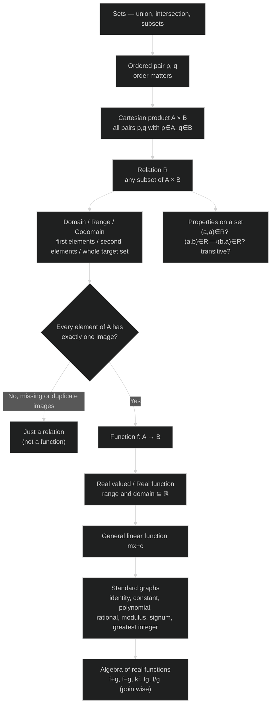
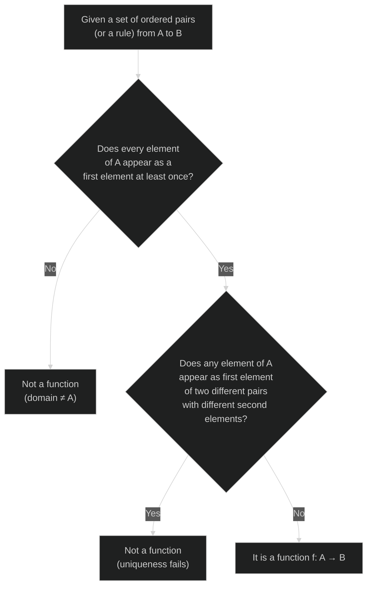
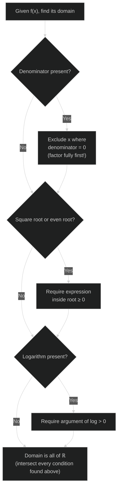
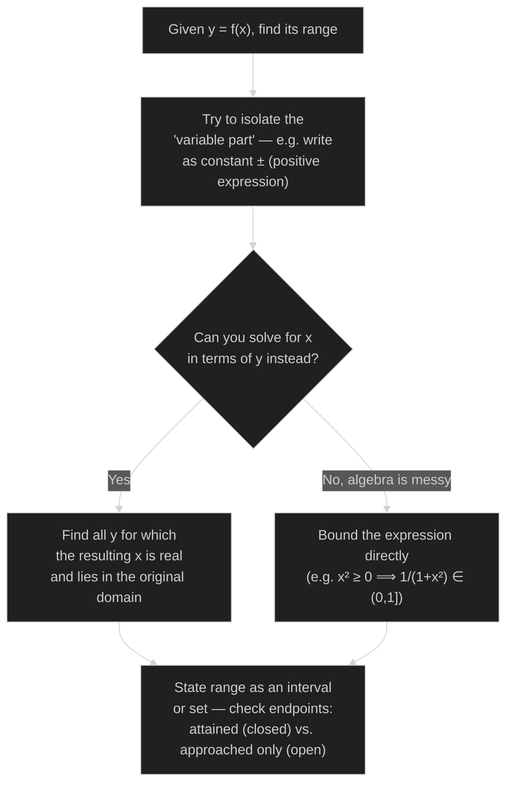
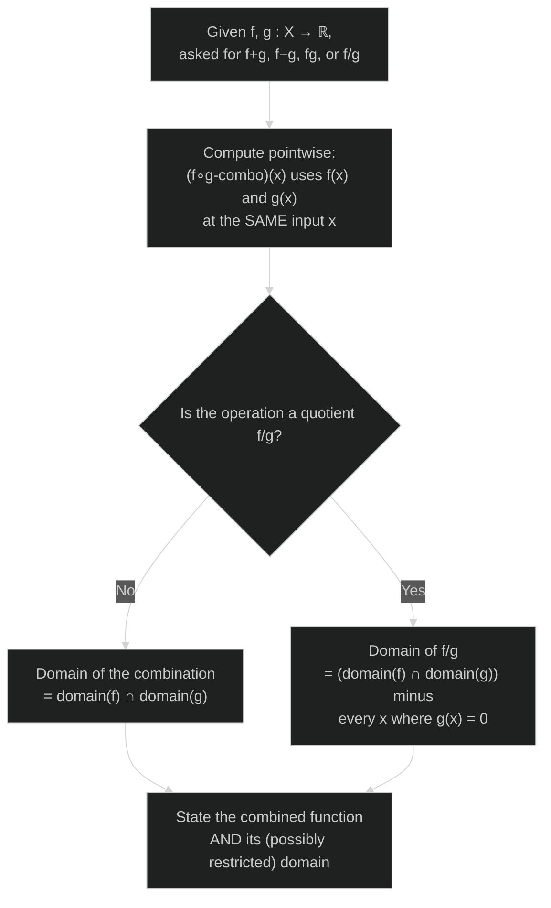
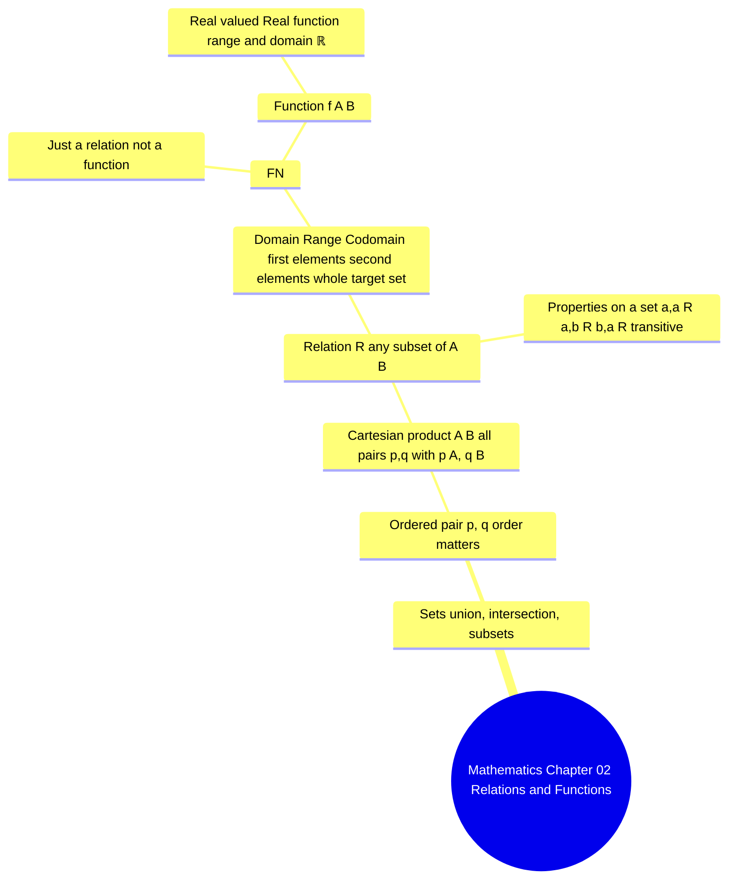

# Mathematics | Chapter 02 | Relations and Functions | CNOTES

> This file holds the chapter's **Concept Roadmap** and its **Problem-Solving Strategy** flowcharts only — for definitions and worked examples see the NOTES file, and for the formula/quick-reference sheet see the GLOSSARY file. *(Upgrade note: this content previously lived under the wrong filename — a `-PQs.md` file that, despite its name, contained this roadmap rather than practice questions. It has been moved here, and `-PQs.md` now holds actual solved practice questions from NCERT Exercises 2.1–2.3 and the Miscellaneous Exercise.)*

## Concept Roadmap

How every idea in this chapter builds on the one before it — from Sets, all the way to combining functions algebraically.

*Reading the map:* everything below "Relation" on the left branch is a *subset* of everything above it — a function is a relation, a real function is a function, and the seven standard graphs are just specific real functions worth memorizing by sight (with the general linear function \(mx+c\) as the parent case identity and constant both fall out of). The right branch — reflexivity, symmetry, transitivity — is a separate axis that any relation *on a set* can be tested against, independent of whether it happens to be a function. The algebra of functions at the bottom only makes sense once domain/range discipline (top half) is second nature — every combined function inherits domain restrictions from its pieces.

---

## Problem-Solving Strategy

### Strategy 1 — "Is this a relation or a function?"

### Strategy 2 — "Find the domain of a given expression"

### Strategy 3 — "Find the range of a given function"

*A worked instance of Strategy 3 lives in the main notes: \(f(x)=\dfrac{x^2}{1+x^2}\) rewritten as \(1-\dfrac{1}{1+x^2}\), giving range \([0,1)\) — closed at \(0\) because it's attained at \(x=0\), open at \(1\) because it's only approached as \(x\to\pm\infty\).*

## Section-by-section key facts

- **2.1 Cartesian products:** Ordered pairs preserve order, and \(A\times B\) contains every pair with first element from \(A\) and second from \(B\). For finite sets, \(n(A\times B)=n(A)n(B)\).
- **2.2 Relations:** A relation from \(A\) to \(B\) is any subset of \(A\times B\). Its domain consists of first components that occur, its range of second components that occur, and its codomain is the target set \(B\).
- **2.3 Functions:** A function \(f:A\to B\) assigns every element of \(A\) exactly one image in \(B\); missing or multiple images violate the definition.
- **2.4 Real functions:** Domain and range restrictions determine the graph. Standard examples include identity, constant, polynomial, rational, modulus, signum and greatest-integer functions.
- **2.5 Algebra of real functions:** Sum, difference and product are defined pointwise on the common domain; the quotient also excludes points where the denominator function is zero.

### Strategy 4 — "Combine two real functions \(f\) and \(g\)"

*Reading the map:* the one place students lose marks here isn't the algebra — it's forgetting the quotient's extra restriction. Both worked examples in the main notes (NCERT Examples 16 and 17) show a value where \(f\) and \(g\) are individually fine but \(f/g\) is excluded solely because \(g(x)=0\) there.

## Chapter Mindmap

