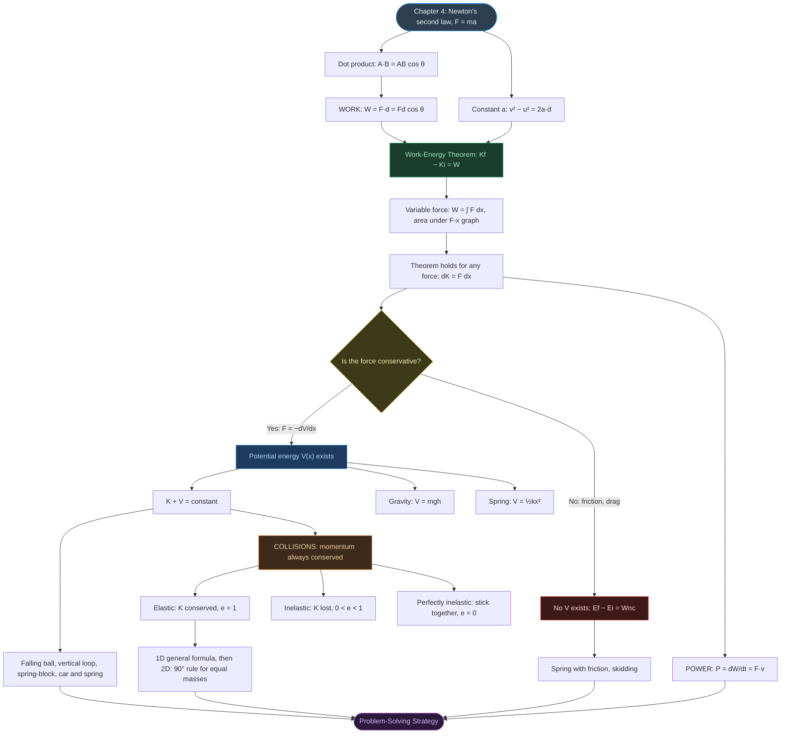
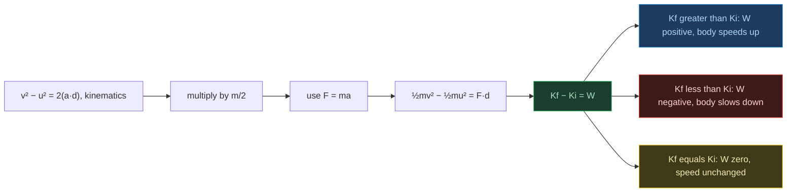
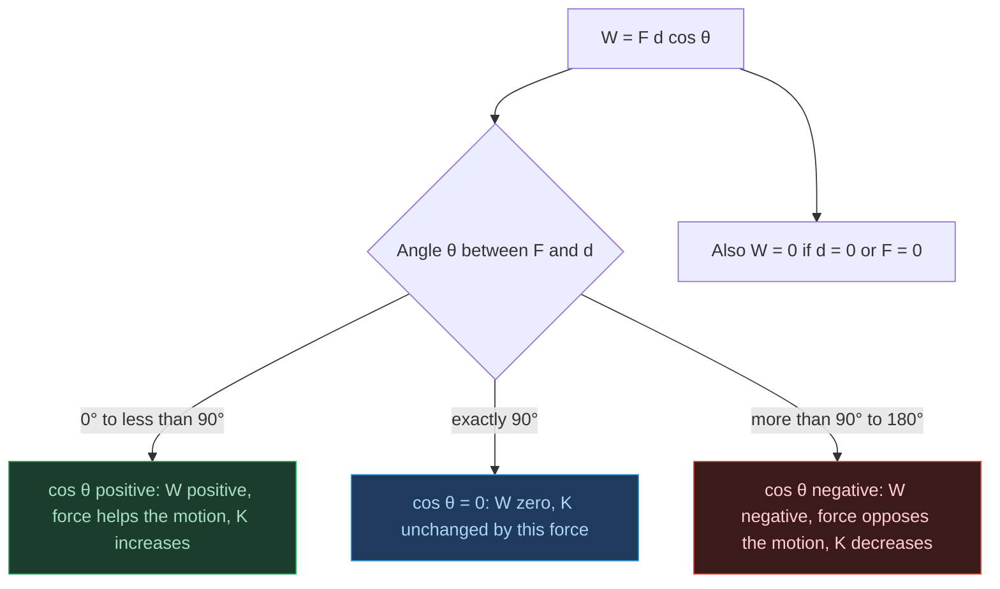
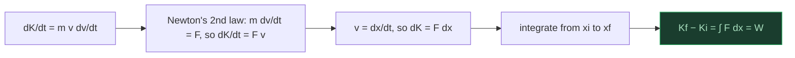
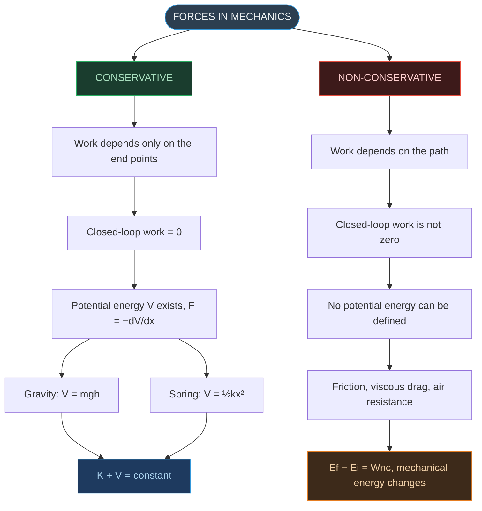
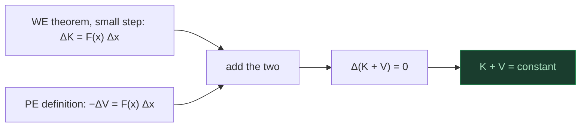
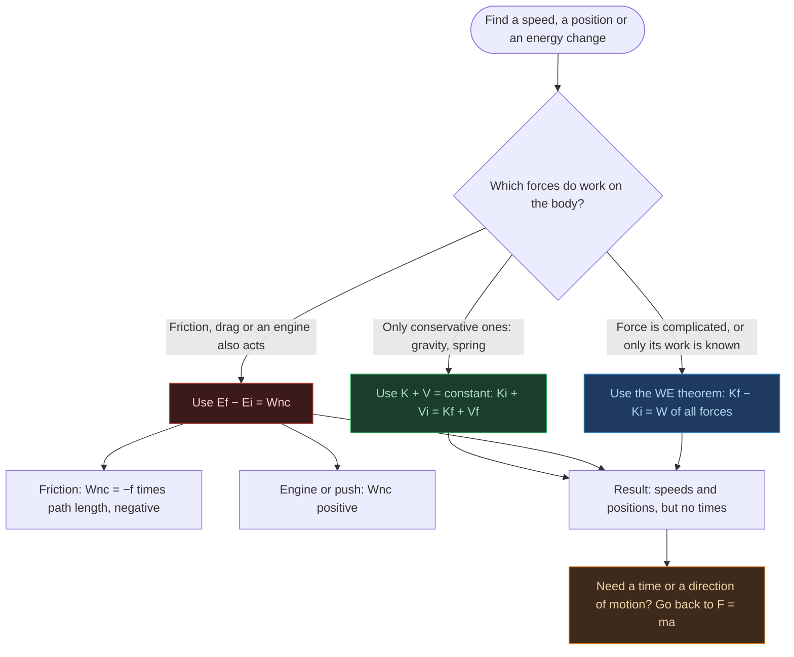
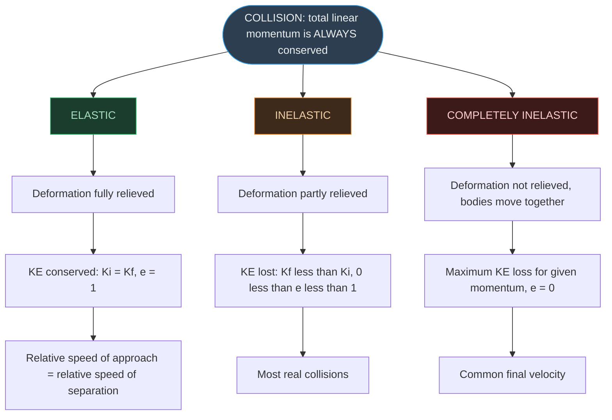
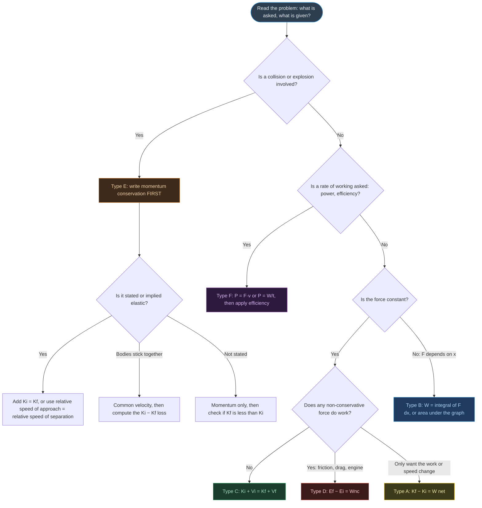

# Physics | Chapter 05 | Work, Energy and Power | NOTES

### Complete Study Notes | Board · NEET · JEE Layered

---

## Chapter Brief

Chapter 4 explained motion *moment by moment*: a force acts, an acceleration follows, and the velocity changes. This chapter takes the other route. Instead of following every instant, it asks what a force accomplishes **over a stretch of displacement** (work), what a moving body is *able to do* because of its speed (kinetic energy), what a body or spring *stores* because of where it sits (potential energy), and how *fast* any of this happens (power). The payoff is a set of conservation laws that solve problems in a single line which Newton's second law would need pages to handle: the speed at the bottom of a slide, the compression of a spring, the minimum speed to loop a vertical circle, and the outcome of a collision. By the end, the reader should be able to look at a problem and choose, within seconds, between a force method, an energy method and a momentum method.

## Front Matter

**Prerequisites:** Newton's laws of motion and the equations of uniformly accelerated motion (Chapter 4 and Chapter 2), vector components and addition (Chapter 3), the idea of momentum and its conservation (Chapter 4), and elementary calculus (differentiation, and integration of simple powers, $1/x$).

**Key outcomes** — by the end of this chapter, the reader should be able to:
- Evaluate the scalar (dot) product of two vectors in magnitude–angle form and in component form, and use it to compute work and power.
- Derive the work–energy theorem for a constant force and for a variable force, and use it when the force is complicated or unknown.
- Compute the work done by a variable force as an area under an $F$–$x$ graph or as a definite integral.
- Decide whether a force is conservative, define its potential energy through $F=-dV/dx$, and apply conservation of mechanical energy.
- Derive and use the spring potential energy $\tfrac12kx^2$, including the speed at any position and the effect of friction.
- Apply the modified energy equation $E_f-E_i=W_{nc}$ when non-conservative forces act.
- Compute average and instantaneous power, and convert between watt, horse-power and kilowatt-hour.
- Solve one-dimensional elastic and perfectly inelastic collisions, derive the general elastic result from first principles, and handle a two-dimensional glancing collision.

**Scope note:** Motion is treated along a straight line (one dimension) for the derivations, with vectors used only where the dot product is needed. The variation of $g$ with height, the gravitational potential energy $-GMm/r$, rotational kinetic energy and rolling motion belong to later chapters (Gravitation, Rotational Motion) and appear here only as forward pointers.

**Labelling convention for worked examples:**
- `(NCERT 5.x)` — taken from the textbook, with its numbering.
- `(Class notes)` — taken from the handwritten class notes, re-derived and checked.
- `(New)` — added here to fill a gap or to give extra practice.

Where a textbook or class-note answer failed an independent recomputation, the note says so in a `[!warning]` box rather than copying the number.

## Table of Contents

- **§1 Introduction and the Scalar (Dot) Product**
  - 1.1 Why Everyday Words Need Precise Definitions
  - 1.2 The Scalar Product — Definition
  - 1.3 Geometric Meaning: Projection
  - 1.4 Properties of the Dot Product
  - 1.5 Component Form — Derivation
  - 1.6 Interactive — Dot Product Versus Angle
  - 1.7 Solved Example (NCERT 5.1)
- **§2 The Work–Energy Theorem for a Constant Force**
  - 2.1 Starting Point: Kinematics
  - 2.2 Derivation (1D → 3D)
  - 2.3 Statement of the Theorem
  - 2.4 Reading the Theorem
  - 2.5 Solved Example (NCERT 5.2) — Raindrop
- **§3 Work**
  - 3.1 Definition
  - 3.2 When Is Work Zero?
  - 3.3 Sign of Work
  - 3.4 Interactive — Work Versus Angle
  - 3.5 Units and Dimensions
  - 3.6 Solved Example (NCERT 5.3) — Skidding Cyclist
  - 3.7 Why $W_{12}+W_{21}$ Need Not Vanish
  - 3.8 Additional Practice — Work Using Vectors
- **§4 Kinetic Energy**
  - 4.1 Definition
  - 4.2 Kinetic Energy and Momentum
  - 4.3 Interactive — Kinetic Energy Versus Speed
  - 4.4 Typical Kinetic Energies
  - 4.5 Solved Example (NCERT 5.4) — Bullet Through Plywood
- **§5 Work Done by a Variable Force**
  - 5.1 From Rectangles to an Integral
  - 5.2 Area Under the $F$–$x$ Graph
  - 5.3 Interactive — Work Accumulating With the Upper Limit
  - 5.4 Solved Example (NCERT 5.5) — Pushing a Trunk
  - 5.5 Additional Practice — Variable-Force Integrals
- **§6 The Work–Energy Theorem for a Variable Force**
  - 6.1 Proof (Textbook Route)
  - 6.2 Alternate Proof (Class-Notes Route)
  - 6.3 Work–Energy Theorem Versus Newton's Second Law
  - 6.4 Solved Example (NCERT 5.6) — Rough Patch
  - 6.5 Interactive — The $-k/x$ Patch
- **§7 Potential Energy and Conservative Forces**
  - 7.1 What Is Potential Energy?
  - 7.2 Gravitational Potential Energy — Derivation
  - 7.3 The Relation $F=-dV/dx$
  - 7.4 Conservative Forces — Three Equivalent Definitions
  - 7.5 Path Independence — Same Height, Any Path
  - 7.6 Classification of Forces
  - 7.7 Sign of Potential Energy
  - 7.8 Types of Potential Energy
- **§8 Conservation of Mechanical Energy**
  - 8.1 Derivation
  - 8.2 Ball Dropped From a Height $H$
  - 8.3 Interactive — Energy Bookkeeping During a Fall
  - 8.4 Solved Example (NCERT 5.7) — Bob on a Vertical Circle
  - 8.5 Energy at Key Points
- **§9 Potential Energy of a Spring**
  - 9.1 Hooke's Law
  - 9.2 Work Done by the Spring Force
  - 9.3 Spring Potential Energy
  - 9.4 The Spring Force Is Conservative
  - 9.5 Energy and Speed at Different Positions
  - 9.6 Interactive — Complementary Parabolas
  - 9.7 Solved Example (NCERT 5.8) — Car and Spring
  - 9.8 Solved Example (NCERT 5.9) — Spring With Friction
  - 9.9 Additional Solved — Block Dropped Onto a Vertical Spring
  - 9.10 Remarks on Conservative Forces
- **§10 Non-Conservative Forces and the Modified Energy Equation**
  - 10.1 Derivation
  - 10.2 Which Principle Do I Use?
- **§11 Power**
  - 11.1 Definition
  - 11.2 Instantaneous Power $P=\mathbf F\cdot\mathbf v$ — Derivation
  - 11.3 Units: Watt, Horse-Power, Kilowatt-Hour
  - 11.4 Interactive — Constant-Power Hyperbola
  - 11.5 Solved Example (NCERT 5.10) — Elevator
  - 11.6 Constant Acceleration and Constant Power (New)
  - 11.7 A Pitfall With Variable Force (New)
- **§12 Collisions**
  - 12.1 What Is a Collision?
  - 12.2 Momentum Is Always Conserved — Derivation
  - 12.3 Types of Collision
  - 12.4 Completely Inelastic Collision in 1D
  - 12.5 General Elastic Collision in 1D
  - 12.6 Special Case: Target at Rest
  - 12.7 Special Cases of Elastic Collision
  - 12.8 Interactive — Outcomes Versus Mass Ratio
  - 12.9 Solved Example (NCERT 5.11) — Slowing Down Neutrons
  - 12.10 Elastic Collision in Two Dimensions
  - 12.11 Solved Example (NCERT 5.12) — Billiard Balls
  - 12.12 Additional Practice — Collision Problems
  - 12.13 Scattering
- **§13 Worked NCERT Exercises**
  - 13.1 Exercise 5.2 — Block on a Rough Table
  - 13.2 Exercise 5.4 — Turning Points of an Oscillator
  - 13.3 Exercise 5.12 — Electron Versus Proton
  - 13.4 Exercises 5.17 and 5.18 — Pendulum Problems
  - 13.5 Exercise 5.20 — Work From a Velocity Law
  - 13.6 Exercises 5.15 and 5.21 — Power Applications
- Quick Reference
- Points to Ponder
- Key Historical Persons
- Problem-Solving Strategy

---

## 🗺️ CONCEPT ROADMAP



*How to read it:* the green node (work–energy theorem) is the hinge of the whole chapter. Everything to its left is preparation (dot product, work, kinematics); everything to its right is a consequence. The yellow decision diamond is the single question that splits the chapter in two: if the force is conservative you gain a potential energy and a conservation law; if not, you fall back on the modified energy equation. Collisions (orange) hang off conservation laws rather than off forces, which is why they work even when the collision force is unknown.

---

## SECTION 1 — INTRODUCTION AND THE SCALAR (DOT) PRODUCT ⭐⭐

### 1.1 Why Everyday Words Need Precise Definitions

In daily speech a farmer ploughing, a student studying and an artist painting are all "working", and a person who can work 14–16 hours a day has "a lot of energy". Physics keeps the words but fixes their meanings:

| Everyday idea | Precise physics meaning |
|:---|:---|
| Work | A force acting **over a displacement**, counted only along the direction of motion |
| Energy | The **capacity to do work** (the quantity that is transferred when work is done) |
| Power | The **rate** at which work is done or energy is transferred |

The loose correlation between the two vocabularies is exactly that: loose. Pushing hard against a rigid wall tires you out, yet the wall does not move, so the work done on it is zero. To define work properly, one mathematical tool is needed first: the scalar product.

### 1.2 The Scalar Product — Definition

Vectors can be multiplied in two ways. One gives a **scalar** (the dot product, used here); the other gives a **vector** (the cross product, met in Chapter 6).

> [!note] Definition
> The **scalar product** (dot product) of two vectors $\mathbf A$ and $\mathbf B$, read "$\mathbf A$ dot $\mathbf B$", is
> $$\boxed{\mathbf A\cdot\mathbf B=AB\cos\theta}\qquad\text{...(5.1a)}$$
> where $\theta$ is the angle between the two vectors when they are drawn tail to tail.

Because $A$, $B$ and $\cos\theta$ are all scalars, the result is a **scalar**. Each vector has a direction, but their dot product does not.

### 1.3 Geometric Meaning: Projection

**Step 1 — regroup the factors to expose a projection:**

$$\mathbf A\cdot\mathbf B=A\,(B\cos\theta)$$

**Step 2 — regroup the other way:**

$$\mathbf A\cdot\mathbf B=B\,(A\cos\theta)$$

Here $B\cos\theta$ is the component (projection) of $\mathbf B$ along $\mathbf A$, and $A\cos\theta$ is the component of $\mathbf A$ along $\mathbf B$.

```tikz
\usetikzlibrary{arrows.meta}
\begin{tikzpicture}[>={Stealth[length=7pt,width=5pt]}, thick, scale=1.05]
  \coordinate (O) at (0,0);
  \coordinate (A) at (4,0);
  \coordinate (B) at (2.45,2.06);
  \coordinate (F) at (2.45,0);
  \draw[->, blue!70!black, line width=1.6pt] (O) -- (A) node[midway, below, font=\small] {$\mathbf{A}$};
  \draw[->, green!55!black, line width=1.6pt] (O) -- (B) node[midway, above left, font=\small] {$\mathbf{B}$};
  \draw[dashed, gray] (B) -- (F);
  \draw[orange!80!black, line width=1.6pt] (O) -- (F) node[midway, below, font=\small, orange!80!black] {$B\cos\theta$};
  \draw[orange!80!black] (0.7,0) arc (0:40:0.7);
  \node[font=\small, orange!80!black] at (0.95,0.35) {$\theta$};
  \node[below, font=\itshape\small, text=gray] at (2,-0.9) {$\mathbf A\cdot\mathbf B$ = (length of $\mathbf A$) $\times$ (shadow of $\mathbf B$ on $\mathbf A$)};
\end{tikzpicture}
```

The orange segment is the "shadow" of $\mathbf B$ cast onto the line of $\mathbf A$ by light shining perpendicular to $\mathbf A$. The dot product is $A$ times the length of that shadow. When $\theta>90^\circ$ the shadow points backward, so the product is negative.

### 1.4 Properties of the Dot Product

| Property | Statement |
|:---|:---|
| **Commutative** | $\mathbf A\cdot\mathbf B=\mathbf B\cdot\mathbf A$ (the expression $AB\cos\theta$ is symmetric) |
| **Distributive** | $\mathbf A\cdot(\mathbf B+\mathbf C)=\mathbf A\cdot\mathbf B+\mathbf A\cdot\mathbf C$ |
| **Scalar multiple** | $\mathbf A\cdot(\lambda\mathbf B)=\lambda(\mathbf A\cdot\mathbf B)$ for a real number $\lambda$ |
| **Perpendicular vectors** | $\mathbf A\cdot\mathbf B=0$ when $\theta=90^\circ$ (even if neither vector is zero) |
| **Parallel vectors** | $\mathbf A\cdot\mathbf B=AB$ when $\theta=0^\circ$; $-AB$ when $\theta=180^\circ$ |
| **Self product** | $\mathbf A\cdot\mathbf A=A^2$, since $\cos0^\circ=1$ |

For the unit vectors along the axes:

$$\hat\imath\cdot\hat\imath=\hat\jmath\cdot\hat\jmath=\hat k\cdot\hat k=1$$

$$\hat\imath\cdot\hat\jmath=\hat\jmath\cdot\hat k=\hat k\cdot\hat\imath=0$$

> [!warning] Zero dot product does not mean zero vector
> $\mathbf A\cdot\mathbf B=0$ only says the vectors are perpendicular **or** one of them is zero. This is why a force can be non-zero and a displacement non-zero, yet the work done is zero.

### 1.5 Component Form — Derivation

**Step 1 — write both vectors in components:**

$$\mathbf A=A_x\hat\imath+A_y\hat\jmath+A_z\hat k,\qquad \mathbf B=B_x\hat\imath+B_y\hat\jmath+B_z\hat k$$

**Step 2 — dot them and expand with the distributive law (nine terms appear):**

$$\mathbf A\cdot\mathbf B=\left(A_x\hat\imath+A_y\hat\jmath+A_z\hat k\right)\cdot\left(B_x\hat\imath+B_y\hat\jmath+B_z\hat k\right)$$

$$=A_xB_x(\hat\imath\cdot\hat\imath)+A_xB_y(\hat\imath\cdot\hat\jmath)+A_xB_z(\hat\imath\cdot\hat k)+\dots+A_zB_z(\hat k\cdot\hat k)$$

**Step 3 — apply the unit-vector table: the six cross terms vanish and the three "like" terms carry a factor 1:**

$$\boxed{\mathbf A\cdot\mathbf B=A_xB_x+A_yB_y+A_zB_z}\qquad\text{...(5.1b)}$$

**Step 4 — set $\mathbf B=\mathbf A$ to get the magnitude formula:**

$$\mathbf A\cdot\mathbf A=A^2=A_x^2+A_y^2+A_z^2\qquad\text{...(5.1c)}$$

**Step 5 — equate the two forms of the dot product to extract the angle between two vectors:**

$$\cos\theta=\frac{A_xB_x+A_yB_y+A_zB_z}{AB}$$

### 1.6 Interactive — Dot Product Versus Angle

Vector $\mathbf A$ lies along the $x$-axis. Vector $\mathbf B$ is rotated by the angle $q$. The orange segment is the projection $B\cos q$ and the vertical purple segment drops from the tip of $\mathbf B$ onto the line of $\mathbf A$. The value $D=AB\cos q$ is the dot product.

| Desmos variable | Meaning | Matches this note's notation |
|:---|:---|:---|
| $a$ | length of $\mathbf A$ (slider) | $A$ |
| $b$ | length of $\mathbf B$ (slider) | $B$ |
| $q$ | angle between them (slider) | $\theta$ |
| $D$ | $ab\cos q$ | $\mathbf A\cdot\mathbf B$ |

```desmos
%view x=(-5.5,5.5) y=(-5.5,5.5)
@lengthA [slider=(1,5,0.1)]: a=4
@lengthB [slider=(1,5,0.1)]: b=3
@angle [slider=(0,3.14,0.05)]: q=0.9
@vectorA [parametricDomain=(0,1), color=#2d70b3]: \left(ta,0\right)
@vectorB [parametricDomain=(0,1), color=#388c46]: \left(tb\cos q,tb\sin q\right)
@projection [parametricDomain=(0,1), color=#fa7e19]: \left(tb\cos q,0\right)
@drop [parametricDomain=(0,1), color=#6042a6]: \left(b\cos q,tb\sin q\right)
D=ab\cos q
```

Drag $q$ from $0$ to $\pi$: the orange projection shrinks from the full length of $\mathbf B$ down to zero at $q=\pi/2$ (perpendicular, so $D=0$) and then flips to the *negative* side of the $x$-axis, making $D$ negative. Now change $b$ and watch $D$ scale linearly with it.

### 1.7 Solved Example (NCERT 5.1)

**Given:** $\mathbf F=(3\hat\imath+4\hat\jmath-5\hat k)$ unit, $\mathbf d=(5\hat\imath+4\hat\jmath+3\hat k)$ unit.

**Find:** the angle between $\mathbf F$ and $\mathbf d$, and the projection of $\mathbf F$ on $\mathbf d$.

**Model:** use the component form (5.1b) for $\mathbf F\cdot\mathbf d$, the magnitude form (5.1c) for $F$ and $d$, then (5.1a) for the angle.

**Step 1 — dot product from components:**

$$\mathbf F\cdot\mathbf d=(3)(5)+(4)(4)+(-5)(3)=15+16-15=16\ \text{unit}$$

**Step 2 — magnitudes from (5.1c):**

$$F^2=3^2+4^2+(-5)^2=9+16+25=50,\qquad d^2=5^2+4^2+3^2=25+16+9=50$$

**Step 3 — solve $\mathbf F\cdot\mathbf d=Fd\cos\theta$ for the angle:**

$$\cos\theta=\frac{16}{\sqrt{50}\,\sqrt{50}}=\frac{16}{50}=0.32\;\Rightarrow\;\theta=\cos^{-1}(0.32)\approx71.3^\circ$$

**Step 4 — projection of $\mathbf F$ on $\mathbf d$ is $F\cos\theta=(\mathbf F\cdot\mathbf d)/d$:**

$$F\cos\theta=\frac{16}{\sqrt{50}}\approx2.26\ \text{unit}$$

**Check:** the dot product is positive, so the angle is acute ($71.3^\circ<90^\circ$) ✓. The projection $2.26$ is smaller than $F=\sqrt{50}\approx7.07$, as any projection must be ✓.

---

## SECTION 2 — THE WORK–ENERGY THEOREM FOR A CONSTANT FORCE ⭐⭐⭐

### 2.1 Starting Point: Kinematics

For motion in a straight line with constant acceleration $a$, the speeds $u$ (initial) and $v$ (final) and the distance $s$ covered are linked by the equation from Chapter 2:

$$v^2-u^2=2as\qquad\text{...(5.2)}$$

The aim is to dress this purely kinematic statement in dynamics by multiplying it by mass.

### 2.2 Derivation (1D → 3D)

**Step 1 — start from constant-acceleration kinematics:**

$$v^2-u^2=2as$$

**Step 2 — multiply both sides by $m/2$:**

$$\tfrac12mv^2-\tfrac12mu^2=mas$$

**Step 3 — replace $ma$ by the force using Newton's second law $F=ma$:**

$$\tfrac12mv^2-\tfrac12mu^2=Fs\qquad\text{...(5.2a)}$$

**Step 4 — generalise to three dimensions. For constant $\mathbf a$ we have $\mathbf v=\mathbf u+\mathbf at$ and $\mathbf d=\mathbf ut+\tfrac12\mathbf at^2$. Dotting $\mathbf v$ with itself:**

$$v^2=\mathbf v\cdot\mathbf v=u^2+2(\mathbf u\cdot\mathbf a)t+a^2t^2$$

**Step 5 — dot $\mathbf a$ with the displacement and double it:**

$$2\,\mathbf a\cdot\mathbf d=2(\mathbf a\cdot\mathbf u)t+a^2t^2$$

**Step 6 — subtract Step 5 from Step 4 (the right-hand sides match term by term):**

$$v^2-u^2=2\,\mathbf a\cdot\mathbf d$$

**Step 7 — multiply by $m/2$ and use $\mathbf F=m\mathbf a$:**

$$\tfrac12mv^2-\tfrac12mu^2=m\,\mathbf a\cdot\mathbf d=\mathbf F\cdot\mathbf d\qquad\text{...(5.2b)}$$

**Step 8 — name the two sides. The left side is the change in the quantity "half mass times speed squared" (call each term a kinetic energy $K$); the right side is the work $W$ done by the force:**

$$\boxed{K_f-K_i=W}\qquad\text{...(5.3)}$$



*Reading guide:* the left half is pure algebra; the physics enters at exactly one box ("use $F=ma$"). The three outcomes on the right are the only three things the sign of the net work can tell you about the speed.

### 2.3 Statement of the Theorem

> [!important] Work–Energy (WE) Theorem
> **The change in the kinetic energy of a particle equals the work done on it by the net force.**
> $$K_f-K_i=W_{net}$$

Remember: work is done **by a force on a body over a displacement**. Always say which force, and which body.

### 2.4 Reading the Theorem

- It is a **scalar** equation: direction information in $\mathbf F=m\mathbf a$ is integrated over and not retained (see §6.3).
- It lets you find the work done by a force **without knowing the force itself**, provided you know the change in kinetic energy and the work done by the other forces (Example 5.2 below).
- It holds in all inertial frames, and it can be extended to non-inertial frames if pseudo-forces are included in the net force.

### 2.5 Solved Example (NCERT 5.2) — Raindrop

**Given:** a raindrop of mass $m=1.00\ \text{g}=10^{-3}\ \text{kg}$ falls from rest through $h=1.00\ \text{km}=10^3\ \text{m}$ and hits the ground at $v=50.0\ \text{m s}^{-1}$. Take $g=10\ \text{m s}^{-2}$.

**Find:** (a) the work done by gravity; (b) the work done by the unknown resistive force.

**Model:** gravity and the resistive force are the only forces, so $K_f-K_i=W_g+W_r$. The resistive force is unknown, but the theorem lets us find its work indirectly.

**Step 1 — change in kinetic energy (the drop starts from rest):**

$$\Delta K=\tfrac12mv^2-0=\tfrac12(10^{-3})(50)^2=1.25\ \text{J}$$

**Step 2 — work done by gravity (force along the displacement):**

$$W_g=mgh=(10^{-3})(10)(10^3)=10.0\ \text{J}$$

**Step 3 — apply the WE theorem $\Delta K=W_g+W_r$ and solve for $W_r$:**

$$W_r=\Delta K-W_g=1.25-10.0=-8.75\ \text{J}$$

**Check:** the resistive force opposes the downward motion, so its work must be **negative** ✓. Gravity supplied $10$ J, but only $1.25$ J became kinetic energy; the remaining $8.75$ J ($87.5\%$) was removed by air resistance.

---

## SECTION 3 — WORK ⭐⭐⭐

### 3.1 Definition

Consider a constant force $\mathbf F$ acting on a body that undergoes a displacement $\mathbf d$, with angle $\theta$ between them.

> [!note] Definition
> **Work** is the product of the component of the force along the displacement and the magnitude of the displacement.
> $$\boxed{W=(F\cos\theta)\,d=\mathbf F\cdot\mathbf d}\qquad\text{...(5.4)}$$

This is exactly the right-hand side of Eq. (5.2b), which is why the work–energy theorem comes out so naturally.

```tikz
\usetikzlibrary{arrows.meta}
\begin{tikzpicture}[>={Stealth[length=7pt,width=5pt]}, thick, scale=1.0]
  \draw[line width=1pt] (-0.3,0) -- (6.3,0);
  \draw[gray] (0,0)--(-0.2,-0.25) (1.2,0)--(1.0,-0.25) (2.4,0)--(2.2,-0.25)
              (3.6,0)--(3.4,-0.25) (4.8,0)--(4.6,-0.25) (6.0,0)--(5.8,-0.25);
  \draw[fill=blue!15] (0,0) rectangle (1,0.8);
  \draw[dashed, fill=blue!5] (4,0) rectangle (5,0.8);
  \draw[->, black, line width=1pt] (0.5,-0.6) -- (4.5,-0.6) node[midway, below, font=\small] {$d$};
  \draw[->, red!75!black, line width=1.8pt] (0.5,0.4) -- (2.1,1.55) node[above, font=\small] {$\mathbf{F}$};
  \draw[red!75!black] (1.0,0.4) arc (0:35:0.5);
  \node[font=\small, red!75!black] at (1.35,0.62) {$\theta$};
  \node[below, font=\itshape\small, text=gray] at (2.5,-1.1) {$W=(F\cos\theta)d$ -- only the component along $d$ does work};
\end{tikzpicture}
```

Only the part of the force that points along the motion does work. The vertical part of $\mathbf F$ in the picture lifts (or presses) the block but contributes nothing to the work, because it is perpendicular to $\mathbf d$.

### 3.2 When Is Work Zero?

| Condition | Why $W=Fd\cos\theta=0$ | Example |
|:---|:---|:---|
| $d=0$ | No displacement | A weightlifter holds a $150$ kg load steadily on the shoulder for $30$ s; pushing hard on a rigid brick wall |
| $F=0$ | No force | A block sliding on a smooth (frictionless) horizontal table has no horizontal force on it |
| $\theta=90^\circ$ | $\cos90^\circ=0$ | Gravity on a block moving horizontally; the Earth's pull on a Moon in a perfectly circular orbit |

> [!note] Muscles tire, but no work is done
> Holding a load still makes the muscle fibres contract and relax continuously, so internal chemical energy is used up and you get tired. Physics counts only the **mechanical work done on the load**, which is zero because the load does not move.

### 3.3 Sign of Work



| Case | Angle | Work | Class-notes statement | Example |
|:---|:---|:---|:---|:---|
| Positive | $\theta=0^\circ$ | $W=+Fd$ | Force and displacement along the same direction | Pushing a trolley forward |
| Negative | $\theta=180^\circ$ | $W=-Fd$ | Force and displacement in opposite directions | **Friction** on a sliding body; gravity on a body being lifted |
| Zero | $\theta=90^\circ$ | $W=0$ | Force perpendicular to displacement | Normal force on a body moving along a surface |

**Types of force (class notes).** A **constant force** keeps both magnitude and direction fixed, so $W=Fd\cos\theta$. A **variable force** depends on position, for example $F(x)=-kx$, and its work needs an integral (§5).

> [!warning] Sign traps
> Work by friction is negative. Work by gravity on a **rising** body is negative; on a **falling** body it is positive. Work by the normal force on a body sliding along a fixed surface is zero. Unlike mass or kinetic energy, work can be of either sign.

### 3.4 Interactive — Work Versus Angle

Hold the force and the displacement fixed, and sweep only the angle between them. The curve is $W=Fd\cos x$. Notice where it is positive, where it is zero, and where it is negative.

| Desmos variable | Meaning |
|:---|:---|
| $F$ | magnitude of the force (slider) |
| $d$ | magnitude of the displacement (slider) |
| $q$ | angle between $\mathbf F$ and $\mathbf d$ (slider) |
| $W$ | $Fd\cos q$, the work for that angle |

```desmos
%view x=(0,3.3) y=(-26,26)
@force [slider=(1,5,0.5)]: F=5
@displacement [slider=(1,5,0.5)]: d=4
@angle [slider=(0,3.14,0.05)]: q=0.6
y=Fd\cos x
y=0
W=Fd\cos q
P=\left(q,Fd\cos q\right)
```

At $q=0$ the work is the maximum possible, $+Fd$. It falls to zero at $q=\pi/2\approx1.57$ and reaches its most negative value $-Fd$ at $q=\pi$ (friction-like). Raising $F$ or $d$ stretches the curve vertically but never moves the place where it crosses zero: that crossing is set by the geometry alone.

### 3.5 Units and Dimensions

**Step 1 — dimensions of work:**

$$[W]=[F][d]=[MLT^{-2}][L]=[ML^2T^{-2}]$$

**Step 2 — SI unit** is the **joule (J)**, named after the British physicist James Prescott Joule:

$$1\ \text{J}=1\ \text{N m}=1\ \text{kg m}^2\,\text{s}^{-2}$$

Work and energy have the same dimensions, so they share units. Because they are used so widely, alternative units abound:

| Unit | Value in joule |
|:---|:---|
| erg | $10^{-7}$ J |
| electron volt (eV) | $1.6\times10^{-19}$ J |
| calorie (cal) | $4.186$ J |
| kilowatt-hour (kWh) | $3.6\times10^{6}$ J |

**Step 3 — check the kWh conversion:**

$$1\ \text{kWh}=(10^3\ \text{W})(3600\ \text{s})=3.6\times10^6\ \text{J}$$

### 3.6 Solved Example (NCERT 5.3) — Skidding Cyclist

**Given:** a cyclist skids to a stop in $10$ m. The road exerts a force of $200$ N on the cycle, directly opposite to the motion.

**Find:** (a) the work done by the road on the cycle; (b) the work done by the cycle on the road.

**Model:** work depends on the displacement of the body **on which the force acts**.

**Step 1 — (a) force and displacement are at $180^\circ$:**

$$W_r=Fd\cos\theta=(200)(10)\cos180^\circ=-2000\ \text{J}$$

This negative work is what brings the cycle to a halt, in line with the WE theorem.

**Step 2 — (b) by Newton's third law the cycle pushes back on the road with $200$ N, but the road does not move:**

$$d_{road}=0\;\Rightarrow\;W=0$$

**Check:** the two forces are equal and opposite, yet the two works ($-2000$ J and $0$) are not. That is the lesson of this example, derived next.

### 3.7 Why $W_{12}+W_{21}$ Need Not Vanish

Newton's third law says the force on body 1 from body 2 and the force on body 2 from body 1 are equal and opposite:

$$\mathbf F_{12}+\mathbf F_{21}=\mathbf 0$$

**Step 1 — write the work each force does over that body's own displacement ($\mathbf d_1$ and $\mathbf d_2$):**

$$W_{12}=\mathbf F_{12}\cdot\mathbf d_1,\qquad W_{21}=\mathbf F_{21}\cdot\mathbf d_2$$

**Step 2 — use $\mathbf F_{21}=-\mathbf F_{12}$ and add:**

$$W_{12}+W_{21}=\mathbf F_{12}\cdot\mathbf d_1-\mathbf F_{12}\cdot\mathbf d_2$$

**Step 3 — factor:**

$$W_{12}+W_{21}=\mathbf F_{12}\cdot(\mathbf d_1-\mathbf d_2)$$

The sum vanishes only if both bodies undergo the **same** displacement ($\mathbf d_1=\mathbf d_2$) or if the force is perpendicular to their relative displacement. In the cyclist example $\mathbf d_{cycle}=10$ m and $\mathbf d_{road}=0$, so the sum is $-2000$ J, which is not zero.

### 3.8 Additional Practice — Work Using Vectors

For any constant force, work is the dot product of the force and the displacement vector. The displacement between two points is **final position minus initial position**: $\mathbf S=\mathbf r_B-\mathbf r_A$.

> [!example] Class notes Q4 (New label: re-derived)
> $\mathbf F=(\hat\imath+5\hat\jmath+7\hat k)$ N acts on a particle that is displaced by $\mathbf S=(6\hat\imath+9\hat k)$ m.
>
> **Step 1 — dot product using components (the $\hat\jmath$ component of $\mathbf S$ is $0$):**
>
> $$W=\mathbf F\cdot\mathbf S=(1)(6)+(5)(0)+(7)(9)$$
>
> **Step 2 — evaluate:**
>
> $$W=6+0+63=69\ \text{J}$$

> [!example] Class notes Q5
> $\mathbf F=(2\hat\imath-3\hat\jmath+\hat k)$ N moves a body from $A(1,2,-3)$ to $B(2,0,-5)$.
>
> **Step 1 — displacement vector $\mathbf{AB}=\mathbf{OB}-\mathbf{OA}$:**
>
> $$\mathbf S=(2-1)\hat\imath+(0-2)\hat\jmath+(-5+3)\hat k=\hat\imath-2\hat\jmath-2\hat k$$
>
> **Step 2 — dot with the force:**
>
> $$W=(2)(1)+(-3)(-2)+(1)(-2)=2+6-2=6\ \text{J}$$

> [!example] Class notes Q6
> Two forces $\mathbf F_1=(2\hat\imath-3\hat\jmath+4\hat k)$ N and $\mathbf F_2=(-\hat\imath+2\hat\jmath-3\hat k)$ N displace a body from $A(2,1,0)$ to $B(-3,-4,-2)$.
>
> **Step 1 — net force (forces add as vectors):**
>
> $$\mathbf F_{net}=\mathbf F_1+\mathbf F_2=\hat\imath-\hat\jmath+\hat k$$
>
> **Step 2 — displacement $\mathbf{AB}=\mathbf{OB}-\mathbf{OA}$:**
>
> $$\mathbf S=(-3-2)\hat\imath+(-4-1)\hat\jmath+(-2-0)\hat k=-5\hat\imath-5\hat\jmath-2\hat k$$
>
> **Step 3 — work done by the net force:**
>
> $$W=(1)(-5)+(-1)(-5)+(1)(-2)=-5+5-2=-2\ \text{J}$$

> [!warning] Sign slip in the handwritten solution
> The class-notes page writes the $\hat k$ component of $\mathbf S$ as $+2$, which gives $W=+2$ J. Since $z_B-z_A=-2-0=-2$, the component is $-2$ and the correct work is **$-2$ J**. A single dropped sign in $\mathbf S=\mathbf r_B-\mathbf r_A$ flips the answer, so build $\mathbf S$ component by component.


---

## SECTION 4 — KINETIC ENERGY ⭐⭐

### 4.1 Definition

The left side of the WE theorem contains the combination $\tfrac12mv^2$. This is the **kinetic energy** of a body of mass $m$ moving with velocity $\mathbf v$:

> [!note] Definition
> $$\boxed{K=\tfrac12m\,\mathbf v\cdot\mathbf v=\tfrac12mv^2}\qquad\text{...(5.5)}$$
> **SI unit:** joule (J). **Dimensional formula:** $[ML^2T^{-2}]$.

Kinetic energy is a **scalar** and is **never negative**. It measures the work a body can do by virtue of its motion (a fast stream grinds corn; sailing ships use the kinetic energy of the wind).

**Why it equals "the work needed to start the body from rest":** set $K_i=0$ in the WE theorem and the final kinetic energy is $K_f=W$, the work done in bringing the body from rest to speed $v$.

### 4.2 Kinetic Energy and Momentum

Many problems give momentum rather than speed. The two are linked as follows.

**Step 1 — start from the definition:**

$$K=\tfrac12mv^2$$

**Step 2 — multiply numerator and denominator by $m$ (this changes nothing):**

$$K=\frac12\cdot\frac{m^2v^2}{m}$$

**Step 3 — recognise the momentum $p=mv$:**

$$\boxed{K=\frac{p^2}{2m}}$$

**Step 4 — invert to express momentum through kinetic energy:**

$$\boxed{p=\sqrt{2mK}}$$

**Step 5 — a third handy form, from $K=\tfrac12(mv)v$:**

$$K=\tfrac12pv$$

> [!tip] Which body has more energy?
> For **equal momenta**, $K\propto1/m$: the **lighter** body carries more kinetic energy. For **equal kinetic energies**, $p\propto\sqrt m$: the **heavier** body carries more momentum.

### 4.3 Interactive — Kinetic Energy Versus Speed

Kinetic energy grows as the **square** of speed. The orange point sits at **double** the chosen speed; compare its height with the blue point.

| Desmos variable | Meaning |
|:---|:---|
| $m$ | mass (slider) |
| $v$ | speed of the first point (slider) |
| blue point $P$ | $\left(v,\ \tfrac12mv^2\right)$ |
| orange point $Q$ | $\left(2v,\ \tfrac12m(2v)^2\right)$ |

```desmos
%view x=(0,10.5) y=(0,260)
@mass [slider=(0.5,5,0.5)]: m=2
@speed [slider=(0.5,5,0.5)]: v=3
y=\frac{1}{2}mx^2
@speedPoint [color=#2d70b3, label="v", showLabel]: \left(v,\frac{1}{2}mv^2\right)
@doubleSpeedPoint [color=#fa7e19, label="2v", showLabel]: \left(2v,\frac{1}{2}m\left(2v\right)^2\right)
```

Whatever $m$ and $v$ you choose, the orange point is exactly **four times** as high as the blue one. Double the speed and the kinetic energy quadruples, which is why stopping distance of a vehicle grows so quickly with speed.

For a fixed momentum, plot kinetic energy against **mass**:

```desmos
%view x=(0,10.5) y=(0,70)
@momentum [slider=(1,8,0.5)]: p=6
@mass [slider=(0.5,10,0.5)]: m=2
y=\frac{p^2}{2x}
@massPoint [color=#c74440, label="K at this mass", showLabel]: \left(m,\frac{p^2}{2m}\right)
```

The curve is the hyperbola $K=p^2/2m$. At equal momentum the kinetic energy falls as the mass rises, which is the content of the tip above.

### 4.4 Typical Kinetic Energies

| Object | Mass (kg) | Speed (m s⁻¹) | $K$ (J) |
|:---|:---|:---|:---|
| Car | $2000$ | $25$ | $6.3\times10^5$ |
| Running athlete | $70$ | $10$ | $3.5\times10^3$ |
| Bullet | $5\times10^{-2}$ | $200$ | $10^3$ |
| Stone dropped from $10$ m | $1$ | $14$ | $10^2$ |
| Raindrop at terminal speed | $3.5\times10^{-5}$ | $9$ | $1.4\times10^{-3}$ |
| Air molecule | $\approx10^{-26}$ | $500$ | $\approx10^{-21}$ |

A tiny fast bullet and a heavy running athlete land within a factor of four of each other: mass enters linearly, speed enters squared.

### 4.5 Solved Example (NCERT 5.4) — Bullet Through Plywood

**Given:** a bullet of mass $m=50.0\ \text{g}=0.05\ \text{kg}$ moves at $v_i=200\ \text{m s}^{-1}$ and emerges from soft plywood with $10\%$ of its initial kinetic energy.

**Find:** the emergent speed $v_f$.

**Model:** kinetic energy is $\tfrac12mv^2$; the final value is given as a fraction of the initial value.

**Step 1 — initial kinetic energy:**

$$K_i=\tfrac12(0.05)(200)^2=1000\ \text{J}$$

**Step 2 — final kinetic energy ($10\%$ of $K_i$):**

$$K_f=0.1\times1000=100\ \text{J}$$

**Step 3 — solve $\tfrac12mv_f^2=K_f$ for the speed:**

$$v_f=\sqrt{\frac{2K_f}{m}}=\sqrt{\frac{2\times100\ \text{J}}{0.05\ \text{kg}}}=63.2\ \text{m s}^{-1}$$

**Check:** speeds scale as the square root of kinetic energy, so $v_f/v_i=\sqrt{0.1}=0.316$. The speed fell by about $68\%$, **not $90\%$**.

> [!warning] Energy fraction is not speed fraction
> Losing $90\%$ of the kinetic energy does **not** mean losing $90\%$ of the speed. Because $K\propto v^2$, a $10\%$ energy remainder leaves $\sqrt{10\%}\approx31.6\%$ of the speed.

---

## SECTION 5 — WORK DONE BY A VARIABLE FORCE ⭐⭐⭐

A constant force is rare. Springs, gravity at large distances, and friction that changes with speed are all variable. Here the force depends on position, $F=F(x)$.

### 5.1 From Rectangles to an Integral

**Step 1 — over a tiny displacement $\Delta x$ the force is almost constant, so the earlier definition applies:**

$$\Delta W=F(x)\,\Delta x$$

**Step 2 — add the contributions of successive strips from the start $x_i$ to the end $x_f$:**

$$W\approx\sum_{x_i}^{x_f}F(x)\,\Delta x\qquad\text{...(5.6)}$$

**Step 3 — let every strip shrink ($\Delta x\to0$). The number of terms grows without limit but the sum approaches a definite value, the definite integral:**

$$\boxed{W=\lim_{\Delta x\to0}\sum_{x_i}^{x_f}F(x)\,\Delta x=\int_{x_i}^{x_f}F(x)\,dx}\qquad\text{...(5.7)}$$

### 5.2 Area Under the $F$–$x$ Graph

```tikz
\usetikzlibrary{arrows.meta}
\begin{tikzpicture}[>={Stealth[length=7pt,width=5pt]}, thick, scale=1.0]
  \draw[->, line width=1pt] (-0.3,0) -- (6.5,0) node[right, font=\small] {$x$};
  \draw[->, line width=1pt] (0,-0.3) -- (0,4) node[above, font=\small] {$F(x)$};
  \draw[blue!70!black, line width=1.6pt, smooth]
       plot coordinates {(0.3,0.8) (1.0,1.3) (1.8,1.6) (2.6,2.1) (3.4,2.0) (4.2,2.6) (5.0,3.1) (5.8,3.3)};
  \fill[blue!15]
       plot[smooth] coordinates {(1.8,0) (1.8,1.6) (2.6,2.1) (3.4,2.0) (4.2,2.6) (4.2,0)} -- cycle;
  \draw[dashed, gray] (1.8,0) -- (1.8,1.6);
  \draw[dashed, gray] (4.2,0) -- (4.2,2.6);
  \node[below, font=\small] at (1.8,-0.05) {$x_i$};
  \node[below, font=\small] at (4.2,-0.05) {$x_f$};
  \node[font=\small, blue!55!black] at (3.0,1.0) {Area $=\displaystyle\int_{x_i}^{x_f}\!F(x)\,dx=W$};
\end{tikzpicture}
```

The shaded region between the curve, the $x$-axis and the two limits is the work. Area **above** the axis counts as positive work (force along $+x$); area **below** the axis counts as negative work (force along $-x$ while moving along $+x$), exactly as the sign of $\cos\theta$ demands.

### 5.3 Interactive — Work Accumulating With the Upper Limit

Take $F(x)=7-2x+3x^2$ newtons (the class-notes force; $x$ in metres). Drag the upper limit $b$: the shaded area is the work from $0$ to $b$, and the point $(b,W)$ traces the running total.

| Desmos variable | Meaning |
|:---|:---|
| $b$ | upper limit of the displacement (slider) |
| $f(x)$ | the force $7-2x+3x^2$ |
| shaded region | area from $0$ to $b$ |
| $W$ | $\int_0^bf(s)\,ds$ |

```desmos
%view x=(0,5.5) y=(-5,140)
@upperLimit [slider=(0,5,0.1)]: b=3
f(x)=7-2x+3x^2
y=f(x)
0\le y\le f(x)\left\{0\le x\le b\right\}
W=\int_{0}^{b}f(s)ds
@workPoint [color=#c74440, label="running work", showLabel]: \left(b,W\right)
```

At $b=5$ the reading is $W=135$ J, the answer worked by hand in §5.5. Notice the red point climbs faster and faster: the force itself is increasing, so each extra metre adds more work than the last.

### 5.4 Solved Example (NCERT 5.5) — Pushing a Trunk

**Given:** a woman pushes a trunk on a rough platform. She applies $100$ N over the first $10$ m, then her force falls **linearly** to $50$ N by $x=20$ m. Friction is a constant $50$ N opposing the motion over the whole $20$ m.

**Find:** the work done by the woman and by friction over $20$ m.

**Model:** the force is piecewise; the work is the signed area under the $F$–$x$ graph. Friction acts along $-x$ while the displacement is along $+x$, so it is plotted below the axis.

```tikz
\usetikzlibrary{arrows.meta}
\begin{tikzpicture}[>={Stealth[length=7pt,width=5pt]}, thick, scale=1.0]
  \draw[->] (-0.3,0) -- (7.4,0) node[right, font=\small] {$x$ (m)};
  \draw[->] (0,-2.2) -- (0,4.1) node[above, font=\small] {$F$ (N)};
  \fill[blue!12] (0,0) rectangle (3.3,3.33);
  \fill[blue!20] (3.3,0) -- (3.3,3.33) -- (6.6,1.67) -- (6.6,0) -- cycle;
  \fill[red!15] (0,0) rectangle (6.6,-1.67);
  \draw[blue!70!black, line width=1.6pt] (0,3.33) -- (3.3,3.33) -- (6.6,1.67);
  \draw[red!70!black, line width=1.6pt] (0,-1.67) -- (6.6,-1.67);
  \draw[dashed, gray] (3.3,0) -- (3.3,3.33);
  \draw[dashed, gray] (6.6,0) -- (6.6,1.67);
  \node[left, font=\small] at (0,3.33) {100};
  \node[left, font=\small] at (0,1.67) {50};
  \node[left, font=\small] at (0,-1.67) {$-50$};
  \node[below, font=\small] at (3.3,-0.05) {10};
  \node[above, font=\small] at (6.6,0.05) {20};
  \node[font=\small, blue!55!black] at (1.65,1.65) {rectangle $1000$ J};
  \node[font=\small, blue!55!black] at (4.9,0.8) {trapezium $750$ J};
  \node[font=\small, red!60!black] at (3.3,-0.85) {friction: $-1000$ J};
  \node[below, font=\itshape\small, text=gray] at (3.3,-2.4) {Applied force above the axis, friction below the axis};
\end{tikzpicture}
```

**Step 1 — work by the woman, first $10$ m (rectangle of height $100$ N and width $10$ m):**

$$W_1=(100)(10)=1000\ \text{J}$$

**Step 2 — work by the woman, next $10$ m (trapezium with parallel sides $100$ N and $50$ N, width $10$ m):**

$$W_2=\tfrac12(100+50)(10)=750\ \text{J}$$

**Step 3 — total work by the woman:**

$$W_F=W_1+W_2=1000+750=1750\ \text{J}$$

**Step 4 — work by friction (a rectangle below the axis, $-50$ N over $20$ m):**

$$W_f=(-50)(20)=-1000\ \text{J}$$

**Check:** by the WE theorem the net work, $1750-1000=750$ J, is the kinetic energy gained by the trunk. The negative area for friction is not an error: area on the negative side of the force axis carries a negative sign.

### 5.5 Additional Practice — Variable-Force Integrals

> [!example] Class notes Q1 — $F(x)=7-2x+3x^2$ from $x=0$ to $x=5$ m
>
> **Step 1 — set up the integral:**
>
> $$W=\int_0^5(7-2x+3x^2)\,dx$$
>
> **Step 2 — integrate term by term (power rule):**
>
> $$W=\Big[7x-x^2+x^3\Big]_0^5$$
>
> **Step 3 — substitute the limits:**
>
> $$W=(35-25+125)-0=135\ \text{J}$$

> [!example] Class notes Q2 — $F(x)=a+bx$ from $x=0$ to $x=d$
>
> **Step 1 — set up and integrate:**
>
> $$W=\int_0^d(a+bx)\,dx=\Big[ax+\frac{bx^2}{2}\Big]_0^d$$
>
> **Step 2 — substitute the limits:**
>
> $$W=ad+\frac{bd^2}{2}=\frac{2ad+bd^2}{2}\ \text{J}$$

> [!example] Class notes Q3 — $F(x)=15+0.5x$ from $x=0$ to $x=2$ m
>
> **Step 1 — integrate ($0.5x$ integrates to $0.5x^2/2=x^2/4$):**
>
> $$W=\int_0^2(15+0.5x)\,dx=\Big[15x+\frac{x^2}{4}\Big]_0^2$$
>
> **Step 2 — substitute the limits:**
>
> $$W=\left(30+\frac44\right)-0=31\ \text{J}$$
>
> **Check:** the force rises from $15$ N to $16$ N over $2$ m, so the average force is $15.5$ N and $W=15.5\times2=31$ J ✓.

---

## SECTION 6 — THE WORK–ENERGY THEOREM FOR A VARIABLE FORCE ⭐⭐⭐

Section 2 proved the theorem only for a constant force. It holds just as well for a force that changes along the path. The proof is carried out in one dimension.

### 6.1 Proof (Textbook Route)



**Step 1 — differentiate $K=\tfrac12mv^2$ with respect to time:**

$$\frac{dK}{dt}=\frac{d}{dt}\left(\tfrac12mv^2\right)=mv\frac{dv}{dt}$$

**Step 2 — use Newton's second law, $m\,dv/dt=F$:**

$$\frac{dK}{dt}=Fv$$

**Step 3 — replace $v$ by $dx/dt$ and cancel $dt$:**

$$\frac{dK}{dt}=F\frac{dx}{dt}\;\Rightarrow\;dK=F\,dx$$

**Step 4 — integrate from the initial position $x_i$ (kinetic energy $K_i$) to the final position $x_f$ (kinetic energy $K_f$):**

$$\int_{K_i}^{K_f}dK=\int_{x_i}^{x_f}F\,dx$$

$$\boxed{K_f-K_i=\int_{x_i}^{x_f}F\,dx}\qquad\text{...(5.8a)}$$

**Step 5 — by (5.7) the right-hand side is the work:**

$$K_f-K_i=W\qquad\text{...(5.8b)}$$

So the WE theorem holds for a variable force.

### 6.2 Alternate Proof (Class-Notes Route)

**Step 1 — the small work done over a small displacement:**

$$dW=F\,dx$$

**Step 2 — apply Newton's second law:**

$$dW=ma\,dx$$

**Step 3 — write the acceleration with the chain rule, $a=\dfrac{dv}{dt}=\dfrac{dv}{dx}\dfrac{dx}{dt}=v\dfrac{dv}{dx}$:**

$$dW=m\,v\frac{dv}{dx}\,dx=mv\,dv$$

**Step 4 — integrate between the initial speed $u$ and the final speed $v$:**

$$W=\int_u^v mv\,dv=m\left[\frac{v^2}{2}\right]_u^v$$

**Step 5 — evaluate:**

$$W=\tfrac12mv^2-\tfrac12mu^2=K_f-K_i$$

Both proofs reach the same result; the second avoids the integral over position altogether and is often quicker when only speeds are involved.

### 6.3 Work–Energy Theorem Versus Newton's Second Law

| | Newton's second law | Work–energy theorem |
|:---|:---|:---|
| Form | $\mathbf F=m\mathbf a$ (vector) | $K_f-K_i=W$ (scalar) |
| Time | Holds at **every instant** | **Integrated** over a displacement |
| Direction | Retained | Lost: only magnitudes matter |
| Gives | Acceleration, at each moment | Speed change, between two positions |

The theorem is therefore not independent of Newton's second law: it can be viewed as its scalar, integrated form. In turn, the conservation of mechanical energy (§8) can be viewed as a consequence of the WE theorem for conservative forces. The theorem does **not** hold all the dynamical information: the temporal detail of $\mathbf F=m\mathbf a$ has been integrated away.

### 6.4 Solved Example (NCERT 5.6) — Rough Patch

**Given:** a block of mass $m=1\ \text{kg}$ moves on a horizontal surface at $v_i=2\ \text{m s}^{-1}$ and enters a rough patch from $x=0.10$ m to $x=2.01$ m. The retarding force there is $F_r=-k/x$ with $k=0.5$ J, and $F_r=0$ outside the patch.

**Find:** the final kinetic energy $K_f$ and speed $v_f$ as the block leaves the patch.

**Model:** the force is variable, so use (5.8a): $K_f=K_i+\int F\,dx$.

**Step 1 — initial kinetic energy:**

$$K_i=\tfrac12mv_i^2=\tfrac12(1)(2)^2=2\ \text{J}$$

**Step 2 — set up (5.8a) over the patch:**

$$K_f=K_i+\int_{0.1}^{2.01}\left(-\frac kx\right)dx$$

**Step 3 — integrate $1/x$ (natural logarithm):**

$$K_f=K_i-k\Big[\ln x\Big]_{0.1}^{2.01}=\tfrac12mv_i^2-k\ln\!\left(\frac{2.01}{0.1}\right)$$

**Step 4 — substitute numbers ($\ln20.1\approx3.0$):**

$$K_f=2-0.5\ln(20.1)=2-1.5=0.5\ \text{J}$$

**Step 5 — convert to speed:**

$$v_f=\sqrt{\frac{2K_f}{m}}=\sqrt{\frac{2(0.5)}{1}}=1\ \text{m s}^{-1}$$

**Check:** the force opposes the motion, so the block must emerge slower than $2$ m s⁻¹ ✓. Here $\ln$ is the natural logarithm: $\ln X=2.303\log_{10}X$.

### 6.5 Interactive — The $-k/x$ Patch

The retarding force $F_r=-k/x$ is plotted as the magnitude $k/x$. The shaded area between $x=0.1$ and $x=2.01$ is the work lost, $W_r=k\ln20.1$. Change $k$ (a rougher patch) or the entry speed $u$.

| Desmos variable | Meaning |
|:---|:---|
| $k$ | strength of the retarding force (slider, J) |
| $u$ | entry speed of the 1 kg block (slider) |
| $r$ | ratio $2.01/0.1$ |
| $K_f$ | final kinetic energy $\tfrac12u^2-k\ln r$ |
| $v_f$ | $\sqrt{2K_f}$ (undefined if the block stops inside) |
| $x_s$ | stopping position inside the patch, if $K_f<0$ |

```desmos
%view x=(0,2.6) y=(0,11)
@strength [slider=(0.1,1,0.05)]: k=0.5
@entrySpeed [slider=(0.5,4,0.1)]: u=2
r=\frac{2.01}{0.1}
y=\frac{k}{x}\left\{0.1\le x\le2.01\right\}
0\le y\le\frac{k}{x}\left\{0.1\le x\le2.01\right\}
K_{f}=\frac{1}{2}u^{2}-k\ln\left(r\right)
v_{f}=\sqrt{2K_{f}}
x_{s}=0.1e^{\frac{u^{2}}{2k}}
```

At the defaults ($k=0.5$, $u=2$) you should read $K_f\approx0.5$ J and $v_f\approx1$ m s⁻¹, matching the worked example. Now raise $k$ to $1$ and lower $u$ to about $1$: $K_f$ turns negative, $v_f$ becomes undefined, and the stopping position $x_s$ drops *inside* the patch. A negative $K_f$ is the theorem's way of saying "the block stops before it gets across".


---

## SECTION 7 — POTENTIAL ENERGY AND CONSERVATIVE FORCES ⭐⭐⭐

### 7.1 What Is Potential Energy?

The word *potential* suggests possibility, a capacity for action. A stretched bow-string, a compressed spring, water held behind a dam and the stressed fault lines of the Earth's crust all hold energy simply because of **where their parts are**. Release the constraint and that stored energy appears as kinetic energy (the arrow flies off, the spring uncoils, the earthquake happens).

> [!note] Definition
> **Potential energy** is the energy stored in a body or system by virtue of its **position or configuration**. It is available as kinetic energy when the external constraints are removed.

Potential energy is defined only for a special class of forces, the **conservative** forces, introduced below. It is *not* defined for friction.

### 7.2 Gravitational Potential Energy — Derivation

Near the Earth's surface the gravitational force on a ball of mass $m$ is $mg$ with $g$ treated as constant. "Near" means the height $h$ is small compared with the Earth's radius $R_E$ ($h\ll R_E$), so the variation of $g$ can be ignored. Take **upward as positive**.

**Step 1 — raise the ball slowly through height $h$ (so its kinetic energy does not change). The outside agent pushes up with $mg$ over a displacement $h$:**

$$W_{ext}=mgh$$

**Step 2 — gravity does the opposite amount of work on the ball (force down, displacement up):**

$$W_g=-mgh$$

**Step 3 — define the gravitational potential energy as the negative of the work done by gravity (equivalently, the work stored by the outside agent):**

$$\boxed{V(h)=-W_g=mgh}\qquad\text{...(5.9 gravitational case)}$$

**Step 4 — release the ball. Just before it hits the ground, kinematics gives $v^2=2gh$. Multiply by $m/2$ to see the stored energy come out as kinetic energy:**

$$\tfrac12mv^2=mgh$$

The reference level ($V=0$) is the ground: that is a choice of convenience, not a law of nature.

### 7.3 The Relation $F=-dV/dx$

**Step 1 — differentiate the gravitational potential energy:**

$$\frac{dV}{dh}=\frac{d}{dh}(mgh)=mg$$

**Step 2 — the force is the negative of this derivative:**

$$F=-\frac{dV}{dh}=-mg$$

The negative sign says the gravitational force points **downward**, i.e. toward decreasing $h$.

This generalises to any force in one dimension. A potential energy $V(x)$ exists if the force can be written

$$\boxed{F(x)=-\frac{dV}{dx}}$$

**Step 3 — integrate both sides from $x_i$ to $x_f$ to see what this means for the work:**

$$\int_{x_i}^{x_f}F(x)\,dx=-\int_{V_i}^{V_f}dV=V_i-V_f$$

**Step 4 — for a small step, the same statement is:**

$$\Delta V=-F(x)\,\Delta x\qquad\text{...(5.9)}$$

The change in potential energy equals the **negative of the work done by the force**. Potential energy has dimensions $[ML^2T^{-2}]$ and unit joule, the same as work and kinetic energy.

### 7.4 Conservative Forces — Three Equivalent Definitions

> [!important] Conservative force
> A force is **conservative** if any one of the following (equivalent) statements holds:
> 1. It can be derived from a scalar function $V(x)$ through $F=-dV/dx$.
> 2. The work it does depends **only on the end points**, not on the path: $W=K_f-K_i=V(x_i)-V(x_f)$.
> 3. The work it does over any **closed path** (return to the starting point) is **zero**.

Statement 3 follows from 2 by setting $x_f=x_i$. A force that fails these tests, for example friction (whose work over a closed loop is not zero and depends on the path), is **non-conservative**.

### 7.5 Path Independence — Same Height, Any Path

A ball released from rest at the top of a **smooth** inclined plane of height $h$ reaches the bottom with speed $\sqrt{2gh}$, whatever the angle of the incline. Here is why.

```tikz
\usetikzlibrary{arrows.meta}
\begin{tikzpicture}[>={Stealth[length=6pt,width=4.5pt]}, thick, scale=1.0]
  \draw[line width=1pt] (-0.9,0) -- (7.4,0);
  \draw[dashed, gray] (-0.9,3) -- (0.6,3);
  \draw[<->, gray] (-0.6,0.05) -- (-0.6,2.95);
  \node[left, font=\small] at (-0.65,1.5) {$h$};
  \draw[blue!70!black, line width=1.5pt] (0,3) -- (1.4,0);
  \draw[green!50!black, line width=1.5pt] (0,3) -- (3.6,0);
  \draw[orange!85!black, line width=1.5pt] (0,3) -- (1.1,2.1) -- (2.0,2.3) -- (3.1,1.1) -- (4.4,0.9) -- (5.6,0);
  \fill[black] (0,3) circle (2.5pt) node[above right, font=\small] {start};
  \node[font=\small, blue!70!black] at (0.45,0.45) {steep};
  \node[font=\small, green!50!black] at (2.6,0.45) {gentle};
  \node[font=\small, orange!85!black] at (6.3,0.55) {bumpy};
  \node[below, font=\itshape\small, text=gray] at (3.4,-0.5) {Different paths, same height drop $h$: gravity's work is $mgh$ on every one};
\end{tikzpicture}
```

**Step 1 — on an incline of angle $\theta$ the displacement along the slope is $s=h/\sin\theta$. The normal force does no work; the component of gravity along the slope is $mg\sin\theta$:**

$$W_g=(mg\sin\theta)\left(\frac{h}{\sin\theta}\right)=mgh$$

The angle has cancelled out. The same holds for the curved bumpy path: only the vertical drop matters.

**Step 2 — apply the WE theorem (starting from rest):**

$$\tfrac12mv^2=mgh\;\Rightarrow\;v=\sqrt{2gh}$$

If the work, or the final kinetic energy, depended on the path (the speed gained by sliding down a **rough** slope depends on its length and angle), the force would be non-conservative.

**Interactive — speed is angle-independent, time is not.** The flat curve is the speed at the bottom (m s⁻¹), the falling curve is the time to slide down (s). Both are plotted against the incline angle $q$ (radians) for a smooth plane.

| Desmos variable | Meaning |
|:---|:---|
| $h$ | height of the incline (slider) |
| $g$ | gravitational acceleration (slider) |
| $q$ | incline angle (slider) |
| flat curve | $\sqrt{2gh}$, the speed at the bottom |
| falling curve | $\dfrac{1}{\sin x}\sqrt{\dfrac{2h}{g}}$, the sliding time |

```desmos
%view x=(0.1,1.6) y=(0,12)
@height [slider=(0.5,5,0.1)]: h=2
@gravity [slider=(5,12,0.1)]: g=10
@speedAtBottom [color=#2d70b3]: y=\sqrt{2gh}
@timeToSlide [color=#c74440]: y=\frac{1}{\sin x}\sqrt{\frac{2h}{g}}
@angle [slider=(0.1,1.57,0.01)]: q=0.5
\left(q,\sqrt{2gh}\right)
\left(q,\frac{1}{\sin q}\sqrt{\frac{2h}{g}}\right)
```

The blue line is perfectly flat: energy conservation gives the speed without caring about the angle. The red time curve is not flat, which is a reminder that **energy methods give speeds and positions, not times** (§9.10).

### 7.6 Classification of Forces



*Reading guide:* the two branches are mirror images. The conservative branch ends in a conservation law; the non-conservative branch ends in an energy *bookkeeping* equation where the lost mechanical energy is accounted for by the work of the non-conservative force. Class-notes examples of conservative forces: gravitational, electrostatic, magnetostatic and nuclear forces.

### 7.7 Sign of Potential Energy

Because the zero of potential energy is arbitrary, a negative value is not mysterious in itself. In the convention where $V\to0$ as the separation goes to infinity (the one used for gravitational and electrostatic energy between two bodies), a **negative** potential energy has a definite physical meaning (class notes):

| Negative potential energy means… | Why |
|:---|:---|
| The system is **attractive** | Work must be done *against* the force to pull the parts apart |
| The system is **stable** | The parts sit in a potential "well" |
| The force acting is **conservative** | A potential energy can be defined |
| The system is **bounded** | The total energy is below the value at infinity, so the parts cannot escape |

This convention differs from "$V=0$ at the ground" used in §7.2. Both are legitimate; **once a reference is chosen it must be kept for the whole problem** ("you cannot change horses in midstream").

**Interactive — negative energy means bound.** The curve is an attractive potential $V(x)=-A/x$. The horizontal line is the total energy $E$ (slider). When $E<0$ the line meets the curve at a single **turning point** and the particle is confined to the left of it. When $E\ge0$ there is no turning point: the particle escapes.

| Desmos variable | Meaning |
|:---|:---|
| $A$ | strength of the attraction (slider) |
| $E$ | total energy (slider) |
| curve | $V(x)=-A/x$ |
| red point | turning point, at $x=-A/E$ (exists only for $E<0$) |

```desmos
%view x=(0,10) y=(-5,3)
@strength [slider=(1,6,0.5)]: A=4
@totalEnergy [slider=(-3,1,0.1)]: E=-1
@potentialCurve [color=#2d70b3]: y=-\frac{A}{x}
@energyLine [color=#388c46]: y=E
@turningPoint [color=#c74440, label="turning point", showLabel]: \left(-\frac{A}{E},E\right)\left\{E<0\right\}
```

Slide $E$ from $-3$ up toward $0$: the turning point runs off to the right (the bound orbit gets larger). Once $E$ reaches $0$ or above, the red point disappears and the particle is free.

### 7.8 Types of Potential Energy

| Type | Associated force | Where it appears |
|:---|:---|:---|
| Gravitational | Gravity | This chapter ($mgh$); Gravitation chapter ($-GMm/r$) |
| Elastic (spring) | Hooke's-law spring force | §9 |
| Electrostatic | Coulomb force | Electrostatics |
| Magnetostatic | Magnetic force on magnets | Magnetism |

---

## SECTION 8 — CONSERVATION OF MECHANICAL ENERGY ⭐⭐⭐

### 8.1 Derivation



Consider a body moving in one dimension under a **conservative** force $F$, through a small displacement $\Delta x$.

**Step 1 — the WE theorem for the small step:**

$$\Delta K=F(x)\,\Delta x$$

**Step 2 — because the force is conservative, a potential energy exists, and by (5.9):**

$$-\Delta V=F(x)\,\Delta x$$

**Step 3 — the right-hand sides are identical, so the left-hand sides are equal:**

$$\Delta K=-\Delta V\;\Rightarrow\;\Delta K+\Delta V=0$$

$$\Delta(K+V)=0\qquad\text{...(5.10)}$$

**Step 4 — the quantity $K+V$ does not change from step to step, hence over the whole path from $x_i$ to $x_f$:**

$$\boxed{K_i+V(x_i)=K_f+V(x_f)}\qquad\text{...(5.11)}$$

The sum $E=K+V$ is the **total mechanical energy**. Individually $K$ and $V$ vary from point to point, but their sum is constant, which is the aptness of the word "conservative".

> [!important] Principle of conservation of mechanical energy
> **The total mechanical energy of a system is conserved if the forces doing work on it are conservative.**

### 8.2 Ball Dropped From a Height $H$

A ball of mass $m$ is released from rest at height $H$ above the ground ($V=0$ at the ground). Compare the total energy at three heights.

**Step 1 — at the top (height $H$, at rest):**

$$E_H=mgH\qquad\text{...(5.11a)}$$

**Step 2 — at an intermediate height $h$ (speed $v_h$):**

$$E_h=mgh+\tfrac12mv_h^2\qquad\text{...(5.11b)}$$

**Step 3 — just before landing (height $0$, speed $v_f$):**

$$E_0=\tfrac12mv_f^2\qquad\text{...(5.11c)}$$

**Step 4 — conservation $E_H=E_0$ gives the landing speed:**

$$mgH=\tfrac12mv_f^2\;\Rightarrow\;v_f=\sqrt{2gH}$$

**Step 5 — conservation $E_H=E_h$ gives the speed at height $h$:**

$$mgH=mgh+\tfrac12mv_h^2\;\Rightarrow\;v_h^2=2g(H-h)\qquad\text{...(5.11d)}$$

Both agree with the kinematic equations. The energy is purely potential at the top, partly kinetic at height $h$, and fully kinetic at the ground:

| Height | $K$ | $V$ | $E=K+V$ |
|:---|:---|:---|:---|
| $H$ (top) | $0$ | $mgH$ | $mgH$ |
| $h$ (middle) | $\tfrac12mv_h^2=mg(H-h)$ | $mgh$ | $mgH$ |
| $0$ (ground) | $\tfrac12mv_f^2=mgH$ | $0$ | $mgH$ |

### 8.3 Interactive — Energy Bookkeeping During a Fall

The horizontal axis is the **height** $x$ of the ball above the ground, from $H$ (release) down to $0$ (landing). Watch the potential and kinetic energies trade places while the sum stays flat.

| Desmos variable | Meaning |
|:---|:---|
| $m$ | mass in kg (slider) |
| $H$ | release height in m (slider) |
| $g$ | fixed at $10$ m s⁻² |
| $h$ | height of the marked point (slider) |
| blue | potential energy $mgx$ |
| red | kinetic energy $mg(H-x)$ |
| black | total energy $mgH$ |

```desmos
%view x=(0,10.5) y=(-10,320)
@mass [slider=(0.5,3,0.5)]: m=2
@releaseHeight [slider=(1,10,0.5)]: H=8
g=10
@markedHeight [slider=(0,10,0.1)]: h=5
@potentialEnergy [color=#2d70b3]: y=mgx\left\{0\le x\le H\right\}
@kineticEnergy [color=#c74440]: y=mg\left(H-x\right)\left\{0\le x\le H\right\}
@totalEnergy [color=#000000]: y=mgH\left\{0\le x\le H\right\}
\left(h,mgh\right)\left\{h\le H\right\}
\left(h,mg\left(H-h\right)\right)\left\{h\le H\right\}
```

The red and blue dots always lie on the same vertical line and their heights add up to the black line. Raise $m$ or $H$ and the black line (total energy) rises, but the two curves still cross exactly at the half-way height $H/2$, where $K=V$.

### 8.4 Solved Example (NCERT 5.7) — Bob on a Vertical Circle

**Given:** a bob of mass $m$ hangs from a light string of length $L$. It is given a horizontal velocity $v_0$ at the lowest point $A$ so that it completes the vertical circle, the string becoming slack only at the topmost point $C$. $B$ is the point level with the centre, at height $L$ above $A$.

**Find:** (i) $v_0$; (ii) the speeds at $B$ and $C$; (iii) the ratio $K_B/K_C$; (iv) the nature of the motion after $C$.

**Model:** two forces act on the bob: gravity and the string tension. The tension is always perpendicular to the displacement of the bob, so it does **no work**. Only gravity (conservative) does work, so mechanical energy is conserved. Take $V=0$ at $A$.

```tikz
\usetikzlibrary{arrows.meta}
\begin{tikzpicture}[>={Stealth[length=7pt,width=5pt]}, thick, scale=1.0]
  \draw[gray!60] (0,0) circle (2);
  \fill[black] (0,0) circle (1.5pt) node[above left, font=\small] {$O$};
  \draw[dashed, gray] (0,0) -- (0,-2) node[midway, left, font=\small] {$L$};
  \draw[dashed, gray] (0,0) -- (2,0);
  \coordinate (A) at (0,-2); \coordinate (B) at (2,0); \coordinate (C) at (0,2);
  \fill[blue!70!black] (A) circle (2.5pt);
  \fill[blue!70!black] (B) circle (2.5pt);
  \fill[blue!70!black] (C) circle (2.5pt);
  \node[below left, font=\small] at (A) {A ($v_0$)};
  \node[right, font=\small] at (B) {B ($v_B$)};
  \node[above, font=\small] at (C) {C ($v_C$, $T_C=0$)};
  \draw[->, red!75!black, line width=1.4pt] (A) -- ++(0.9,0);
  \draw[->, red!75!black, line width=1.4pt] (B) -- ++(0,0.9);
  \draw[->, red!75!black, line width=1.4pt] (C) -- ++(-0.9,0);
  \draw[->, green!45!black, line width=1.4pt] (A) -- ++(0,0.8) node[right, font=\small] {$T_A$};
  \draw[->, orange!85!black, line width=1.4pt] (A) -- ++(0,-0.8) node[right, font=\small] {$mg$};
  \draw[->, orange!85!black, line width=1.4pt] (C) -- ++(0,-0.8) node[right, font=\small] {$mg$};
  \node[below, font=\itshape\small, text=gray] at (0,-2.9) {Red: velocity. At C the tension vanishes and gravity alone supplies the centripetal force};
\end{tikzpicture}
```

**Step 1 — energy at A (all kinetic, $V=0$):**

$$E=\tfrac12mv_0^2\qquad\text{...(5.12)}$$

**Step 2 — at the top $C$ the string just goes slack, $T_C=0$, so gravity alone provides the centripetal force (Newton's second law along the radius):**

$$mg=\frac{mv_C^2}{L}\;\Rightarrow\;v_C^2=gL\qquad\text{...(5.14)}$$

**Step 3 — energy at C (height $2L$ gained):**

$$E=\tfrac12mv_C^2+2mgL=\tfrac12mgL+2mgL=\tfrac52mgL\qquad\text{...(5.13)}$$

**Step 4 — equate the energies at A and C:**

$$\tfrac12mv_0^2=\tfrac52mgL\;\Rightarrow\;\boxed{v_0=\sqrt{5gL}}$$

**Step 5 — speed at C, from Step 2:**

$$\boxed{v_C=\sqrt{gL}}$$

**Step 6 — energy at B (height $L$) set equal to the same total:**

$$\tfrac12mv_B^2+mgL=\tfrac52mgL\;\Rightarrow\;\tfrac12mv_B^2=\tfrac32mgL\;\Rightarrow\;\boxed{v_B=\sqrt{3gL}}$$

**Step 7 — ratio of kinetic energies at B and C:**

$$\frac{K_B}{K_C}=\frac{\tfrac12m(3gL)}{\tfrac12m(gL)}=\frac31$$

**Step 8 — after $C$:** the string is slack and the velocity of the bob is horizontal (to the left). If the string is cut at that instant, the bob follows a **projectile path** like a stone kicked horizontally off a cliff. Otherwise it continues on its circular path and completes the revolution.

**Check:** the three energies at $A$, $B$, $C$ all add to $\tfrac52mgL$ (table below) ✓.

**Extra (New) — tension at the bottom.** At $A$ the net inward force provides the centripetal force:

$$T_A-mg=\frac{mv_0^2}{L}=\frac{m(5gL)}{L}=5mg\;\Rightarrow\;T_A=6mg$$

The string must be able to bear six times the weight of the bob at the lowest point.

**Extra (New) — what happens for other launch speeds**, for a string:

| Launch speed $v_0$ | Behaviour |
|:---|:---|
| $v_0\le\sqrt{2gL}$ | Bob rises no higher than $B$; string stays taut; it **oscillates** like a pendulum |
| $\sqrt{2gL}<v_0<\sqrt{5gL}$ | String goes slack **before** reaching $C$; the bob leaves the circle and follows a projectile path |
| $v_0\ge\sqrt{5gL}$ | The bob **completes** the vertical circle |

### 8.5 Energy at Key Points

| Point | Height | Speed | $K$ | $V$ | $K+V$ |
|:---|:---|:---|:---|:---|:---|
| A (bottom) | $0$ | $\sqrt{5gL}$ | $\tfrac52mgL$ | $0$ | $\tfrac52mgL$ |
| B (level with centre) | $L$ | $\sqrt{3gL}$ | $\tfrac32mgL$ | $mgL$ | $\tfrac52mgL$ |
| C (top) | $2L$ | $\sqrt{gL}$ | $\tfrac12mgL$ | $2mgL$ | $\tfrac52mgL$ |

---

## SECTION 9 — POTENTIAL ENERGY OF A SPRING ⭐⭐⭐

### 9.1 Hooke's Law

The spring force is a **variable force** that is also conservative. Picture a block on a smooth horizontal surface attached to a light (massless) ideal spring whose other end is fixed to a wall. Let $x$ be the displacement of the block from its **equilibrium** position.

> [!note] Hooke's law
> $$\boxed{F_s=-kx}$$
> $k$ is the **spring constant**. **SI unit:** N m⁻¹. **Dimensional formula:** $[MT^{-2}]$. A **stiff** spring has a large $k$; a **soft** spring has a small $k$.

The minus sign makes the spring force a **restoring** force: it always points back toward the equilibrium position.

```tikz
\usetikzlibrary{arrows.meta}
\begin{tikzpicture}[>={Stealth[length=6pt,width=4.5pt]}, thick, scale=0.95]
  \draw[dashed, gray] (3.0,1.1) -- (3.0,-6.4);
  \node[above, font=\small, gray] at (3.0,1.1) {$x=0$};

  % (a) relaxed
  \draw[line width=2pt] (0,0.7) -- (0,-0.7);
  \draw (0,0) -- (0.35,0) -- (0.5,0.28) -- (0.8,-0.28) -- (1.1,0.28) -- (1.4,-0.28) -- (1.7,0.28) -- (2.0,-0.28) -- (2.3,0.28) -- (2.6,-0.28) -- (2.75,0) -- (3.0,0);
  \draw[fill=blue!20] (3.0,-0.4) rectangle (4.1,0.4);
  \node[right, font=\small] at (4.4,0) {(a) $x=0$, $F_s=0$};

  % (b) stretched
  \begin{scope}[yshift=-2.6cm]
    \draw[line width=2pt] (0,0.7) -- (0,-0.7);
    \draw (0,0) -- (0.5,0) -- (0.75,0.28) -- (1.2,-0.28) -- (1.7,0.28) -- (2.15,-0.28) -- (2.6,0.28) -- (3.1,-0.28) -- (3.55,0.28) -- (4.0,-0.28) -- (4.25,0) -- (4.6,0);
    \draw[fill=blue!20] (4.6,-0.4) rectangle (5.7,0.4);
    \draw[->, red!70!black, line width=1.6pt] (5.15,0.65) -- (4.05,0.65) node[midway, above, font=\small, red!70!black] {$F_s$};
    \draw[->, green!45!black, line width=1.4pt] (3.0,-0.7) -- (4.6,-0.7) node[midway, below, font=\small, green!45!black] {$x>0$};
    \node[right, font=\small] at (6.0,0) {(b) stretched: $F_s<0$};
  \end{scope}

  % (c) compressed
  \begin{scope}[yshift=-5.2cm]
    \draw[line width=2pt] (0,0.7) -- (0,-0.7);
    \draw (0,0) -- (0.2,0) -- (0.3,0.28) -- (0.5,-0.28) -- (0.65,0.28) -- (0.85,-0.28) -- (1.0,0.28) -- (1.2,-0.28) -- (1.4,0.28) -- (1.55,-0.28) -- (1.65,0) -- (1.8,0);
    \draw[fill=blue!20] (1.8,-0.4) rectangle (2.9,0.4);
    \draw[->, red!70!black, line width=1.6pt] (2.35,0.65) -- (3.45,0.65) node[midway, above, font=\small, red!70!black] {$F_s$};
    \draw[->, green!45!black, line width=1.4pt] (3.0,-0.7) -- (1.8,-0.7) node[midway, below, font=\small, green!45!black] {$x<0$};
    \node[right, font=\small] at (4.4,0) {(c) compressed: $F_s>0$};
  \end{scope}
\end{tikzpicture}
```

In (b) the block is pulled to the right ($x>0$) and the spring pulls back to the left ($F_s<0$). In (c) the block is pushed to the left ($x<0$) and the spring pushes back to the right ($F_s>0$). In every case $F_s$ and $x$ have opposite signs.

### 9.2 Work Done by the Spring Force

Pull the block out slowly from $x=0$ to the extension $x_m$.

**Step 1 — set up the work integral for the spring force:**

$$W_s=\int_0^{x_m}F_s\,dx=-\int_0^{x_m}kx\,dx$$

**Step 2 — integrate:**

$$W_s=-k\left[\frac{x^2}{2}\right]_0^{x_m}$$

**Step 3 — substitute the limits:**

$$\boxed{W_s=-\frac{kx_m^2}{2}}\qquad\text{...(5.15)}$$

The spring force does **negative** work (force and displacement are opposite). The external force that stretches the spring does the opposite, **positive**, work:

$$W_{ext}=+\frac{kx_m^2}{2}\qquad\text{...(5.16)}$$

**The same result from a graph:** the work is the area of the shaded triangle between the line $F_s=-kx$ and the $x$-axis. The area is below the axis, so it is negative.

```tikz
\usetikzlibrary{arrows.meta}
\begin{tikzpicture}[>={Stealth[length=7pt,width=5pt]}, thick, scale=1.0]
  \draw[->] (-2.2,0) -- (4.2,0) node[right, font=\small] {$x$};
  \draw[->] (0,-3.4) -- (0,2.6) node[above, font=\small] {$F_s$};
  \draw[blue!70!black, line width=1.6pt] (-2.0,2.0) -- (3.4,-3.4);
  \node[font=\small, blue!70!black] at (-1.2,2.0) {$F_s=-kx$};
  \fill[red!15] (0,0) -- (2.4,0) -- (2.4,-2.4) -- cycle;
  \draw[dashed, gray] (2.4,0) -- (2.4,-2.4);
  \node[above, font=\small] at (2.4,0.05) {$x_m$};
  \node[below right, font=\small] at (2.4,-2.4) {A};
  \node[above left, font=\small] at (0,0.05) {O};
  \node[font=\small, red!60!black] at (1.75,-0.75) {Area $=-\frac{1}{2}\,kx_m^2$};
  \node[below, font=\itshape\small, text=gray] at (1.0,-3.7) {Slope of the line is $-k$; the triangle below the axis is negative work};
\end{tikzpicture}
```

**Step 4 — for a compression $x_c<0$ the same steps give:**

$$W_s=-\frac{kx_c^2}{2}$$

The spring force again does negative work, and the external force does $+kx_c^2/2$.

### 9.3 Spring Potential Energy

**Step 1 — define the potential energy as the negative of the work done by the spring force, with $V=0$ at the equilibrium position ($x=0$):**

$$V(x)=-W_s\Big|_{0\to x}$$

**Step 2 — use (5.15):**

$$\boxed{V(x)=\frac{kx^2}{2}}\qquad\text{...(5.19)}$$

**Step 3 — consistency check: the force must come back from the derivative, $F=-dV/dx$:**

$$-\frac{dV}{dx}=-\frac{d}{dx}\left(\tfrac12kx^2\right)=-kx\ \checkmark$$

The potential energy is **always positive** and symmetric about $x=0$ (a parabola), whether the spring is stretched or compressed. The class-notes version of the same derivation reads $U=-\int_0^xF\,dx=+\int_0^xkx\,dx=\tfrac12kx^2$, identical to the above.

### 9.4 The Spring Force Is Conservative

**Step 1 — move the block from an initial displacement $x_i$ to a final displacement $x_f$. The work done by the spring force is:**

$$W_s=-\int_{x_i}^{x_f}kx\,dx=\frac{kx_i^2}{2}-\frac{kx_f^2}{2}\qquad\text{...(5.17)}$$

**Step 2 — it depends only on the end points $x_i$ and $x_f$, not on the path.**

**Step 3 — closed cycle: pull the block out to $x_i$ and let it return to $x_i$. Setting $x_f=x_i$:**

$$W_s=\frac{kx_i^2}{2}-\frac{kx_i^2}{2}=0\qquad\text{...(5.18)}$$

The spring force depends only on position and its work over a closed loop is zero, so it is **conservative**. (Class notes: the work done on the spring is stored as potential energy and can be converted back into kinetic energy.)

### 9.5 Energy and Speed at Different Positions

A block of mass $m$ is pulled to the extension $x_m$ and **released from rest**. Since the spring force is conservative, mechanical energy is conserved at every position $x$ between $-x_m$ and $+x_m$.

**Step 1 — total energy, evaluated at the extreme position where the speed is zero (all potential):**

$$E=\tfrac12kx_m^2$$

**Step 2 — at an arbitrary position $x$ (speed $v$), the same energy is shared:**

$$\tfrac12kx_m^2=\tfrac12kx^2+\tfrac12mv^2$$

**Step 3 — solve for the kinetic energy and the speed at $x$:**

$$K=\tfrac12mv^2=\tfrac12k(x_m^2-x^2)$$

$$\boxed{v=\sqrt{\frac km\left(x_m^2-x^2\right)}}$$

**Step 4 — put $x=0$ (equilibrium) for the maximum speed:**

$$\tfrac12mv_m^2=\tfrac12kx_m^2\;\Rightarrow\;\boxed{v_m=\sqrt{\frac km}\;x_m}$$

**Step 5 — dimensional check: $k/m$ has dimensions $[MT^{-2}]/[M]=[T^{-2}]$, so $\sqrt{k/m}\,x_m$ has dimensions $[T^{-1}][L]=[LT^{-1}]$, a speed ✓.**

| Position | $K$ | $V$ | Speed |
|:---|:---|:---|:---|
| Extreme, $x=\pm x_m$ | $0$ | $\tfrac12kx_m^2$ (maximum) | $0$ (turning point) |
| Intermediate, $x$ | $\tfrac12k(x_m^2-x^2)$ | $\tfrac12kx^2$ | $\sqrt{\tfrac km(x_m^2-x^2)}$ |
| Equilibrium, $x=0$ | $\tfrac12kx_m^2$ (maximum) | $0$ | $v_m=x_m\sqrt{k/m}$ |

In the class notes this appears as three cases (extreme, intermediate, equilibrium); the second case labels $\tfrac12k(x_m^2-x^2)$ as "P.E.", but it is the **energy converted to kinetic form**, i.e. the kinetic energy $K$ at that position.

### 9.6 Interactive — Complementary Parabolas

Potential energy (blue, opening upward) and kinetic energy (red, opening downward) are mirror-image parabolas. Their sum is the flat black line, constant for an isolated spring–block system.

| Desmos variable | Meaning |
|:---|:---|
| $k$ | spring constant (slider) |
| $m$ | block mass (slider) |
| $A$ | amplitude $x_m$ (slider) |
| $p$ | position of the marked point (slider) |
| blue | $V=\tfrac12kx^2$ |
| red | $K=\tfrac12k(A^2-x^2)$ |
| black | $E=\tfrac12kA^2$ |
| $v$ | speed at $p$ |

```desmos
%view x=(-4,4) y=(-2,30)
@springConstant [slider=(1,6,0.5)]: k=4
@blockMass [slider=(0.5,4,0.5)]: m=1
@amplitude [slider=(0.5,3,0.1)]: A=2
@position [slider=(-3,3,0.1)]: p=1
@potentialEnergy [color=#2d70b3]: y=\frac{1}{2}kx^2
@kineticEnergy [color=#c74440]: y=\frac{1}{2}k\left(A^2-x^2\right)\left\{-A\le x\le A\right\}
@totalEnergy [color=#000000]: y=\frac{1}{2}kA^2\left\{-A\le x\le A\right\}
\left(p,\frac{1}{2}kp^2\right)\left\{-A\le p\le A\right\}
\left(p,\frac{1}{2}k\left(A^2-p^2\right)\right)\left\{-A\le p\le A\right\}
v=\sqrt{\frac{k}{m}\left(A^2-p^2\right)}
```

Where the red parabola peaks (at $x=0$) the blue one is zero: that is the maximum-speed point. Where the blue parabola reaches the black line ($x=\pm A$) the red one touches zero: the block is momentarily at rest. Drag $p$ and read $v$; it matches $\sqrt{(k/m)(A^2-p^2)}$.

### 9.7 Solved Example (NCERT 5.8) — Car and Spring

**Given:** a car of mass $m=1000$ kg moves at $18\ \text{km h}^{-1}$ on a smooth road and collides with a horizontally mounted spring of constant $k=5.25\times10^3\ \text{N m}^{-1}$.

**Find:** the maximum compression $x_m$ of the spring.

**Model:** the road is smooth and the spring is ideal, so mechanical energy is conserved. At maximum compression the car is momentarily at rest and all its kinetic energy has become spring potential energy.

**Step 1 — convert the speed (useful fact: $36\ \text{km h}^{-1}=10\ \text{m s}^{-1}$):**

$$v=18\ \text{km h}^{-1}=5\ \text{m s}^{-1}$$

**Step 2 — kinetic energy of the car:**

$$K=\tfrac12mv^2=\tfrac12(10^3)(5)^2=1.25\times10^4\ \text{J}$$

**Step 3 — equate to the spring energy at maximum compression:**

$$\tfrac12kx_m^2=K$$

**Step 4 — solve:**

$$x_m=\sqrt{\frac{2K}{k}}=\sqrt{\frac{2(1.25\times10^4)}{5.25\times10^3}}=\sqrt{4.76}\approx2.18\ \text{m}$$

> [!warning] The printed textbook answer does not match its own data
> NCERT prints $x_m=2.00$ m for this example. Recomputing with the given numbers gives **$2.18$ m**. A value of exactly $2.00$ m would need $k=2K/x_m^2=6.25\times10^3$ N m⁻¹. This note uses the recomputed value, and §9.8 below is built on it.

**Check:** units $\sqrt{\text{J}/(\text{N m}^{-1})}=\sqrt{\text{N m}/(\text{N m}^{-1})}=\text{m}$ ✓. The idealisations are a massless spring and a surface with negligible friction.

### 9.8 Solved Example (NCERT 5.9) — Spring With Friction

**Given:** the same car and spring as above, but the coefficient of friction is now $\mu=0.5$ (take $g=10\ \text{m s}^{-2}$ as NCERT does).

**Find:** the maximum compression of the spring.

**Model:** friction is **non-conservative**, so conservation of mechanical energy cannot be used on its own. Use the **work–energy theorem** with *both* the spring force and friction acting. The car starts at $5$ m s⁻¹ and stops at the maximum compression $x_m$.

**Step 1 — friction force:**

$$f=\mu mg=0.5\times1000\times10=5000\ \text{N}$$

**Step 2 — change in kinetic energy (car ends at rest):**

$$\Delta K=0-\tfrac12mv^2=-\tfrac12mv^2$$

**Step 3 — work done by the two forces (both oppose the motion):**

$$W=-\tfrac12kx_m^2-\mu mg\,x_m$$

**Step 4 — WE theorem, $\Delta K=W$, rearranged:**

$$\tfrac12mv^2=\tfrac12kx_m^2+\mu mg\,x_m$$

**Step 5 — multiply by $2$ and collect terms into a quadratic in $x_m$:**

$$kx_m^2+2\mu mg\,x_m-mv^2=0\qquad\text{...(NCERT form)}$$

**Step 6 — numbers ($k=5250$, $2\mu mg=10000$, $mv^2=25000$); divide through by $250$:**

$$5250x_m^2+10000x_m-25000=0\;\Longrightarrow\;21x_m^2+40x_m-100=0$$

**Step 7 — quadratic formula, taking the positive root (since $x_m>0$):**

$$x_m=\frac{-40+\sqrt{40^2+4(21)(100)}}{2(21)}=\frac{-40+\sqrt{10000}}{42}=\frac{-40+100}{42}=\frac{10}{7}\approx1.43\ \text{m}$$

**Step 8 — the same answer from the general formula:**

$$x_m=\frac{-\mu mg+\sqrt{\mu^2m^2g^2+mkv^2}}{k}=\frac{-5000+\sqrt{2.5\times10^7+1.3125\times10^8}}{5250}=\frac{-5000+12500}{5250}\approx1.43\ \text{m}$$

> [!warning] Second textbook mismatch
> NCERT prints $x_m=1.35$ m. The recomputation gives $10/7\approx1.43$ m (and $1.44$ m if $g=9.8$ is used). The qualitative statement in the textbook still holds: the compression with friction ($1.43$ m) is **less** than without friction ($2.18$ m), because part of the car's kinetic energy is dissipated by friction.

### 9.9 Additional Solved — Block Dropped Onto a Vertical Spring

**Given (class notes):** a block of mass $m=2$ kg is dropped from a height $h=40$ cm onto a vertical spring of constant $k=1960\ \text{N m}^{-1}$. Take $g=10\ \text{m s}^{-2}$.

**Find:** the maximum compression $x$ of the spring.

**Model:** only gravity and the spring force (both conservative) do work, so mechanical energy is conserved between release (at rest) and the instant of maximum compression (at rest again). The vital difference from the horizontal case in §9.7–9.8: **gravity keeps doing work during the compression**, so the block's total fall is $h+x$, not just $h$.

```tikz
\usetikzlibrary{arrows.meta}
\begin{tikzpicture}[>={Stealth[length=6pt,width=4.5pt]}, thick, scale=1.0]
  \draw[line width=1.4pt] (1.4,0) -- (4.6,0);
  \draw (3,0) -- (3,0.25) -- (3.28,0.4) -- (2.72,0.7) -- (3.28,1.0) -- (2.72,1.3) -- (3.28,1.6) -- (2.72,1.9) -- (3,2.05) -- (3,2.4);
  \draw[fill=blue!20] (2.55,4.0) rectangle (3.45,4.6);
  \node[font=\small] at (3.0,4.3) {$m$};
  \draw[dashed, fill=blue!5] (2.55,1.5) rectangle (3.45,2.1);
  \draw[dashed, gray] (1.6,2.4) -- (4.4,2.4);
  \draw[dashed, gray] (1.6,1.5) -- (4.4,1.5);
  \draw[<->, green!45!black] (1.9,2.4) -- (1.9,4.0);
  \node[left, font=\small, green!45!black] at (1.85,3.2) {$h$};
  \draw[<->, red!70!black] (1.9,1.5) -- (1.9,2.4);
  \node[left, font=\small, red!70!black] at (1.85,1.95) {$x$};
  \node[right, font=\small] at (4.5,2.4) {natural length};
  \node[right, font=\small] at (4.5,1.5) {max compression};
  \node[below, font=\itshape\small, text=gray] at (3.0,-0.5) {The block falls through $h+x$ in total, so gravity's work is $mg(h+x)$};
\end{tikzpicture}
```

**Step 1 — energy balance: the gravitational potential energy lost over the total fall $h+x$ equals the elastic energy stored at maximum compression:**

$$mg(h+x)=\tfrac12kx^2$$

**Step 2 — substitute the numbers ($mg=20$ N, $h=0.4$ m, $\tfrac12k=980$):**

$$20(0.4+x)=980x^2\;\Rightarrow\;8+20x=980x^2$$

**Step 3 — rearrange into standard quadratic form and divide by $4$:**

$$980x^2-20x-8=0\;\Longrightarrow\;245x^2-5x-2=0$$

**Step 4 — quadratic formula, positive root only (compression is positive):**

$$x=\frac{5+\sqrt{25+4(245)(2)}}{2(245)}=\frac{5+\sqrt{1985}}{490}$$

**Step 5 — evaluate:**

$$x=\frac{5+44.55}{490}\approx0.101\ \text{m}\approx10.1\ \text{cm}$$

**Check (New):** substitute back, $245(0.1011)^2-5(0.1011)-2\approx2.506-0.506-2=0$ ✓. For comparison, the *static* compression when the block merely rests on the spring is $mg/k=20/1960\approx0.010$ m, so the dropped block compresses the spring about **ten times** farther than its weight alone would.

**Interactive — the two sides of the energy balance.** The blue line is gravity's side, $mg(h+x)$, and the orange parabola is the spring's side, $\tfrac12kx^2$. They intersect at the maximum compression.

| Desmos variable | Meaning |
|:---|:---|
| $m$ | block mass (slider) |
| $h$ | drop height before touching the spring (slider) |
| $k$ | spring constant (slider) |
| $g$ | fixed at $10$ m s⁻² |
| $x_s$ | the positive root $\dfrac{mg+\sqrt{(mg)^2+2kmgh}}{k}$ |

```desmos
%view x=(-0.1,0.5) y=(-5,45)
@blockMass [slider=(1,4,0.5)]: m=2
@dropHeight [slider=(0.1,1,0.05)]: h=0.4
@springConstant [slider=(500,4000,10)]: k=1960
g=10
@gravitySide [color=#2d70b3]: y=mg\left(h+x\right)
@springSide [color=#fa7e19]: y=\frac{1}{2}kx^2
x_{s}=\frac{mg+\sqrt{\left(mg\right)^2+2kmgh}}{k}
@maxCompression [color=#c74440, label="max compression", showLabel]: \left(x_{s},\frac{1}{2}kx_{s}^2\right)
```

At the defaults the red point sits at $x\approx0.101$ m, matching the algebra. Raise $h$: the blue line shifts up and the intersection moves right. Stiffen the spring ($k$ up): the orange parabola gets steeper and the intersection moves left.

### 9.10 Remarks on Conservative Forces

1. **No time information.** Energy conservation gives the *compression* but not the *time* over which it happens. A solution of Newton's second law for the system is needed for any temporal detail (compare the flat speed line and the varying time curve in §7.5).
2. **Not all forces are conservative.** Friction is not, and the energy principle must be modified for it (§10; Example 5.9).
3. **The zero of potential energy is arbitrary** and set for convenience: $V=0$ at $x=0$ for a spring; $V=0$ on the ground for the constant force $mg$. In the gravitation chapter the zero is best placed at infinite separation. Whatever zero is chosen, it must be **used consistently** throughout a discussion.


---

## SECTION 10 — NON-CONSERVATIVE FORCES AND THE MODIFIED ENERGY EQUATION ⭐⭐

Real systems usually contain friction or an engine as well as gravity and springs. The conservation law of §8 must then be extended.

### 10.1 Derivation

Suppose a body is acted on by both a conservative force $F_c$ and a non-conservative force $F_{nc}$.

**Step 1 — the WE theorem applies to the net force over a small step $\Delta x$:**

$$(F_c+F_{nc})\,\Delta x=\Delta K$$

**Step 2 — the conservative part defines a potential energy, $F_c\,\Delta x=-\Delta V$. Substitute it:**

$$-\Delta V+F_{nc}\,\Delta x=\Delta K$$

**Step 3 — move $\Delta V$ to the left and let $E=K+V$ be the total mechanical energy:**

$$\Delta(K+V)=F_{nc}\,\Delta x\;\Rightarrow\;\Delta E=F_{nc}\,\Delta x$$

**Step 4 — sum over the whole path from initial to final state:**

$$\boxed{E_f-E_i=W_{nc}}$$

where $W_{nc}$ is the total work done by the non-conservative forces over the path. Unlike the work of a conservative force, $W_{nc}$ **depends on the path** taken from the initial to the final state.

| Non-conservative force present | $W_{nc}$ | Effect on mechanical energy |
|:---|:---|:---|
| Friction, air drag | Negative | $E_f<E_i$: mechanical energy is **lost** (to heat) |
| Motor, engine, applied push along the motion | Positive | $E_f>E_i$: mechanical energy is **gained** |

**Check with §9.8 (spring with friction):** the initial energy is $E_i=\tfrac12mv^2$, the final energy at maximum compression is $E_f=\tfrac12kx_m^2$, and the friction work is $W_{nc}=-\mu mg\,x_m$. Then $E_f-E_i=W_{nc}$ reads

$$\tfrac12kx_m^2-\tfrac12mv^2=-\mu mg\,x_m$$

which is exactly the equation solved there ✓.

### 10.2 Which Principle Do I Use?



*Reading guide:* the three coloured boxes are three **equivalent** routes to the same physics. Choose the one whose inputs you already have. All three give only speeds and positions; as soon as a *time* or a *direction* is asked for, return to Newton's second law.

---

## SECTION 11 — POWER ⭐⭐

Often it matters not only how much work is done but **how fast**. Two people can climb the same four floors, but the one who does it faster is more powerful.

### 11.1 Definition

> [!note] Definition
> **Power** is the time rate at which work is done or energy is transferred.

**Average power** is the work $W$ divided by the total time $t$ taken:

$$\boxed{P_{av}=\frac Wt}$$

**Instantaneous power** is the limit of the average power as the time interval shrinks to zero:

$$\boxed{P=\frac{dW}{dt}}\qquad\text{...(5.20)}$$

Power is a **scalar**. **Dimensional formula:** $[ML^2T^{-3}]$. **SI unit:** the **watt (W)**, with $1\ \text{W}=1\ \text{J s}^{-1}=1\ \text{kg m}^2\,\text{s}^{-3}$, named after James Watt, one of the innovators of the steam engine in the eighteenth century.

### 11.2 Instantaneous Power $P=\mathbf F\cdot\mathbf v$ — Derivation

**Step 1 — a force $\mathbf F$ acting through a small displacement $d\mathbf r$ does a small work:**

$$dW=\mathbf F\cdot d\mathbf r$$

**Step 2 — divide by the small time $dt$ it takes:**

$$P=\frac{dW}{dt}=\mathbf F\cdot\frac{d\mathbf r}{dt}$$

**Step 3 — $d\mathbf r/dt$ is the instantaneous velocity $\mathbf v$:**

$$\boxed{P=\mathbf F\cdot\mathbf v}\qquad\text{...(5.21)}$$

Here $\mathbf v$ is the instantaneous velocity at the moment the force is $\mathbf F$. When the force is along the motion, $P=Fv$.

### 11.3 Units: Watt, Horse-Power, Kilowatt-Hour

| Unit | Meaning | Value |
|:---|:---|:---|
| watt (W) | SI unit of **power** | $1\ \text{J s}^{-1}$ |
| horse-power (hp) | Used for automobiles, motorbikes | $1\ \text{hp}=746\ \text{W}$ |
| kilowatt-hour (kWh) | A unit of **energy**, not power | $3.6\times10^6\ \text{J}$ |

**Step 1 — electricity bills use the kWh. A $100$ W bulb on for $10$ hours uses:**

$$100\ \text{W}\times10\ \text{h}=1000\ \text{W h}=1\ \text{kWh}$$

**Step 2 — convert to joules:**

$$1\ \text{kWh}=10^3\ \text{W}\times3600\ \text{s}=3.6\times10^6\ \text{J}$$

> [!warning] kWh is energy
> "kilowatt" is power; "kilowatt-hour" is power multiplied by time, which is **energy**. Electricity bills charge for energy.

### 11.4 Interactive — Constant-Power Hyperbola

A machine that delivers constant power $P$ can trade force for speed: $F=P/v$. Here $P$ is in kW, $v$ in m s⁻¹ and $F$ in kN (so the numbers stay small). The default values are the elevator of Example 5.10.

| Desmos variable | Meaning |
|:---|:---|
| $P$ | power delivered, in kW (slider) |
| $v$ | speed, in m s⁻¹ (slider) |
| hyperbola | $F=P/v$ in kN |
| $P_{hp}$ | the same power in horse-power |

```desmos
%view x=(0,10.5) y=(0,70)
@power [slider=(10,60,1)]: P=44
@speed [slider=(0.5,10,0.1)]: v=2
@forceCurve [color=#2d70b3]: y=\frac{P}{x}
@operatingPoint [color=#c74440, label="operating point", showLabel]: \left(v,\frac{P}{v}\right)
P_{hp}=\frac{1000P}{746}
```

At $P=44$ and $v=2$ the red point sits at $22$ kN, i.e. $22000$ N, and $P_{hp}$ reads about $59$ hp. Push the speed up: the force the machine can still supply falls in proportion. This is why a car in a high gear at high speed has little spare force for acceleration.

### 11.5 Solved Example (NCERT 5.10) — Elevator

**Given:** an elevator (with passengers) can carry a maximum load of $1800$ kg. It moves **up at a constant speed** of $2\ \text{m s}^{-1}$. The frictional force opposing the motion is $4000$ N. Take $g=10\ \text{m s}^{-2}$.

**Find:** the minimum power the motor must deliver, in watt and in horse-power.

**Model:** at constant speed the acceleration is zero, so the net force on the elevator is zero: the upward pull of the motor balances the weight plus friction. Any acceleration would need more than this, so the constant-speed value is the **minimum**.

**Step 1 — force the motor must supply (it balances gravity and friction, both downward):**

$$F=mg+F_f=(1800)(10)+4000=22000\ \text{N}$$

**Step 2 — power, with force and velocity along the same direction:**

$$P=\mathbf F\cdot\mathbf v=(22000)(2)=44000\ \text{W}=44\ \text{kW}$$

**Step 3 — convert to horse-power (class notes: $44000\div746$):**

$$P=\frac{44000}{746}\approx59\ \text{hp}$$

**Check:** $44$ kW is $44\times10^3$ J delivered every second; in one second the elevator rises $2$ m, and $22000\ \text{N}\times2\ \text{m}=44000$ J ✓.

### 11.6 Constant Acceleration and Constant Power (New)

Two NCERT exercises ask how power and displacement vary with time. Both follow from $P=Fv$.

> [!example] Exercise 5.9 — a body starts from rest with constant acceleration $a$. How does the power delivered to it vary with time?
>
> **Step 1 — speed after time $t$:**
>
> $$v=at$$
>
> **Step 2 — the force is constant, $F=ma$. Insert into $P=Fv$:**
>
> $$P=(ma)(at)=ma^2t$$
>
> **Result:** $P\propto t$. The power rises linearly, because the force stays the same while the speed keeps growing.

> [!example] Exercise 5.10 — a body moves in a straight line under a source of **constant power** $P$. How does its displacement vary with time?
>
> **Step 1 — write $F=m\,dv/dt$ in $P=Fv$:**
>
> $$P=m\,v\,\frac{dv}{dt}$$
>
> **Step 2 — separate the variables:**
>
> $$m\,v\,dv=P\,dt$$
>
> **Step 3 — integrate from rest (at $t=0$) to time $t$:**
>
> $$\tfrac12mv^2=Pt\;\Rightarrow\;v=\sqrt{\frac{2Pt}{m}}\propto t^{1/2}$$
>
> **Step 4 — integrate the speed to get the displacement:**
>
> $$x=\int_0^t\sqrt{\frac{2P}{m}}\,t'^{1/2}\,dt'=\frac23\sqrt{\frac{2P}{m}}\;t^{3/2}$$
>
> **Result:** $x\propto t^{3/2}$.

### 11.7 A Pitfall With Variable Force (New)

> [!warning] Do not differentiate "$F\cdot s$" with the product rule
> A tempting extension of $P=\mathbf F\cdot d\mathbf s/dt$ to a changing force is to write $P=\mathbf F\cdot\mathbf v+\mathbf F'\cdot\mathbf s$ (differentiating the product $\mathbf F\cdot\mathbf s$). That is **not** correct. The product $\mathbf F\cdot\mathbf s$ equals the work only when $\mathbf F$ is **constant**; for a variable force the work is $\int\mathbf F\cdot d\mathbf s$. Differentiating that integral gives back $dW/dt=\mathbf F\cdot\mathbf v$ with the **instantaneous** values of $\mathbf F$ and $\mathbf v$, whatever way $\mathbf F$ varies. So $P=\mathbf F\cdot\mathbf v$ is valid at every instant, and no extra term appears.

---

## SECTION 12 — COLLISIONS ⭐⭐⭐

### 12.1 What Is a Collision?

In physics we study motion (change in position), and we also look for quantities that **do not change** in a process. Momentum and energy conservation are the prime examples, and collisions (billiards, carrom, marbles) are where they are used most. A **collision** is a brief interaction in which bodies exert large **impulsive forces** on each other, exchanging momentum and energy.

Collisions are treated here for two spherical, smooth bodies of masses $m_1$ and $m_2$. Take $m_2$ initially **at rest**, which loses no generality (it is only a choice of frame). Mass $m_1$ has initial speed $v_{1i}$.

### 12.2 Momentum Is Always Conserved — Derivation

When two bodies collide, the mutual impulsive forces act for a short time $\Delta t$ and change their momenta.

**Step 1 — each momentum changes by the impulse on that body:**

$$\Delta\mathbf p_1=\mathbf F_{12}\,\Delta t,\qquad\Delta\mathbf p_2=\mathbf F_{21}\,\Delta t$$

**Step 2 — Newton's third law:**

$$\mathbf F_{12}=-\mathbf F_{21}$$

**Step 3 — add the two momentum changes:**

$$\Delta\mathbf p_1+\Delta\mathbf p_2=\mathbf 0$$

The conclusion holds **even though the forces vary in a complicated way** during the collision time, because the third law is true at every instant; the total impulse on body 1 is at every instant equal and opposite to that on body 2. So **the total linear momentum is always conserved** (provided no external impulse acts).

**Kinetic energy is another matter.** The impact and deformation can generate heat and sound, so part of the initial kinetic energy is converted into other forms. A useful picture is the "compressed spring" connecting the two bodies: if the spring regains its shape without any energy loss, the initial and final kinetic energies are equal; but during the collision the kinetic energy is **not constant**, because some of it is momentarily stored in the deformation.

### 12.3 Types of Collision



| Type | Momentum | Kinetic energy | Coefficient $e$ | Example |
|:---|:---|:---|:---|:---|
| **Elastic** | Conserved | Conserved | $e=1$ | Ideal: billiard balls (approximately), gas molecules |
| **Inelastic** | Conserved | Part lost | $0<e<1$ | Most everyday collisions |
| **Completely inelastic** | Conserved | Maximum loss | $e=0$ | Bullet embedding in a block; clay balls sticking |

The **coefficient of restitution** (a standard extra, not in NCERT) is the ratio of the speed of separation to the speed of approach along the line of impact:

$$e=\frac{v_2-v_1}{u_1-u_2}$$

The elastic value $e=1$ follows from the derivation in §12.5, and the sticking case $v_1=v_2$ gives $e=0$.

> [!important] Golden rule
> **Momentum is always conserved** in a collision (no external impulse). **Kinetic energy is conserved only in an elastic collision.** Always write the momentum equation first, and check which case you are in before writing a kinetic-energy equation.

### 12.4 Completely Inelastic Collision in 1D

Mass $m_1$ moves with speed $v_{1i}$ and strikes the stationary mass $m_2$; they **stick together** and move with a common speed $v_f$.

```tikz
\usetikzlibrary{arrows.meta}
\begin{tikzpicture}[>={Stealth[length=7pt,width=5pt]}, thick, scale=1.0]
  \draw[line width=1pt] (-0.3,2.5) -- (7.3,2.5);
  \draw[fill=blue!20] (0.3,2.5) rectangle (1.4,3.3);
  \node at (0.85,2.9) {$m_1$};
  \draw[->, blue!60!black, line width=1.6pt] (0.85,3.65) -- (2.3,3.65) node[midway, above, font=\small] {$v_{1i}$};
  \draw[fill=gray!25] (3.6,2.5) rectangle (4.8,3.3);
  \node at (4.2,2.9) {$m_2$};
  \node[font=\small] at (4.2,3.65) {at rest};
  \node[left, font=\itshape\small, text=gray] at (-0.4,2.9) {before};
  \draw[line width=1pt] (-0.3,0) -- (7.3,0);
  \draw[fill=green!20] (3.6,0) rectangle (5.9,0.8);
  \node at (4.75,0.4) {$m_1+m_2$};
  \draw[->, green!45!black, line width=1.6pt] (4.75,1.15) -- (5.9,1.15) node[midway, above, font=\small] {$v_f$};
  \node[left, font=\itshape\small, text=gray] at (-0.4,0.4) {after};
  \node[below, font=\itshape\small, text=gray] at (3.5,-0.5) {The two bodies stick: one common velocity, maximum kinetic-energy loss};
\end{tikzpicture}
```

**Step 1 — momentum conservation (the only equation available, since kinetic energy is not conserved):**

$$m_1v_{1i}=(m_1+m_2)\,v_f$$

**Step 2 — solve for the common velocity:**

$$\boxed{v_f=\frac{m_1}{m_1+m_2}\,v_{1i}}\qquad\text{...(5.22)}$$

**Step 3 — the kinetic energy lost is the initial minus the final kinetic energy:**

$$\Delta K=\tfrac12m_1v_{1i}^2-\tfrac12(m_1+m_2)v_f^2$$

**Step 4 — substitute (5.22) for $v_f$:**

$$\Delta K=\tfrac12m_1v_{1i}^2-\tfrac12\,\frac{m_1^2}{m_1+m_2}\,v_{1i}^2$$

**Step 5 — factor out $\tfrac12m_1v_{1i}^2$:**

$$\Delta K=\tfrac12m_1v_{1i}^2\left[1-\frac{m_1}{m_1+m_2}\right]$$

**Step 6 — simplify the bracket:**

$$\boxed{\Delta K=\tfrac12\,\frac{m_1m_2}{m_1+m_2}\,v_{1i}^2}$$

This is **always positive**, as it must be: kinetic energy is lost when the bodies stick.

### 12.5 General Elastic Collision in 1D

The textbook derives the elastic result only for a target at rest. The general case, with **both bodies moving**, comes first here (class-notes derivation); the textbook formulas then follow by setting $u_2=0$.

Let $m_1$ and $m_2$ move along the same line with initial velocities $u_1$ and $u_2$ and final velocities $v_1$ and $v_2$ (all measured along the same positive direction). The collision is elastic.

**Step 1 — momentum conservation:**

$$m_1u_1+m_2u_2=m_1v_1+m_2v_2$$

**Step 2 — group each body's terms (rearranged for later use):**

$$m_1(u_1-v_1)=m_2(v_2-u_2)\qquad\text{...(1)}$$

**Step 3 — kinetic-energy conservation, with the factor $\tfrac12$ cancelled:**

$$m_1(u_1^2-v_1^2)=m_2(v_2^2-u_2^2)\qquad\text{...(2)}$$

**Step 4 — factor each difference of squares in (2):**

$$m_1(u_1-v_1)(u_1+v_1)=m_2(v_2-u_2)(v_2+u_2)\qquad\text{...(2′)}$$

**Step 5 — divide (2′) by (1); the common factor $m_1(u_1-v_1)=m_2(v_2-u_2)$ cancels:**

$$u_1+v_1=v_2+u_2\qquad\text{...(3)}$$

**Step 6 — rearranged, (3) says the relative speed of approach equals the relative speed of separation (this is $e=1$):**

$$u_1-u_2=v_2-v_1$$

**Step 7 — solve (3) for $v_2$:**

$$v_2=u_1-u_2+v_1$$

**Step 8 — put this $v_2$ into the momentum equation of Step 1:**

$$m_1u_1+m_2u_2=m_1v_1+m_2(u_1-u_2+v_1)$$

**Step 9 — expand and gather the $v_1$ terms on the right:**

$$m_1u_1-m_2u_1+2m_2u_2=(m_1+m_2)\,v_1$$

**Step 10 — solve for $v_1$:**

$$\boxed{v_1=\frac{m_1-m_2}{m_1+m_2}\,u_1+\frac{2m_2}{m_1+m_2}\,u_2}$$

**Step 11 — the problem is symmetric under the swap of labels $1\leftrightarrow2$, so:**

$$\boxed{v_2=\frac{m_2-m_1}{m_1+m_2}\,u_2+\frac{2m_1}{m_1+m_2}\,u_1}$$

### 12.6 Special Case: Target at Rest

**Step 1 — set $u_2=0$ in the general result:**

$$v_1=\frac{m_1-m_2}{m_1+m_2}\,u_1\qquad v_2=\frac{2m_1}{m_1+m_2}\,u_1$$

**Step 2 — rename $u_1\to v_{1i}$, $v_1\to v_{1f}$, $v_2\to v_{2f}$ to match the textbook:**

$$\boxed{v_{1f}=\frac{m_1-m_2}{m_1+m_2}\,v_{1i}}\qquad\text{...(5.26)}$$

$$\boxed{v_{2f}=\frac{2m_1}{m_1+m_2}\,v_{1i}}\qquad\text{...(5.27)}$$

**Step 3 — consistency check with the textbook relation $v_{2f}=v_{1i}+v_{1f}$ (5.25):**

$$v_{1i}+v_{1f}=v_{1i}\left[1+\frac{m_1-m_2}{m_1+m_2}\right]=\frac{2m_1}{m_1+m_2}\,v_{1i}=v_{2f}\ \checkmark$$

The "unknowns" $v_{1f}$ and $v_{2f}$ are obtained in terms of the "knowns" $m_1$, $m_2$ and $v_{1i}$.

### 12.7 Special Cases of Elastic Collision

| Case | Condition | Result | Picture |
|:---|:---|:---|:---|
| **Equal masses** | $m_1=m_2$ | $v_{1f}=0$, $v_{2f}=v_{1i}$ | First mass stops and the second leaves with the first's speed (Newton's cradle) |
| **Heavy target** | $m_2\gg m_1$ | $v_{1f}\approx-v_{1i}$, $v_{2f}\approx0$ | Heavy body undisturbed; light body **bounces back** |
| **Heavy projectile** | $m_1\gg m_2$ | $v_{1f}\approx v_{1i}$, $v_{2f}\approx2v_{1i}$ | Heavy body barely slows; the light target is flung at twice the speed |

**Zero total momentum reverses both velocities (New).** If the total momentum is zero, $m_1u_1+m_2u_2=0$, then $m_2u_2=-m_1u_1$.

**Step 1 — insert into the general $v_1$:**

$$v_1=\frac{(m_1-m_2)u_1+2(-m_1u_1)}{m_1+m_2}$$

**Step 2 — simplify the numerator:**

$$v_1=\frac{-(m_1+m_2)u_1}{m_1+m_2}=-u_1$$

By the same steps $v_2=-u_2$: in the centre-of-momentum frame an elastic collision simply **reverses** each velocity.

### 12.8 Interactive — Outcomes Versus Mass Ratio

For a target initially at rest, divide numerator and denominator of (5.26) and (5.27) by $m_1$ and write $r=m_2/m_1$:

$$v_{1f}=\frac{1-r}{1+r}\,v_{1i}\qquad v_{2f}=\frac{2}{1+r}\,v_{1i}$$

The horizontal axis is the mass ratio $r$.

| Desmos variable | Meaning |
|:---|:---|
| $u$ | initial speed $v_{1i}$ of the projectile (slider) |
| $r$ | mass ratio $m_2/m_1$ (slider) |
| blue curve | $v_{1f}$, the projectile's final velocity |
| red curve | $v_{2f}$, the target's final velocity |

```desmos
%view x=(0,12) y=(-6,11)
@initialSpeed [slider=(1,5,0.5)]: u=5
@massRatio [slider=(0.1,12,0.1)]: r=3
@projectileFinal [color=#2d70b3]: y=\frac{1-x}{1+x}u
@targetFinal [color=#c74440]: y=\frac{2}{1+x}u
y=0
\left(r,\frac{1-r}{1+r}u\right)
\left(r,\frac{2}{1+r}u\right)
```

Read the curves from left to right. For $r\ll1$ (heavy projectile) the red curve is near $2u$ and the blue near $+u$. At $r=1$ (equal masses) the blue curve crosses zero and the red curve equals $u$: complete transfer. For $r>1$ the blue curve goes **negative**: the light projectile bounces back, approaching $-u$ for a very heavy target while the red curve drops toward $0$.

### 12.9 Solved Example (NCERT 5.11) — Slowing Down Neutrons

**Given:** in a nuclear reactor a fast neutron (about $10^7\ \text{m s}^{-1}$) must be slowed to about $10^3\ \text{m s}^{-1}$ so that it can readily cause fission in $^{235}_{92}\text{U}$. The slowing material is a **moderator** (heavy water $\text{D}_2\text{O}$ or graphite) made of light nuclei.

**Find:** show that a neutron loses most of its kinetic energy in an elastic collision with deuterium or carbon nuclei, and compare them.

**Model:** a head-on elastic collision with a nucleus at rest; use (5.26). Let the neutron be body 1 (mass $m_1$) and the nucleus body 2 (mass $m_2$).

**Step 1 — initial kinetic energy of the neutron:**

$$K_{1i}=\tfrac12m_1v_{1i}^2$$

**Step 2 — final kinetic energy, using (5.26) for $v_{1f}$:**

$$K_{1f}=\tfrac12m_1v_{1f}^2=\tfrac12m_1\left(\frac{m_1-m_2}{m_1+m_2}\right)^2v_{1i}^2$$

**Step 3 — the fraction **retained** by the neutron:**

$$f_1=\frac{K_{1f}}{K_{1i}}=\left(\frac{m_1-m_2}{m_1+m_2}\right)^2$$

**Step 4 — the fraction **transferred** to the nucleus (elastic: total energy conserved):**

$$f_2=1-f_1=\frac{4m_1m_2}{(m_1+m_2)^2}$$

**Step 5 — deuterium ($m_2=2m_1$):**

$$f_1=\left(\frac{1-2}{1+2}\right)^2=\frac19\approx11\%,\qquad f_2=\frac89\approx89\%$$

**Step 6 — carbon ($m_2\approx12m_1$):**

$$f_1=\left(\frac{1-12}{1+12}\right)^2=\frac{121}{169}\approx71.6\%,\qquad f_2\approx28.4\%$$

Almost $90\%$ of the neutron's energy goes to deuterium in one collision, but only about $28\%$ to carbon. In practice the transfer is smaller, because perfectly head-on collisions are rare. Note the textbook's wording calls $f_1$ the "fractional kinetic energy lost"; with $f_1=K_{1f}/K_{1i}$ it is in fact the fraction **retained**.

**Interactive — retained and transferred fractions versus mass ratio.**

| Desmos variable | Meaning |
|:---|:---|
| $r$ | mass ratio $m_2/m_1$ (slider) |
| red curve | $f_1=\left(\dfrac{r-1}{r+1}\right)^2$, fraction retained by the neutron |
| blue curve | $f_2=1-f_1$, fraction transferred |
| labelled points | deuterium ($r=2$), carbon ($r\approx12$) |

```desmos
%view x=(0,14) y=(0,1.05)
@massRatio [slider=(0.1,14,0.1)]: r=2
@retained [color=#c74440]: y=\left(\frac{x-1}{x+1}\right)^2
@transferred [color=#2d70b3]: y=1-\left(\frac{x-1}{x+1}\right)^2
@deuterium [color=#388c46, label="deuterium", showLabel]: \left(2,\frac{1}{9}\right)
@carbon [color=#6042a6, label="carbon", showLabel]: \left(12,\left(\frac{11}{13}\right)^2\right)
\left(r,\left(\frac{r-1}{r+1}\right)^2\right)
```

The retained fraction $f_1$ touches **zero at $r=1$**: a collision with a target of equal mass transfers all the energy. It then climbs back toward $1$ as the target becomes much heavier (a light ball bouncing off a wall keeps almost all of its energy). That is why a **light** moderator is wanted.

### 12.10 Elastic Collision in Two Dimensions

In general the two bodies do not stay on one line. Fig. 5.10 shows mass $m_1$ striking the stationary mass $m_2$, after which they fly off at angles $\theta_1$ and $\theta_2$ to the original direction. Momentum is a vector, so conservation gives one equation per direction.

**Why the motion is in one plane.** Choose the plane of the two final velocities as the $x$–$y$ plane, with the incoming direction along $x$. Momentum conservation along $z$ (initially zero) says the whole collision lies in the $x$–$y$ plane.

**Step 1 — $x$-component of momentum:**

$$m_1v_{1i}=m_1v_{1f}\cos\theta_1+m_2v_{2f}\cos\theta_2\qquad\text{...(5.28)}$$

**Step 2 — $y$-component of momentum (initially zero):**

$$0=m_1v_{1f}\sin\theta_1-m_2v_{2f}\sin\theta_2\qquad\text{...(5.29)}$$

**Step 3 — if the collision is also elastic, add the kinetic-energy equation:**

$$\tfrac12m_1v_{1i}^2=\tfrac12m_1v_{1f}^2+\tfrac12m_2v_{2f}^2\qquad\text{...(5.30)}$$

**Counting unknowns:** there are **four** unknowns ($v_{1f}$, $v_{2f}$, $\theta_1$, $\theta_2$) and only **three** equations, so **one** quantity (for example $\theta_1$, measured with an angular detector) must be known. Given $m_1$, $m_2$, $v_{1i}$ and $\theta_1$, the other three follow. Setting $\theta_1=\theta_2=0$ recovers the one-dimensional case (5.23)–(5.24).

### 12.11 Solved Example (NCERT 5.12) — Billiard Balls

**Given:** two billiard balls of **equal mass**. The cue ball strikes the target (initially at rest) so that the target heads for the corner pocket at $\theta_2=37^\circ$. The collision is elastic; friction and rotation are ignored.

**Find:** the direction $\theta_1$ of the cue ball after the collision.

**Model:** equal masses, one at rest, elastic: use vector momentum conservation and the kinetic-energy equation together.

```tikz
\usetikzlibrary{arrows.meta}
\begin{tikzpicture}[>={Stealth[length=7pt,width=5pt]}, thick, scale=1.0]
  \draw[gray!50] (-3.8,0) -- (3.4,0);
  \fill[blue!60!black] (-3.4,0) circle (3pt) node[below=3pt, font=\small] {$m_1$};
  \draw[->, blue!60!black, line width=1.6pt] (-3.4,0) -- (-0.4,0) node[midway, above, font=\small] {$v_{1i}$};
  \fill[gray!70!black] (0,0) circle (3pt) node[below left=1pt, font=\small] {$m_2$ at rest};
  \draw[->, green!45!black, line width=1.7pt] (0,0) -- (1.08,1.44) node[above right, font=\small] {$v_{1f}$};
  \draw[->, red!70!black, line width=1.7pt] (0,0) -- (1.92,-1.44) node[below right, font=\small] {$v_{2f}$};
  \draw[green!45!black] (0.7,0) arc (0:53:0.7);
  \node[font=\small, green!45!black] at (1.15,0.35) {$\theta_1$};
  \draw[red!70!black] (0.9,0) arc (0:-37:0.9);
  \node[font=\small, red!70!black] at (1.3,-0.3) {$\theta_2$};

  \begin{scope}[xshift=6.4cm, yshift=-0.7cm]
    \draw[->, blue!60!black, line width=1.7pt] (0,0) -- (3.0,0) node[midway, below, font=\small] {$\mathbf v_{1i}$};
    \draw[->, green!45!black, line width=1.7pt] (0,0) -- (1.08,1.44) node[midway, above left, font=\small] {$\mathbf v_{1f}$};
    \draw[->, red!70!black, line width=1.7pt] (1.08,1.44) -- (3.0,0) node[midway, above right, font=\small] {$\mathbf v_{2f}$};
    \draw (0.93,1.24) -- (1.13,1.09) -- (1.28,1.29);
  \end{scope}
  \node[below, font=\itshape\small, text=gray] at (3.2,-2.2) {Left: the collision ($\theta_2=37^\circ$, so $\theta_1=53^\circ$). Right: $\mathbf v_{1i}=\mathbf v_{1f}+\mathbf v_{2f}$ closes a right triangle};
\end{tikzpicture}
```

**Step 1 — momentum conservation for equal masses (the mass cancels from every term):**

$$\mathbf v_{1i}=\mathbf v_{1f}+\mathbf v_{2f}$$

**Step 2 — take the dot product of each side with itself:**

$$v_{1i}^2=(\mathbf v_{1f}+\mathbf v_{2f})\cdot(\mathbf v_{1f}+\mathbf v_{2f})=v_{1f}^2+v_{2f}^2+2\,\mathbf v_{1f}\cdot\mathbf v_{2f}$$

**Step 3 — the angle between the two final velocities is $\theta_1+\theta_2$, so:**

$$v_{1i}^2=v_{1f}^2+v_{2f}^2+2v_{1f}v_{2f}\cos(\theta_1+\theta_2)\qquad\text{...(5.31)}$$

**Step 4 — kinetic-energy conservation for equal masses (the factor $\tfrac12m$ cancels):**

$$v_{1i}^2=v_{1f}^2+v_{2f}^2\qquad\text{...(5.32)}$$

**Step 5 — compare (5.31) and (5.32): the extra term must vanish:**

$$2v_{1f}v_{2f}\cos(\theta_1+\theta_2)=0\;\Rightarrow\;\cos(\theta_1+\theta_2)=0$$

**Step 6 — the angle whose cosine is zero is $90^\circ$:**

$$\theta_1+\theta_2=90^\circ\;\Rightarrow\;\theta_1=90^\circ-37^\circ=\boxed{53^\circ}$$

> [!important] Right-angle result
> When two **equal masses** undergo a **glancing elastic collision** and one of them is **initially at rest**, they move off at **right angles** to each other.

**Speeds (New).** The velocity triangle in the figure is a right triangle with hypotenuse $v_{1i}$, so $v_{1f}=v_{1i}\cos\theta_1=0.6\,v_{1i}$ and $v_{2f}=v_{1i}\cos\theta_2=0.8\,v_{1i}$. For $v_{1i}=5$ the three speeds are $5$, $3$ and $4$: the familiar $3$–$4$–$5$ triangle, and $3^2+4^2=5^2$ confirms energy conservation.

### 12.12 Additional Practice — Collision Problems

> [!example] Problem A (class notes) — find an unknown mass
> A body of mass $2$ kg collides **elastically in 1D** with a stationary body of mass $m$ and rebounds with $\tfrac13$ of its initial speed. Find $m$.
>
> **Step 1 — use the target-at-rest formula; the final velocity is $-\tfrac13u_1$ (reversed):**
>
> $$-\frac13u_1=\frac{2-m}{2+m}\,u_1$$
>
> **Step 2 — cancel $u_1$ and cross-multiply:**
>
> $$3(2-m)=-(2+m)\;\Rightarrow\;6-3m=-2-m$$
>
> **Step 3 — collect terms and solve:**
>
> $$8=2m\;\Rightarrow\;m=4\ \text{kg}$$
>
> **Check:** $(2-4)/(2+4)=-\tfrac13$ ✓. The lighter body bounces back, as it should.

> [!example] Problem B (class notes) — both bodies moving, elastic
> A $10$ kg ball moving at $+20\ \text{m s}^{-1}$ and a $20$ kg ball moving at $-10\ \text{m s}^{-1}$ approach each other and collide **elastically** in 1D. Find the final velocities.
>
> **Step 1 — use the general formulas of §12.5 with $m_1=10$, $u_1=20$, $m_2=20$, $u_2=-10$:**
>
> $$v_1=\frac{10-20}{30}(20)+\frac{2(20)}{30}(-10)=-\frac{200}{30}-\frac{400}{30}=-20\ \text{m s}^{-1}$$
>
> **Step 2 — the second ball:**
>
> $$v_2=\frac{20-10}{30}(-10)+\frac{2(10)}{30}(20)=-\frac{100}{30}+\frac{400}{30}=+10\ \text{m s}^{-1}$$
>
> **Check:** the total momentum is $10(20)+20(-10)=0$, so by §12.7 both velocities must simply reverse: $v_1=-u_1=-20$ and $v_2=-u_2=+10$ ✓.

> [!example] Problem C (class notes) — equal masses, both leave at $30^\circ$
> A body of mass $M$ moving at $9\ \text{m s}^{-1}$ strikes an identical stationary body. After the collision both move off at $30^\circ$ on either side of the original line. Find their speeds.
>
> **Step 1 — momentum along the original line ($x$-axis), with equal speeds $v$ by symmetry:**
>
> $$M(9)=Mv\cos30^\circ+Mv\cos30^\circ=2Mv\cdot\frac{\sqrt3}{2}=\sqrt3\,Mv$$
>
> **Step 2 — solve:**
>
> $$v=\frac{9}{\sqrt3}=3\sqrt3\approx5.2\ \text{m s}^{-1}$$
>
> **Step 3 — momentum perpendicular to the line: the two $Mv\sin30^\circ$ terms are equal and opposite, so $0=0$ ✓ (this is why the speeds are equal).**

> [!warning] This collision is **not** elastic
> Check the kinetic energies: initial $\tfrac12M(9)^2=40.5\,M$; final $2\times\tfrac12M(3\sqrt3)^2=27\,M$. They are **not equal** (one third is lost), so only momentum conservation may be used here. The two bodies are separated by $30^\circ+30^\circ=60^\circ$, not $90^\circ$, which is consistent: the right-angle rule of §12.11 applies **only** to elastic collisions.

### 12.13 Scattering

In everyday life collisions happen only when bodies touch. But consider a comet coming from far away toward the Sun, or an alpha particle approaching a nucleus and flying off in some direction. There is no contact; the bodies interact through forces **acting at a distance**. Such an event is called **scattering**. The final velocities and directions depend on the initial velocities and the **type of interaction**, the masses, and the shapes and sizes, but the same conservation principles (momentum, and energy for elastic scattering) still apply.

---

## SECTION 13 — WORKED NCERT EXERCISES ⭐⭐

These are textbook exercises solved with the tools of this chapter. Take $g=10\ \text{m s}^{-2}$ unless stated.

### 13.1 Exercise 5.2 — Block on a Rough Table

**Given:** a $2$ kg body, initially at rest, is moved by a horizontal force of $7$ N on a table with $\mu_k=0.1$. Use $g=9.8\ \text{m s}^{-2}$ (as the textbook answer does).

**Find:** in $10$ s: (a) work by the applied force, (b) work by friction, (c) work by the net force, (d) change in kinetic energy.

**Step 1 — friction force:**

$$f=\mu_kmg=0.1\times2\times9.8=1.96\ \text{N}$$

**Step 2 — acceleration and distance in $10$ s:**

$$a=\frac{7-1.96}{2}=2.52\ \text{m s}^{-2},\qquad s=\tfrac12at^2=\tfrac12(2.52)(10)^2=126\ \text{m}$$

**Step 3 — (a) work by the applied force:**

$$W_F=Fs=7\times126=882\ \text{J}$$

**Step 4 — (b) work by friction (opposes the motion):**

$$W_f=-fs=-1.96\times126\approx-247\ \text{J}$$

**Step 5 — (c) work by the net force:**

$$W_{net}=882-247=635\ \text{J}$$

**Step 6 — (d) change in kinetic energy, from $v=at=25.2$ m s⁻¹:**

$$\Delta K=\tfrac12(2)(25.2)^2=635\ \text{J}$$

**Interpretation:** $W_{net}=\Delta K$ ✓, the work–energy theorem. Of the $882$ J supplied, $247$ J is dissipated as heat by friction and $635$ J becomes kinetic energy.

### 13.2 Exercise 5.4 — Turning Points of an Oscillator

**Given:** $V(x)=\tfrac12kx^2$ with $k=0.5\ \text{N m}^{-1}$; the particle has total energy $E=1$ J.

**Find:** show that the particle must turn back at $x=\pm2$ m.

**Step 1 — at a turning point the speed is zero, so $K=0$ and $E=V$:**

$$1=\tfrac12(0.5)x^2$$

**Step 2 — solve:**

$$x^2=4\;\Rightarrow\;x=\pm2\ \text{m}$$

**Step 3 — beyond $|x|=2$ m the potential energy exceeds $E$, which would need $K=E-V<0$. Negative kinetic energy is impossible, so the particle turns back.**

### 13.3 Exercise 5.12 — Electron Versus Proton

**Given:** an electron has kinetic energy $10$ keV and a proton $100$ keV. $m_e=9.11\times10^{-31}$ kg, $m_p=1.67\times10^{-27}$ kg, $1\ \text{eV}=1.60\times10^{-19}$ J.

**Find:** which is faster, and the ratio of their speeds.

**Step 1 — energies in joule:**

$$K_e=10^4\times1.60\times10^{-19}=1.60\times10^{-15}\ \text{J},\qquad K_p=10^5\times1.60\times10^{-19}=1.60\times10^{-14}\ \text{J}$$

**Step 2 — speeds from $v=\sqrt{2K/m}$:**

$$v_e=\sqrt{\frac{2(1.60\times10^{-15})}{9.11\times10^{-31}}}\approx5.93\times10^{7}\ \text{m s}^{-1}$$

$$v_p=\sqrt{\frac{2(1.60\times10^{-14})}{1.67\times10^{-27}}}\approx4.38\times10^{6}\ \text{m s}^{-1}$$

**Step 3 — ratio:**

$$\frac{v_e}{v_p}\approx13.5$$

**Result:** the **electron** is faster, by a factor of about $13.5$, even though it carries only a tenth of the kinetic energy. Its mass is so much smaller ($\approx1/1800$ of the proton). (At $\approx0.2\,c$ the non-relativistic formula is only approximate; it is accepted at this level.)

### 13.4 Exercises 5.17 and 5.18 — Pendulum Problems

> [!example] Exercise 5.17 — bob A (released from $30^\circ$) hits an identical bob B at rest, elastically. How high does A rise afterwards?
>
> **Step 1 — equal masses, target at rest, elastic, head-on (§12.7):**
>
> $$v_{1f}=0,\qquad v_{2f}=v_{1i}$$
>
> **Step 2 — bob A stops dead at the collision point, so it has no kinetic energy to climb with:**
>
> $$h_A=0$$
>
> **Result:** A does **not rise**; all of its motion is passed to B, which moves off with A's speed.

> [!example] Exercise 5.18 — a pendulum bob released from the horizontal position, $L=1.5$ m. It loses $5\%$ of its initial energy to air resistance. What is its speed at the lowest point?
>
> **Step 1 — the initial energy is $mgL$ (released from rest a height $L$ above the lowest point):**
>
> $$E_i=mgL$$
>
> **Step 2 — only $95\%$ of it is left as kinetic energy at the bottom:**
>
> $$\tfrac12mv^2=0.95\,mgL$$
>
> **Step 3 — solve for $v$:**
>
> $$v=\sqrt{1.9\,gL}=\sqrt{1.9\times10\times1.5}=\sqrt{28.5}\approx5.3\ \text{m s}^{-1}$$
>
> **Check:** with no loss the speed would be $\sqrt{2gL}=\sqrt{30}=5.48$ m s⁻¹; a $5\%$ energy loss cuts the speed by only about $2.5\%$ ✓ (speed goes as the square root of energy). With $g=9.8$ the result is $5.28$ m s⁻¹.

### 13.5 Exercise 5.20 — Work From a Velocity Law

**Given:** a body of mass $0.5$ kg travels in a straight line with $v=ax^{3/2}$, where $a=5\ \text{m}^{-1/2}\text{s}^{-1}$.

**Find:** the work done by the net force from $x=0$ to $x=2$ m.

**Model:** the force is not given and the velocity law is awkward, but the WE theorem needs only the **speeds** at the two ends.

**Step 1 — speed squared as a function of position:**

$$v^2=a^2x^3$$

**Step 2 — speeds at the end points:**

$$v^2(0)=0,\qquad v^2(2)=(5)^2(2)^3=25\times8=200\ \text{m}^2\text{s}^{-2}$$

**Step 3 — WE theorem:**

$$W=\Delta K=\tfrac12m\,v^2(2)-0=\tfrac12(0.5)(200)=50\ \text{J}$$

### 13.6 Exercises 5.15 and 5.21 — Power Applications

> [!example] Exercise 5.15 — a pump lifts water to fill a $30\ \text{m}^3$ tank $40$ m above the ground in $15$ min. The pump is $30\%$ efficient. How much electric power does it consume?
>
> **Step 1 — mass of water ($1\ \text{m}^3$ of water is $1000$ kg):**
>
> $$m=30\times1000=3\times10^4\ \text{kg}$$
>
> **Step 2 — work needed to raise it $40$ m:**
>
> $$W=mgh=3\times10^4\times10\times40=1.2\times10^7\ \text{J}$$
>
> **Step 3 — useful (output) power over $15\ \text{min}=900$ s:**
>
> $$P_{out}=\frac{1.2\times10^7}{900}\approx1.33\times10^4\ \text{W}$$
>
> **Step 4 — the electric input must be larger by the efficiency factor:**
>
> $$P_{in}=\frac{P_{out}}{0.30}\approx4.4\times10^4\ \text{W}=44\ \text{kW}$$

> [!example] Exercise 5.21 — a windmill with blades sweeping area $A=30\ \text{m}^2$, wind speed $v=36\ \text{km h}^{-1}$, air density $\rho=1.2\ \text{kg m}^{-3}$, $25\%$ conversion to electricity. Find the electrical power.
>
> **Step 1 — mass of air passing through the blades in time $t$ (a cylinder of length $vt$):**
>
> $$m=\rho Avt$$
>
> **Step 2 — kinetic energy of that air:**
>
> $$K=\tfrac12mv^2=\tfrac12\rho Av^3\,t$$
>
> **Step 3 — kinetic power of the wind (energy per unit time):**
>
> $$P_{wind}=\tfrac12\rho Av^3$$
>
> **Step 4 — numbers with $v=36\ \text{km h}^{-1}=10\ \text{m s}^{-1}$:**
>
> $$P_{wind}=\tfrac12(1.2)(30)(10)^3=1.8\times10^4\ \text{W}$$
>
> **Step 5 — $25\%$ is converted to electrical power:**
>
> $$P_{elec}=0.25\times1.8\times10^4=4500\ \text{W}=4.5\ \text{kW}$$
>
> **Note:** the power varies as the **cube** of the wind speed: doubling the speed gives eight times the power.


---

## 📋 QUICK REFERENCE

> [!important] Dot Product and Work
>
> $$\mathbf A\cdot\mathbf B=AB\cos\theta=A_xB_x+A_yB_y+A_zB_z$$
>
> $$W=\mathbf F\cdot\mathbf d=Fd\cos\theta\qquad\text{scalar; positive for }\theta<90^\circ\text{, zero at }90^\circ\text{, negative for }\theta>90^\circ$$
>
> $\hat\imath\cdot\hat\imath=1$, $\hat\imath\cdot\hat\jmath=0$; $\mathbf A\cdot\mathbf B=\mathbf B\cdot\mathbf A$ (commutative); $\mathbf A\cdot\mathbf A=A^2$

> [!important] Kinetic Energy and the Work–Energy Theorem
>
> $$K=\tfrac12mv^2=\frac{p^2}{2m}\qquad[ML^2T^{-2}]\text{, joule}$$
>
> $$K_f-K_i=W_{net}\qquad\text{(constant or variable force, any path)}$$
>
> $K\ge0$ always; $K$ depends on the frame (speed is relative)

> [!important] Variable Force
>
> $$W=\int_{x_i}^{x_f}F(x)\,dx=\text{area under the }F\text{–}x\text{ graph (signed)}$$
>
> Area above the axis is positive work; area below is negative work.

> [!important] Potential Energy and Conservative Forces
>
> $$F(x)=-\frac{dV}{dx}\qquad V(x_f)-V(x_i)=-\int_{x_i}^{x_f}F\,dx$$
>
> Conservative: work depends only on the end points; work on a closed path is zero.
>
> Gravity (near the Earth): $V=mgh$. Spring: $V=\tfrac12kx^2$. Only **differences** in $V$ matter.

> [!important] Conservation of Mechanical Energy
>
> $$K+V=\text{constant}\qquad K_i+V_i=K_f+V_f$$
>
> Valid only if every force that does work is conservative.
>
> With non-conservative forces: $E_f-E_i=W_{nc}$ (friction: $W_{nc}<0$; engine: $W_{nc}>0$).

> [!important] Spring
>
> $$F_s=-kx\qquad V=\tfrac12kx^2\qquad\tfrac12mv^2+\tfrac12kx^2=\tfrac12kx_m^2$$
>
> $$v=\sqrt{\frac km\,(x_m^2-x^2)}\qquad v_{max}=x_m\sqrt{k/m}\text{ at }x=0$$
>
> $k$ has unit N m⁻¹ and dimensions $[MT^{-2}]$.

> [!important] Power
>
> $$P_{av}=\frac Wt\qquad P=\frac{dW}{dt}=\mathbf F\cdot\mathbf v$$
>
> $1\ \text{W}=1\ \text{J s}^{-1}$; $1\ \text{hp}=746\ \text{W}$; $1\ \text{kWh}=3.6\times10^6\ \text{J}$ (energy!)
>
> Constant $a$ from rest: $P\propto t$. Constant $P$ from rest: $v\propto t^{1/2}$, $x\propto t^{3/2}$.

> [!important] Collisions
>
> **Always:** $m_1u_1+m_2u_2=m_1v_1+m_2v_2$ (momentum conserved).
>
> **Perfectly inelastic, target at rest:** $v_f=\dfrac{m_1}{m_1+m_2}\,v_{1i}$; $\Delta K=\tfrac12\dfrac{m_1m_2}{m_1+m_2}\,v_{1i}^2$.
>
> **Elastic (1D):** $u_1-u_2=v_2-v_1$ and
>
> $$v_1=\frac{m_1-m_2}{m_1+m_2}\,u_1+\frac{2m_2}{m_1+m_2}\,u_2\qquad v_2=\frac{m_2-m_1}{m_1+m_2}\,u_2+\frac{2m_1}{m_1+m_2}\,u_1$$
>
> **Equal masses, elastic, target at rest:** velocities exchange (1D), or the balls leave at $90^\circ$ (2D).

### Dimensions and Units at a Glance

| Quantity | Symbol | Type | Dimensional formula | SI unit |
|:---|:---:|:---:|:---:|:---|
| Work | $W$ | Scalar | $[ML^2T^{-2}]$ | joule (J) |
| Kinetic energy | $K$ | Scalar | $[ML^2T^{-2}]$ | joule (J) |
| Potential energy | $V$ | Scalar | $[ML^2T^{-2}]$ | joule (J) |
| Power | $P$ | Scalar | $[ML^2T^{-3}]$ | watt (W) |
| Spring constant | $k$ | Scalar | $[MT^{-2}]$ | N m⁻¹ |
| Momentum | $\mathbf p$ | Vector | $[MLT^{-1}]$ | kg m s⁻¹ |
| Coefficient of restitution | $e$ | Scalar | dimensionless | none |

| Other energy unit | Equivalent in joule |
|:---|:---|
| 1 erg | $10^{-7}$ J |
| 1 electron-volt (eV) | $1.6\times10^{-19}$ J |
| 1 calorie | $4.186$ J |
| 1 kilowatt-hour (kWh) | $3.6\times10^6$ J |

---

## ⚡ POINTS TO PONDER (High-Yield for Exams)

1. **Work is done by a force on a body over a displacement**, not by a body "in itself". "Holding a heavy suitcase" does zero work on it (no displacement), even though your muscles tire.
2. **Work is a scalar but can be negative.** The sign carries physical information: the force adds energy to the body (positive) or removes it (negative).
3. **The work done by the net force is the sum of the works of the individual forces**, and it equals $\Delta K$. Do not add a separate "work by the net force" term when you have already counted every force.
4. **Constant speed does not mean zero work by each force.** The *net* work is zero ($\Delta K=0$), but gravity and the lifting force each do non-zero work that cancel (the elevator of §11.5).
5. **Uniform circular motion:** the force (centripetal) is always perpendicular to the displacement, so its work is zero and the speed is constant.
6. **Kinetic energy is never negative; potential energy can be.** Only differences of $V$ have meaning; the zero of $V$ is a free choice. A negative $V$ means the body is bound.
7. **$K=p^2/2m$** is often the quickest route: a $1\%$ increase in momentum gives about $2\%$ increase in kinetic energy; for equal momentum the *lighter* body has more kinetic energy.
8. **Conservative test:** work independent of the path, equal to zero over a closed loop, and $F=-dV/dx$ exists. Friction fails all three.
9. **Gravity potential energy $mgh$ is only valid near the surface** where $g$ is constant. For large heights the true form is $-GMm/r$ (a later chapter).
10. **Mechanical energy is conserved only if every force doing work is conservative.** Normal reaction and tension on a pendulum do no work (perpendicular to the motion), so they do not spoil conservation.
11. **Energy is conserved overall.** When friction removes mechanical energy it appears as heat and sound: the *total* energy of the universe is conserved; only the *mechanical* part is not.
12. **A spring stores the same energy when stretched or compressed by $x$** ($V=\tfrac12kx^2$ is even in $x$). The *force* is opposite in sign, the energy is not.
13. **Speed of a spring-block at displacement $x$** depends on the amplitude: $v=\sqrt{(k/m)(x_m^2-x^2)}$. The maximum speed is at the natural length.
14. **Power is a rate.** A body can have large power with small work (done in a tiny time). A higher power rating means the work is done faster, not that more work is done.
15. **The kilowatt-hour is a unit of energy**, not of power.
16. **Momentum is conserved in every collision** (no external impulse), **kinetic energy only in an elastic one.** In a perfectly inelastic collision the maximum possible kinetic energy is lost *consistent with momentum conservation*, not all of it (the bodies still move with $v_f\ne0$ unless the total momentum is zero).
17. **In a head-on elastic collision between equal masses the velocities are exchanged.** Newton's cradle shows this directly.
18. **A light body hitting a heavy stationary one bounces back at nearly the same speed**, and the heavy one hardly moves. A heavy body hitting a light stationary one barely slows and throws the light one at about twice its own speed.
19. **A glancing elastic collision of equal masses (one at rest) gives a $90^\circ$ split.** If the angle is not $90^\circ$, the collision is not elastic (§12.12, Problem C).
20. **Fast neutrons are best slowed by light nuclei** (deuterium, carbon), because the energy transfer per collision is greatest when the masses are comparable (§12.9).

> [!warning] Errata and Pitfalls Found While Preparing These Notes
> - **NCERT Example 5.8:** the printed answer $2.00$ m for the spring-and-friction problem is not consistent with the data; the corrected value is $\approx2.18$ m (§9.7).
> - **NCERT Example 5.9:** the printed answer $1.35$ m should be $10/7\approx1.43$ m (§9.8).
> - **NCERT Example 5.11 wording:** $f_1=K_{1f}/K_{1i}$ is the fraction of kinetic energy **retained**, not "lost" (§12.9).
> - **Class-notes vector-work problem (Q6):** a sign slip gave $+2$ J; the correct value is $-2$ J (§3.8).
> - **Class-notes power expression:** differentiating "$\mathbf F\cdot\mathbf s$" with the product rule is wrong for a variable force; use $P=\mathbf F\cdot\mathbf v$ (§11.7).
> - **James Joule's dates:** NCERT prints 1811–1869; the correct dates are **1818–1889**.

---

## 🔑 Key Historical Persons (Chapter 5)

| Person | Contribution |
|:---|:---|
| **James Prescott Joule** (1818–1889) | Established the mechanical equivalent of heat; the SI unit of energy is named after him. (NCERT prints his dates as 1811–1869, which is an error.) |
| **James Watt** (1736–1819) | Improved the steam engine; the SI unit of power is named after him |
| **Robert Hooke** (1635–1703) | Law of elasticity (Hooke's law, $F=-kx$), the basis of spring potential energy |
| **Isaac Newton** (1643–1727) | Laws of motion, from which the work–energy theorem is derived; collision rules |
| **Gaspard-Gustave de Coriolis** (1792–1843) | Introduced the terms "work" and "kinetic energy" with their modern meaning ($\tfrac12mv^2$) |
| **Émilie du Châtelet** (1706–1749) | Argued from experiment that the energy of a moving body goes as $v^2$ (not $v$) and translated Newton's *Principia* into French |
| **Thomas Young** (1773–1829) | Introduced the word "energy" in its modern scientific sense |

---

## 🧭 PROBLEM-SOLVING STRATEGY



**Type A — Work and work–energy theorem problems**
1. List every force on the body and draw its direction against the displacement.
2. For each force compute $W=Fd\cos\theta$ with the correct sign (or $\mathbf F\cdot\mathbf d$ in components).
3. Add the signed works to get $W_{net}$.
4. Set $W_{net}=K_f-K_i$ and solve for the unknown speed or distance.
5. Check the sign: speeding up needs $W_{net}>0$; slowing down needs $W_{net}<0$.

**Type B — Variable-force problems**
1. Write $F$ as a function of $x$ and fix the limits $x_i$ and $x_f$.
2. If the graph is made of triangles and rectangles, add the **signed areas**; otherwise integrate $\int F\,dx$.
3. Use $W=\Delta K$ to turn the work into a speed.
4. If asked for a stopping point, solve $K=0$ (equivalently $W=-K_i$) for $x$.

**Type C — Conservation of mechanical energy problems**
1. Confirm that only conservative forces do work (gravity, spring). Normal force and tension perpendicular to the motion do no work.
2. Pick a zero level for $V$ and keep it for the whole problem.
3. Write $K_i+V_i=K_f+V_f$ for the two states, including **both** gravity and spring terms if both are present.
4. Solve for the speed or position. For circular motion add the **force** equation at the point of interest ($T-mg\cos\theta=mv^2/L$) and apply the minimum-speed condition.
5. Remember energy methods give **speeds and positions, not times**.

**Type D — Non-conservative force problems**
1. Choose the two states (initial and final) and write $E=K+V$ for each.
2. Compute $W_{nc}$: friction gives $-\mu N\times$ (path length), **not** displacement.
3. Write $E_f-E_i=W_{nc}$ and solve. For a spring with friction this is often a **quadratic**; reject the root that has no physical meaning (a negative compression, say).
4. Cross-check by energy bookkeeping: lost mechanical energy equals the heat generated.

**Type E — Collision problems**
1. Fix a positive direction and give every velocity a sign.
2. Write $\sum p_{before}=\sum p_{after}$ (always).
3. Decide the type: elastic (add $K$ conservation or $e=1$), perfectly inelastic (common velocity), or general inelastic (momentum only).
4. In 2D write the $x$ and $y$ momentum equations separately; count unknowns against equations.
5. Verify by computing $K_i$ and $K_f$: equal means elastic; $K_f>K_i$ means you made an error.

**Type F — Power problems**
1. Use $P=W/t$ for average power, $P=\mathbf F\cdot\mathbf v$ for instantaneous power.
2. For a machine at constant speed the force balances the resistive forces, so $F=$ weight component + friction + drag.
3. Efficiency: $P_{in}=P_{out}/\eta$. Quote the **input** if asked what the machine consumes.
4. Convert units at the end: $746$ W per hp; kWh is energy, $3.6\times10^6$ J.

> [!tip] One-line sanity checks
> - Energy answers must have units of joule; power answers watt; speeds from energy methods never need a time.
> - A body cannot end with more mechanical energy than it started with unless a positive $W_{nc}$ was applied.
> - In a collision the total kinetic energy cannot increase.
> - If the answer for a spring-block speed is imaginary, the block never reaches that position (it turns back first).

---