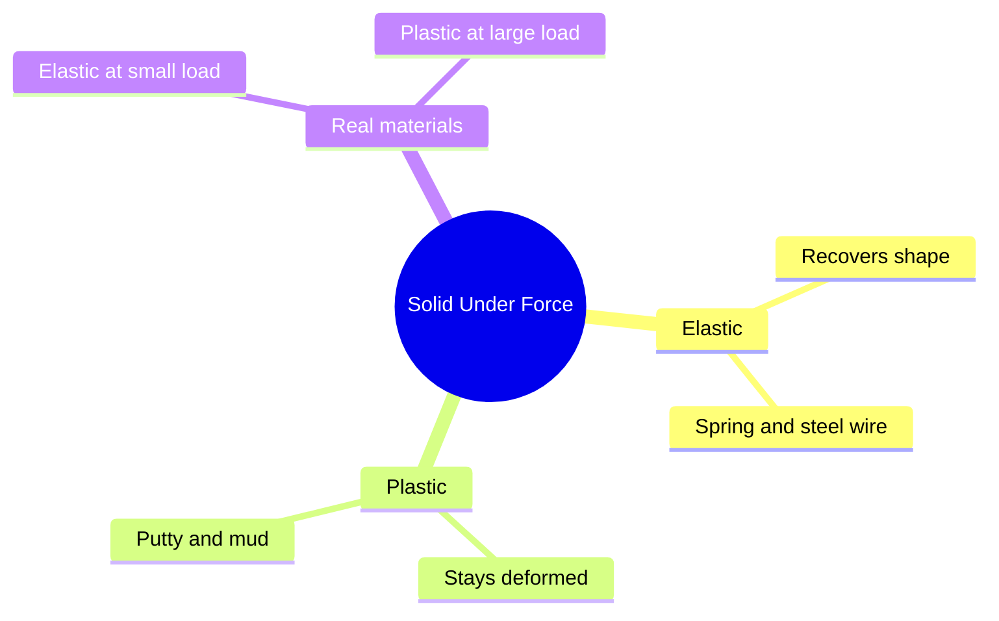
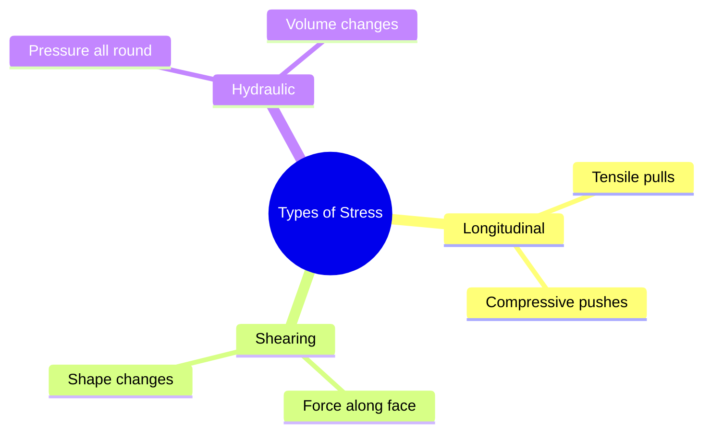
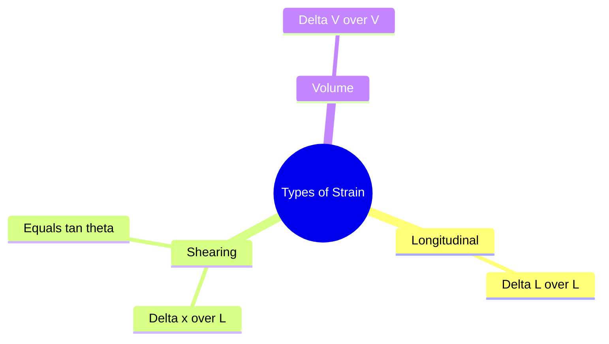
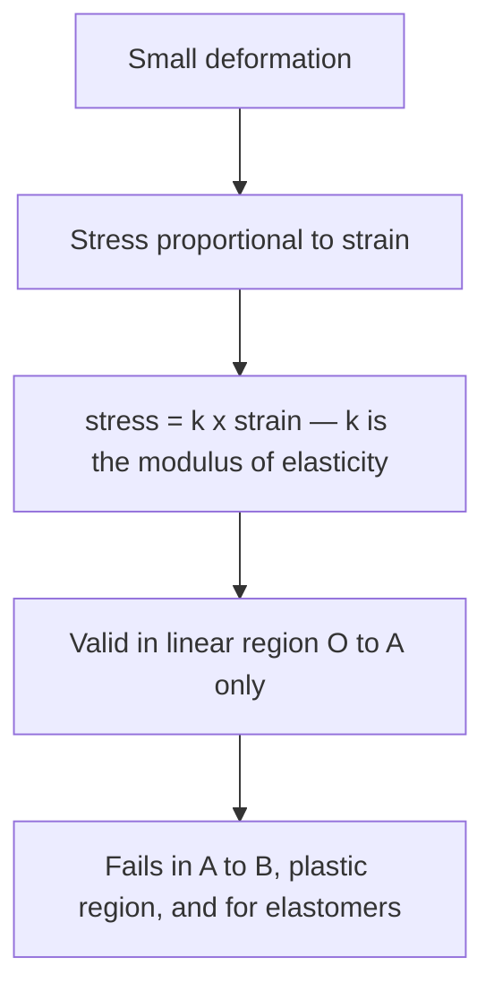
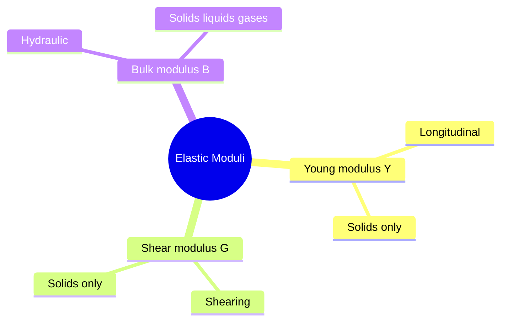
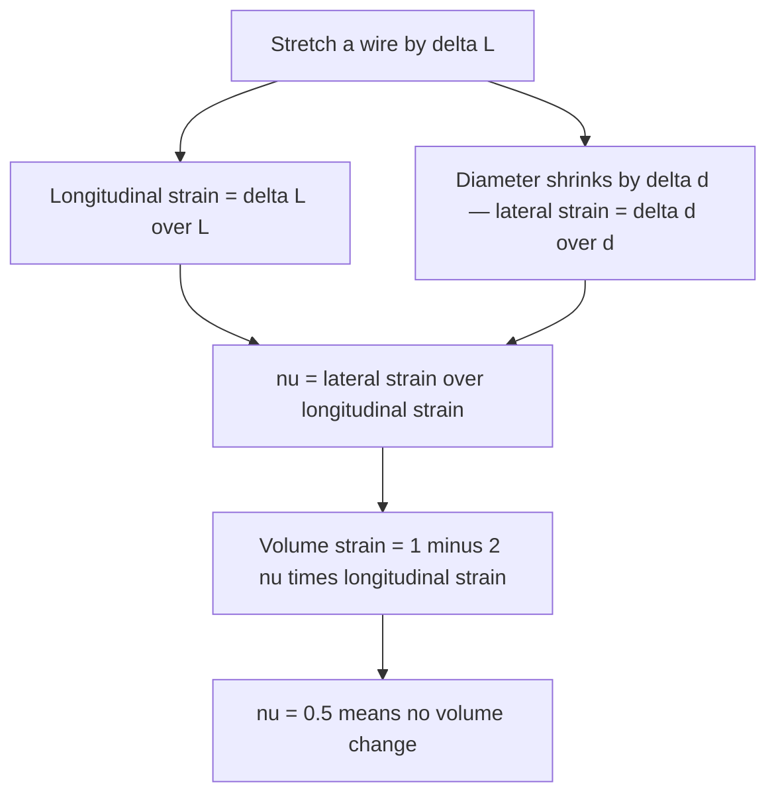
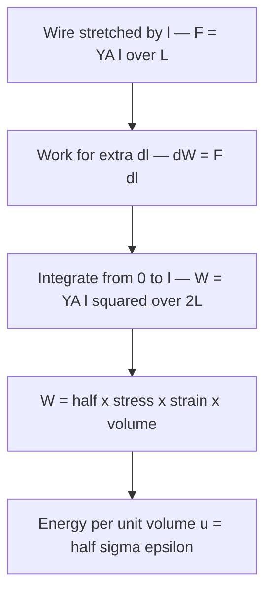
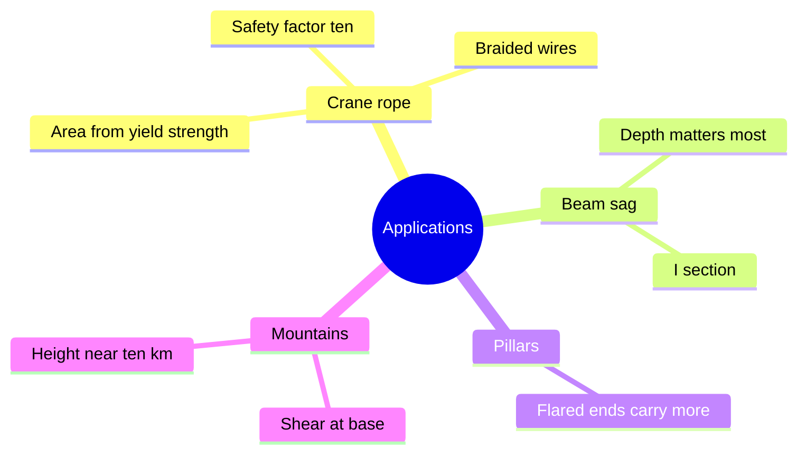
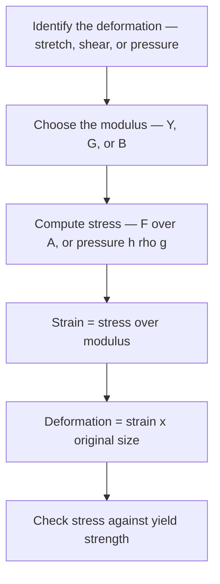

# Physics | Chapter 08 | Mechanical Properties of Solids | CNOTES

### Condensed Notes | Mirrors NOTES §1–§10 exactly

---

## §1 Introduction: Elastic and Plastic Behaviour



### 1.1 Deformable Bodies vs Rigid Bodies
- **Rigid body** — idealisation; definite, unchanging shape and size.
- Real solids stretch, compress and bend under force.
- Even a steel bar deforms under a large enough force.
- **Deformation** — any change in shape or size caused by a force.

### 1.2 Elasticity and Plasticity
- **Elasticity** — tendency to regain original size and shape on removing the force. Example: helical spring.
- **Elastic deformation** — the temporary change.
- **Plasticity** — body stays permanently deformed. Examples: putty, clay, mud.
- Ideal elastic solid — recovers perfectly; none exists.
- Ideal plastic solid — recovers nothing; putty and mud come close.
- Real materials — elastic for small loads, plastic for large ones.

### 1.3 Why Elastic Properties Matter
- Needed for buildings, bridges, automobiles, ropeways.
- Crane rope thickness — §9.1.
- I-shaped beams and railway tracks — §9.2.
- Glass brittle, copper not — §5.2.
- Steel preferred over rubber in structures — §6.1.

---

## §2 Stress



### 2.1 Definition
- **Restoring force** — internal force, equal and opposite to the applied force.
- **Stress** $=F/A$ — restoring force per unit area. Eq. (8.1).
- SI unit: Pa $=$ N m⁻². Dimensional formula $[ML^{-1}T^{-2}]$.
- Same dimensions as pressure.
- Stress is **not a vector** — cannot be given one specific direction.
- Trap: force on one side of a section has a direction; stress at the section does not. §2.1

### 2.2 Types of Stress
- **Tensile stress** — equal opposite forces ⊥ to cross-section, outward; body elongates.
- **Compressive stress** — equal opposite forces ⊥ to cross-section, inward; body shortens.
- Tensile or compressive — also called **longitudinal stress**; length changes.
- **Shearing (tangential) stress** — equal opposite forces ‖ to cross-section; shape changes, volume does not.
- **Hydraulic stress** — force ⊥ to the surface at every point; equals the pressure; volume changes, shape does not.
- Hydraulic stress — also called hydrostatic stress.
- Trap: shearing stress exists only in solids; fluids flow. §2.2

### 2.3 Seeing the Three Situations
- (a) Tensile — cylinder elongates by $\Delta L$.
- (b) Shearing — top face slides over bottom face.
- (c) Hydraulic — body shrinks uniformly under pressure; same shape.

### 2.4 Tension in a Hanging Wire — $F$, Not $2F$
- Ceiling force $F$ and weight $F$ are the two external forces on the whole wire.
- Cut at any section — the lower part is in equilibrium under weight $F$ and tension $T$.
- Hence $T=F$; tensile stress $=F/A$.
- Wire's own weight neglected.
- Trap: tension is $F$, not $2F$. §2.4

---

## §3 Strain



### 3.1 Longitudinal Strain
- Strain — ratio of change in dimension to original dimension.
- Strain has no unit and no dimensional formula.
- Longitudinal strain $=\Delta L/L$. Eq. (8.2).

### 3.2 Shearing Strain
- $\Delta x$ — relative displacement of opposite faces; $L$ — perpendicular distance between them.
- Shearing strain $=\Delta x/L=\tan\theta\approx\theta$. Eq. (8.3), (8.4).
- $\theta$ — angular displacement from the original vertical, in radians.
- Small-angle approximation only; at $\theta=10^\circ$ the difference is about 1%.
- Also called pure shear — angle change, no volume change.

### 3.3 Volume Strain
- Volume strain $=\Delta V/V$. Eq. (8.5).
- Produced by hydraulic stress.
- No change of shape.

### 3.4 How Small Is "Small"? $\tan\theta$ vs $\theta$
- $\tan\theta$ exceeds $\theta$ by about 1.03% at $10^\circ$.
- Curves indistinguishable near zero; visible separation past about 0.3 rad.

### 3.5 Summary Table — Stress and Strain Types

| Type | Force | Strain | Shape change | Volume change | Matter |
|:---|:---|:---|:---:|:---:|:---|
| Tensile / compressive | ⊥ cross-section | $\Delta L/L$ | Yes | No | Solids |
| Shearing | ‖ surface | $\Delta x/L=\theta$ | Yes | No | Solids |
| Hydraulic | ⊥ everywhere | $\Delta V/V$ | No | Yes | Solids, liquids, gases |

---

## §4 Hooke's Law



### 4.1 Statement
- Hooke's law — for small deformations, stress $\propto$ strain.
- stress $=k\times$ strain. Eq. (8.6).
- $k$ — modulus of elasticity; characteristic of the material.
- Hooke's law is empirical.
- Valid for most materials; not for all.

### 4.2 Where It Holds and Where It Fails
- O → A — obeyed; body recovers.
- A → B — not obeyed; body still recovers.
- Beyond B — not obeyed; permanent deformation.
- Elastomers — not obeyed over most of the range.

### 4.3 Two Statements of the Law
- Handwritten form — "within the elastic limit". *(Supp.)*
- Safer form — within the **proportional limit** (A).
- Trap: A → B is elastic but already non-proportional. §4.3

---

## §5 Stress–Strain Curve

```desmos
%view x=(0,7.5) y=(0,5.5)
@unloadStrain [slider=(1.5,5.2,0.05)]: m=2.2
@elasticLinear [color=#388c46]: y=2.4x\left\{0\le x\le1\right\}
@elasticNonlinear [color=#2d70b3]: y=2.4+1.24\left(x-1\right)-0.48\left(x-1\right)^{2}\left\{1\le x\le1.5\right\}
@plasticRegion [color=#e07b00]: y=4.3-0.1023\left(5.2-x\right)^{2}\left\{1.5\le x\le5.2\right\}
@necking [color=#e07b00]: y=4.3-0.3061\left(x-5.2\right)^{2}\left\{5.2\le x\le6.6\right\}
@yieldLine [color=#888888]: y=2.9\left\{0\le x\le1.5\right\}
@ultimateLine [color=#888888]: y=4.3\left\{0\le x\le5.2\right\}
s_c=4.3-0.1023\left(5.2-m\right)^{2}
p=m-\frac{s_c}{2.4}
@unloadLine [color=#c74440]: y=2.4\left(x-p\right)\left\{p\le x\le m\right\}
@pointA [color=#000000, label="A", showLabel]: \left(1,2.4\right)
@pointB [color=#000000, label="B", showLabel]: \left(1.5,2.9\right)
@pointC [color=#c74440, label="C", showLabel]: \left(m,s_c\right)
@pointD [color=#000000, label="D", showLabel]: \left(5.2,4.3\right)
@pointE [color=#000000, label="E", showLabel]: \left(6.6,3.7\right)
@permanentSet [color=#c74440, label="permanent set", showLabel]: \left(p,0\right)
```

- Green — O → A, linear and elastic; slope $=Y$.
- Blue — A → B, elastic but non-linear.
- Orange — B → D → E, plastic region and fracture.
- Grey lines — $\sigma_y$ at B and $\sigma_u$ at D.
- Slider $m$ moves C between B and D; the red line from C runs parallel to OA.
- Its intercept on the strain axis — permanent set.
- Schematic scale; axes not to scale.

### 5.1 Key Regions of the Curve
- Test — stretch a cylinder or wire with gradually increasing force; plot stress against strain.
- Curves differ from material to material; similar graphs exist for compression and shear.
- **O → A** — linear; Hooke's law obeyed; slope $=Y$; body elastic.
- **A** — proportional limit.
- **A → B** — not proportional; body still returns to original dimensions.
- **B** — yield point, also elastic limit; stress there $=\sigma_y$.
- **B → D** — plastic region; strain grows rapidly for small stress change.
- **Permanent set** — strain left at zero stress after unloading at C between B and D.
- Unloading line from C — parallel to OA.
- **Plastic deformation** — the deformation beyond B.
- **D** — ultimate tensile strength $\sigma_u$; maximum stress.
- **D → E** — more strain at reduced force; necking.
- **E** — fracture point.
- Metal scale in the textbook figure — elastic strain below 1%, fracture near 30%.
- Trap: D is the peak stress; E can lie at lower stress. §5.1

### 5.2 Brittle vs Ductile Materials

| Type | D and E | Behaviour | Examples |
|:---|:---|:---|:---|
| Ductile | Far apart | Large plastic region, necking | Copper, mild steel, gold, aluminium |
| Brittle | Close | Sudden fracture, little plastic strain | Glass, cast iron, ceramics, concrete |

- Brittle versus ductile — a statement about the D–E gap.
- Trap: it is not a statement about strength. §5.2

### 5.3 Elastomers
- **Elastomer** — stretches to several times its length and recovers. Examples: rubber, aortic tissue.
- Elastic region very large.
- Hooke's law not obeyed over most of it.
- No well-defined plastic region.
- Trap: an elastomer recovers fully but has a small $Y$; not "more elastic" than steel. §5.3

### 5.4 Load, Unload, and Permanent Set
- Unload at or below B — body retraces the curve; no permanent set.
- Unload beyond B — line of slope $Y$ parallel to OA; permanent set $>0$.
- Permanent set grows with strain beyond B.

### 5.5 Reconciling Labels Across Sources
- Textbook — one point B; yield point also elastic limit.
- Handwritten — elastic limit at B, yield strength at C. *(Supp.)*
- Handwritten "D → E: Buckling" — incorrect; use necking.
- Exam version — textbook labels.
- Trap: buckling is a compression failure of slender bars (§9.2), not a D → E tension effect. §5.5

---

## §6 Elastic Moduli



### 6.1 Young's Modulus
- Modulus in region OA — characteristic of the material.
- Tensile and compressive strains — equal in magnitude for the same stress.
- $Y=\dfrac{\sigma}{\varepsilon}=\dfrac{F/A}{\Delta L/L}=\dfrac{FL}{A\,\Delta L}$. Eq. (8.7), (8.8).
- Unit: Pa. Dimensional formula $[ML^{-1}T^{-2}]$.
- Solids only.
- Large $Y$ — large force for small change in length; stiffer.
- Wire as spring — $F=(YA/L)\Delta L$; $k_{eff}=YA/L$.
- Force for 0.1% strain in a $0.1\ \text{cm}^2$ steel wire — about 2000 N.
- Same strain — Al 690 N, brass 900 N, Cu 1100 N.
- Steel preferred in heavy-duty machines and structures.
- Wood, bone, concrete, glass — small $Y$.
- Trap: more elastic means larger $Y$, not more stretch. §6.1
- Trap: stiffer is not stronger — $Y$ is slope; strength is $\sigma_y$, $\sigma_u$. §6.1
- Trap: Table 8.1 gives Al $Y=70$ GPa (700 N); text quotes 690 N. §6.1
- Trap: mild-steel $\sigma_y$ — text 300, Table 8.1 250 ($10^6$ N m⁻²). §6.1

| Substance | $\rho$ (kg m⁻³) | $Y$ (GPa) | $\sigma_u$ (MPa) | $\sigma_y$ (MPa) |
|:---|:---:|:---:|:---:|:---:|
| Aluminium | 2710 | 70 | 110 | 95 |
| Copper | 8890 | 110 | 400 | 200 |
| Iron (wrought) | 7800–7900 | 190 | 330 | 170 |
| Steel | 7860 | 200 | 400 | 250 |
| Glass# | 2190 | 65 | 50 | — |
| Concrete | 2320 | 30 | 40 | — |
| Wood# | 525 | 13 | 50 | — |
| Bone# | 1900 | 9.4 | 170 | — |
| Polystyrene | 1050 | 3 | 48 | — |

\# tested under compression.

#### 6.1.1 Same Strain, Different Force
- Same area, same strain — stress and force scale with $Y$.
- Steel : copper : aluminium forces at 0.1% strain — 2000 : 1100 : 700 N.
- Steel yields near strain $1.25\times10^{-3}$; lines hold only below that.

### 6.2 Shear Modulus
- $G=\dfrac{\sigma_s}{\theta}=\dfrac{F/A}{\Delta x/L}=\dfrac{FL}{A\,\Delta x}=\dfrac{F}{A\theta}$. Eq. (8.10), (8.11).
- $\sigma_s=G\theta$. Eq. (8.12a).
- Also called modulus of rigidity.
- Unit: Pa. Dimensional formula $[ML^{-1}T^{-2}]$.
- Solids only.
- $G<Y$; for most materials $G\approx Y/3$.
- $Y/G$ for common metals — about 2.4 to 2.8.
- Coil spring stretching — governed by the shear modulus of the wire. *(New)*
- Trap: handwritten $Y\gg\eta$ — overstated; $Y/G$ is only about 2.4–3. §6.2

| Material | $G$ (GPa) | Material | $G$ (GPa) |
|:---|:---:|:---|:---:|
| Aluminium | 25 | Lead | 5.6 |
| Brass | 36 | Nickel | 77 |
| Copper | 42 | Steel | 84 |
| Glass | 23 | Tungsten | 150 |
| Iron | 70 | Wood | 10 |

### 6.3 Bulk Modulus
- $B=-\dfrac{p}{\Delta V/V}$. Eq. (8.12b).
- Minus sign — pressure up, volume down; $B$ always positive.
- Unit: Pa. Dimensional formula $[ML^{-1}T^{-2}]$.
- Solids, liquids and gases.
- **Compressibility** $k=1/B=-\dfrac{1}{\Delta p}\cdot\dfrac{\Delta V}{V}$. Eq. (8.13).
- Compressibility unit Pa⁻¹; dimensional formula $[M^{-1}LT^2]$.
- $B$: solids $\gg$ liquids $\gg$ gases.
- Solids least compressible; gases most compressible.
- Gases about $10^6$ times more compressible than solids.
- Solids' incompressibility — tight coupling of neighbouring atoms.
- Liquids — weaker coupling. Gases — very poor coupling.
- Ideal gas at constant temperature — $B=p$. *(New)*
- Air at STP — $p\approx1.0\times10^5$ Pa $=1.0\times10^{-4}$ GPa.
- Trap: $B$ has a negative sign in its definition. §6.3

| Solids | $B$ (GPa) | Liquids | $B$ (GPa) | Gases | $B$ (GPa) |
|:---|:---:|:---|:---:|:---|:---:|
| Aluminium | 72 | Water | 2.2 | Air (STP) | $1.0\times10^{-4}$ |
| Brass | 61 | Ethanol | 0.9 | | |
| Copper | 140 | Carbon disulphide | 1.56 | | |
| Glass | 37 | Glycerine | 4.76 | | |
| Iron | 100 | Mercury | 25 | | |
| Nickel | 260 | | | | |
| Steel | 160 | | | | |

#### 6.3.1 Compression of Sea Water with Depth
- $p=h\rho g$; $\Delta V/V=p/B$.
- Water, 3000 m — 1.36%.
- Water, 11 000 m — about 5%.

### 6.4 Elastic Moduli — Master Summary Table

| Stress | Strain | Shape change | Volume change | Modulus | Matter |
|:---|:---|:---:|:---:|:---|:---|
| Tensile / compressive $\sigma=F/A$ | $\Delta L/L$ | Yes | No | $Y=FL/(A\Delta L)$ | Solid |
| Shearing $\sigma_s=F/A$ | $\theta$ | Yes | No | $G=F/(A\theta)$ | Solid |
| Hydraulic $p$ | $\Delta V/V$ | No | Yes | $B=-p/(\Delta V/V)$ | Solid, liquid, gas |

### 6.5 Relations Among the Elastic Constants *(New)*
- $Y=2G(1+\nu)$.
- $Y=3B(1-2\nu)$.
- $9/Y=3/G+1/B$.
- $G>0$ gives $\nu>-1$; $B>0$ gives $\nu<0.5$.
- $\nu=0.5$ — $G=Y/3$ exactly; $B\to\infty$.
- $\nu=0.3$ — $G\approx0.385\,Y$.
- Tabulated values are rounded; they satisfy these only approximately.
- Steel — $Y,B$ give $\nu\approx0.29$; $Y,G$ give $\nu\approx0.19$.

---

## §7 Poisson's Ratio



### 7.1 Lateral Strain
- Stretching a wire thins it.
- **Lateral strain** — strain ⊥ to the applied force; $\Delta d/d$.

### 7.2 Poisson's Ratio
- Poisson — lateral strain $\propto$ longitudinal strain within the elastic limit.
- $\nu=\dfrac{\Delta d/d}{\Delta L/L}=\dfrac{\Delta d}{\Delta L}\times\dfrac{L}{d}$.
- Pure number; no units or dimensions.
- Depends only on the nature of the material (fixed at a given temperature). *(Supp.)*
- Steels $0.28$–$0.30$; aluminium alloys about $0.33$.
- Theoretical range $-1<\nu<0.5$.
- Signed form $\nu=-\varepsilon_T/\varepsilon_L$ — same number. *(Supp.)*

### 7.3 Volume Change and the Limit $\nu\le0.5$ *(New)*
- $V=\pi d^2L/4$.
- $\Delta V/V=\Delta L/L-2\,\Delta d/d=(1-2\nu)\varepsilon$.
- $\nu<0.5$ — volume increases on stretching.
- $\nu=0.5$ — volume constant; incompressible limit.
- Rubber — $\nu$ near 0.5. Cork — $\nu$ near 0.
- Steel $\nu=0.3$ — $\Delta V/V=0.4\,\varepsilon$.
- Trap: "volume is conserved" is true only for $\nu=0.5$. §7.3

---

## §8 Elastic Potential Energy in a Stretched Wire



### 8.1 Derivation
- Work against inter-atomic forces is stored as elastic PE.
- $F=YA\,l/L$.
- $dW=F\,dl=\dfrac{YAl}{L}dl$.
- $W=\displaystyle\int_0^l\dfrac{YAl'}{L}dl'=\dfrac{YA\,l^2}{2L}$.
- $W=\tfrac12Y(l/L)^2\times AL$.
- $W=\tfrac12\times\text{stress}\times\text{strain}\times\text{volume}$.
- Work $=$ area under the $F$–$l$ line $=\tfrac12Fl$.

### 8.2 Elastic Potential Energy per Unit Volume
- $u=\tfrac12\sigma\varepsilon$. Eq. (8.14).
- Equivalent forms — $u=\tfrac12Y\varepsilon^2=\sigma^2/2Y$.
- Unit: J m⁻³ $=$ Pa. Dimensional formula $[ML^{-1}T^{-2}]$.
- Total $U=u\times AL=\tfrac12F\,\Delta L$.
- Energy released when the force is removed.
- Valid in the linear region only.
- Trap: do not drop the $\tfrac12$. §8.2
- Trap: handwritten $\mu$ for $u$ — same quantity. §8.2

### 8.3 Energy Density Is an Area
- $u$ — area of the triangle under the stress–strain line.
- Steel, strain 0.1% — $u=100$ kJ m⁻³.
- $u\propto\varepsilon^2$ at fixed $Y$.

---

## §9 Applications of Elastic Behaviour



### 9.1 Steel Ropes for Cranes
- Condition — stress below yield: $A\ge W/\sigma_y=Mg/\sigma_y$. Eq. (8.15).
- 10 tonne load, $\sigma_y=300\times10^6$ N m⁻² — $A\ge3.3\times10^{-4}$ m².
- Radius about 1 cm.
- With $\sigma_y=250\times10^6$ — $r\approx1.1$ cm.
- Safety factor about 10 on the load — radius about 3 cm.
- Single thick wire would be rigid.
- Ropes — many thin wires braided together; flexible, easy to make, strong.

### 9.2 I-Shaped Beams in Construction
- Beam length $l$, breadth $b$, depth $d$, centre load $W$.
- Sag $\delta=\dfrac{Wl^3}{4bd^3Y}$. Eq. (8.16).
- $\delta\propto Y^{-1}$.
- $\delta\propto d^{-3}$ — depth is very effective.
- $\delta\propto b^{-1}$ — breadth only linear.
- $\delta\propto l^3$ — keep the span small.
- Doubling $d$ — sag $\times\tfrac18$. Doubling $b$ — sag $\times\tfrac12$.
- Too deep and thin — **buckling** under off-centre load.
- **I-section** — large load-bearing surface plus enough depth.
- I-section saves weight and cost without losing strength.
- Used for bridge beams, supports, railway tracks.
- Trap: sag depends on $d^3$, not $d$. §9.2

### 9.3 Pillars and Columns
- Rounded ends — support less load.
- Distributed ends — support more load.
- Design also weighs conditions of use, cost, reliability of material.

### 9.4 Maximum Height of Mountains
- Mountain base is not under uniform compression.
- Shear component at the base $\approx h\rho g$.
- Not a case of bulk compression.
- Rock elastic limit $\approx30\times10^7$ N m⁻²; $\rho=3\times10^3$ kg m⁻³.
- $h=30\times10^7/(3\times10^3\times10)=10$ km.
- Above Mt. Everest height ($\approx8.85$ km).
- Denser rock — smaller limiting height.

---

## §10 Solved Examples



### 10.1 NCERT 8.1 — Stress, Elongation, Strain
- Steel rod $r=10$ mm, $L=1$ m, $F=100$ kN, $Y=2\times10^{11}$ N m⁻².
- Stress $=3.18\times10^8$ N m⁻².
- $\Delta L=1.59$ mm.
- Strain $=1.59\times10^{-3}=0.16\%$.
- Trap: stress exceeds Table 8.1 steel yield ($2.5\times10^8$); example is practice in using $Y$. §10.1

### 10.2 NCERT 8.2 — Two Wires in Series
- Copper 2.2 m + steel 1.6 m, $d=3.0$ mm, total elongation 0.70 mm.
- Series — same tension, elongations add.
- $\Delta L_c/\Delta L_s=(Y_s/Y_c)(L_c/L_s)=2.5$.
- $\Delta L_c=0.50$ mm; $\Delta L_s=0.20$ mm.
- Load $W\approx1.8\times10^2$ N.

### 10.3 NCERT 8.3 — Compression of a Thighbone
- Supported mass $=280-60=220$ kg; $F=2156$ N; per bone $1078$ N.
- $L=0.5$ m, $r=2$ cm, $Y=9.4\times10^9$ N m⁻².
- $\Delta L=4.55\times10^{-5}$ m; fractional $0.0091\%$.

### 10.4 NCERT 8.4 — Shear of a Lead Slab
- Face area $0.05$ m²; $F=9.0\times10^4$ N; $G=5.6\times10^9$ N m⁻².
- Stress $1.8\times10^6$ N m⁻².
- $\Delta x=1.6\times10^{-4}$ m $=0.16$ mm.
- Trap: textbook prints $9.4\times10^4$ N in the working; the force is $9.0\times10^4$ N. §10.4

### 10.5 NCERT 8.5 — Compression of Ocean Water
- Depth 3000 m; $B=2.2\times10^9$ N m⁻².
- $p=3\times10^7$ N m⁻².
- $\Delta V/V=1.36\%$.

### 10.6 Additional Practice *(Supp.)* — Young's Modulus from Mass and Density
- Steel wire 2.5 m, 50 g, $8$ g cm⁻³, 10 kgf, 2 mm extension.
- $A=m/(\rho l)=1/40$ cm².
- $Y=5\times10^{11}$ dyne cm⁻² $=5\times10^{10}$ N m⁻².
- Trap: handwritten unit "dyne m⁻¹" should be dyne cm⁻²; $Y\approx50$ GPa is unrealistic for steel. §10.6

### 10.7 Additional Practice *(Supp.)* — Longitudinal Strain of a Steel Rod
- $r=20$ mm, $F=62.8$ kN, $Y=2\times10^{11}$ N m⁻².
- $\varepsilon_L=F/(AY)=2.5\times10^{-4}$.
- Length not needed for the strain.

### 10.8 Additional Practice *(New)* — Poisson's Ratio and Stored Energy for Example 8.1
- $\nu=0.30$ — $\Delta d\approx9.5\times10^{-3}$ mm.
- $\Delta V/V=6.4\times10^{-4}$.
- $u=2.53\times10^5$ J m⁻³.
- $U=79.6$ J $=\tfrac12F\,\Delta L$.

---

## Points to Ponder

- Trap: stress is not a vector — it cannot be given one specific direction. §2.1
- Trap: tension in a hanging wire is $F$, not $2F$. §2.4
- Trap: "stretches more" is not "more elastic" — larger $Y$ means more elastic. §6.1
- Trap: stiffer is not stronger — $Y$ is the slope; strength is $\sigma_y$ or $\sigma_u$. §6.1
- Trap: rubber's $Y$ is far below steel's; rubber does not obey Hooke's law over most of its range. §5.3
- Trap: Hooke's law holds only in O → A; A → B is elastic but non-linear. §4.2
- Trap: proportional limit (A) is not the elastic limit (B); B lies at or beyond A. §5.1
- Trap: D is the maximum stress; E can lie at lower stress. §5.1
- Trap: brittle versus ductile is the D–E gap, not strength. §5.2
- Trap: unloading beyond B runs parallel to OA and leaves a permanent set; unloading within A → B retraces. §5.4
- Trap: $Y$ and $G$ are for solids only; $B$ covers solids, liquids and gases. §6.4
- Trap: a coil spring stretches by shearing its wire — governed by $G$. §6.2
- Trap: $G<Y$, roughly $Y/3$ — not $Y\gg G$. §6.2
- Trap: gases are about $10^6$ times more compressible than solids; for an ideal gas at constant temperature $B=p$. §6.3
- Trap: keep the minus sign in $B=-p/(\Delta V/V)$. §6.3
- Trap: volume is conserved under stretching only when $\nu=0.5$. §7.3
- Trap: elastic PE carries a factor $\tfrac12$ — $u=\tfrac12\sigma\varepsilon$, $U=\tfrac12F\Delta L$; linear region only. §8.2
- Trap: sag $\propto d^{-3}$ but $\propto b^{-1}$ and $\propto l^{3}$. §9.2
- Trap: a deep thin bar buckles; the I-section resists both bending and buckling. §9.2
- Trap: size a rope for yield, then apply a safety factor of about 10. §9.1
- Trap: mountain height is limited by shear at the base, not bulk compression. §9.4

---

## Key Historical Persons

| Person | Contribution |
|:---|:---|
| Robert Hooke (1635–1703) | Law of elasticity — stress proportional to strain for small deformations |
| Thomas Young (1773–1829) | Modulus of elasticity for tension and compression — Young's modulus |
| Siméon Denis Poisson (1781–1840) | Lateral strain proportional to longitudinal strain — Poisson's ratio |
| Leonhard Euler (1707–1783) | Analysis of buckling of slender columns *(New)* |

---

## Problem-Solving Strategy

**Type A — One wire or rod under axial load**
1. Find $A$; recover it from mass and density if needed.
2. Stress $\sigma=F/A$; check against yield strength.
3. $\Delta L=FL/(AY)$; strain $=\sigma/Y$.
4. Convert all units to N, m, Pa.

**Type B — Wires joined together**
1. Series — same tension; elongations add.
2. Parallel — same elongation; forces add.
3. Write the equal quantity, then the sum constraint, then solve.

**Type C — Shear**
1. Area ‖ to the force; $L$ = distance between fixed and loaded faces.
2. $\sigma_s=F/A$; $\theta=\sigma_s/G$; $\Delta x=\theta L$.

**Type D — Pressure and volume**
1. $p=h\rho g$.
2. $|\Delta V/V|=p/B$.
3. Density at depth $\rho'\approx\rho(1+p/B)$. *(New)*

**Type E — Energy stored**
1. $u=\tfrac12\sigma\varepsilon$ per unit volume; $U=\tfrac12F\Delta L$ total.
2. Cross-check with $U=u\,AL$.

**Type F — Design**
1. Rope — $A\ge Mg/\sigma_y$, then multiply load by safety factor.
2. Beam — compare ratios of $d^{-3}$, $b^{-1}$, $l^3$, $Y^{-1}$.

**Type G — Reading a graph**
1. Slope of the straight part $=Y$.
2. $\sigma_y$ at B; $\sigma_u$ at the peak D.
3. Brittle or ductile — the D–E gap.
4. Stronger — higher stress; stiffer — steeper slope.

---

## Rapid Reference

| Fact | Value |
|:---|:---|
| Stress | $\sigma=F/A$; Pa; $[ML^{-1}T^{-2}]$ |
| Longitudinal strain | $\Delta L/L$ |
| Shearing strain | $\Delta x/L=\tan\theta\approx\theta$ |
| Volume strain | $\Delta V/V$ |
| Hooke's law | stress $=k\times$ strain (O → A) |
| Young's modulus | $Y=FL/(A\Delta L)$ |
| Wire spring constant | $k_{eff}=YA/L$ |
| Shear modulus | $G=F/(A\theta)$; $\sigma_s=G\theta$ |
| Bulk modulus | $B=-p/(\Delta V/V)$ |
| Compressibility | $k=1/B$; Pa⁻¹; $[M^{-1}LT^2]$ |
| Poisson's ratio | $\nu=(\Delta d/d)/(\Delta L/L)$ |
| Poisson range | $-1<\nu<0.5$ |
| Volume strain of a stretched wire | $(1-2\nu)\varepsilon$ |
| Constant relations | $Y=2G(1+\nu)=3B(1-2\nu)$ |
| $G$ versus $Y$ | $G<Y$; $G\approx Y/3$ |
| Elastic PE per unit volume | $u=\tfrac12\sigma\varepsilon=\tfrac12Y\varepsilon^2$; J m⁻³ |
| Total elastic PE | $U=\tfrac12F\Delta L$ |
| Rope area | $A\ge Mg/\sigma_y$ |
| Beam sag | $\delta=Wl^3/(4bd^3Y)$ |
| Mountain height | $h\rho g=30\times10^7\Rightarrow h\approx10$ km |
| $Y$ — steel / copper / aluminium | 200 / 110 / 70 GPa |
| $Y$ — glass / concrete / wood / bone | 65 / 30 / 13 / 9.4 GPa |
| $\sigma_y$ — steel / copper / aluminium | 250 / 200 / 95 MPa |
| $\sigma_u$ — steel / copper / aluminium | 400 / 400 / 110 MPa |
| $G$ — steel / copper / aluminium | 84 / 42 / 25 GPa |
| $B$ — steel / water / air (STP) | 160 / 2.2 / $1.0\times10^{-4}$ GPa |
| Gas versus solid compressibility | about $10^6$ times |
| Poisson ratio — steels / aluminium alloys | 0.28–0.30 / about 0.33 |
| Force for 0.1% strain, $0.1\ \text{cm}^2$ wire | steel 2000 N; copper 1100 N; brass 900 N; aluminium 690 N |
| Shear strain approximation | $\tan\theta\approx\theta$ — 1% error at $10^\circ$ |
| NCERT 8.1 | $\sigma=3.18\times10^8$ N m⁻²; $\Delta L=1.59$ mm; $\varepsilon=0.16\%$ |
| NCERT 8.2 | $W\approx1.8\times10^2$ N; $\Delta L_c=0.50$ mm; $\Delta L_s=0.20$ mm |
| NCERT 8.3 | $\Delta L=4.55\times10^{-5}$ m; 0.0091% |
| NCERT 8.4 | $\Delta x=0.16$ mm |
| NCERT 8.5 | $\Delta V/V=1.36\%$ |
| Crane rope, 10 tonnes | $A\ge3.3\times10^{-4}$ m²; $r\approx1$ cm; with safety factor $r\approx3$ cm |
| Handwritten practice | $Y=5\times10^{10}$ N m⁻²; $\varepsilon_L=2.5\times10^{-4}$ |

---

*End of CNOTES — Physics Ch. 8*
