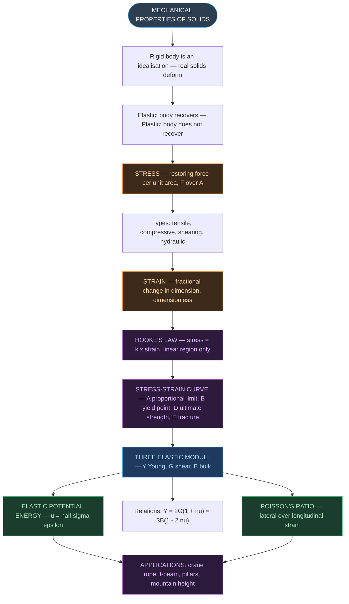

# Physics | Chapter 08 | Mechanical Properties of Solids | NOTES

### Complete Study Notes | Board · NEET · JEE Layered

---

## Chapter Brief

The rotational-motion chapters treated a solid as perfectly rigid, so only the distribution of its mass mattered. This chapter drops that idealisation: real solids stretch, shear and compress under load, and how much they deform — and whether they spring back — decides whether a cable, a beam or a bone is fit for purpose. It builds from stress and strain, through Hooke's law and the stress–strain curve, to the three elastic moduli, Poisson's ratio and stored elastic energy, and closes with engineering applications. By the end, the reader should be able to choose the right modulus for a given deformation, read a stress–strain curve, and size simple structural members.

## Front Matter

**Prerequisites:** Newton's laws and static equilibrium, the rigid-body idealisation from the previous rotational-motion chapter, pressure and density of fluids, the spring energy $\tfrac12kx^2$, and elementary integration.

**Key outcomes** — by the end of this chapter, the reader should be able to:
- Define stress and strain for each of the three deformation modes (tensile/compressive, shearing, hydraulic) and quote their units and dimensions.
- State Hooke's law, say exactly where it holds and fails, and locate the points A, B, C, D, E on a stress–strain curve.
- Choose among $Y$, $G$ and $B$ for a given situation and compute the resulting deformation from a given force or pressure.
- Use Poisson's ratio to link lateral and longitudinal strain, including the resulting volume change.
- Calculate the elastic potential energy stored in a stretched wire, per unit volume and in total.
- Size a crane rope against yield, and compare beam designs using $\delta=Wl^3/(4bd^3Y)$.

**Scope note:** Isotropic solids, small deformations, static loads only; torsion, fatigue, creep and time-dependent (viscoelastic) behaviour are not treated. The relations among $Y$, $G$, $B$ and $\nu$ (§6.5) go slightly beyond the textbook and are stated without derivation.

**Source labels:** *(NCERT 8.x)* = worked example from the textbook · *(Supp.)* = taken from the handwritten notes · *(New)* = added during gap-fill. Where the sources disagree, a `[!warning]` callout appears at that point and the entry is logged in the Source Discrepancy Log at the end.

## Table of Contents

- **§1 Introduction: Elastic and Plastic Behaviour**
  - 1.1 Deformable Bodies vs Rigid Bodies
  - 1.2 Elasticity and Plasticity
  - 1.3 Why Elastic Properties Matter
- **§2 Stress**
  - 2.1 Definition
  - 2.2 Types of Stress
  - 2.3 Seeing the Three Situations
  - 2.4 Tension in a Hanging Wire — $F$, Not $2F$
- **§3 Strain**
  - 3.1 Longitudinal Strain
  - 3.2 Shearing Strain
  - 3.3 Volume Strain
  - 3.4 Interactive — How Small Is "Small"? $\tan\theta$ vs $\theta$
  - 3.5 Summary Table — Stress and Strain Types
- **§4 Hooke's Law**
  - 4.1 Statement
  - 4.2 Where It Holds and Where It Fails
  - 4.3 Two Statements of the Law
- **§5 Stress–Strain Curve**
  - 5.1 Key Regions of the Curve
  - 5.2 Brittle vs Ductile Materials
  - 5.3 Elastomers
  - 5.4 Interactive — Load, Unload, and Permanent Set
  - 5.5 Reconciling Labels Across Sources
- **§6 Elastic Moduli**
  - 6.1 Young's Modulus
  - 6.1.1 Interactive — Same Strain, Different Force
  - 6.2 Shear Modulus
  - 6.3 Bulk Modulus
  - 6.3.1 Interactive — Compression of Sea Water with Depth
  - 6.4 Elastic Moduli — Master Summary Table
  - 6.5 Relations Among the Elastic Constants *(New)*
- **§7 Poisson's Ratio**
  - 7.1 Lateral Strain
  - 7.2 Poisson's Ratio
  - 7.3 Volume Change and the Limit $\nu\le0.5$ *(New)*
- **§8 Elastic Potential Energy in a Stretched Wire**
  - 8.1 Derivation
  - 8.2 Elastic Potential Energy per Unit Volume
  - 8.3 Interactive — Energy Density Is an Area
- **§9 Applications of Elastic Behaviour**
  - 9.1 Steel Ropes for Cranes
  - 9.2 I-Shaped Beams in Construction
  - 9.3 Pillars and Columns
  - 9.4 Maximum Height of Mountains
- **§10 Solved Examples**
  - 10.1 Solved (NCERT 8.1) — Stress, Elongation, Strain
  - 10.2 Solved (NCERT 8.2) — Two Wires in Series
  - 10.3 Solved (NCERT 8.3) — Compression of a Thighbone
  - 10.4 Solved (NCERT 8.4) — Shear of a Lead Slab
  - 10.5 Solved (NCERT 8.5) — Compression of Ocean Water
  - 10.6 Additional Practice *(Supp.)* — Young's Modulus from Mass and Density
  - 10.7 Additional Practice *(Supp.)* — Longitudinal Strain of a Steel Rod
  - 10.8 Additional Practice *(New)* — Poisson's Ratio and Stored Energy for Example 8.1
- Quick Reference
- Points to Ponder
- Key Historical Persons
- Problem-Solving Strategy
- Source Discrepancy Log

---

## 🗺️ CONCEPT ROADMAP



---

## SECTION 1 — INTRODUCTION: ELASTIC AND PLASTIC BEHAVIOUR ⭐

### 1.1 Deformable Bodies vs Rigid Bodies

A **rigid body** is an idealisation — a hard solid object with a perfectly definite shape and size. In reality, every solid can be stretched, compressed and bent; even a steel bar deforms when a sufficiently large external force acts on it, though the change may be far too small to see without instruments.

> [!note] Definition
> **Deformation** is any change in the shape or size of a body caused by an applied force.

The question this chapter answers is *how much* a given body deforms under a given load, and *whether it recovers* when the load is removed.

### 1.2 Elasticity and Plasticity

| Property | Description | Example |
|:---|:---|:---|
| **Elasticity** | Tendency to regain original size and shape when the deforming force is removed | Helical spring, steel wire |
| **Plasticity** | No tendency to regain the original shape; the deformation stays | Putty, clay, mud |

> [!important] Key Distinction
> **Elastic deformation** is temporary — the body returns to its original dimensions on unloading. **Plastic deformation** is permanent — the body does not return.

- **Ideal elastic solid:** recovers perfectly after any load — no real material does this exactly.
- **Ideal plastic solid:** recovers nothing — putty and mud come close.
- **Real materials** behave elastically for small loads and plastically for large ones; where the changeover happens is read off the stress–strain curve (§5).

### 1.3 Why Elastic Properties Matter

Every engineering design needs the elastic properties of its materials, and the chapter's questions map directly to later sections:

| Design question | Where answered |
|:---|:---|
| How thick must a crane rope be so it does not deform permanently? | §9.1 |
| Why are bridge beams and railway tracks I-shaped? | §9.2 |
| Why do pillars have flared ends? | §9.3 |
| Why is Mt. Everest-scale height the limit for mountains? | §9.4 |
| Why is glass brittle while copper is not? | §5.2 |
| Why is steel preferred over rubber for heavy-duty structures, though rubber stretches far more? | §6.1 |

---

## SECTION 2 — STRESS ⭐⭐⭐

### 2.1 Definition

When a body in static equilibrium is subjected to a deforming force, it deforms by an amount that depends on the material and the size of the force. As it deforms, an internal **restoring force** develops — equal in magnitude and opposite in direction to the applied force. The restoring force per unit area is **stress**.

> [!important] Definition of Stress
> If $F$ is the force applied normal to a cross-section of area $A$:
> $$\boxed{\text{Stress}=\frac{F}{A}} \qquad \text{...(8.1)}$$
> **SI unit:** N m⁻² $=$ pascal (Pa). **Dimensional formula:** $[ML^{-1}T^{-2}]$ — the same as pressure.

> [!note] Stress is not a vector
> Unlike a force, stress cannot be assigned one specific direction. The force on one side of a section has a definite direction; the stress at that section does not. (In advanced mechanics stress is a rank-2 tensor — at this level, only remember that it is **not** a vector.)

### 2.2 Types of Stress

A solid can change its dimensions in three ways, giving three kinds of stress:

- **Tensile stress** — two equal and opposite forces act **perpendicular** to the cross-section and **pull outward**. The body elongates.
- **Compressive stress** — two equal and opposite forces act **perpendicular** to the cross-section and **push inward**. The body shortens.
- **Longitudinal stress** — the common name for tensile or compressive stress; both change the *length* of the body.
- **Shearing (tangential) stress** — two equal and opposite forces act **parallel** to the cross-sectional area. One face slides sideways relative to the opposite face: the **shape** changes, the volume does not.
- **Hydraulic stress** — a fluid presses on the body with force **perpendicular to the surface at every point**, uniformly from all sides (called *hydrostatic stress* in some texts). Its magnitude equals the hydraulic pressure. The **volume** changes; the shape does not.

> [!warning] Shearing stress exists only in solids
> Liquids and gases cannot sustain shearing stress — they flow instead. This is why $Y$ and $G$ are defined for solids only, while hydraulic stress (and hence $B$) applies to solids, liquids and gases.

### 2.3 Seeing the Three Situations

```tikz
\usetikzlibrary{arrows.meta}
\begin{tikzpicture}[>={Stealth[length=6pt,width=4.5pt]}, <={Stealth[length=6pt,width=4.5pt]}, thick, scale=0.85]
  % (a) tensile
  \draw[dashed, gray] (0,0) rectangle (1,2);
  \draw[fill=blue!15] (0,0) rectangle (1,2.5);
  \draw[->, red!75!black, line width=1.5pt] (0.5,2.5) -- (0.5,3.5);
  \draw[->, red!75!black, line width=1.5pt] (0.5,0) -- (0.5,-1.0);
  \node[right, font=\small, red!75!black] at (0.6,3.2) {$F$};
  \node[right, font=\small, red!75!black] at (0.6,-0.7) {$F$};
  \node[below, font=\itshape\small, text=gray, align=center] at (0.5,-1.4) {(a) Tensile stress:\\elongation};

  % (b) shearing
  \begin{scope}[xshift=4.3cm]
    \draw[dashed, gray] (0,0) rectangle (1.6,2);
    \draw[fill=blue!15] (0,0) -- (1.6,0) -- (2.1,2) -- (0.5,2) -- cycle;
    \draw[->, red!75!black, line width=1.5pt] (0.7,2.3) -- (1.9,2.3);
    \draw[->, red!75!black, line width=1.5pt] (1.4,-0.3) -- (0.2,-0.3);
    \node[above, font=\small, red!75!black] at (1.3,2.3) {$F$};
    \node[below, font=\small, red!75!black] at (0.8,-0.3) {$F$};
    \node[below, font=\itshape\small, text=gray, align=center] at (0.9,-1.0) {(b) Shearing stress:\\shape changes};
  \end{scope}

  % (c) hydraulic
  \begin{scope}[xshift=9.6cm, yshift=1.0cm]
    \draw[dashed, gray] (0,0) circle (1.0);
    \draw[fill=blue!15] (0,0) circle (0.82);
    \draw[->, red!75!black, line width=1.3pt] (0:1.9) -- (0:1.15);
    \draw[->, red!75!black, line width=1.3pt] (45:1.9) -- (45:1.15);
    \draw[->, red!75!black, line width=1.3pt] (90:1.9) -- (90:1.15);
    \draw[->, red!75!black, line width=1.3pt] (135:1.9) -- (135:1.15);
    \draw[->, red!75!black, line width=1.3pt] (180:1.9) -- (180:1.15);
    \draw[->, red!75!black, line width=1.3pt] (225:1.9) -- (225:1.15);
    \draw[->, red!75!black, line width=1.3pt] (270:1.9) -- (270:1.15);
    \draw[->, red!75!black, line width=1.3pt] (315:1.9) -- (315:1.15);
    \node[font=\small, red!75!black] at (0,0) {$p$};
    \node[below, font=\itshape\small, text=gray, align=center] at (0,-2.4) {(c) Hydraulic stress:\\volume shrinks, shape same};
  \end{scope}
\end{tikzpicture}
```

In (a) the dashed outline is the original cylinder; the forces $F$ act normal to the end faces. In (b) the forces act *along* the faces, sliding the top relative to the bottom. In (c) the fluid pressure acts normal to the surface everywhere, shrinking the body uniformly — the dashed circle is the original size.

### 2.4 Tension in a Hanging Wire — $F$, Not $2F$

A wire hangs from a ceiling with a weight $F$ at its lower end. The ceiling pulls the wire up with $F$ and the weight pulls it down with $F$ — it is tempting to add these and say the tension is $2F$. It is not.

```tikz
\usetikzlibrary{arrows.meta}
\begin{tikzpicture}[>={Stealth[length=6pt,width=4.5pt]}, thick, scale=0.9]
  % LEFT: whole wire
  \draw[line width=1pt] (-1,4) -- (1,4);
  \draw[gray] (-0.8,4)--(-1.0,4.25) (-0.4,4)--(-0.6,4.25) (0,4)--(-0.2,4.25) (0.4,4)--(0.2,4.25) (0.8,4)--(0.6,4.25);
  \draw[line width=1.3pt] (0,4) -- (0,1);
  \draw[fill=blue!15] (-0.4,0) rectangle (0.4,1);
  \draw[->, red!75!black, line width=1.5pt] (0,0) -- (0,-0.9);
  \node[right, font=\small, red!75!black] at (0.1,-0.6) {$F$ (weight)};
  \draw[dashed, blue!60!black] (-0.5,2.5) -- (0.5,2.5);
  \node[right, font=\small, blue!60!black] at (0.55,2.5) {cut S};
  \node[below, font=\itshape\small, text=gray] at (0,-1.3) {whole wire};

  % RIGHT: lower part after the cut
  \begin{scope}[xshift=6cm]
    \draw[line width=1.3pt] (0,2.5) -- (0,1);
    \draw[fill=blue!15] (-0.4,0) rectangle (0.4,1);
    \draw[->, green!45!black, line width=1.7pt] (0,2.5) -- (0,3.6);
    \node[right, font=\small, green!45!black] at (0.1,3.2) {$T$ (pull from upper wire)};
    \draw[->, red!75!black, line width=1.5pt] (0,0) -- (0,-0.9);
    \node[right, font=\small, red!75!black] at (0.1,-0.6) {$F$ (weight)};
    \node[below, font=\itshape\small, text=gray] at (0,-1.3) {lower part is in equilibrium $\Rightarrow T=F$};
  \end{scope}
\end{tikzpicture}
```

Cut the wire at any cross-section S and look at the lower part alone. It is in equilibrium under only two forces — the weight $F$ downward and the pull $T$ of the upper wire upward — so $T=F$. The ceiling force and the weight are the two *external* forces on the whole wire; they are not both acting on any one cross-section. Hence the tensile stress is $F/A$, not $2F/A$ (the wire's own weight is neglected).

---

## SECTION 3 — STRAIN ⭐⭐⭐

Strain is the ratio of the change in a dimension to the original dimension, so it has **no units and no dimensional formula**. Each type of stress in §2 has its own strain.

### 3.1 Longitudinal Strain

> [!note] Definition
> $$\text{Longitudinal strain}=\frac{\Delta L}{L} \qquad \text{...(8.2)}$$
> $\Delta L$ = change in length; $L$ = original length. Produced by tensile or compressive stress, acting along the direction of the force.

### 3.2 Shearing Strain

Under a shearing force the opposite faces of the body are displaced sideways relative to each other by $\Delta x$, while the perpendicular distance between them is $L$.

```tikz
\usetikzlibrary{arrows.meta}
\begin{tikzpicture}[>={Stealth[length=7pt,width=5pt]}, <={Stealth[length=7pt,width=5pt]}, thick, scale=1.0]
  \draw[dashed, gray] (0,0) rectangle (3,2.4);
  \draw[fill=blue!12, line width=1.2pt] (0,0) -- (3,0) -- (3.5,2.4) -- (0.5,2.4) -- cycle;
  % forces
  \draw[->, red!75!black, line width=1.6pt] (1.0,2.65) -- (2.3,2.65);
  \node[above, font=\small, red!75!black] at (1.65,2.65) {$F$};
  \draw[->, red!75!black, line width=1.6pt] (2.2,-0.3) -- (0.9,-0.3);
  \node[below, font=\small, red!75!black] at (1.55,-0.3) {$F$};
  % L dimension
  \draw[<->, green!45!black, line width=1.1pt] (-0.5,0) -- (-0.5,2.4);
  \node[left, font=\small, green!45!black] at (-0.5,1.2) {$L$};
  % delta x dimension
  \draw[dotted, gray] (3,2.4) -- (3,3.35);
  \draw[dotted, gray] (3.5,2.4) -- (3.5,3.35);
  \draw[<->, orange!85!black, line width=1.1pt] (3,3.2) -- (3.5,3.2);
  \node[above, font=\small, orange!85!black] at (3.25,3.2) {$\Delta x$};
  % angle
  \draw[blue!70!black, line width=1.2pt] (3,0.9) arc (90:78.2:0.9);
  \node[right, font=\small, blue!70!black] at (3.2,0.95) {$\theta$};
  \node[below, font=\itshape\small, text=gray] at (1.6,-0.9) {$\text{shearing strain}=\Delta x/L=\tan\theta\approx\theta$};
\end{tikzpicture}
```

> [!note] Definition
> $$\text{Shearing strain}=\frac{\Delta x}{L}=\tan\theta\approx\theta \qquad \text{...(8.3), (8.4)}$$
> $\theta$ is the angular displacement from the original vertical, in radians. The approximation $\tan\theta\approx\theta$ holds only for small $\theta$.

At $\theta=10^\circ$ the difference between $\theta$ and $\tan\theta$ is only about 1% (exactly $1.03\%$), which is why the small-angle form is used throughout. Shearing strain is also called **pure shear** — angular deformation with no change in volume.

### 3.3 Volume Strain

> [!note] Definition
> $$\text{Volume strain}=\frac{\Delta V}{V} \qquad \text{...(8.5)}$$
> $\Delta V$ = change in volume; $V$ = original volume. Produced by hydraulic stress. There is no change of shape.

### 3.4 Interactive — How Small Is "Small"? $\tan\theta$ vs $\theta$

The step from $\Delta x/L=\tan\theta$ to $\theta$ is a small-angle approximation. The graph shows both curves together; the point $P$ rides on $\tan\theta$ and the value $E$ is the percentage by which $\tan\theta$ exceeds $\theta$ at the chosen angle.

| Desmos variable | Meaning |
|:---|:---|
| $x$ | angle $\theta$ in radians |
| $q$ | chosen angle (slider) |
| $P$ | the point $(q,\ \tan q)$ |
| $E$ | percentage excess of $\tan q$ over $q$ |

```desmos
%view x=(0,0.6) y=(0,0.8)
@angle [slider=(0.02,0.6,0.01)]: q=0.17
@thetaLine [color=#2d70b3]: y=x
@tanLine [color=#c74440]: y=\tan x
P=\left(q,\tan q\right)
E=\frac{\tan q-q}{q}\cdot100
```

Drag $q$ up from $0.02$: the two curves are indistinguishable near zero and separate visibly only past roughly $0.3$ rad ($\approx17^\circ$). At $q\approx0.175$ rad ($10^\circ$), $E\approx1.03$ — the "about 1%" quoted above.

### 3.5 Summary Table — Stress and Strain Types

| Type | Force direction | Strain | Shape change? | Volume change? | Applicable to |
|:---|:---|:---|:---|:---|:---|
| Tensile / compressive | ⊥ to cross-section | $\Delta L/L$ | Yes | No | Solids |
| Shearing | ‖ to surface | $\Delta x/L=\theta$ | Yes | No | Solids |
| Hydraulic | ⊥ everywhere (pressure) | $\Delta V/V$ | No | Yes | Solids, liquids, gases |

---

## SECTION 4 — HOOKE'S LAW ⭐⭐⭐

### 4.1 Statement

Stress and strain take different forms in the three situations of §2, but for small deformations they are proportional to each other in every case.

> [!important] Hooke's Law
> **For small deformations, stress is directly proportional to strain.**
> $$\text{stress}\propto\text{strain}\quad\Rightarrow\quad\boxed{\text{stress}=k\times\text{strain}} \qquad \text{...(8.6)}$$
> $k$ is the proportionality constant, the **modulus of elasticity**. Its value is a characteristic of the *material*.

Hooke's law is **empirical** — found by experiment, not derived from theory — and holds for most materials, but not all.

### 4.2 Where It Holds and Where It Fails

| Situation | Hooke's law obeyed? | Why |
|:---|:---|:---|
| Region O → A of the stress–strain curve | **Yes** | Linear region; body also recovers fully |
| Region A → B | **No** — but body still recovers | Elastic yet non-linear |
| Beyond B (plastic region) | **No** | Permanent deformation; stress and strain not proportional |
| Elastomers (rubber, aortic tissue) | **No**, over most of the range | Very large elastic region but non-linear (§5.3) |

### 4.3 Two Statements of the Law

> [!warning] "Within the elastic limit" is not quite enough *(Supp.)*
> The handwritten notes state the law as "within the elastic limit, deformation is directly proportional to the applied force." The safer form is "within the **proportional limit** (A)". Between A and B the body is still elastic, but proportionality has already failed (§5.5). For a given wire the two statements agree in the linear region because $F=(YA/L)\,\Delta L$ (§6.1).

---

## SECTION 5 — STRESS–STRAIN CURVE ⭐⭐⭐

The relation between stress and strain for a material under tension is found experimentally. A test cylinder or wire is stretched by a force that is increased gradually in steps; at each step the change in length (hence the strain) and the applied force are recorded. Plotting stress (equal in magnitude to force per unit area) against strain gives the curve below. Analogous graphs for compression and shear can also be drawn, and the curves differ from material to material.

### 5.1 Key Regions of the Curve

```tikz
\usetikzlibrary{arrows.meta}
\begin{tikzpicture}[>={Stealth[length=7pt,width=5pt]}, <={Stealth[length=7pt,width=5pt]}, thick, scale=1.15]
  \draw[->, line width=1pt] (0,0) -- (7.8,0) node[right, font=\small] {strain $\varepsilon$};
  \draw[->, line width=1pt] (0,0) -- (0,5.2) node[above, font=\small] {stress $\sigma$};
  % O-A linear elastic
  \draw[green!50!black, line width=1.9pt] (0,0) -- (1.0,2.4);
  % A-B non-linear elastic
  \draw[blue!70!black, line width=1.9pt, smooth] plot coordinates {(1.0,2.4) (1.25,2.7) (1.5,2.9)};
  % B-D-E plastic region, then necking and fracture
  \draw[orange!85!black, line width=1.9pt, smooth] plot coordinates {(1.5,2.9) (2.2,3.15) (3.2,3.6) (4.2,4.1) (5.2,4.3) (6.0,4.15) (6.6,3.7)};
  % guides
  \draw[dashed, gray] (0,2.9) -- (1.5,2.9);
  \draw[dashed, gray] (0,4.3) -- (5.2,4.3);
  \draw[dashed, gray] (1.5,2.9) -- (1.5,0);
  \draw[dashed, gray] (5.2,4.3) -- (5.2,0);
  \draw[dashed, gray] (6.6,3.7) -- (6.6,0);
  \node[left, font=\small] at (0,2.9) {$\sigma_y$};
  \node[left, font=\small] at (0,4.3) {$\sigma_u$};
  % unloading from C parallel to OA
  \draw[dashed, red!70!black, line width=1.3pt] (2.2,3.15) -- (0.8875,0);
  \fill[red!70!black] (2.2,3.15) circle (2.2pt);
  \fill[red!70!black] (0.8875,0) circle (2.2pt);
  \node[below, font=\small, red!70!black] at (0.89,-0.05) {permanent set};
  % points
  \fill[black] (1.0,2.4) circle (2.2pt);
  \fill[black] (1.5,2.9) circle (2.2pt);
  \fill[black] (5.2,4.3) circle (2.2pt);
  \fill[black] (6.6,3.7) circle (2.2pt);
  \node[left, font=\small] at (0.98,2.45) {A};
  \node[above left, font=\small] at (1.5,2.92) {B};
  \node[below right, font=\small, red!70!black] at (2.2,3.1) {C};
  \node[above, font=\small] at (5.2,4.35) {D};
  \node[right, font=\small] at (6.65,3.7) {E};
  \node[below left, font=\small] at (0,0) {O};
  % region brackets
  \draw[<->, gray] (0,-1.05) -- (1.5,-1.05);
  \draw[<->, gray] (1.5,-1.05) -- (5.2,-1.05);
  \draw[<->, gray] (5.2,-1.05) -- (6.6,-1.05);
  \node[below, font=\small] at (0.75,-1.05) {elastic};
  \node[below, font=\small] at (3.35,-1.05) {plastic};
  \node[below, font=\small] at (5.9,-1.05) {fracture};
  \node[below, font=\itshape\small, text=gray, align=center] at (3.6,-1.5) {Schematic, axes not to scale:\\elastic strain $<1\%$, fracture near $30\%$ for a metal};
\end{tikzpicture}
```

Green (O→A) is the linear, Hooke's-law region; blue (A→B) is still elastic but no longer linear; orange (B→D→E) is the plastic region ending in fracture. The red dashed line shows unloading from C: it runs **parallel to OA**, so it reaches zero stress at a non-zero strain — the permanent set.

The same curve is drawn interactively below, using the proportions of the figure above. Each region has its own colour, and the slider lets you choose where unloading starts.

| Desmos element | Meaning |
|:---|:---|
| green line | O → A: linear, Hooke's law, slope $=Y$ |
| blue curve | A → B: elastic but not linear |
| orange curve | B → D → E: plastic region, then fracture |
| grey lines | $\sigma_y$ (level of B) and $\sigma_u$ (level of D) |
| $m$ (slider) | strain at which unloading starts; point C lies on B → D |
| red line | unloading from C, parallel to OA |
| $p$ and the labelled point | strain left at zero stress — the permanent set |

```desmos
%view x=(0,7.5) y=(0,5.5)
@unloadStrain [slider=(1.5,5.2,0.05)]: m=2.2
@elasticLinear [color=#388c46]: y=2.4x\left\{0\le x\le1\right\}
@elasticNonlinear [color=#2d70b3]: y=2.4+1.24\left(x-1\right)-0.48\left(x-1\right)^{2}\left\{1\le x\le1.5\right\}
@plasticRegion [color=#e07b00]: y=4.3-0.1023\left(5.2-x\right)^{2}\left\{1.5\le x\le5.2\right\}
@necking [color=#e07b00]: y=4.3-0.3061\left(x-5.2\right)^{2}\left\{5.2\le x\le6.6\right\}
@yieldLine [color=#888888]: y=2.9\left\{0\le x\le1.5\right\}
@ultimateLine [color=#888888]: y=4.3\left\{0\le x\le5.2\right\}
s_c=4.3-0.1023\left(5.2-m\right)^{2}
p=m-\frac{s_c}{2.4}
@unloadLine [color=#c74440]: y=2.4\left(x-p\right)\left\{p\le x\le m\right\}
@pointA [color=#000000, label="A", showLabel]: \left(1,2.4\right)
@pointB [color=#000000, label="B", showLabel]: \left(1.5,2.9\right)
@pointC [color=#c74440, label="C", showLabel]: \left(m,s_c\right)
@pointD [color=#000000, label="D", showLabel]: \left(5.2,4.3\right)
@pointE [color=#000000, label="E", showLabel]: \left(6.6,3.7\right)
@permanentSet [color=#c74440, label="permanent set", showLabel]: \left(p,0\right)
```

Drag $m$ between B and D: the red line stays parallel to OA while its intercept — the permanent set — grows. The graph is schematic; the axes are not to scale. (Section 5.4 below uses a simpler model so that loading *below* B can be explored as well.)

| Region / Point | What it is |
|:---|:---|
| **O → A** | Linear region — Hooke's law obeyed; the solid behaves as an elastic body; slope $=Y$. |
| **A** — proportional limit | End of the linear region (stress and strain stop being proportional). |
| **A → B** | Stress and strain **not** proportional, but the body still returns to its original dimensions on unloading. |
| **B** — yield point (elastic limit) | End of elastic behaviour. The stress here is the **yield strength** $\sigma_y$. |
| **B → D** | Plastic region — strain increases rapidly for a small change in stress. Unloading at C leaves strain non-zero at zero stress: **permanent set**; the deformation is **plastic deformation**. |
| **D** — ultimate tensile strength | The maximum stress on the curve, $\sigma_u$. |
| **D → E** | Additional strain is produced even by a *reduced* applied force (the wire thins locally — *necking*). |
| **E** — fracture point | The material breaks. |

> [!note] Why the force falls beyond D
> Past D the wire thins at one spot (necking), so the area $A$ there shrinks faster than the material strengthens; the force needed to keep stretching it decreases and fracture follows at E. *(Standard explanation — the textbook states only the observation.)*

> [!warning] D is the maximum stress, not the fracture point
> The fracture point E can lie at a *lower* stress than D. $\sigma_u$ is the **peak** of the curve, not where the material breaks.

### 5.2 Brittle vs Ductile Materials

The distance between D and E decides how a material fails.

```tikz
\usetikzlibrary{arrows.meta}
\begin{tikzpicture}[>={Stealth[length=6pt,width=4.5pt]}, <={Stealth[length=6pt,width=4.5pt]}, thick, scale=0.85]
  % DUCTILE
  \draw[->, line width=1pt] (0,0) -- (6.3,0) node[right, font=\small] {$\varepsilon$};
  \draw[->, line width=1pt] (0,0) -- (0,4.6) node[above, font=\small] {$\sigma$};
  \draw[green!50!black, line width=1.7pt] (0,0) -- (0.8,2.4);
  \draw[orange!85!black, line width=1.7pt, smooth] plot coordinates {(0.8,2.4) (1.4,3.0) (2.4,3.5) (3.4,3.9) (4.0,4.0) (4.8,3.8) (5.6,3.0)};
  \fill[black] (4.0,4.0) circle (2.3pt);
  \fill[black] (5.6,3.0) circle (2.3pt);
  \node[above, font=\small] at (4.0,4.05) {D};
  \node[right, font=\small] at (5.65,3.0) {E};
  \draw[dashed, gray] (4.0,4.0) -- (4.0,0);
  \draw[dashed, gray] (5.6,3.0) -- (5.6,0);
  \draw[<->, red!70!black, line width=1.2pt] (4.0,-0.5) -- (5.6,-0.5);
  \node[below, font=\small, red!70!black] at (4.8,-0.5) {D, E far apart};
  \node[below, font=\itshape\small, text=gray] at (3.0,-1.5) {Ductile: large plastic strain before fracture};

  % BRITTLE
  \begin{scope}[xshift=8.4cm]
    \draw[->, line width=1pt] (0,0) -- (4.2,0) node[right, font=\small] {$\varepsilon$};
    \draw[->, line width=1pt] (0,0) -- (0,4.6) node[above, font=\small] {$\sigma$};
    \draw[green!50!black, line width=1.7pt] (0,0) -- (1.2,3.4);
    \draw[orange!85!black, line width=1.7pt, smooth] plot coordinates {(1.2,3.4) (1.6,3.8) (1.9,3.95) (2.05,3.8)};
    \fill[black] (1.9,3.95) circle (2.3pt);
    \fill[black] (2.05,3.8) circle (2.3pt);
    \node[above left, font=\small] at (1.9,3.97) {D};
    \node[right, font=\small] at (2.1,3.75) {E};
    \draw[dashed, gray] (1.9,3.95) -- (1.9,0);
    \draw[dashed, gray] (2.05,3.8) -- (2.05,0);
    \node[below, font=\small, red!70!black] at (2.0,-0.3) {D $\approx$ E};
    \node[below, font=\itshape\small, text=gray] at (2.0,-1.5) {Brittle: fractures soon after $\sigma_u$};
  \end{scope}
\end{tikzpicture}
```

| Material type | Position of D and E | Behaviour | Examples |
|:---|:---|:---|:---|
| **Ductile** | Far apart | Large plastic region; drawn into wires; thins (necks) before breaking | Copper, mild steel, gold, aluminium |
| **Brittle** | Close together | Snaps suddenly with almost no plastic deformation | Glass, cast iron, ceramics, concrete |

Brittle versus ductile is a statement about the *gap* between D and E — not about how strong the material is. This is the textbook's answer to "why is glass brittle while brass is not?"

### 5.3 Elastomers

The stress–strain behaviour varies with material. Rubber can be pulled to several times its original length and still return to its original shape. Substances like rubber and the elastic tissue of the aorta — the large vessel carrying blood from the heart — that can be stretched to cause large strains are called **elastomers**.

```tikz
\usetikzlibrary{arrows.meta}
\begin{tikzpicture}[>={Stealth[length=7pt,width=5pt]}, x=4.6cm, y=2.6cm, thick]
  \draw[->, line width=1pt] (0,0) -- (1.2,0) node[right, font=\small] {strain};
  \draw[->, line width=1pt] (0,0) -- (0,1.4) node[above, font=\small] {stress ($10^6$ N m$^{-2}$)};
  \node[below, font=\small] at (0.5,0) {0.5};
  \node[below, font=\small] at (1.0,0) {1.0};
  \node[left, font=\small] at (0,0.5) {0.5};
  \node[left, font=\small] at (0,1.0) {1.0};
  \draw[dashed, gray, line width=1pt] (0,0) -- (1.0,1.2);
  \draw[blue!70!black, line width=1.9pt, smooth] plot coordinates {(0,0) (0.25,0.01) (0.5,0.05) (0.75,0.2) (0.9,0.52) (1.0,1.2)};
  \node[above left, font=\small, gray, align=right] at (0.6,0.72) {straight line\\(Hooke) for\\comparison};
  \node[right, font=\small, blue!70!black] at (0.78,0.06) {aorta tissue};
  \node[below, font=\itshape\small, text=gray] at (0.6,-0.14) {Schematic after NCERT Fig. 8.3: very large elastic region, but curved over most of it};
\end{tikzpicture}
```

Two features of the elastomer curve matter: the elastic region is **very large**, yet the material does **not** obey Hooke's law over most of it (the curve bends away from the straight line), and there is **no well-defined plastic region**.

> [!note] Elastomer is not the same as "highly elastic"
> An elastomer recovers fully from huge strains but has a tiny Young's modulus; in physics, steel is far *more* elastic than rubber (§6.1).

### 5.4 Interactive — Load, Unload, and Permanent Set

This model reuses the shape of §5.1 on a simple scale. The curve is straight up to the proportional limit A, bends (slope drops to 0.6 of the initial slope) up to the yield point B, then rises gradually toward the ultimate strength. Drag the load strain $m$ to choose how far the specimen is stretched before unloading.

| Desmos variable | Meaning | Matches §5.1 |
|:---|:---|:---|
| $Y$ | initial slope of the curve | Young's modulus (OA) |
| $a$, $b$ | strains at A and B | proportional limit, yield point |
| $s_u$ | highest stress the curve approaches | $\sigma_u$ (D) |
| $m$ | strain at which unloading starts (slider) | strain reached at C |
| $P$ | point on the curve at that strain | the loaded state |
| $p$ | strain remaining after unloading | permanent set |
| $S$ | point $(p,\ 0)$ | where unloading meets the strain axis |

```desmos
%view x=(0,6) y=(0,9)
Y=10
a=0.4
b=0.6
s_u=8
c=2
f_b=Ya+0.6Y\left(b-a\right)
f\left(x\right)=\left\{x\le a:Yx,x\le b:Ya+0.6Y\left(x-a\right),f_b+\left(s_u-f_b\right)\left(1-e^{-\left(x-b\right)/c}\right)\right\}
@loadStrain [slider=(0.1,6,0.05)]: m=3
p=\left\{m\le b:0,m-\frac{f\left(m\right)}{Y}\right\}
P=\left(m,f\left(m\right)\right)
S=\left(p,0\right)
@unloadLine [color=#2d70b3]: y=Y\left(x-p\right)\left\{p\le x\le m\right\}\left\{m>b\right\}
```

Set $m\le0.6$ (up to the yield point B): $p=0$ and no unloading line appears — the body retraces the curve to the origin, even through the *non-linear* stretch A→B. Push $m$ past $0.6$: a blue line of slope $Y$ — **parallel to OA** — drops from $P$ to the strain axis and $p>0$. That intercept is the permanent set, and it grows the further past B you load.

### 5.5 Reconciling Labels Across Sources

> [!warning] Three places where the handwritten notes differ from the textbook *(Supp.)*
> The textbook version is the one to use for examinations; the differences below are worth knowing so a diagram from either source can be read correctly.

| Item | Textbook (use this) | Handwritten notes | Resolution |
|:---|:---|:---|:---|
| **Elastic limit vs yield point** | One point, **B**: "yield point (also known as elastic limit)"; its stress is $\sigma_y$. | Two points: $\sigma_e$ elastic limit **[B]**, $\sigma_y$ yield strength **[C]** (where plastic deformation starts); the curve dips from B to C. | The dip is the upper/lower yield behaviour of mild steel; for most problems elastic limit ≈ yield point. Quote the textbook labels. |
| **D → E** | Beyond D additional strain occurs at reduced force; fracture at E. | Labelled "Buckling". | "Buckling" is wrong here — it is the sideways collapse of a slender bar under *compression* (§9.2). The D→E behaviour in tension is necking. |
| **Hooke's law validity** | Linear region O → A. | "Within the elastic limit". | Use proportional limit A (§4.3). |

---

## SECTION 6 — ELASTIC MODULI ⭐⭐⭐

The proportional region within the elastic limit (OA in §5.1) is of great importance for structural and manufacturing design. There the ratio of stress to strain — the **modulus of elasticity** — is a *characteristic of the material*: it does not depend on the size or shape of the sample. Each type of stress has its own modulus.

### 6.1 Young's Modulus

For a given material the strain produced is the same in magnitude whether the stress is tensile or compressive. The ratio of tensile (or compressive) stress to longitudinal strain is **Young's modulus**.

> [!important] Young's Modulus
> $$\boxed{Y=\frac{\sigma}{\varepsilon}=\frac{F/A}{\Delta L/L}=\frac{F\,L}{A\,\Delta L}} \qquad \text{...(8.7), (8.8)}$$
> - **SI unit:** N m⁻² $=$ Pa (same as stress, since strain is dimensionless). **Dimensional formula:** $[ML^{-1}T^{-2}]$.
> - Applies to **solids only** — only solids have a definite length and shape.
> - Large $Y$ means a large force is needed for a small change in length: the material is **stiffer**, and in the physics sense **more elastic**.

Rearranging (8.8) gives the force–extension relation of a wire:

$$F=\frac{YA}{L}\,\Delta L \quad\Rightarrow\quad k_{\text{eff}}=\frac{YA}{L}$$

so a wire behaves like a spring of constant $YA/L$: a longer wire is softer, a thicker one stiffer, and $Y$ alone carries the material's contribution.

**Key values (NCERT Table 8.1):**

| Substance | Density $\rho$ (kg m⁻³) | $Y$ ($10^9$ N m⁻²) | Ultimate strength $\sigma_u$ ($10^6$ N m⁻²) | Yield strength $\sigma_y$ ($10^6$ N m⁻²) |
|:---|:---:|:---:|:---:|:---:|
| Aluminium | 2710 | 70 | 110 | 95 |
| Copper | 8890 | 110 | 400 | 200 |
| Iron (wrought) | 7800–7900 | 190 | 330 | 170 |
| Steel | 7860 | 200 | 400 | 250 |
| Glass$^{\#}$ | 2190 | 65 | 50 | — |
| Concrete | 2320 | 30 | 40 | — |
| Wood$^{\#}$ | 525 | 13 | 50 | — |
| Bone$^{\#}$ | 1900 | 9.4 | 170 | — |
| Polystyrene | 1050 | 3 | 48 | — |

$^{\#}$ Substance tested under compression.

Metals have large Young's moduli. To increase the length of a thin steel wire of cross-section $0.1\ \text{cm}^2$ by $0.1\%$ takes a force of about $2000$ N; the force for the same strain in aluminium, brass and copper wires of the same area is $690$ N, $900$ N and $1100$ N. Steel is therefore the most elastic of these, which is why it is preferred in heavy-duty machines and structural design. Wood, bone, concrete and glass have rather small Young's moduli.

> [!warning] "Stretches more" does not mean "more elastic"
> In daily life a material that stretches a lot feels more elastic — a misnomer. The physically more elastic material is the one that stretches *less* for a given load, i.e. the one with the larger $Y$. Steel ($Y=200$ GPa) is far more elastic than rubber.

> [!warning] Small inconsistencies in the textbook's numbers
> (1) The $690$ N figure for aluminium corresponds to $Y\approx69$ GPa; Table 8.1's $70$ GPa gives $700$ N. (2) §9.1 quotes mild steel's yield strength as "about $300\times10^6$ N m⁻² from Table 8.1", but the table lists $250\times10^6$ for steel. (3) Point 5 of the textbook's Points to Ponder says metals have larger $Y$ than alloys, yet steel — an alloy — has a larger $Y$ than copper or aluminium; read it as "metals and alloys have much larger $Y$ than elastomers".

#### 6.1.1 Interactive — Same Strain, Different Force

Three wires of identical cross-section $A=0.1\ \text{cm}^2$ are stretched to the same strain $\varepsilon$. By Hooke's law each lies on a straight line of slope $Y$, so the stress — and hence the force — scales directly with $Y$.

| Desmos variable | Meaning |
|:---|:---|
| $x$ | strain, in units of $10^{-3}$ (so $1$ means $0.1\%$) |
| $y$ | stress in MPa (with $Y$ in GPa, stress $=Y\times x$) |
| $e$ | chosen strain (slider) |
| $P_1,P_2,P_3$ | stress points for steel, copper, aluminium |
| $F_1,F_2,F_3$ | the corresponding forces in newtons for $A=0.1\ \text{cm}^2$ |

```desmos
%view x=(0,1.3) y=(0,260)
@strain [slider=(0,1.2,0.05)]: e=1
@steel [color=#c74440]: y=200x
@copper [color=#2d70b3]: y=110x
@aluminium [color=#388c46]: y=70x
P_1=\left(e,200e\right)
P_2=\left(e,110e\right)
P_3=\left(e,70e\right)
F_1=10\cdot200e
F_2=10\cdot110e
F_3=10\cdot70e
```

At $e=1$ ($0.1\%$ strain) the three forces read $2000$, $1100$ and $700$ N — the textbook's steel, copper and aluminium comparison. The slider stops at $1.2$ because steel reaches its yield strength ($250$ MPa) near $e\approx1.25$; past that, Hooke's law — and these straight lines — no longer apply.

### 6.2 Shear Modulus

The ratio of shearing stress to the corresponding shearing strain is the **shear modulus** $G$, also called the **modulus of rigidity**.

> [!important] Shear Modulus
> $$\boxed{G=\frac{\sigma_s}{\theta}=\frac{F/A}{\Delta x/L}=\frac{F\,L}{A\,\Delta x}=\frac{F}{A\theta}} \qquad \text{...(8.10), (8.11)}$$
> Equivalently $\sigma_s=G\theta$ ...(8.12a). *(The textbook prints the number 8.12 twice — here the shear relation is 8.12a and the bulk-modulus relation is 8.12b.)*
> - **SI unit:** Pa. **Dimensional formula:** $[ML^{-1}T^{-2}]$.
> - Applies to **solids only** — fluids flow under shear.
> - Generally $G<Y$; for most materials $G\approx Y/3$.

From the tables, $Y/G$ lies between about $2.4$ and $2.8$ for common metals (steel $200/84$, copper $110/42$, aluminium $70/25$), so $G\approx Y/3$ is a rough estimate. Section 6.5 explains where the $1/3$ comes from.

**Key values (NCERT Table 8.2):**

| Material | $G$ (GPa) | Material | $G$ (GPa) |
|:---|:---:|:---|:---:|
| Aluminium | 25 | Lead | 5.6 |
| Brass | 36 | Nickel | 77 |
| Copper | 42 | Steel | 84 |
| Glass | 23 | Tungsten | 150 |
| Iron | 70 | Wood | 10 |

> [!warning] $G$ is smaller than $Y$ — not "much greater" *(Supp.)*
> The handwritten notes write $Y\gg\eta$ ($\eta$ is their symbol for the shear modulus), justified by "it is easier to slide layers of atoms of a solid than to pull them apart or compress them". The reasoning — sliding is easier — is right and explains why $G<Y$, but $Y$ exceeds $G$ only by a factor of about $2.4$–$3$ for metals, not by orders of magnitude.

> [!note] A coil spring stretches by shearing its wire *(New — NCERT Ex. 8.4b)*
> When a helical spring is stretched, each turn of the wire is *twisted*, and a twist is a shear deformation of the wire's material. So the stretching of a coil is governed by the **shear modulus** of the wire, not by Young's modulus.

### 6.3 Bulk Modulus

A body submerged in a fluid feels a hydraulic stress equal to the pressure, producing a volume strain (§3.3). The ratio of hydraulic stress to volume strain is the **bulk modulus** $B$.

> [!important] Bulk Modulus
> $$\boxed{B=-\frac{p}{\Delta V/V}} \qquad \text{...(8.12b)}$$
> The negative sign records that a pressure increase ($p>0$) causes a volume decrease ($\Delta V<0$), so for a system in equilibrium $B$ is always **positive**.
> - **SI unit:** Pa. **Dimensional formula:** $[ML^{-1}T^{-2}]$.
> - Applies to **solids, liquids and gases**.

The reciprocal of the bulk modulus is the **compressibility** $k$, the fractional change in volume per unit increase in pressure:

$$k=\frac1B=-\frac{1}{\Delta p}\times\frac{\Delta V}{V} \qquad \text{...(8.13)}$$

SI unit: Pa⁻¹. Dimensional formula: $[M^{-1}LT^{2}]$.

**Key values (NCERT Table 8.3):**

| Solids | $B$ (GPa) | Liquids | $B$ (GPa) | Gases | $B$ (GPa) |
|:---|:---:|:---|:---:|:---|:---:|
| Aluminium | 72 | Water | 2.2 | Air (at STP) | $1.0\times10^{-4}$ |
| Brass | 61 | Ethanol | 0.9 | | |
| Copper | 140 | Carbon disulphide | 1.56 | | |
| Glass | 37 | Glycerine | 4.76 | | |
| Iron | 100 | Mercury | 25 | | |
| Nickel | 260 | | | | |
| Steel | 160 | | | | |

The bulk moduli of solids are much larger than those of liquids, which are again much larger than that of a gas. So solids are the **least compressible** and gases the **most compressible** — gases are about a million times more compressible than solids (steel/air: $160/10^{-4}=1.6\times10^{6}$; water/air: about $2\times10^{4}$).

The incompressibility of solids is due to the tight coupling between neighbouring atoms. Molecules in liquids are also bound to their neighbours, but less strongly; molecules in a gas are very poorly coupled, so a gas's compressibility is large and varies with pressure and temperature.

> [!note] Why air's $B$ is so small *(New)*
> For an ideal gas at constant temperature, $pV=\text{constant}$, so $p\,dV+V\,dp=0$, giving $B=-dp\big/(dV/V)=p$. At atmospheric pressure $p\approx1.0\times10^{5}$ Pa $=1.0\times10^{-4}$ GPa — exactly the tabulated value for air.

#### 6.3.1 Interactive — Compression of Sea Water with Depth

At depth $h$ the pressure is $p=h\rho g$, so the fractional compression is $\Delta V/V=p/B$. Here $\rho=1000$ kg m⁻³ and $g=10$ m s⁻² as in the textbook, treating $\rho$ as constant.

| Desmos variable | Meaning |
|:---|:---|
| $x$ | depth in metres |
| $y$ | fractional volume compression $\Delta V/V$ in per cent |
| $B$ | bulk modulus in GPa (slider; $2.2$ for water) |
| $h$ | depth of interest (slider) |
| $P$ | the point $(h,\ \Delta V/V)$ |

```desmos
%view x=(0,11000) y=(0,6)
@bulkModulus [slider=(0.5,10,0.1)]: B=2.2
@depth [slider=(0,11000,100)]: h=3000
y=\frac{10^{4}x}{B\cdot10^{9}}\cdot100
P=\left(h,\frac{10^{4}h}{B\cdot10^{9}}\cdot100\right)
```

At $B=2.2$ GPa and $h=3000$ m the point reads $1.36\%$ — Example 8.5 (§10.5). Even at $11\,000$ m the compression is only about $5\%$. Raising $B$ toward the values for solids flattens the line: a solid sphere at the same depth barely shrinks.

### 6.4 Elastic Moduli — Master Summary Table

| Type of stress | Stress | Strain | Shape change | Volume change | Modulus | State of matter |
|:---|:---|:---|:---:|:---:|:---|:---|
| Tensile / compressive | $\sigma=F/A$ (forces ⊥ to opposite faces) | $\Delta L/L$ (longitudinal) | Yes | No | $Y=FL/(A\,\Delta L)$ — Young's | Solid |
| Shearing | $\sigma_s=F/A$ (forces ‖ to opposite surfaces, total force and total torque zero) | Pure shear, $\theta$ | Yes | No | $G=F/(A\theta)$ — shear (rigidity) | Solid |
| Hydraulic | $p$ (force ⊥ to the surface, same pressure everywhere) | $\Delta V/V$ | No | Yes | $B=-p/(\Delta V/V)$ — bulk | Solid, liquid, gas |

### 6.5 Relations Among the Elastic Constants *(New)*

The three moduli and Poisson's ratio are not independent for an isotropic solid. Without derivation (beyond the textbook, but standard at NEET/JEE level):

$$\boxed{Y=2G(1+\nu)} \qquad \boxed{Y=3B(1-2\nu)} \qquad \frac{9}{Y}=\frac{3}{G}+\frac{1}{B}$$

Three consequences follow:
- $G>0$ requires $\nu>-1$; $B>0$ requires $\nu<\tfrac12$ — the theoretical range $-1<\nu<0.5$ quoted in §7.2.
- At $\nu=0.5$, $G=Y/3$ exactly; at $\nu=0.3$, $G\approx0.385\,Y$ — the origin of the rough rule $G\approx Y/3$ for materials with $\nu$ between about $0.3$ and $0.5$.
- At $\nu=0.5$, $B\to\infty$: the material is incompressible (§7.3).

> [!warning] Use these as relations, not as checks on tabulated values
> Table values are rounded and taken from different sources, so they satisfy the relations only approximately. For steel, $Y=200$ and $B=160$ GPa give $\nu\approx0.29$ (inside the textbook's $0.28$–$0.30$ range), but $Y=200$ and $G=84$ GPa give $\nu\approx0.19$.

---

## SECTION 7 — POISSON'S RATIO ⭐⭐

### 7.1 Lateral Strain

Stretching a wire along its length also thins it. The strain **perpendicular** to the applied force is the **lateral strain**. With original diameter $d$ and contraction $\Delta d$ under stress, the lateral strain is $\Delta d/d$; the longitudinal strain is $\Delta L/L$.

### 7.2 Poisson's Ratio

Simon Poisson pointed out that, within the elastic limit, lateral strain is directly proportional to longitudinal strain.

> [!important] Poisson's Ratio
> $$\boxed{\nu=\frac{\text{lateral strain}}{\text{longitudinal strain}}=\frac{\Delta d/d}{\Delta L/L}=\frac{\Delta d}{\Delta L}\times\frac{L}{d}}$$
> - A ratio of two strains: a **pure number**, no units or dimensions.
> - Its value depends only on the **nature of the material** (and, as the handwritten notes add, is fixed for a given body at a given temperature *(Supp.)*).
> - Steels: $\nu\approx0.28$–$0.30$. Aluminium alloys: $\nu\approx0.33$.
> - Theoretical limits: $-1<\nu<0.5$.

```tikz
\usetikzlibrary{arrows.meta}
\begin{tikzpicture}[>={Stealth[length=6pt,width=4.5pt]}, <={Stealth[length=6pt,width=4.5pt]}, thick, scale=1.0]
  \draw[dashed, gray] (0,0.5) rectangle (3,1.5);
  \draw[fill=blue!15, line width=1.2pt] (0,0.65) rectangle (3.5,1.35);
  \draw[->, red!75!black, line width=1.6pt] (3.5,1.0) -- (4.5,1.0);
  \draw[->, red!75!black, line width=1.6pt] (0,1.0) -- (-1.0,1.0);
  \node[above, font=\small, red!75!black] at (4.0,1.0) {$F$};
  \node[above, font=\small, red!75!black] at (-0.5,1.0) {$F$};
  \draw[dotted, gray] (3,1.5) -- (3,2.3);
  \draw[dotted, gray] (3.5,1.35) -- (3.5,2.3);
  \draw[<->, orange!85!black, line width=1.1pt] (3,2.15) -- (3.5,2.15);
  \node[above, font=\small, orange!85!black] at (3.25,2.15) {$\Delta L$};
  \draw[<->, green!45!black, line width=1.1pt] (0,-0.2) -- (3,-0.2);
  \node[below, font=\small, green!45!black] at (1.5,-0.2) {$L$};
  \draw[->, blue!70!black, line width=1.3pt] (1.5,2.0) -- (1.5,1.42);
  \draw[->, blue!70!black, line width=1.3pt] (1.5,0.0) -- (1.5,0.58);
  \node[left, font=\small, blue!70!black] at (1.4,1.9) {lateral contraction};
  \node[below, font=\itshape\small, text=gray] at (1.8,-0.9) {Stretching along $L$ thins the wire: $\nu=(\Delta d/d)\,/\,(\Delta L/L)$};
\end{tikzpicture}
```

The dashed outline is the unstretched wire (length $L$, diameter $d$); the solid body is the stretched one — longer by $\Delta L$ and thinner by $\Delta d$ (exaggerated).

> [!note] Signed form *(Supp.)*
> The handwritten notes define $\nu=-\varepsilon_T/\varepsilon_L$ with $\varepsilon_T=-\Delta d/d$ the (negative) transverse strain. This is the same number as above — the minus sign just makes $\nu$ positive for ordinary materials. The textbook uses magnitudes of both strains.

### 7.3 Volume Change and the Limit $\nu\le0.5$ *(New)*

For a wire of diameter $d$ and length $L$, $V=\pi d^2L/4$. After stretching, $L\to L+\Delta L$ and $d\to d-\Delta d$. To first order in small strains:

$$\frac{\Delta V}{V}=\frac{\Delta L}{L}-2\,\frac{\Delta d}{d}=\varepsilon-2\nu\varepsilon$$

$$\boxed{\frac{\Delta V}{V}=(1-2\nu)\,\varepsilon}$$

So a stretched wire's volume **increases** for $\nu<0.5$ and stays **constant only if $\nu=0.5$** (an incompressible material, which is also why $\nu$ cannot exceed $0.5$ — it would mean volume *shrinking* under tension). Rubber has $\nu$ close to $0.5$; cork is near $0$, so it hardly thins when stretched.

| Desmos variable | Meaning |
|:---|:---|
| $x$ | Poisson's ratio $\nu$ |
| $y$ | volume strain $\Delta V/V$ in units of $10^{-3}$ |
| $e$ | longitudinal strain, in units of $10^{-3}$ (slider) |
| $n$ | the material's $\nu$ (slider) |
| $P$ | the point $(n,\ (1-2n)e)$ |

```desmos
%view x=(-1,0.6) y=(-0.5,6.5)
@strain [slider=(0.5,2,0.1)]: e=1
@poisson [slider=(-0.9,0.5,0.01)]: n=0.3
@volumeStrain [color=#2d70b3]: y=\left(1-2x\right)e
@limit [color=#c74440]: x=0.5
P=\left(n,\left(1-2n\right)e\right)
```

Slide $n$ to $0.5$: $P$ drops to the axis — no volume change. At $n=0.3$ (steel-like) $P$ sits at $0.4e$. The red line at $\nu=0.5$ is the upper limit.

> [!warning] "Volume is conserved" is not true in general *(Supp.)*
> The handwritten notes record "Vol is conserved" beside Poisson's ratio. That holds only in the incompressible limit $\nu=0.5$. For steel ($\nu\approx0.3$) the volume rises by $0.4\,\varepsilon$ on stretching.

---

## SECTION 8 — ELASTIC POTENTIAL ENERGY IN A STRETCHED WIRE ⭐⭐⭐

### 8.1 Derivation

When a wire is put under tensile stress, work is done against the inter-atomic forces. This work is stored in the wire as **elastic potential energy**. Take a wire of original length $L$ and cross-section $A$, stretched by a deforming force $F$ along its length. When the elongation is $l$, equation (8.8) gives

$$F=YA\,\frac{l}{L}$$

For a further infinitesimal elongation $dl$, the work done is $dW=F\,dl=\dfrac{YAl}{L}\,dl$. Integrating from $l=0$ to $l$:

$$W=\int_0^{l}\frac{YA\,l'}{L}\,dl'=\frac{YA}{2L}\,l^{2}=\frac12\times Y\times\left(\frac lL\right)^{2}\times AL$$

$$W=\tfrac12\times\text{Young's modulus}\times\text{strain}^2\times\text{volume}=\tfrac12\times\text{stress}\times\text{strain}\times\text{volume}$$

This work is stored in the wire as elastic potential energy $U$.

```tikz
\usetikzlibrary{arrows.meta}
\begin{tikzpicture}[>={Stealth[length=7pt,width=5pt]}, thick, scale=1.0]
  \draw[->, line width=1pt] (0,0) -- (5.3,0) node[right, font=\small] {extension $l$};
  \draw[->, line width=1pt] (0,0) -- (0,3.9) node[above, font=\small] {force $F$};
  \fill[blue!15] (0,0) -- (4,0) -- (4,3) -- cycle;
  \draw[blue!70!black, line width=1.8pt] (0,0) -- (4.6,3.45);
  \draw[dashed, gray] (4,0) -- (4,3);
  \draw[dashed, gray] (0,3) -- (4,3);
  \node[below, font=\small] at (4,0) {$l$};
  \node[left, font=\small] at (0,3) {$F$};
  \node[font=\small, blue!55!black] at (3.0,0.85) {Area $=\tfrac12Fl=U$};
  \node[above left, font=\small, blue!70!black] at (2.2,1.65) {slope $=YA/L$};
  \node[below, font=\itshape\small, text=gray] at (2.5,-0.6) {Work done in stretching $=$ area under the $F$--$l$ line};
\end{tikzpicture}
```

The force rises linearly from $0$ to $F$ as the wire is stretched, so the work equals the area of the triangle, $\tfrac12Fl$ — the same $\tfrac12$ as in a spring's $\tfrac12kx^2$ with $k=YA/L$.

### 8.2 Elastic Potential Energy per Unit Volume

> [!important] Elastic PE Density
> $$\boxed{u=\frac12\,\sigma\,\varepsilon} \qquad \text{...(8.14)}$$
> $\sigma$ = stress, $\varepsilon$ = strain, $u$ = elastic potential energy **per unit volume**.
> - **SI unit:** J m⁻³ $=$ N m⁻² $=$ Pa. **Dimensional formula:** $[ML^{-1}T^{-2}]$.
> - Equivalent forms: $u=\tfrac12Y\varepsilon^2=\dfrac{\sigma^2}{2Y}$.
> - Total stored energy: $U=u\times AL=\tfrac12F\,\Delta L$.
> - The energy is released when the deforming force is removed.

> [!warning] Linear region only
> The derivation assumes $F\propto l$ (Hooke's law). Beyond the proportional limit the formula fails, and beyond the yield point much of the work is dissipated as heat in plastic flow rather than stored. The handwritten notes use $\mu$ for the energy density; this note uses $u$ as the textbook does *(Supp.)*.

### 8.3 Interactive — Energy Density Is an Area

The energy per unit volume is the area under the stress–strain line from $0$ to the current strain: a triangle of base $\varepsilon$ and height $\sigma=Y\varepsilon$, with area $\tfrac12Y\varepsilon^2$.

| Desmos variable | Meaning |
|:---|:---|
| $x$ | strain, in units of $10^{-3}$ |
| $y$ | stress in MPa |
| $Y$ | Young's modulus in GPa (slider) |
| $e$ | current strain (slider) |
| $u$ | energy density $\tfrac12Ye^2$ in kJ m⁻³ |
| shaded triangle | area under the line $=u$ |

```desmos
%view x=(0,2.2) y=(0,420)
@modulus [slider=(10,200,5)]: Y=200
@strain [slider=(0.1,2,0.05)]: e=1
@stressLine [color=#c74440]: y=Yx
@energyArea [color=#2d70b3]: 0\le y\le Yx\left\{0\le x\le e\right\}
u=\frac{1}{2}Ye^{2}
P=\left(e,Ye\right)
```

At $Y=200$ GPa (steel) and $e=1$ ($0.1\%$ strain), $u=100$ kJ m⁻³. Halve $Y$ at the same strain and the triangle — and $u$ — halves; double the strain and the area grows fourfold, since $u\propto\varepsilon^2$.

---

## SECTION 9 — APPLICATIONS OF ELASTIC BEHAVIOUR ⭐⭐

Every engineering design needs precise knowledge of the elastic behaviour of materials: the columns, beams and supports of a building, the ropes of a crane, the spans of a bridge. This section takes four standard cases.

### 9.1 Steel Ropes for Cranes

A crane must lift 10 tonnes ($10^4$ kg; 1 tonne $=1000$ kg) without the rope deforming permanently, so the stress must stay below the yield strength: $W/A\le\sigma_y$. The cross-section must therefore satisfy

$$A\ge\frac{W}{\sigma_y}=\frac{Mg}{\sigma_y} \qquad \text{...(8.15)}$$

With the textbook's $\sigma_y\approx300\times10^6$ N m⁻² for mild steel:

$$A\ge\frac{10^4\times9.8}{300\times10^6}\approx3.3\times10^{-4}\ \text{m}^2 \quad\Rightarrow\quad r=\sqrt{A/\pi}\approx1\ \text{cm}$$

> [!warning] Which $\sigma_y$? *(source discrepancy)*
> The textbook cites Table 8.1 for $300\times10^6$ N m⁻², but Table 8.1 lists $250\times10^6$ for steel. With $250\times10^6$: $A\ge3.9\times10^{-4}$ m², $r\approx1.1$ cm. Either way the answer is "about 1 cm" — use the value the question gives.

A large margin of safety — about a factor of ten in the load — is provided in practice. With $A\to10A$: $r\approx3$ cm. A single wire of that radius would be practically a rigid rod, so crane ropes are **made of many thin wires braided together** (like pigtails) for ease of manufacture, flexibility and strength.

| Desmos variable | Meaning |
|:---|:---|
| $x$ | load in tonnes |
| $y$ | rope radius in cm |
| $f$ | safety factor on the load (slider) |
| $M$ | chosen load (slider) |
| $P$ | radius for the bare yield limit ($f=1$) |
| $Q$ | radius with the safety factor applied |

```desmos
%view x=(0,20) y=(0,6)
@safetyFactor [slider=(1,10,0.5)]: f=10
@load [slider=(1,20,0.5)]: M=10
@minimumRadius [color=#2d70b3]: y=100\sqrt{\frac{1000\cdot9.8x}{\pi\cdot3\cdot10^{8}}}
@designRadius [color=#c74440]: y=100\sqrt{\frac{f\cdot1000\cdot9.8x}{\pi\cdot3\cdot10^{8}}}
P=\left(M,100\sqrt{\frac{1000\cdot9.8M}{\pi\cdot3\cdot10^{8}}}\right)
Q=\left(M,100\sqrt{\frac{f\cdot1000\cdot9.8M}{\pi\cdot3\cdot10^{8}}}\right)
```

At $M=10$: $P$ reads about $1.0$ cm and $Q$ (with $f=10$) about $3.2$ cm — the textbook's two numbers. Because the radius goes as $\sqrt{fM}$, a tenfold safety factor costs only $\sqrt{10}\approx3.2$ times the radius.

### 9.2 I-Shaped Beams in Construction

A bridge must withstand traffic, wind and its own weight; buildings rely on beams and columns. In both, bending of a beam under load is the central problem — the beam should neither bend too much nor break. Consider a beam supported near its ends and loaded at the centre.

```tikz
\usetikzlibrary{arrows.meta}
\begin{tikzpicture}[>={Stealth[length=6pt,width=4.5pt]}, <={Stealth[length=6pt,width=4.5pt]}, thick, scale=1.0]
  \draw[dashed, gray] (0,0.3) -- (6,0.3);
  \draw[blue!70!black, line width=2pt, smooth] plot coordinates {(0,0.3) (1.5,-0.05) (3,-0.2) (4.5,-0.05) (6,0.3)};
  \draw[fill=gray!30] (0,0.3) -- (-0.25,-0.1) -- (0.25,-0.1) -- cycle;
  \draw[fill=gray!30] (6,0.3) -- (5.75,-0.1) -- (6.25,-0.1) -- cycle;
  \draw[line width=1pt] (3,-0.2) -- (3,-1.0);
  \draw[fill=red!15] (2.7,-1.6) rectangle (3.3,-1.0);
  \node[font=\small, red!75!black] at (3,-1.3) {$W$};
  \draw[<->, green!45!black, line width=1.1pt] (0,1.0) -- (6,1.0);
  \node[above, font=\small, green!45!black] at (3,1.0) {$l$};
  \draw[<->, orange!85!black, line width=1.1pt] (2.35,0.3) -- (2.35,-0.15);
  \node[left, font=\small, orange!85!black] at (2.35,0.08) {$\delta$};
  \node[below, font=\itshape\small, text=gray] at (3,-1.9) {Beam of length $l$, loaded at the centre, sags by $\delta$};
\end{tikzpicture}
```

A bar of length $l$, breadth $b$ and depth $d$, loaded at the centre by $W$, sags by

> [!important] Beam Sag Formula
> $$\boxed{\delta=\frac{W\,l^{3}}{4\,b\,d^{3}\,Y}} \qquad \text{...(8.16)}$$
> (The textbook states this without derivation; it follows from the earlier ideas plus a little calculus.)

Reading the formula:

| To reduce the sag $\delta$ … | Because |
|:---|:---|
| Use a material with large $Y$ | $\delta\propto Y^{-1}$ |
| Increase the **depth** $d$ | $\delta\propto d^{-3}$ — very effective |
| Increase the breadth $b$ | $\delta\propto b^{-1}$ — only linear |
| Keep the span $l$ as small as possible | $\delta\propto l^{3}$ |

Doubling $d$ cuts the sag to $\tfrac18$; doubling $b$ cuts it only to $\tfrac12$.

| Desmos variable | Meaning |
|:---|:---|
| $x$ | factor by which $d$ (or $b$) is increased |
| $y$ | sag relative to the original sag |
| $s$ | chosen factor (slider) |
| $P_d$ | sag after scaling the depth, $1/s^3$ |
| $P_b$ | sag after scaling the breadth, $1/s$ |
| $A$ | how many times better depth scaling is, $s^2$ |

```desmos
%view x=(1,3) y=(0,1.1)
@scale [slider=(1,3,0.05)]: s=2
@depthCurve [color=#c74440]: y=\frac{1}{x^{3}}
@breadthCurve [color=#2d70b3]: y=\frac{1}{x}
P_d=\left(s,\frac{1}{s^{3}}\right)
P_b=\left(s,\frac{1}{s}\right)
A=s^{2}
```

At $s=2$ the depth point sits at $0.125$ and the breadth point at $0.5$ — the gap $A=4$ is the extra benefit of spending material on depth.

Increasing the depth has a catch. Unless the load is exactly in the right place — hard to arrange in a bridge with moving traffic — a deep, thin bar may bend sideways, which is called **buckling**. The common compromise is the **I-section**: its wide flanges give a large load-bearing surface and its web gives enough depth to prevent bending, while the shape saves weight (and cost) without sacrificing strength.

```tikz
\usetikzlibrary{arrows.meta}
\begin{tikzpicture}[>={Stealth[length=6pt,width=4.5pt]}, <={Stealth[length=6pt,width=4.5pt]}, thick, scale=1.0]
  % (a) rectangular bar
  \draw[fill=blue!15] (0,0) rectangle (0.8,2.4);
  \draw[<->, green!45!black] (-0.35,0) -- (-0.35,2.4);
  \node[left, font=\small, green!45!black] at (-0.35,1.2) {$d$};
  \draw[<->, orange!85!black] (0,-0.35) -- (0.8,-0.35);
  \node[below, font=\small, orange!85!black] at (0.4,-0.35) {$b$};
  \node[below, font=\itshape\small, text=gray, align=center] at (0.4,-1.0) {(a) rectangular\\bar};
  % (b) thin bar that buckles
  \begin{scope}[xshift=3.2cm]
    \draw[dashed, gray] (0,0) rectangle (0.4,2.4);
    \draw[blue!70!black, line width=1.6pt, smooth] plot coordinates {(0,0) (0.12,0.7) (0.25,1.2) (0.12,1.7) (0,2.4)};
    \draw[blue!70!black, line width=1.6pt, smooth] plot coordinates {(0.4,0) (0.52,0.7) (0.65,1.2) (0.52,1.7) (0.4,2.4)};
    \draw[blue!70!black, line width=1.6pt] (0,0) -- (0.4,0);
    \draw[blue!70!black, line width=1.6pt] (0,2.4) -- (0.4,2.4);
    \node[below, font=\itshape\small, text=gray, align=center] at (0.35,-1.0) {(b) deep thin bar\\buckles};
  \end{scope}
  % (c) I-section
  \begin{scope}[xshift=6.4cm]
    \draw[fill=blue!15, line width=1.2pt] (0,2.4) -- (1.6,2.4) -- (1.6,2.0) -- (0.95,2.0) -- (0.95,0.4) -- (1.6,0.4) -- (1.6,0) -- (0,0) -- (0,0.4) -- (0.65,0.4) -- (0.65,2.0) -- (0,2.0) -- cycle;
    \node[below, font=\itshape\small, text=gray, align=center] at (0.8,-1.0) {(c) I-section:\\depth plus flanges};
  \end{scope}
\end{tikzpicture}
```

This is why bridge beams, supports and railway tracks have an I-shaped cross-section: maximum resistance to bending and buckling for the least material.

### 9.3 Pillars and Columns

Pillars and columns are common in buildings and bridges. The shape of the ends matters:

| Pillar | Load it supports |
|:---|:---|
| Rounded ends | Less |
| Distributed (flared) ends | More |

The precise design of a bridge or building must also take into account the conditions under which it will function, the cost, the long-term reliability of the material, and so on.

### 9.4 Maximum Height of Mountains

Why is the maximum height of a mountain on Earth about 10 km? The answer again lies in the elastic properties of rock. A mountain's base is not under uniform compression, so the rock experiences some **shearing stress** and can flow once that stress exceeds its critical value.

At the bottom of a mountain of height $h$ the force per unit area due to the weight above is $h\rho g$ ($\rho$ = density of the mountain material). It acts vertically while the sides of the mountain are free, so this is **not** hydraulic (bulk) compression; there is a shear component of approximately $h\rho g$ itself. Equating it to the elastic limit of a typical rock, $30\times10^{7}$ N m⁻², with $\rho=3\times10^{3}$ kg m⁻³:

$$h\rho g=30\times10^{7}\ \Rightarrow\ h=\frac{30\times10^{7}}{3\times10^{3}\times10}=10\ \text{km}$$

which is more than the height of Mt. Everest ($\approx8.85$ km): above about 10 km the rock at the base would flow under its own weight.

| Desmos variable | Meaning |
|:---|:---|
| $x$ | mountain height in km |
| $y$ | stress at the base in units of $10^{7}$ N m⁻² |
| $D$ | rock density in kg m⁻³ (slider) |
| line $y=30$ | elastic limit of rock, $30\times10^{7}$ N m⁻² |
| $P$ | where the stress reaches the limit |
| $h$ | the limiting height in km |

```desmos
%view x=(0,20) y=(0,70)
@density [slider=(2000,4000,100)]: D=3000
@baseStress [color=#c74440]: y=\frac{Dx}{1000}
@elasticLimit [color=#2d70b3]: y=30
P=\left(\frac{30000}{D},30\right)
h=\frac{30000}{D}
```

At $D=3000$ the lines cross at $x=10$ km. A denser rock (larger $D$) reaches the limit at a smaller height; a lighter one supports a taller mountain.

---

## SECTION 10 — SOLVED EXAMPLES ⭐⭐⭐

Every example below follows Given / Find / Model / Work / Check, and every number was recomputed from the given data.

### 10.1 Solved (NCERT 8.1) — Stress, Elongation, Strain ⭐

> [!example] Structural steel rod
> **Given:** $r=10$ mm, $L=1.0$ m, $F=100$ kN along the length, $Y=2.0\times10^{11}$ N m⁻².
>
> **Find:** (a) stress, (b) elongation, (c) strain.
>
> **Model:** One end clamped, force along the axis: $\sigma=F/A$, $\Delta L=\sigma L/Y$, $\varepsilon=\Delta L/L$ (Hooke's law in the linear region).
>
> **Work:**
> $$A=\pi r^2=\pi(10^{-2})^2=3.14\times10^{-4}\ \text{m}^2$$
> $$\sigma=\frac{F}{A}=\frac{100\times10^3}{3.14\times10^{-4}}=3.18\times10^{8}\ \text{N m}^{-2}$$
> $$\Delta L=\frac{\sigma L}{Y}=\frac{(3.18\times10^{8})(1)}{2\times10^{11}}=1.59\times10^{-3}\ \text{m}=1.59\ \text{mm}$$
> $$\varepsilon=\frac{\Delta L}{L}=1.59\times10^{-3}=0.16\%$$
>
> **Check:** Strain $=\sigma/Y=3.18\times10^8/2\times10^{11}=1.59\times10^{-3}$ ✓. A strain of about $0.16\%$ is typical for a metal in its elastic range.

> [!warning] Is the rod still elastic? *(physical-consistency check)*
> The stress $3.18\times10^{8}$ N m⁻² exceeds the yield strength Table 8.1 lists for steel ($2.5\times10^{8}$). "Structural steel" can have a higher yield strength than the table's generic steel, so the example is fine as practice in using $Y$ — but with the table's value the rod would be just past its yield point and Hooke's law would no longer be exact.

### 10.2 Solved (NCERT 8.2) — Two Wires in Series ⭐

> [!example] Copper and steel wires end to end
> **Given:** copper $L_c=2.2$ m, steel $L_s=1.6$ m, both of diameter $3.0$ mm; net elongation $0.70$ mm; $Y_c=1.1\times10^{11}$, $Y_s=2.0\times10^{11}$ N m⁻².
>
> **Find:** the load $W$.
>
> **Model:** In series, both wires carry the **same tension** $W$ and have the same area $A$, so $W/A=Y_c(\Delta L_c/L_c)=Y_s(\Delta L_s/L_s)$; the **elongations add**.
>
> **Work:**
> $$\frac{\Delta L_c}{\Delta L_s}=\frac{Y_s}{Y_c}\times\frac{L_c}{L_s}=\frac{2.0}{1.1}\times\frac{2.2}{1.6}=2.5$$
> $$\Delta L_c+\Delta L_s=0.70\ \text{mm}\ \Rightarrow\ \Delta L_c=0.50\ \text{mm},\ \ \Delta L_s=0.20\ \text{mm}$$
> $$W=\frac{A\,Y_c\,\Delta L_c}{L_c}=\pi(1.5\times10^{-3})^2\times\frac{(1.1\times10^{11})(5.0\times10^{-4})}{2.2}\approx1.8\times10^{2}\ \text{N}$$
>
> **Check:** Using the steel wire instead: $A\,Y_s\,\Delta L_s/L_s=7.07\times10^{-6}\times2\times10^{11}\times2\times10^{-4}/1.6=177$ N ✓. The stress $W/A\approx2.5\times10^{7}$ N m⁻² is far below either yield strength.

### 10.3 Solved (NCERT 8.3) — Compression of a Thighbone ⭐

> [!example] Human pyramid
> **Given:** total mass $280$ kg; performer at the bottom $60$ kg; each thighbone $L=0.5$ m, $r=2.0$ cm; $Y_{\text{bone}}=9.4\times10^{9}$ N m⁻².
>
> **Find:** compression of each thighbone.
>
> **Model:** The legs support everything except the performer's own mass, shared equally by two bones: $\Delta L=FL/(YA)$.
>
> **Work:**
> $$m=280-60=220\ \text{kg},\quad W=220\times9.8=2156\ \text{N},\quad F=\tfrac12W=1078\ \text{N}$$
> $$A=\pi(2\times10^{-2})^2=1.26\times10^{-3}\ \text{m}^2$$
> $$\Delta L=\frac{FL}{YA}=\frac{1078\times0.5}{9.4\times10^{9}\times1.26\times10^{-3}}=4.55\times10^{-5}\ \text{m}$$
>
> **Check:** $\Delta L/L=9.1\times10^{-5}=0.0091\%$ — tiny, as expected for bone. The stress $F/A=8.6\times10^{5}$ N m⁻² is far below bone's ultimate strength ($1.7\times10^{8}$). (With $A$ unrounded the result is $4.56\times10^{-5}$ m.)

### 10.4 Solved (NCERT 8.4) — Shear of a Lead Slab ⭐

> [!example] Lead slab riveted to the floor
> **Given:** square slab, side $50$ cm, thickness $10$ cm; shearing force $9.0\times10^{4}$ N on the narrow face; lower edge riveted; $G_{\text{lead}}=5.6\times10^{9}$ N m⁻².
>
> **Find:** displacement $\Delta x$ of the upper edge.
>
> **Model:** Shear: $\sigma_s=F/A$, $\Delta x/L=\sigma_s/G$ with $L=0.5$ m the distance between the fixed edge and the loaded edge.
>
> **Work:**
> $$A=0.5\times0.1=0.05\ \text{m}^2,\qquad \sigma_s=\frac{9.0\times10^{4}}{0.05}=1.8\times10^{6}\ \text{N m}^{-2}$$
> $$\Delta x=\frac{\sigma_s L}{G}=\frac{(1.8\times10^{6})(0.5)}{5.6\times10^{9}}=1.6\times10^{-4}\ \text{m}=0.16\ \text{mm}$$
>
> **Check:** Shearing strain $=3.2\times10^{-4}$ rad — tiny, so $\tan\theta\approx\theta$ is safe.

> [!warning] Misprint in the textbook solution
> The printed solution writes the stress as "$9.4\times10^{4}$ N/0.05 m²" but evaluates $1.80\times10^{6}$, which corresponds to the problem's $9.0\times10^{4}$ N. The force is $9.0\times10^{4}$ N.

### 10.5 Solved (NCERT 8.5) — Compression of Ocean Water ⭐

> [!example] Indian Ocean
> **Given:** depth $3000$ m, $B_{\text{water}}=2.2\times10^{9}$ N m⁻², $g=10$ m s⁻², $\rho=1000$ kg m⁻³.
>
> **Find:** fractional compression $\Delta V/V$ at the bottom.
>
> **Model:** Hydraulic stress equals the pressure of the water column: $p=h\rho g$, and $|\Delta V/V|=p/B$.
>
> **Work:**
> $$p=3000\times1000\times10=3\times10^{7}\ \text{N m}^{-2}$$
> $$\frac{\Delta V}{V}=\frac{p}{B}=\frac{3\times10^{7}}{2.2\times10^{9}}=1.36\times10^{-2}=1.36\%$$
>
> **Check:** Water's $B$ ($2.2$ GPa) is far below a solid's, yet the compression is only about $1.4\%$ at $3$ km — water is nearly incompressible. (Matches the point on the §6.3.1 graph.)

### 10.6 Additional Practice *(Supp.)* — Young's Modulus from Mass and Density

> [!example] Steel wire, 2.5 m
> **Given:** $l=2.5$ m, mass $50$ g, density $8$ g cm⁻³, force $10$ kgf, elongation $2$ mm.
>
> **Find:** $Y$.
>
> **Model:** The area is not given — recover it from mass and density: $V=m/\rho=A\,l$. Then $Y=(F/A)(l/\Delta l)$.
>
> **Work** (CGS, with $10$ kgf $=10^{7}$ dyne, i.e. $g=1000$ cm s⁻² as the textbook uses $g=10$ m s⁻²):
> $$A=\frac{m}{\rho\,l}=\frac{50}{8\times250}=\frac1{40}\ \text{cm}^2$$
> $$Y=\frac{F}{A}\cdot\frac{l}{\Delta l}=\frac{10^{7}}{1/40}\times\frac{250}{0.2}=5\times10^{11}\ \text{dyne cm}^{-2}=5\times10^{10}\ \text{N m}^{-2}$$
>
> **Check:** In SI with $g=9.8$: $A=2.5\times10^{-6}$ m², $F=98$ N, $Y=4.9\times10^{10}$ N m⁻² — consistent.

> [!warning] Two flags on the handwritten solution
> (1) The unit is written "dyne m⁻¹"; it should be **dyne cm⁻²**. (2) The answer, about $50$ GPa, is a quarter of Table 8.1's $200$ GPa for steel — the problem's data are not realistic for real steel, so treat it as practice in the method.

### 10.7 Additional Practice *(Supp.)* — Longitudinal Strain of a Steel Rod

> [!example] Rod under 62.8 kN
> **Given:** $r=20$ mm, $L=2$ m, $F=62.8$ kN, $Y=2\times10^{11}$ N m⁻².
>
> **Find:** longitudinal strain $\varepsilon_L$.
>
> **Model:** $Y=\sigma\,\varepsilon_L^{-1}$, so $\varepsilon_L=\sigma/Y=F/(AY)$.
>
> **Work:**
> $$A=\pi(20\times10^{-3})^2=4\pi\times10^{-4}\ \text{m}^2$$
> $$\varepsilon_L=\frac{62.8\times10^{3}}{(4\pi\times10^{-4})(2\times10^{11})}=2.5\times10^{-4}$$
>
> **Check:** $\Delta L=\varepsilon_LL=0.50$ mm; stress $=5.0\times10^{7}$ N m⁻², well below the yield strength ✓. (The length $L=2$ m is not needed for the strain.)

### 10.8 Additional Practice *(New)* — Poisson's Ratio and Stored Energy for Example 8.1

> [!example] Extending the steel rod of §10.1
> **Given:** the rod of §10.1 ($d=20$ mm, $L=1.0$ m, $F=100$ kN, $\varepsilon=1.59\times10^{-3}$, $\sigma=3.18\times10^{8}$ N m⁻²); take $\nu=0.30$.
>
> **Find:** (a) the decrease in diameter, (b) the volume strain, (c) the energy stored per unit volume and in total.
>
> **Model:** $\Delta d/d=\nu\varepsilon$ (§7.2); $\Delta V/V=(1-2\nu)\varepsilon$ (§7.3); $u=\tfrac12\sigma\varepsilon$ and $U=u\,AL$ (§8.2).
>
> **Work:**
> $$\Delta d=\nu\varepsilon d=0.30\times1.59\times10^{-3}\times20\ \text{mm}=9.5\times10^{-3}\ \text{mm}$$
> $$\frac{\Delta V}{V}=(1-0.60)(1.59\times10^{-3})=6.4\times10^{-4}$$
> $$u=\tfrac12(3.18\times10^{8})(1.59\times10^{-3})=2.53\times10^{5}\ \text{J m}^{-3}$$
> $$U=u\,AL=(2.53\times10^{5})(3.14\times10^{-4})=79.6\ \text{J}$$
>
> **Check:** $\tfrac12F\,\Delta L=\tfrac12(10^{5})(1.59\times10^{-3})=79.6$ J ✓ — the two routes to $U$ agree. The diameter shrinks by under $0.01$ mm, which is why lateral contraction is invisible without instruments.

---

## 📋 QUICK REFERENCE

> [!important] Stress and Strain
>
> Stress $=F/A$ (restoring force per unit area); SI: Pa $=$ N m⁻²; $[ML^{-1}T^{-2}]$; **not a vector**
>
> Types: tensile · compressive · shearing · hydraulic
>
> Longitudinal strain $=\Delta L/L$; shearing strain $=\Delta x/L=\tan\theta\approx\theta$; volume strain $=\Delta V/V$ — all **dimensionless**

> [!important] Hooke's Law and the Curve
>
> stress $=k\times$ strain (linear region O → A only)
>
> A proportional limit · B yield point $=$ elastic limit ($\sigma_y$) · C unloading point (permanent set) · D ultimate tensile strength ($\sigma_u$, the peak) · E fracture
>
> Brittle: D and E close · Ductile: D and E far apart · Elastomers: large elastic region, no Hooke's law, no plastic region

> [!important] Three Elastic Moduli (all $[ML^{-1}T^{-2}]$, unit Pa)
>
> $Y=\dfrac{FL}{A\,\Delta L}$ — solids only — wire acts as spring with $k=YA/L$
>
> $G=\dfrac{F}{A\theta}$ ($\sigma_s=G\theta$) — solids only — $G<Y$, rough rule $G\approx Y/3$
>
> $B=-\dfrac{p}{\Delta V/V}$ — solids, liquids, gases — compressibility $k=1/B$ $[M^{-1}LT^2]$, unit Pa⁻¹

> [!important] Poisson's Ratio and Constant Relations
>
> $\nu=\dfrac{\Delta d/d}{\Delta L/L}$ — dimensionless — steels $0.28$–$0.30$, Al alloys $\approx0.33$ — range $-1<\nu<0.5$
>
> $\Delta V/V=(1-2\nu)\,\varepsilon$ (wire); $Y=2G(1+\nu)=3B(1-2\nu)$; $9/Y=3/G+1/B$ *(New)*

> [!important] Elastic Energy
>
> $u=\tfrac12\sigma\varepsilon=\tfrac12Y\varepsilon^2=\sigma^2/2Y$ (per unit volume; J m⁻³ $=$ Pa)
>
> $U=\tfrac12F\,\Delta L=u\times AL$ (total) — never drop the $\tfrac12$

> [!important] Applications
>
> Rope: $A\ge Mg/\sigma_y$ — practical safety factor $\approx10$ on the load
>
> Beam sag: $\delta=Wl^3/(4bd^3Y)$ — $\delta\propto l^3,\ d^{-3},\ b^{-1},\ Y^{-1}$
>
> Mountain: $h\rho g\le30\times10^7$ N m⁻² $\Rightarrow h\approx10$ km

---

## ⚡ POINTS TO PONDER (High-Yield for Exams)

1. **Stress is not a vector.** Unlike a force, it cannot be assigned one specific direction. (§2.1)
2. **Tension in a hanging wire is $F$, not $2F$.** Cutting the wire anywhere leaves a lower part in equilibrium under only the weight and the pull of the upper wire. (§2.4)
3. **"Stretches more" is not "more elastic".** The material that stretches *less* for a given load — larger $Y$ — is the more elastic. Steel is more elastic than rubber. (§6.1)
4. **Stiffer is not stronger.** $Y$ is the slope of the linear region (stiffness); strength is read from the height of the curve ($\sigma_y$, $\sigma_u$). A material can have the larger $Y$ yet break at lower stress. (§5.1, §6.1)
5. **Rubber's Young's modulus is not greater than steel's** — it is far smaller; and rubber (an elastomer) does not even obey Hooke's law over most of its range. (§5.3, §6.1)
6. **Hooke's law holds only in the linear part O → A.** In A → B the body is elastic but not proportional. (§4.2)
7. **Proportional limit (A) ≠ elastic limit (B).** A ends linearity; B ends recovery; B lies at or beyond A. (§5.1)
8. **D is the maximum stress, E the fracture point;** fracture can occur at a lower stress than $\sigma_u$. (§5.1)
9. **Brittle versus ductile is the gap between D and E,** not the strength of the material. (§5.2)
10. **Unloading from the plastic region runs parallel to OA,** leaving a permanent set; unloading within A → B retraces the curve. (§5.4)
11. **$Y$ and $G$ exist for solids only; $B$ exists for solids, liquids and gases.** Shearing stress cannot be sustained by fluids. (§2.2, §6.4)
12. **A coil spring is stretched by shearing its wire** — its stretching is governed by the shear modulus. (§6.2)
13. **$G<Y$, typically $G\approx Y/3$ — not $Y\gg G$.** (§6.2)
14. **Gases are about $10^6$ times more compressible than solids** (steel/air $=1.6\times10^6$), because gas molecules are barely coupled. For an ideal gas at constant temperature $B=p$. (§6.3)
15. **The sign in $B=-p/(\Delta V/V)$ is essential** — it keeps $B$ positive. (§6.3)
16. **Volume is conserved under stretching only if $\nu=0.5$;** otherwise $\Delta V/V=(1-2\nu)\varepsilon>0$. (§7.3)
17. **Elastic PE has a factor $\tfrac12$:** $u=\tfrac12\sigma\varepsilon$, $U=\tfrac12F\Delta L$ — the same $\tfrac12$ as a spring. It holds only in the linear region. (§8.2)
18. **Sag depends on the cube of depth but only linearly on breadth;** it also grows as the cube of the span. (§9.2)
19. **A thin deep bar buckles;** the I-section gives depth to resist bending and flanges to resist buckling. (§9.2)
20. **A rope is sized for the yield strength, then with a safety factor of about 10** — and made of braided thin wires. (§9.1)
21. **Mountain height is limited by shear in the rock at the base,** not by bulk compression: $h\rho g\approx$ elastic limit $\Rightarrow h\approx10$ km. (§9.4)

---

## 🔑 Key Historical Persons (Chapter 8)

| Person | Contribution |
|:---|:---|
| **Robert Hooke** (1635–1703) | Law of elasticity — stress (force) proportional to strain (extension) for small deformations |
| **Thomas Young** (1773–1829) | Modulus of elasticity for tension and compression, named Young's modulus after him |
| **Siméon Denis Poisson** (1781–1840) | Pointed out that lateral strain is proportional to longitudinal strain within the elastic limit — Poisson's ratio (the textbook writes "Simon Poisson") |
| **Leonhard Euler** (1707–1783) | Analysed the buckling of slender columns under compressive load — the theory behind the buckling failure of §9.2 *(New)* |

---

## 🧭 PROBLEM-SOLVING STRATEGY

**Type A — One wire or rod under axial load**
1. Find $A$ (for a circle, $A=\pi r^2$; recover it from mass and density if needed — §10.6).
2. Compute stress $\sigma=F/A$ and check it is below the yield strength.
3. Use $\Delta L=\sigma L/Y=FL/(AY)$; strain is $\sigma/Y$.
4. Keep units consistent (N, m, Pa) — convert cm² and dyne explicitly.

**Type B — Wires joined together**
1. **Series** (end to end): same tension in each wire; **elongations add**.
2. **Parallel** (side by side, same elongation): **forces add**; each carries $F_i=Y_iA_i\,\Delta L/L_i$.
3. Write the equal quantity first, then the sum constraint, then solve (§10.2).

**Type C — Shearing deformation**
1. Identify the area *parallel* to the force and the perpendicular distance $L$ between the fixed and loaded faces.
2. $\sigma_s=F/A$; $\theta=\sigma_s/G$; $\Delta x=\theta L$.

**Type D — Pressure and volume changes**
1. Pressure from depth: $p=h\rho g$.
2. $|\Delta V/V|=p/B$.
3. For density at depth: the mass is unchanged, so $\rho'=\rho/(1-|\Delta V/V|)\approx\rho\,(1+p/B)$ *(New)*.

**Type E — Energy stored**
1. Use $u=\tfrac12\sigma\varepsilon$ per unit volume, or $U=\tfrac12F\,\Delta L$ for the whole wire.
2. Cross-check one against the other using $U=u\,AL$.

**Type F — Design (rope, beam)**
1. Rope: $A\ge Mg/\sigma_y$, then multiply the load by the safety factor.
2. Beam: compare designs through the ratios of $d^{-3}$, $b^{-1}$, $l^{3}$, $Y^{-1}$ in (8.16).

**Type G — Reading a stress–strain graph**
1. Slope of the straight part $=Y$.
2. $\sigma_y$ from the height of B; $\sigma_u$ from the peak D.
3. Brittle or ductile: look at the D–E gap.
4. "Stronger" means higher yield/ultimate stress; "stiffer" means steeper slope.

---

## 🧾 SOURCE DISCREPANCY LOG

| # | Where | Issue | Used in this note |
|:---|:---|:---|:---|
| 1 | §5.5 | Handwritten notes split elastic limit [B] and yield strength [C]; textbook has one point B | Textbook labels |
| 2 | §5.5 | Handwritten "D → E: Buckling" | Necking / fracture; buckling belongs to §9.2 |
| 3 | §4.3 | Hooke's law "within the elastic limit" (handwritten) | Proportional limit A |
| 4 | §6.2 | Handwritten $Y\gg\eta$ | $G<Y$, $G\approx Y/3$ |
| 5 | §7.3 | Handwritten "Vol is conserved" | True only for $\nu=0.5$ |
| 6 | §6.1 | Aluminium: textbook text $690$ N vs Table 8.1 $Y=70$ GPa → $700$ N | Note the rounding |
| 7 | §6.1, §9.1 | Mild-steel $\sigma_y$: text $300\times10^6$ vs Table 8.1 $250\times10^6$ | Use the value given in the question; both give $r\approx1$ cm |
| 8 | §6.1 | Textbook Point 5: metals have larger $Y$ than alloys (steel is an alloy) | Read as "metals/alloys ≫ elastomers" |
| 9 | §6.2 | Equation number 8.12 printed twice (shear and bulk) | Labelled 8.12a and 8.12b |
| 10 | §10.4 | Solution prints $9.4\times10^4$ N; problem and result use $9.0\times10^4$ N | $9.0\times10^4$ N |
| 11 | §10 | Textbook solutions cite "Table 9.1/9.2" and "Eq. (9.4), (9.8)" — leftover numbering from an older edition | Read as Tables 8.1, 8.2 and Eqs. (8.4), (8.8) |
| 12 | §10.1 | Example stress $318$ MPa exceeds Table 8.1's steel yield $250$ MPa | Flagged; treat as practice in using $Y$ |
| 13 | §10.6 | Handwritten unit "dyne m⁻¹" and $Y\approx50$ GPa for steel | Corrected to dyne cm⁻²; flagged as unrealistic data |
| 14 | Figure refs | Textbook cites Fig. 8.6 for the slab (printed as Fig. 8.5) and Fig. 8.9 for pillars (printed as Fig. 8.8) | No impact on content |
| 15 | Previous PHYSICS08 files | Glossary called stress "a scalar with directional context"; §2 explained hanging-wire tension via "weight of material below" | Corrected: stress is not a vector; $T=F$ from equilibrium of the lower part |

---

*End of Notes — Physics Chapter 8 | Sections 1–10 plus Quick Reference, Points to Ponder, Key Historical Persons, Problem-Solving Strategy, Source Discrepancy Log*
