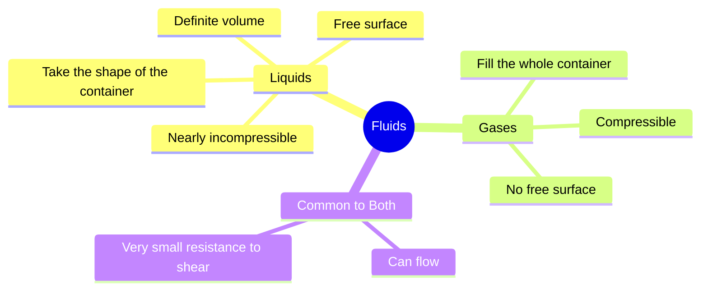
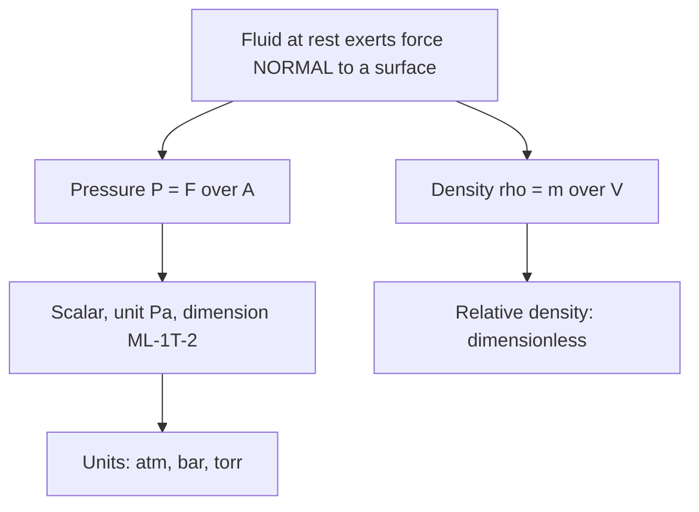
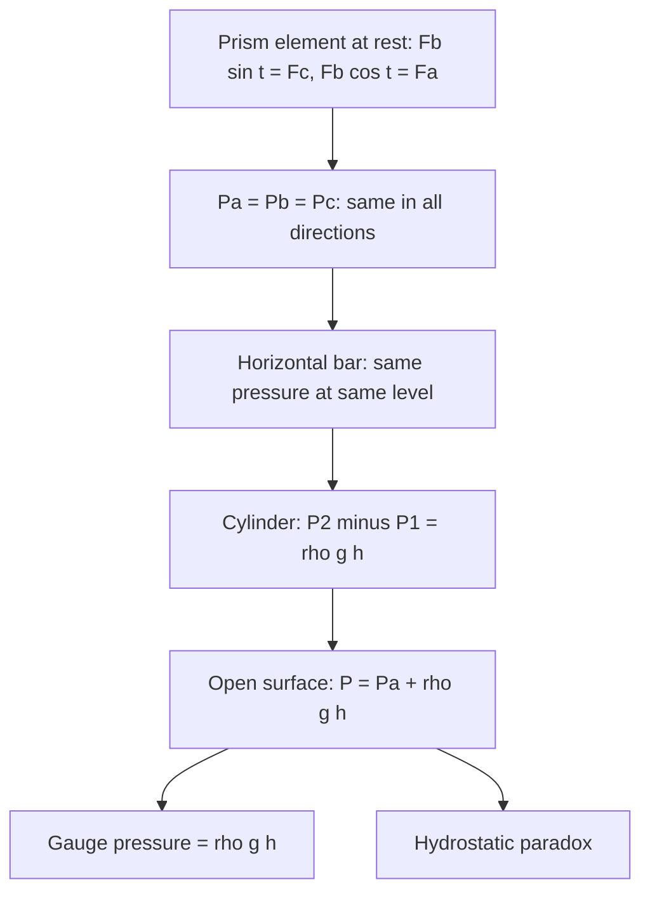
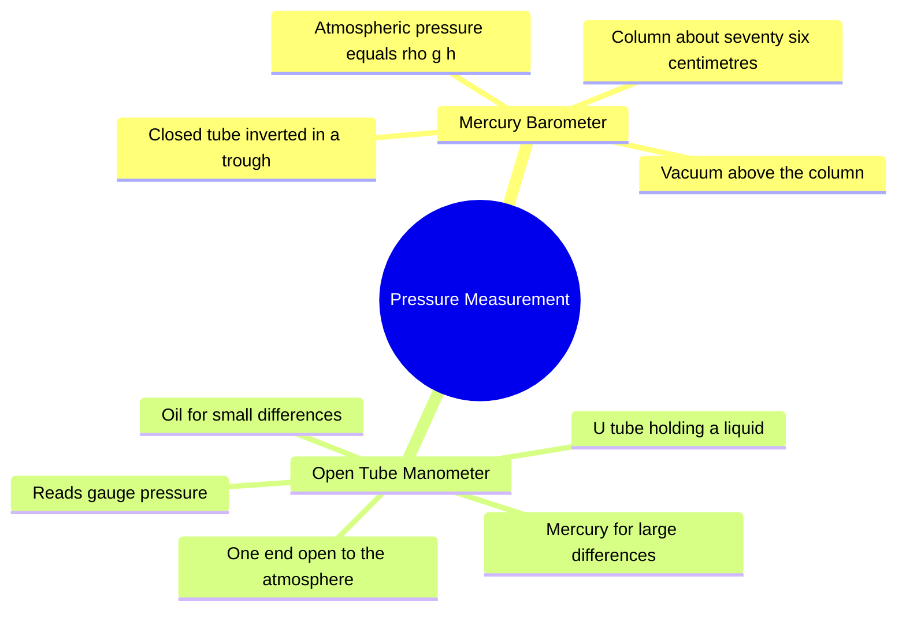
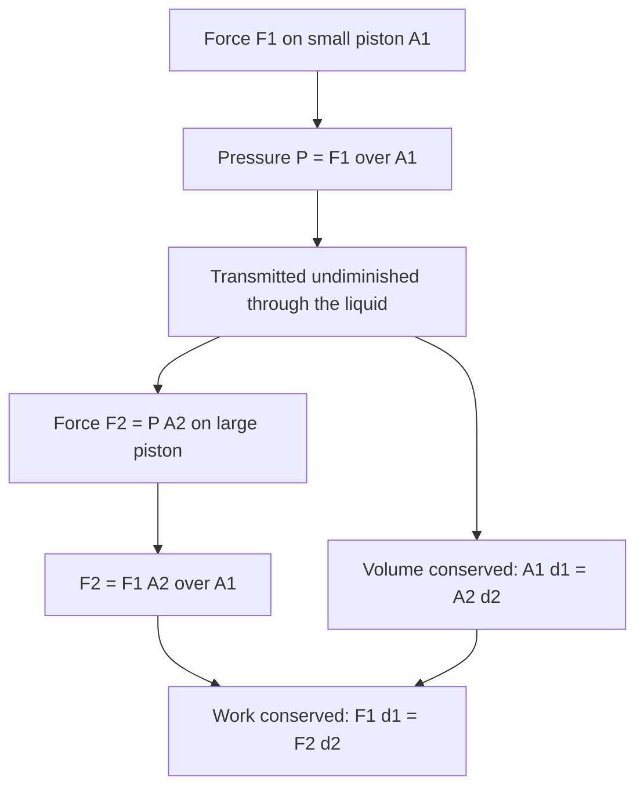
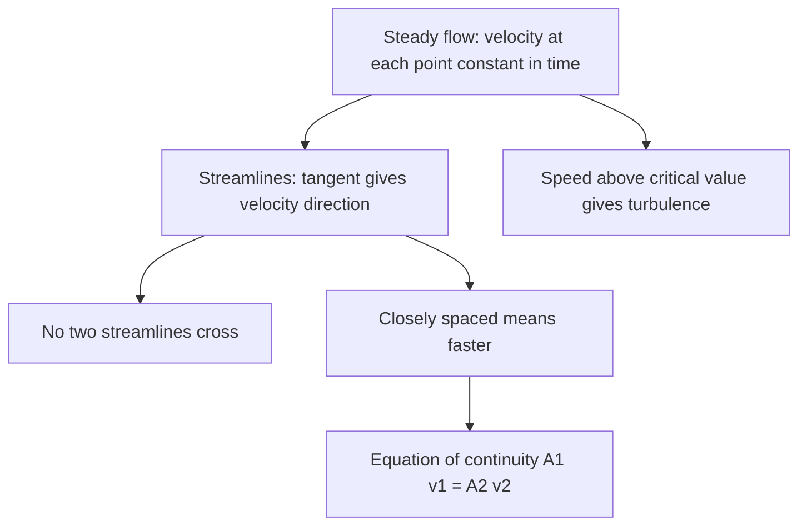
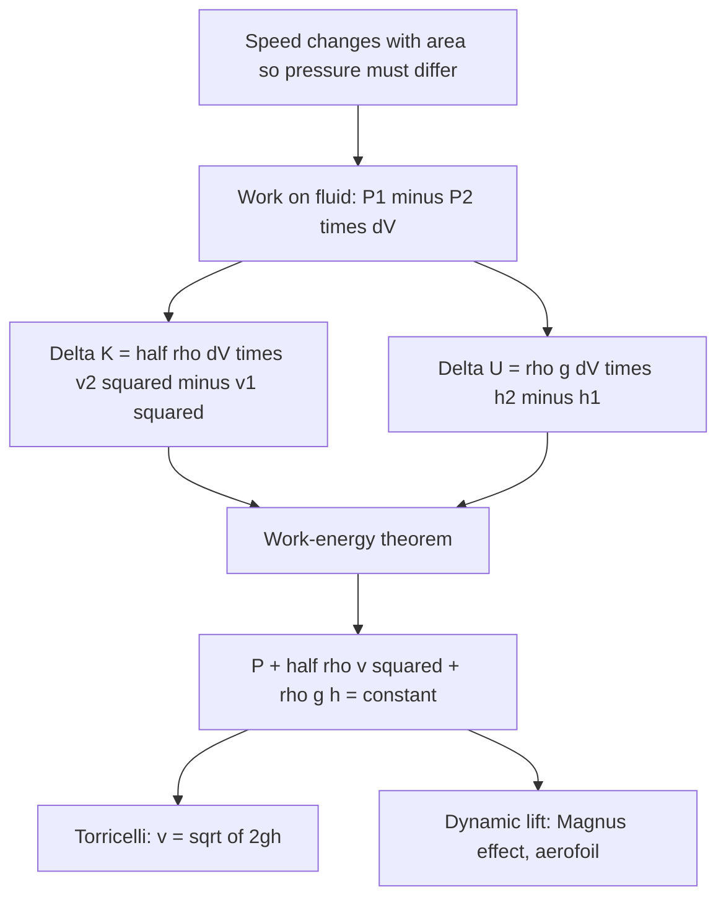
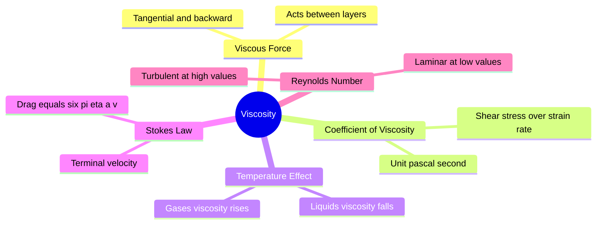
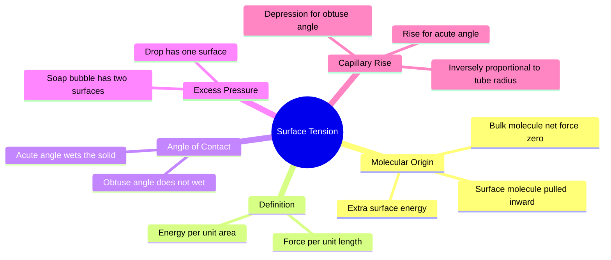
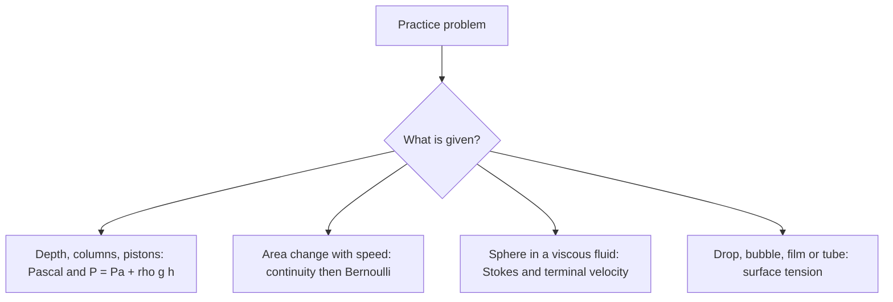

# Physics | Chapter 09 | Mechanical Properties of Fluids | CNOTES

### Condensed Notes | Mirrors NOTES §1–§10 exactly

---

## §1 Introduction: What Are Fluids?

### 1.1 Fluids vs Solids
- **Fluid** — substance that can flow; liquids and gases.
- Fluids give very little resistance to shear stress.
- Shearing stress of a fluid ≈ $10^6$ times smaller than a solid's.
- Solid and liquid "fixed volume" means volume at atmospheric pressure.

| Property | Solids | Liquids | Gases |
|:---|:---|:---|:---|
| Definite shape | Yes | No | No |
| Definite volume | Yes | Yes | No |
| Can flow | No | Yes | Yes |
| Compressibility | Very low | Low | High |
| Free surface | — | Yes | No |

### 1.2 Hydrostatics vs Hydrodynamics
- **Hydrostatics** — fluids at rest (§2–§5).
- **Hydrodynamics** — fluids in motion (§6–§8).
- Surface tension (§9) — boundary property, applies to both.

### 1.3 Compressibility — Liquids vs Gases
- Liquids: $dV\approx0$, density nearly constant.
- Gases: $dV\neq0$, density varies strongly with $P$ and $T$.
- Chapter formulae assume constant $\rho$ — exact only for liquids.

---

## §2 Pressure and Density

### 2.1 Definition of Pressure
- $P_{av}=F/A$ — Eq. (9.1); $P=\lim_{\Delta A\to0}\Delta F/\Delta A$ — Eq. (9.2).
- $F$ = normal component of the force only.
- SI unit: pascal (Pa) $=$ N m⁻²; dimensional formula $[ML^{-1}T^{-2}]$.
- Pressure is a **scalar**.
- Fluid at rest ⟹ force on a surface is normal (a parallel component would make it flow).

### 2.2 Units of Pressure

| Unit | Value |
|:---|:---|
| 1 atm | $1.013\times10^5$ Pa |
| 1 bar | $10^5$ Pa |
| 1 torr $=$ 1 mm Hg | 133 Pa |
| 1 atm | 76 cm Hg $=760$ mm Hg |
| 1 millibar | 100 Pa |

- Trap: handwritten "1 atm $=1.03\times10^5$ Pa" is wrong — $1.03$ is kgf cm⁻². *(§2.2)*

### 2.3 Density and Relative Density
- $\rho=m/V$ — Eq. (9.3); $[ML^{-3}]$; kg m⁻³; positive scalar.
- Relative density $=\rho/\rho_{water,4^\circ C}$; dimensionless. Aluminium: $2.7$.
- Liquids: $\rho$ nearly constant. Gases: large variation.

| Fluid (STP) | $\rho$ (kg m⁻³) |
|:---|:---|
| Water | $1.00\times10^3$ |
| Sea water | $1.03\times10^3$ |
| Mercury | $13.6\times10^3$ |
| Ethyl alcohol | $0.806\times10^3$ |
| Whole blood | $1.06\times10^3$ |
| Air | 1.29 |
| Oxygen | 1.43 |
| Hydrogen | $9.0\times10^{-2}$ |

### 2.4 Solved — Pressure on the Femurs (NCERT 9.1)
- $A=2\times10\ \text{cm}^2=20\times10^{-4}\ \text{m}^2$; $F=400$ N.
- $P=F/A=2\times10^5$ N m⁻² ($\approx2$ atm).

---

## §3 Pascal's Law and Variation of Pressure with Depth

### 3.1 Statements of Pascal's Law
- **Form 1** — pressure at a point in a fluid at rest is the same in all directions.
- **Form 2** — pressure is the same at all points at the same horizontal level.
- **Form 3** — applied pressure on an enclosed fluid is transmitted undiminished to every part and to the walls.
- No gravity ⟹ pressure same at every point.

### 3.2 Proof of Pascal's Law
- Prism element: $F_b\sin\theta=F_c$, $F_b\cos\theta=F_a$.
- Faces: $A_b\sin\theta=A_c$, $A_b\cos\theta=A_a$.
- Divide: $P_b=P_c=P_a$ — Eq. (9.4).
- Pressure has no direction ⟹ scalar.
- Horizontal bar in equilibrium ⟹ equal pressure at its ends ⟹ Form 2.

### 3.3 Variation of Pressure with Depth
- Cylinder element: $(P_2-P_1)A=mg$ — Eq. (9.5).
- $m=\rho hA$ ⟹ $P_2-P_1=\rho gh$ — Eq. (9.6).
- Open liquid: $P=P_a+\rho gh$ — Eq. (9.7).
- Depends only on $\rho$, $h$, $g$ — not on area or container shape.
- Gauge pressure $=P-P_a=\rho gh$.
- Trap: pressure depends on the density of the **fluid** and the **depth of the point**, not on the immersed body.

### 3.4 Interactive — Pressure vs Depth
- Plot of $P(\text{atm})=1+\rho gh/101300$ against $h$.
- Straight line with slope $\propto\rho$.
- Water: $+1$ atm per $\approx10$ m.

### 3.5 Gauge vs Absolute Pressure; The Hydrostatic Paradox
- **Absolute** $P=P_a+\rho gh$; measured from vacuum.
- **Gauge** $P_g=P-P_a$; tyre and blood-pressure gauges read this.
- **Hydrostatic paradox** — vessels of different shape and volume joined at the bottom fill to the same level.
- Reason: same bottom pressure ($h$ only) ⟹ no net push between vessels.

### 3.6 Solved Examples (NCERT 9.2, 9.3, 9.4)
- **9.2** — 10 m lake: $P=1.01\times10^5+10^5=2.01\times10^5$ Pa $\approx2$ atm.
- **9.3** — constant-density atmosphere: $h=P_a/\rho g=7989$ m $\approx8$ km.
- **9.3** — real atmosphere extends $>100$ km because $\rho$ and $g$ fall with height.
- **9.4** — 1000 m depth, sea water: $P=1.0401\times10^7$ Pa; $P_g=1.03\times10^7$ Pa.
- **9.4** — window $0.04\ \text{m}^2$: $F=P_gA=4.12\times10^5$ N (inside at $P_a$).
- Trap: NCERT's "104 atm" uses $1\ \text{atm}\approx10^5$ Pa; exact $\approx102.7$ atm absolute.

---

## §4 Measuring Pressure: Barometer and Manometer

### 4.1 The Mercury Barometer
- Invented by Torricelli (1608–1647).
- Point A (top of column): $P=0$ (mercury vapour neglected).
- B inside tube and C in trough at the same level ⟹ $P_B=P_C=P_a$.
- $P_a=\rho gh$ — Eq. (9.8).
- $0.76\times13.6\times10^3\times9.8=1.01\times10^5$ Pa.
- Column height at sea level ≈ 76 cm (760 mm).
- $1$ torr $=1$ mm Hg $=133$ Pa.
- Barometer fall of $\ge10$ mm warns of a storm.

### 4.2 Why Mercury?
- Water column would be $P_a/\rho_wg\approx10.3$ m.
- Mercury is $13.6\times$ denser ⟹ column $\approx0.76$ m.
- Mercury vapour pressure negligible ⟹ $P_A\approx0$.

### 4.3 The Open-Tube Manometer
- U-tube; one end open, other end connected to the system.
- $P_A=P_B$ (same level, same liquid).
- $P=P_a+\rho gh$ ⟹ $P-P_a=\rho gh$.
- Reads **gauge pressure**, proportional to $h$.
- Low-density liquid (oil): small pressure differences.
- High-density liquid (mercury): large pressure differences.

---

## §5 Hydraulic Machines

### 5.1 The Hydraulic Lift
- Based on Pascal's law, Form 3.
- $P=F_1/A_1$ transmitted to the large piston.
- $F_2=PA_2=F_1A_2/A_1$.
- Mechanical advantage $=A_2/A_1$.

### 5.2 Interactive — Force Multiplication
- $F_2=F_1x$ with $x=A_2/A_1$ — a straight line through the origin.

### 5.3 Energy Is Not Multiplied
- $A_1d_1=A_2d_2$ (incompressible liquid).
- $F_2d_2=F_1d_1$ — work in $=$ work out.
- Force multiplied; displacement divided by the same factor.

### 5.4 Hydraulic Brakes
- Pedal ⟹ master piston ⟹ pressure through brake oil ⟹ larger pistons ⟹ shoes press on lining.
- Same pressure reaches all four cylinders ⟹ equal braking effort on all wheels.

### 5.5 Solved Examples (NCERT 9.5, 9.6)
- **9.5** — $d_1=1.0$ cm, $d_2=3.0$ cm, $F_1=10$ N: $F_2=9\times10=90$ N.
- **9.5** — small piston in 6.0 cm: $L_2=6.0/9=0.67$ cm.
- **9.6** — radii 5 cm and 15 cm, car 1350 kg: $F_1=13230/9=1470$ N $\approx1.5\times10^3$ N.
- **9.6** — $P=F_1/A_1=1.9\times10^5$ Pa (gauge; atmosphere cancels).

---

## §6 Streamline Flow and the Equation of Continuity

### 6.1 Fluid Dynamics and Steady Flow
- **Fluid dynamics** — study of fluids in motion.
- **Steady flow** — at any given point, every passing particle has the same constant velocity.
- Velocity may differ from point to point.
- Particle paths are smooth and never cross.

### 6.2 Streamlines and Their Properties
- **Streamline** — curve whose tangent at each point is along the fluid velocity there.
- No two streamlines cross (else two velocities at one point).
- Tangent gives velocity direction.
- Streamline map is stationary in steady flow.
- Closely spaced streamlines ⟹ higher speed.

### 6.3 Laminar vs Turbulent Flow; Critical Speed

| | Laminar (streamline) | Turbulent |
|:---|:---|:---|
| Pattern | Smooth, parallel layers | Irregular, whirlpools |
| Velocity at a point | Constant in time | Changes continuously |
| Speed | Below critical | Above critical |
| Example | Slow tap flow | White-water rapids |

- **Critical speed** — limit between steady and turbulent flow.
- Laminar: velocities may differ in magnitude, directions parallel.
- In a pipe: maximum speed on the axis, zero at the wall.

### 6.4 The Equation of Continuity — Derivation
- Volume through a section in $\Delta t$: $V=Av\Delta t$.
- Mass conservation: $\rho_1A_1v_1\Delta t=\rho_2A_2v_2\Delta t$ — Eq. (9.9).
- Incompressible ($\rho_1=\rho_2$): $A_1v_1=A_2v_2$ — Eq. (9.10).
- $Av=$ constant — Eq. (9.11).
- $Av$ = volume flux; unit m³ s⁻¹; $[L^3T^{-1}]$.
- Narrow section ⟹ faster; wide section ⟹ slower.
- Trap: continuity is mass conservation, not Bernoulli (energy).
- Trap: handwritten "$V_2=A_1v_2\Delta t$" should read $A_2$.

### 6.5 Interactive — Speed vs Cross-Section
- $v_2=A_1v_1/A_2$ — rectangular hyperbola.
- Halve $A_2$ ⟹ double $v_2$.

---

## §7 Bernoulli's Principle

### 7.1 Derivation (Work–Energy Method)
- $W_1=P_1A_1(v_1\Delta t)=P_1\Delta V$; $W_2=P_2\Delta V$.
- Net work on fluid $=(P_1-P_2)\Delta V$.
- $\Delta K=\tfrac12\rho\Delta V(v_2^2-v_1^2)$.
- $\Delta U=\rho g\Delta V(h_2-h_1)$.
- Work–energy theorem ⟹ $P_1+\tfrac12\rho v_1^2+\rho gh_1=P_2+\tfrac12\rho v_2^2+\rho gh_2$ — Eq. (9.12).
- General: $P+\tfrac12\rho v^2+\rho gh=$ constant — Eq. (9.13).
- Each term = energy per unit volume; $[ML^{-1}T^{-2}]$.
- $v=0$ ⟹ $P_1-P_2=\rho g(h_2-h_1)$ — hydrostatics.
- Same height: faster flow ⟹ lower pressure.

### 7.2 Conditions of Validity
- Fluid non-viscous.
- Fluid incompressible.
- Flow steady (not turbulent).
- Applied along a single streamline.
- Real fluid: viscosity turns kinetic energy into heat ⟹ $P_2$ lower than predicted.

### 7.3 Speed of Efflux: Torricelli's Law
- Continuity: $v_2=(A_1/A_2)v_1\approx0$ if $A_2\gg A_1$.
- Bernoulli: $P_a+\tfrac12\rho v_1^2+\rho gy_1=P+\rho gy_2$.
- Sealed tank: $v_1=\sqrt{2gh+2(P-P_a)/\rho}$ — Eq. (9.14).
- Open tank ($P=P_a$): $v_1=\sqrt{2gh}$ — Eq. (9.15).
- Same as free-fall speed through $h$.
- $P\gg P_a$: $2gh$ negligible — rocket propulsion.
- Outflowing jet ⟹ backward thrust on the vessel.
- Interactive: sealed-tank curve starts above zero at $h=0$; open-tank curve passes through the origin.

### 7.4 Interactive — Pressure Falls as Speed Rises
- Horizontal pipe: $P=P_1+\tfrac12\rho(v_1^2-v^2)$.
- Inverted parabola in $v$; steeper for larger $\rho$.

### 7.5 Dynamic Lift: Magnus Effect and Aerofoil
- **Dynamic lift** — force on a body from its motion through a fluid.
- No spin: symmetric streamlines ⟹ no pressure difference ⟹ no lift.
- **Magnus effect** — spinning ball drags air; speed larger on one side ⟹ pressure difference ⟹ transverse force.
- NCERT Fig. 9.11(b): clockwise spin, air faster above ⟹ lower pressure above ⟹ net upward force.
- Spinning ball deviates from a parabolic path.
- **Aerofoil** — streamlines crowd above the wing ⟹ higher speed, lower pressure above ⟹ lift balances weight.

### 7.6 Solved — Lift on a Boeing (NCERT 9.7)
- $M=3.3\times10^5$ kg; $A=500\ \text{m}^2$; $v=960$ km h⁻¹ $=267$ m s⁻¹; $\rho=1.2$ kg m⁻³.
- $\Delta P=Mg/A=6.5\times10^3$ N m⁻².
- $(v_2-v_1)/v_{av}=\Delta P/\rho v_{av}^2\approx0.08$ ⟹ 8 % faster above.

---

## §8 Viscosity

### 8.1 Viscous Force Between Layers
- **Viscosity** — fluid property giving internal friction that opposes relative motion of layers.
- **Viscous force** — backward dragging force, acts tangentially on layers.
- Fluid in contact with a surface moves with that surface.
- Layer speeds rise uniformly from 0 (fixed plate) to $v$ (moving plate).
- Honey needs more force than oil for the same $v$ ⟹ more viscous.
- Shear strain $\Delta x/l$ grows with time.
- Fluid stress ∝ **rate** of strain $v/l$; solid stress ∝ strain.

### 8.2 Coefficient of Viscosity
- $\eta=\dfrac{F/A}{v/l}=\dfrac{Fl}{vA}$ — Eq. (9.16).
- Differential form: $F=-\eta A\,dv/dz$.
- $[\eta]=[ML^{-1}T^{-1}]$.
- SI: Pa s $=$ N s m⁻² $=$ poiseuille (Pl).
- CGS: poise; $1\ \text{Pl}=10$ poise.
- Thin liquids (water, alcohol) less viscous than thick (tar, glycerine, blood).

| Fluid | $T$ (°C) | $\eta$ (mPl) |
|:---|:---|:---|
| Water | 20 | 1.0 |
| Water | 100 | 0.3 |
| Blood | 37 | 2.7 |
| Machine oil | 16 | 113 |
| Machine oil | 38 | 34 |
| Glycerine | 20 | 830 |
| Honey | — | 200 |
| Air | 0 | 0.017 |
| Air | 40 | 0.019 |

- Blood relative viscosity $\eta/\eta_{water}$ constant from 0 °C to 37 °C.

### 8.3 Effect of Temperature

| Medium | $T$ rises | Reason |
|:---|:---|:---|
| Liquids | $\eta$ falls | Molecules more mobile |
| Gases | $\eta$ rises | More random motion, more momentum transfer |

- Trap: liquids and gases move in opposite directions.

### 8.4 Stokes' Law and Terminal Velocity
- $F=6\pi\eta av$ — Eq. (9.17); opposes motion; ∝ $v$.
- Dimension check: $[F]=[\eta][a][v]$ ⟹ $[\eta]=[ML^{-1}T^{-1}]$.
- Terminal velocity — constant speed when $W=U+F$.
- $W=\tfrac43\pi a^3\rho g$; $U=\tfrac43\pi a^3\sigma g$; $F=6\pi\eta av_t$.
- $v_t=\dfrac{2a^2(\rho-\sigma)g}{9\eta}$ — Eq. (9.18).
- $v_t\propto a^2$; $v_t\propto1/\eta$; $v_t\propto(\rho-\sigma)$.
- $\rho<\sigma$ ⟹ $v_t<0$ ⟹ body rises.
- Raindrops reach terminal velocity; fine dust settles slowly.
- Trap: $\sigma$ = fluid density here; handwritten notes also use $\sigma$ for surface tension.

### 8.5 Critical Velocity and Reynolds Number (Supp.)
- **Critical velocity** — limit of streamline flow.
- Assume $v_c\propto\rho^a\eta^bD^c$.
- Dimensions give $a=-1$, $b=1$, $c=-1$.
- $v_c=K\eta/(\rho D)$; $K$ dimensionless.
- $R_e=\rho vD/\eta$; dimensionless; $K=R_{e,c}$.

| $R_e$ (pipe) | Flow |
|:---|:---|
| $<2000$ | Streamline |
| $2000$–$3000$ | Unstable |
| $>3000$ | Turbulent |

- Thresholds typical, not exact.
- Smaller model ⟹ smaller $D$ ⟹ larger $v_c$.
- Trap: handwritten "Reanault" is Reynolds; its $l$ must be the diameter, with $K$ retained.

### 8.6 Solved Examples (NCERT 9.8, 9.9)
- **9.8** — $F=mg=9.8\times10^{-2}$ N; stress $=0.98$ N m⁻²; strain rate $=0.085/0.30\times10^{-3}=283$ s⁻¹.
- **9.8** — $\eta=3.46\times10^{-3}$ Pa s.
- **9.9** — $a=2$ mm, $v_t=6.5$ cm s⁻¹, $\rho-\sigma=7.4\times10^3$.
- **9.9** — $\eta=\tfrac29a^2(\rho-\sigma)g/v_t=0.99$ Pa s.

---

## §9 Surface Tension

### 9.1 Cohesion, Adhesion and the Molecular Origin of Surface Tension
- Surface tension — property of liquids only (gases have no free surface).
- **Cohesive force** — between molecules of the same substance.
- **Adhesive force** — between molecules of different substances.
- Bulk molecule: attracted by all neighbours ⟹ negative potential energy; net force zero.
- Heat of evaporation of water $\approx40$ kJ mol⁻¹.
- Surface molecule: only lower half surrounded ⟹ potential energy ≈ half of a bulk molecule's.
- Surface molecules carry extra energy.
- Energy to bring a molecule to the surface ≈ half the heat of evaporation.
- Sphere of molecular activity (Supp.): bulk ⟹ net force zero; near surface ⟹ net force inward; greatest when half in air, half in liquid.
- Liquid tends to the minimum surface area, like a stretched membrane.
- Surface is not sharp — density falls to zero over a few molecular sizes.

### 9.2 Surface Energy and Surface Tension
- Moving a bar by $d$ on a two-faced film: extra area $2dl$.
- $S(2dl)=Fd$ — Eq. (9.19) ⟹ $S=F/2l$ — Eq. (9.20).
- $S$ = force per unit length = surface energy per unit area.
- $S=W/\Delta A$; $W=S\Delta A\times$ number of surfaces.
- SI unit N m⁻¹ $=$ J m⁻²; $[MT^{-2}]$; scalar.
- CGS: dyne cm⁻¹; $1\ \text{dyne cm}^{-1}=10^{-3}$ N m⁻¹.
- Single surface: $\sigma=F/L$ (handwritten notes).
- Surface energy depends on the materials on both sides of the interface.
- $S$ usually falls with temperature.

| Liquid | $T$ (°C) | $S$ (N m⁻¹) | Heat of vaporisation (kJ mol⁻¹) |
|:---|:---|:---|:---|
| Helium | −270 | 0.000239 | 0.115 |
| Oxygen | −183 | 0.0132 | 7.1 |
| Ethanol | 20 | 0.0227 | 40.6 |
| Water | 20 | 0.0727 | 44.16 |
| Mercury | 20 | 0.4355 | 63.2 |

### 9.3 Measuring Surface Tension
- Vertical glass plate on a balance, lower edge touching the liquid.
- Extra weight $W=mg$ just clears the plate.
- $S_{la}=W/2l=mg/2l$ — Eq. (9.21).
- $la$ = liquid–air interface.

### 9.4 Angle of Contact
- **Angle of contact $\theta$** — angle between the tangent to the liquid surface at the contact point and the solid surface, inside the liquid.

| Meniscus | $\theta$ | Example | Forces |
|:---|:---|:---|:---|
| Concave | acute ($\approx8^\circ$) | water–glass | adhesive $>$ cohesive |
| Plane | $90^\circ$ | pure water–silver | adhesive $=$ cohesive |
| Convex | obtuse ($\approx138^\circ$) | mercury–glass | cohesive $>$ adhesive |

- $\theta$ depends on the solid–liquid pair, the medium above, and the temperature.
- Force balance on the solid: $S_{la}\cos\theta+S_{sl}=S_{sa}$ — Eq. (9.22).
- $\cos\theta=(S_{sa}-S_{sl})/S_{la}$.
- Acute ⟺ $S_{sl}<S_{sa}$; obtuse ⟺ $S_{sl}>S_{sa}$.
- Right side $>1$ ⟹ complete spreading ($\theta=0$).
- Wetting agents (soap, detergent) reduce $\theta$; waterproofing agents increase $\theta$.
- Trap: NCERT writes "$S_{sl}>S_{la}$ for obtuse" — contradicts Eq. (9.22); use $S_{sa}$.

### 9.5 Drops and Bubbles — Excess Pressure
- Sphere = least area for given volume ⟹ drops and bubbles spherical.
- Drop grows $r\to r+\Delta r$: $\Delta E=8\pi r\Delta rS_{la}$ — Eq. (9.23).
- Work by pressure: $W=(P_i-P_o)4\pi r^2\Delta r$ — Eq. (9.24).
- $P_i-P_o=2S_{la}/r$ — Eq. (9.25).
- Soap bubble, two surfaces: $P_i-P_o=4S_{la}/r$ — Eq. (9.26).

| Object | Surfaces | Excess pressure |
|:---|:---|:---|
| Liquid drop in air | 1 | $2S/r$ |
| Air bubble in liquid | 1 | $2S/r$ |
| Soap bubble in air | 2 | $4S/r$ |

- Higher pressure on the side holding the centre of curvature.
- Smaller bubble ⟹ higher pressure.
- Trap: NCERT says "convex side higher"; the examples (air inside a bubble) are the same.

### 9.6 Capillary Rise
- Wetting liquid (acute $\theta$): concave meniscus ⟹ rise.
- $r=a/\cos\theta$.
- $P_a-P_0=2S/r=(2S/a)\cos\theta$ — Eq. (9.27).
- Points A and B at the same level: $P_a=P_0+h\rho g$ — Eq. (9.28).
- $h=\dfrac{2S\cos\theta}{\rho ga}$ — Eq. (9.29).
- $h\propto1/a$; $h\propto S$; $h\propto\cos\theta$; $h\propto1/\rho$.
- Obtuse $\theta$ (mercury) ⟹ $\cos\theta<0$ ⟹ depression.
- Water, $a=0.05$ cm: $h=2.98$ cm.
- Examples: sap in trees, oil up a wick.

### 9.7 Solved — Bubble at the End of a Capillary (NCERT 9.10)
- Diameter 2.00 mm ⟹ $r=1.00$ mm; depth 8.00 cm; $S=7.30\times10^{-2}$ N m⁻¹.
- $P_o=1.01\times10^5+0.08\times1000\times9.80=1.01784\times10^5$ Pa.
- One surface: excess $=2S/r=146$ Pa.
- $P_i=1.02\times10^5$ Pa.

---

## §10 Additional Practice

### 10.1 Handwritten-Notes Problems, Re-derived (Supp.)
- **P1** — soap bubble 2 cm → 3 cm, $S=30$ dyne cm⁻¹: $W=S\cdot2\cdot4\pi(9-4)=1200\pi$ erg $\approx3768$ erg.
- **P2** — drop of diameter $D$ → 27 drops: $r_d=D/6$; $\Delta A=2\pi D^2$; $\Delta E=2\pi SD^2$.
- **P2** — general: $\Delta E=4\pi R^2S(N^{1/3}-1)$.
- Trap: handwritten 27-drop result is illegible; recomputed.
- **P3** — 4 mm drop → 1000 drops, $S=0.07$: $\Delta E=\pi SD^2(n-1)=3.17\times10^{-5}$ J.
- Trap: handwritten unit "N" should be J.
- **P4** — 500 erg to pop at $r$: $W\propto r^2$; at $3r$ total $4500$ erg; additional $=4000$ erg.
- **P5** — air bubble 0.1 mm below surface, $S=7.2\times10^{-2}$: $\Delta P=2S/r=1440$ Pa.
- **P5** — $P=1.013\times10^5+1440\approx1.027\times10^5$ Pa.
- Trap: handwritten "$1440+10125=11565$" drops a zero.

### 10.2 NCERT Exercises — Numericals (New)
- **9.5** — heel $d=1.0$ cm, 50 kg: $P=6.2\times10^6$ Pa.
- **9.6** — wine $\rho=984$: $h=P_a/\rho g\approx10.5$ m.
- **9.7** — 3 km depth: $P\approx3\times10^7$ Pa $\ll10^9$ Pa ⟹ suitable.
- **9.8** — 3000 kg, $425\ \text{cm}^2$: $P=6.9\times10^5$ Pa.
- **9.9** — equal Hg levels: $\rho_w(10)=\rho_s(12.5)$ ⟹ specific gravity $0.80$.
- **9.10** — $25.0$ cm water vs $27.5$ cm spirit: head $3.0$ cm water ⟹ $\Delta h=3.0/13.6\approx0.22$ cm.
- **9.10** — equal-bore refinement $\approx0.24$ cm.
- **9.13** — glycerine: $Q=3.08\times10^{-6}$ m³ s⁻¹; $\Delta P=8\eta LQ/\pi r^4\approx9.8\times10^2$ Pa.
- **9.13** — $R_e\approx0.31\ll2000$ ⟹ laminar.
- **9.14** — lift $=\tfrac12\rho(v_2^2-v_1^2)A\approx1.5\times10^3$ N.
- **9.16** — $A_{tube}v_{tube}=40\pi(0.5\ \text{mm})^2v_{hole}$ ⟹ $v_{hole}\approx0.64$ m s⁻¹.
- **9.17** — $S=F/2l=0.025$ N m⁻¹.
- **9.19** — mercury drop 3.00 mm: excess $310$ Pa; $P_{in}\approx1.013\times10^5$ Pa.
- **9.20** — soap bubble 5.00 mm: excess $4S/r=20$ Pa.
- **9.20** — air bubble at 40.0 cm: $P_o=1.0570\times10^5$ Pa; $P_i\approx1.057\times10^5$ Pa.

### 10.3 NCERT Exercises — Conceptual (New)
- **9.1(a)** — blood pressure higher at feet: larger depth below the heart.
- **9.1(b)** — pressure halves at 6 km: air compressible, density falls with height.
- **9.1(c)** — hydrostatic pressure scalar: equal in all directions at a point.
- **9.2(a,b)** — mercury cohesion > adhesion ⟹ obtuse $\theta$, does not wet; water acute, wets.
- **9.2(c)** — $S$ independent of area: it is a property of the interface and temperature.
- **9.2(d)** — detergent lowers $S_{sl}$ ⟹ small $\theta$.
- **9.2(e)** — free drop spherical: minimum area for given volume.
- **9.3** — (a) decreases; (b) increases for gases, decreases for liquids; (c) shear strain, rate of shear strain; (d) conservation of mass; (e) greater.
- **9.4(a)** — blow over paper: faster air above ⟹ lower pressure ⟹ paper lifted flat.
- **9.4(b)** — tap closed by fingers: smaller area ⟹ faster jets (continuity).
- **9.4(c)** — needle bore sets syringe flow rate, $Q\propto r^4$.
- **9.4(d)** — outflowing jet ⟹ backward thrust (momentum conservation).
- **9.4(e)** — spinning ball: Magnus effect.
- **9.11** — Bernoulli not valid for rapids: turbulent flow.
- **9.12** — gauge or absolute: no difference if the same $P_a$ acts at both points.
- **9.18** — supported weight $=2Sl$: same in (a), (b), (c).

---

## 📋 Quick Reference

> [!important] Formulas
> $P=F/A$; $P=P_a+\rho gh$; $A_1v_1=A_2v_2$; $P+\tfrac12\rho v^2+\rho gh=$ const
> $\eta=Fl/vA$; $F=6\pi\eta av$; $v_t=2a^2(\rho-\sigma)g/9\eta$
> $S=F/2l$; $\Delta P=2S/r$ or $4S/r$; $h=2S\cos\theta/\rho ga$

---

## ⚡ Points to Ponder

- Pressure is a scalar; the force it exerts is normal to any area.
- Pressure depends on $\rho$, $h$, $g$ — not container shape.
- Gauge pressure $=P-P_a$; manometers and tyre gauges read it.
- Hydraulic lift multiplies force, not work.
- Continuity (mass) and Bernoulli (energy) are separate laws.
- Bernoulli needs: non-viscous, incompressible, steady, one streamline.
- Faster flow ⟹ lower pressure at equal height.
- Torricelli $\sqrt{2gh}$ equals the free-fall speed.
- $\eta$ falls with $T$ for liquids, rises for gases.
- Surface tension of a liquid falls with temperature.
- Stokes' law applies to slow small spheres; $v_t\propto a^2$; sign of $\rho-\sigma$ sets rise or fall.
- Smaller model ⟹ larger critical speed ($v_c\propto1/D$).
- $S$ does not depend on area; N m⁻¹ $=$ J m⁻².
- Count surfaces: drop 1, air bubble in liquid 1, soap bubble 2, film on frame 2.
- Smaller bubble ⟹ higher excess pressure.
- Acute $\theta$ ⟹ rise; obtuse $\theta$ ⟹ depression.
- Splitting a drop absorbs energy.

---

## 🛠️ Source Corrections

| Source | Error | Correction |
|:---|:---|:---|
| Handwritten | $1\ \text{atm}=1.03\times10^5$ Pa | $1.013\times10^5$ Pa |
| Handwritten | pressure depends on density and height "of body" | fluid density, depth of the point |
| Handwritten | $V_2=A_1v_2\Delta t$ | $A_2$ |
| Handwritten | $v_c=\eta/\rho l$, $l$ diameter and radius | use $D$; keep $K=R_{e,c}$ |
| Handwritten | "Reanault" | Reynolds |
| Handwritten | $\sigma$ for both surface tension and density | $S$ and $\sigma$ as in NCERT |
| Handwritten | 27-drop result illegible | $2\pi SD^2$ |
| Handwritten | 1000-drop unit N | joule |
| Handwritten | $1440+10125=11565$ | $\approx1.027\times10^5$ Pa |
| NCERT 9.6.3 | obtuse if $S_{sl}>S_{la}$ | $S_{sl}>S_{sa}$ |
| NCERT 9.6.4 | "convex side higher pressure" | side with centre of curvature |
| NCERT Ex. 9.4 | 104 atm, 103 atm | $\approx102.7$, $\approx101.7$ atm |

---

## 🧭 Problem-Solving Strategy

**Type A — Pressure and depth**
1. Mark the free surface and the point.
2. $P=P_a+\rho gh$ with vertical $h$.
3. One side at $P_a$ ⟹ force $=P_gA$.
4. Stacked liquids: add each $\rho_igh_i$.

**Type B — Manometers and U-tubes**
1. Choose two points at one level in one continuous liquid.
2. Write $P_{\text{surface}}+\sum\rho gh$ for each side.
3. Equate; solve.

**Type C — Hydraulic machines**
1. $F_1/A_1=F_2/A_2$; $A_1d_1=A_2d_2$.
2. Check $F_1d_1=F_2d_2$.
3. $P_a$ cancels.

**Type D — Flow**
1. Mark two points on one streamline.
2. Continuity for the speed.
3. Bernoulli for pressure or speed.
4. Check the four validity conditions.
5. Lift: $\Delta P\,A=Mg$.

**Type E — Viscosity**
1. Sphere: $W=U+F$.
2. Check the sign of $\rho-\sigma$.
3. Plate or block at constant speed: applied force $=\eta Av/l$.
4. Flow type: compare $R_e$ with 2000 and 3000.

**Type F — Surface tension**
1. Count surfaces.
2. $W=S\Delta A\times$ surfaces; conserve volume when drops split.
3. Excess $2S/r$ or $4S/r$; inside $=$ outside $+$ excess.
4. $h=2S\cos\theta/\rho ga$ with tube radius $a$.
5. $\cos\theta=(S_{sa}-S_{sl})/S_{la}$.

---

## Rapid Reference

| Fact | Value |
|:---|:---|
| Pressure | $P=F/A$; Pa; $[ML^{-1}T^{-2}]$; scalar |
| Density | $\rho=m/V$; kg m⁻³; $[ML^{-3}]$ |
| 1 atm | $1.013\times10^5$ Pa $=76$ cm Hg |
| 1 bar | $10^5$ Pa |
| 1 torr | 1 mm Hg $=133$ Pa |
| Water density (4 °C) | $1.0\times10^3$ kg m⁻³ |
| Mercury density | $13.6\times10^3$ kg m⁻³ |
| Pressure at depth | $P=P_a+\rho gh$ (9.7) |
| Gauge pressure | $P_g=P-P_a=\rho gh$ |
| Barometer | $P_a=\rho gh$ (9.8) |
| Water barometer height | $\approx10.3$ m |
| Pascal's law (Form 3) | pressure transmitted undiminished |
| Hydraulic lift | $F_2=F_1A_2/A_1$; $A_1d_1=A_2d_2$ |
| Equation of continuity | $A_1v_1=A_2v_2$ (9.10) |
| Volume flux | $Av$; m³ s⁻¹; $[L^3T^{-1}]$ |
| Bernoulli | $P+\tfrac12\rho v^2+\rho gh=$ const (9.13) |
| Torricelli (open tank) | $v=\sqrt{2gh}$ (9.15) |
| Torricelli (sealed tank) | $v=\sqrt{2gh+2(P-P_a)/\rho}$ (9.14) |
| Coefficient of viscosity | $\eta=Fl/vA$ (9.16); $[ML^{-1}T^{-1}]$ |
| Viscosity units | Pa s $=$ Pl $=10$ poise |
| Stokes' law | $F=6\pi\eta av$ (9.17) |
| Terminal velocity | $v_t=2a^2(\rho-\sigma)g/9\eta$ (9.18) |
| Critical velocity | $v_c=K\eta/\rho D$; $K=R_{e,c}$ |
| Reynolds number | $R_e=\rho vD/\eta$; dimensionless |
| Flow regimes (pipe) | $<2000$ laminar; $2000$–$3000$ unstable; $>3000$ turbulent |
| Surface tension | $S=F/2l$ (9.20); N m⁻¹; $[MT^{-2}]$ |
| Plate method | $S_{la}=mg/2l$ (9.21) |
| Contact-angle balance | $S_{la}\cos\theta+S_{sl}=S_{sa}$ (9.22) |
| Drop or air bubble | $\Delta P=2S/r$ (9.25) |
| Soap bubble | $\Delta P=4S/r$ (9.26) |
| Capillary rise | $h=2S\cos\theta/\rho ga$ (9.29) |
| Water in glass, $a=0.05$ cm | $h=2.98$ cm |
| Water $S$ (20 °C) | $0.0727$ N m⁻¹ |
| Mercury $S$ (20 °C) | $0.4355$ N m⁻¹ |
| Water $\eta$ (20 °C) | 1.0 mPl |
| NCERT 9.2 | $2.01\times10^5$ Pa at 10 m |
| NCERT 9.3 | atmosphere height $\approx8$ km |
| NCERT 9.4 | $P_g=1.03\times10^7$ Pa; $F=4.12\times10^5$ N |
| NCERT 9.5 | $F_2=90$ N; $L_2=0.67$ cm |
| NCERT 9.6 | $F_1\approx1.5\times10^3$ N; $P=1.9\times10^5$ Pa |
| NCERT 9.7 | $\Delta P=6.5\times10^3$ Pa; 8 % speed difference |
| NCERT 9.8 | $\eta=3.46\times10^{-3}$ Pa s |
| NCERT 9.9 | $\eta=0.99$ Pa s |
| NCERT 9.10 | excess $146$ Pa; $P_i=1.02\times10^5$ Pa |
| Soap bubble 2 → 3 cm | $W=1200\pi$ erg $\approx3768$ erg |
| 27-drop split | $\Delta E=2\pi SD^2$ |
| 1000-drop split (4 mm) | $\Delta E=3.17\times10^{-5}$ J |
| Bubble 0.1 mm below surface | $P\approx1.027\times10^5$ Pa |

---

*End of CNOTES — Physics Ch. 9*
