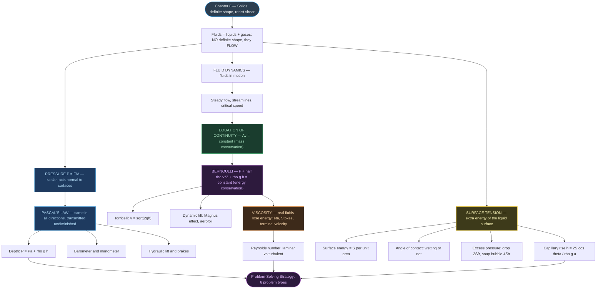
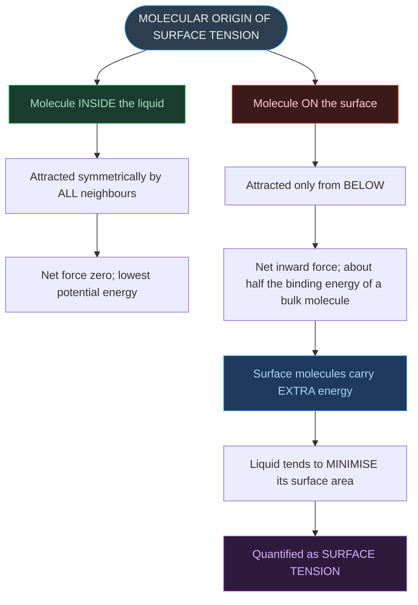
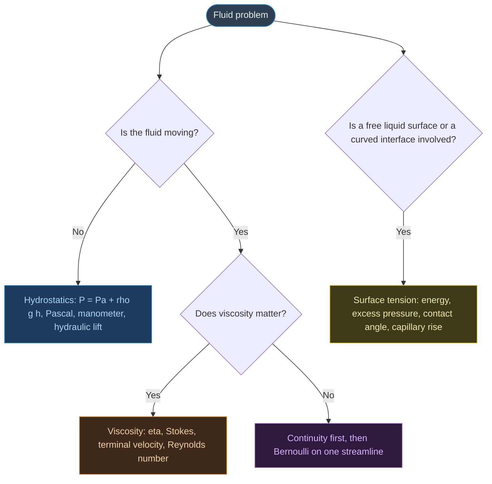

# Physics | Chapter 09 | Mechanical Properties of Fluids | NOTES

### Complete Study Notes | Board · NEET · JEE Layered

---

## Chapter Brief

The previous chapter showed how a *solid* answers a stress with a strain and springs back. This chapter asks what changes when a substance cannot hold a shape of its own: liquids and gases flow, so their behaviour is described by pressure, flow laws and surface effects rather than by elastic moduli. It first builds hydrostatics (pressure, Pascal's law, hydraulic machines), then hydrodynamics (continuity, Bernoulli's principle, viscosity), and finally the molecular surface layer (surface tension, contact angle, capillarity). By the end, the reader should be able to choose the right principle — force balance, conservation of mass, or conservation of energy — for a given fluid situation, and state exactly when each one stops applying.

## Front Matter

**Prerequisites:** Stress, strain and shear (elastic behaviour of solids), Newton's laws and free-body diagrams, the work–energy theorem, density, and dimensional analysis.

**Key outcomes** — by the end of this chapter, the reader should be able to:
- Derive $P=P_a+\rho gh$ and use it for gauge pressure, barometers, manometers and hydraulic machines.
- Distinguish steady (streamline) flow from turbulent flow, and apply the equation of continuity $Av=\text{constant}$.
- Derive Bernoulli's equation from the work–energy theorem and apply it to Torricelli's law, dynamic lift and the Magnus effect — while stating its four validity conditions.
- Define the coefficient of viscosity, derive Stokes' terminal velocity, and use the Reynolds number to predict the nature of flow.
- Explain surface tension as surface energy per unit area, and derive the excess pressure in drops and bubbles and the capillary-rise formula.
- Solve numerical problems in all of the above with correct units, dimensions and sign conventions.

**Scope note:** Fluids are treated as *incompressible and non-viscous* wherever Bernoulli's equation is used; compressible-flow effects (sound, shock waves) and the full Poiseuille analysis of pipe flow are outside this chapter (Poiseuille's formula appears once, in §10.2, only to complete NCERT Exercise 9.13).

**Source conventions:** The NCERT chapter is the primary source; examples numbered *NCERT 9.n* come from its text. Content found only in the handwritten class notes is tagged **(Supp.)**. Practice added during gap-filling is tagged **(New)**. Where the two sources disagree, or a source contains an error, the point is flagged in place with a `[!warning]` callout and collected in **Source Corrections** near the end.

## Table of Contents

- **§1 Introduction: What Are Fluids?**
  - 1.1 Fluids vs Solids
  - 1.2 Hydrostatics vs Hydrodynamics
  - 1.3 Compressibility — Liquids vs Gases
- **§2 Pressure and Density**
  - 2.1 Definition of Pressure
  - 2.2 Units of Pressure
  - 2.3 Density and Relative Density
  - 2.4 Solved — Pressure on the Femurs (NCERT 9.1)
- **§3 Pascal's Law and Variation of Pressure with Depth**
  - 3.1 Statements of Pascal's Law
  - 3.2 Proof of Pascal's Law
  - 3.3 Variation of Pressure with Depth
  - 3.4 Interactive — Pressure vs Depth
  - 3.5 Gauge vs Absolute Pressure; The Hydrostatic Paradox
  - 3.6 Solved Examples (NCERT 9.2, 9.3, 9.4)
- **§4 Measuring Pressure: Barometer and Manometer**
  - 4.1 The Mercury Barometer
  - 4.2 Why Mercury?
  - 4.3 The Open-Tube Manometer
- **§5 Hydraulic Machines**
  - 5.1 The Hydraulic Lift
  - 5.2 Interactive — Force Multiplication
  - 5.3 Energy Is Not Multiplied
  - 5.4 Hydraulic Brakes
  - 5.5 Solved Examples (NCERT 9.5, 9.6)
- **§6 Streamline Flow and the Equation of Continuity**
  - 6.1 Fluid Dynamics and Steady Flow
  - 6.2 Streamlines and Their Properties
  - 6.3 Laminar vs Turbulent Flow; Critical Speed
  - 6.4 The Equation of Continuity — Derivation
  - 6.5 Interactive — Speed vs Cross-Section
- **§7 Bernoulli's Principle**
  - 7.1 Derivation (Work–Energy Method)
  - 7.2 Conditions of Validity
  - 7.3 Speed of Efflux: Torricelli's Law
  - 7.4 Interactive — Pressure Falls as Speed Rises
  - 7.5 Dynamic Lift: Magnus Effect and Aerofoil
  - 7.6 Solved — Lift on a Boeing (NCERT 9.7)
- **§8 Viscosity**
  - 8.1 Viscous Force Between Layers
  - 8.2 Coefficient of Viscosity
  - 8.3 Effect of Temperature
  - 8.4 Stokes' Law and Terminal Velocity
  - 8.5 Critical Velocity and Reynolds Number (Supp.)
  - 8.6 Solved Examples (NCERT 9.8, 9.9)
- **§9 Surface Tension**
  - 9.1 Cohesion, Adhesion and the Molecular Origin of Surface Tension
  - 9.2 Surface Energy and Surface Tension
  - 9.3 Measuring Surface Tension
  - 9.4 Angle of Contact
  - 9.5 Drops and Bubbles — Excess Pressure
  - 9.6 Capillary Rise
  - 9.7 Solved — Bubble at the End of a Capillary (NCERT 9.10)
- **§10 Additional Practice**
  - 10.1 Handwritten-Notes Problems, Re-derived (Supp.)
  - 10.2 NCERT Exercises — Numericals (New)
  - 10.3 NCERT Exercises — Conceptual (New)
- Quick Reference
- Points to Ponder
- Source Corrections
- Key Historical Persons
- Problem-Solving Strategy

---

## 🗺️ CONCEPT ROADMAP



Read the map top to bottom: pressure and Pascal's law govern fluids *at rest*; continuity and Bernoulli govern ideal fluids *in motion*; viscosity corrects Bernoulli for real fluids; surface tension is an independent branch that governs what happens at a liquid's *boundary*.

---

## SECTION 1 — INTRODUCTION: WHAT ARE FLUIDS? ⭐

### 1.1 Fluids vs Solids

> [!note] Definition
> A **fluid** is a substance that can **flow**. Liquids and gases are both fluids; this ability to flow is what separates them from solids in a basic way.

A solid answers a shear stress with a fixed shear strain and stops deforming. A fluid offers very little resistance to shear — its shape changes under a very small shear stress, and it keeps deforming for as long as the stress is applied. The shearing stress that a fluid can bear is about a million ($10^6$) times smaller than that of a solid.

| Property | Solids | Liquids | Gases |
|:---|:---|:---|:---|
| Definite shape | Yes | No — takes the shape of the container | No |
| Definite volume | Yes | Yes | No — fills the whole container |
| Can flow | No | Yes | Yes |
| Compressibility | Very low | Low | High |
| Resistance to shear | High | Very small | Very small |
| Free surface | — | Yes | No |

When we say a solid or liquid has a "fixed" volume, we mean its volume at atmospheric pressure; the volume of *any* substance does depend on the pressure acting on it, but for solids and liquids the dependence is slight.

### 1.2 Hydrostatics vs Hydrodynamics

- **Fluid statics (hydrostatics)** — the branch of physics dealing with fluids **at rest**. Covered in §2–§5.
- **Fluid dynamics (hydrodynamics)** — the branch dealing with fluids **in motion**. Covered in §6–§8.
- **Surface tension (§9)** is a property of the liquid boundary and applies in both cases.

### 1.3 Compressibility — Liquids vs Gases

A liquid is largely **incompressible**: a change in pressure produces a negligible change in volume, so $dV\approx 0$ and the density $\rho$ is nearly constant. A gas is **compressible**: $dV\neq0$ under a pressure change, and its density varies strongly with pressure and temperature. Almost every formula in this chapter (for example $P=P_a+\rho gh$ and Bernoulli's equation) assumes constant $\rho$, so it holds well for liquids and only approximately — over small height or speed ranges — for gases.

---

## SECTION 2 — PRESSURE AND DENSITY ⭐⭐⭐

### 2.1 Definition of Pressure

A sharp needle pierces the skin but the back of a spoon pressed with the same force does not; an elephant's foot would crack a man's ribs, while a wide plank spreads the same load safely. In every case what matters is the force *and* the area it acts over. That "impact per unit area" is **pressure**.

When an object is submerged in a fluid at rest, the force the fluid exerts on its surface is always **normal** (perpendicular) to the surface. A parallel component would, by Newton's third law, make the object push the fluid sideways along the surface; the fluid would then flow, which contradicts it being at rest.

> [!note] Definition
> The **average pressure** is the normal force per unit area:
> $$\boxed{P_{av}=\frac{F}{A}} \qquad \text{...(9.1)}$$
> and the pressure *at a point* is the limit
> $$P=\lim_{\Delta A\to0}\frac{\Delta F}{\Delta A} \qquad \text{...(9.2)}$$

- **SI unit:** N m⁻² $=$ **pascal (Pa)**, after Blaise Pascal (1623–1662).
- **Dimensional formula:** $[ML^{-1}T^{-2}]$ — the same as stress and energy density.
- **Pressure is a scalar.** The $F$ in the numerator is only the *component normal to the area*, not the vector force, and no direction can be assigned to pressure at a point (proved in §3.2).

### 2.2 Units of Pressure

| Unit | Value in Pa | Where used |
|:---|:---|:---|
| pascal (Pa) | $1\ \text{N m}^{-2}$ | SI |
| atmosphere (atm) | $1.013\times10^5$ Pa | sea-level atmospheric pressure |
| bar | $10^5$ Pa | meteorology; 1 millibar $=100$ Pa |
| torr = 1 mm of Hg | $133$ Pa | medicine and physiology |
| 76 cm of Hg | $1$ atm | barometer reading at sea level |

> [!warning] Source discrepancy — value of 1 atm
> The handwritten notes record "1 atm $=1.03\times10^5$ Pa $=1.03$ bar". The correct values are $1\ \text{atm}=1.013\times10^5\ \text{Pa}=1.013$ bar (NCERT; also what the notes' own barometer calculation in §4.1 gives, $1.01\times10^5$ Pa). The value $\approx1.03$ is a *kgf cm⁻²* figure, not a pascal figure. Use $1.013\times10^5$ Pa.

### 2.3 Density and Relative Density

$$\boxed{\rho=\frac{m}{V}} \qquad \text{...(9.3)}$$

- **SI unit:** kg m⁻³; **dimensional formula:** $[ML^{-3}]$; a positive scalar.
- **Relative density (specific gravity)** $=\rho_{\text{substance}}/\rho_{\text{water at }4^\circ\text{C}}$ — dimensionless. Aluminium: $2.7$, i.e. $\rho=2.7\times10^3$ kg m⁻³.
- Liquids: density nearly constant with pressure. Gases: large variation.

**Table 9.1 — Densities at STP** (STP $=0^\circ$C, 1 atm)

| Fluid | $\rho$ (kg m⁻³) | Fluid | $\rho$ (kg m⁻³) |
|:---|:---|:---|:---|
| Water (4 °C) | $1.00\times10^3$ | Air | $1.29$ |
| Sea water | $1.03\times10^3$ | Oxygen | $1.43$ |
| Mercury | $13.6\times10^3$ | Hydrogen | $9.0\times10^{-2}$ |
| Ethyl alcohol | $0.806\times10^3$ | Interstellar space | $\approx10^{-20}$ |
| Whole blood | $1.06\times10^3$ | | |

### 2.4 Solved — Pressure on the Femurs (NCERT 9.1)

**Given:** two femurs, each cross-section $10\ \text{cm}^2$, supporting a body part of mass $40$ kg; take $g=10$ m s⁻².
**Find:** the average pressure on the femurs.
**Model:** the weight acts vertically down, i.e. normal to the horizontal bone cross-section, so $P=F/A$ applies directly.

**Work:**
$$A=2\times10\ \text{cm}^2=20\times10^{-4}\ \text{m}^2,\qquad F=40\times10=400\ \text{N}$$
$$P_{av}=\frac{F}{A}=\frac{400}{20\times10^{-4}}=\boxed{2\times10^{5}\ \text{N m}^{-2}}$$

**Check:** $\approx2$ atm — comparable to the pressure under a swimmer at 10 m depth (§3.6), and bones comfortably bear far more. ✓

---

## SECTION 3 — PASCAL'S LAW AND VARIATION OF PRESSURE WITH DEPTH ⭐⭐⭐

### 3.1 Statements of Pascal's Law

Pascal's law appears in three equivalent forms, each useful in a different problem:

> [!important] Pascal's Law
> 1. **Form 1 (direction):** the pressure at a point in a fluid at rest is the **same in all directions**.
> 2. **Form 2 (level):** the pressure is the **same at all points at the same horizontal level**. (If gravity is ignored, it is the same at *every* point of the fluid.)
> 3. **Form 3 (transmission):** a change in pressure applied to an enclosed fluid is **transmitted undiminished** to every point of the fluid and to the walls of the vessel.

Form 1 is proved in §3.2, Form 2 in §3.3, and Form 3 is the working principle of hydraulic machines (§5).

### 3.2 Proof of Pascal's Law

Take a tiny right-angled prismatic element $ABC\text{-}DEF$ inside a fluid at rest. It is small enough that every point of it is at the same depth, so gravity affects all its faces equally. The surrounding fluid exerts pressures $P_a,P_b,P_c$ on the faces of areas $A_a,A_b,A_c$, and by §2.1 each force $F_a,F_b,F_c$ is normal to its face.

```tikz
\usetikzlibrary{arrows.meta}
\begin{tikzpicture}[>={Stealth[length=7pt,width=5pt]}, thick, scale=1.0]
  \draw[fill=blue!10, line width=1pt] (0,0) -- (3,0) -- (0,2) -- cycle;
  \draw[->, green!50!black, line width=1.7pt] (1.5,-1.0) -- (1.5,0);
  \node[below, font=\small, green!50!black] at (1.5,-1.0) {$F_a$ (on $A_a$)};
  \draw[->, blue!70!black, line width=1.7pt] (-1.2,1.0) -- (0,1.0);
  \node[left, font=\small, blue!70!black] at (-1.2,1.0) {$F_c$ (on $A_c$)};
  \draw[->, red!75!black, line width=1.7pt] (2.0,1.75) -- (1.5,1.0);
  \node[above right, font=\small, red!75!black] at (2.0,1.75) {$F_b$ (on $A_b$)};
  \draw[gray] (2.4,0) arc (180:146.3:0.6);
  \node[font=\small] at (2.15,0.28) {$\theta$};
  \node[below, font=\itshape\small, text=gray, text width=8cm, align=center] at (1.5,-1.55) {Fluid at rest: every force is normal to its face; the element is in equilibrium};
\end{tikzpicture}
```

The figure shows the three normal forces on the element; $F_b$ acts on the sloping face, inclined at $\theta$ to the base. Because the element is in equilibrium, its horizontal and vertical force components must each cancel.

**Derivation**

1. Equilibrium of forces:
$$F_b\sin\theta=F_c,\qquad F_b\cos\theta=F_a$$
2. Geometry of the faces:
$$A_b\sin\theta=A_c,\qquad A_b\cos\theta=A_a$$
3. Divide step 1 by step 2, face by face:
$$\frac{F_b}{A_b}=\frac{F_c}{A_c}=\frac{F_a}{A_a}$$
$$\boxed{P_b=P_c=P_a} \qquad \text{...(9.4)}$$

Since the angle $\theta$ was arbitrary, pressure at a point is the same in every direction. That is why pressure is a **scalar**: like other types of stress it has no direction of its own; the *force* it produces on any area is normal to that area, whatever the area's orientation.

**Form 2 (same level).** Now take a horizontal bar of fluid of uniform cross-section. It is in equilibrium, so the horizontal forces at its two ends must balance — the pressures at the two ends must be equal. Were they unequal, there would be a net force and the fluid would flow; with no flow, pressure is the same at every point of a horizontal plane.

### 3.3 Variation of Pressure with Depth

Consider a cylindrical element of fluid, base area $A$ and height $h$, with point 1 on its top face and point 2 on its bottom face. The fluid is at rest, so the horizontal forces cancel and the vertical forces must balance the weight $mg$.

```tikz
\usetikzlibrary{arrows.meta}
\begin{tikzpicture}[>={Stealth[length=7pt,width=5pt]}, thick, scale=1.0]
  \draw[fill=blue!8, draw=gray!60] (-2.4,-0.9) rectangle (2.4,4.0);
  \draw[fill=blue!22, line width=1pt] (-0.8,0.5) rectangle (0.8,2.7);
  \fill[black] (0,0.5) circle (1.8pt);
  \fill[black] (0,2.7) circle (1.8pt);
  \node[right, font=\small] at (0.85,2.7) {1};
  \node[right, font=\small] at (0.85,0.5) {2};
  \draw[->, red!75!black, line width=1.7pt] (0,3.7) -- (0,2.7);
  \node[right, font=\small, red!75!black] at (0.1,3.3) {$P_1A$};
  \draw[->, green!50!black, line width=1.7pt] (0,-0.5) -- (0,0.5);
  \node[right, font=\small, green!50!black] at (0.1,-0.2) {$P_2A$};
  \draw[->, purple!70!black, line width=1.7pt] (0,1.6) -- (0,0.85);
  \node[right, font=\small, purple!70!black] at (0.1,1.2) {$mg$};
  \draw[<->, black, line width=1pt] (-1.5,0.5) -- (-1.5,2.7);
  \node[left, font=\small] at (-1.5,1.6) {$h$};
  \node[below, font=\itshape\small, text=gray] at (0,-1.1) {Cylindrical element in equilibrium: $(P_2-P_1)A=mg$};
\end{tikzpicture}
```

The downward forces are $P_1A$ and $mg$; the upward force is $P_2A$ — hence the deeper point must be at the higher pressure.

**Derivation**

1. Vertical equilibrium:
$$(P_2-P_1)A=mg \qquad \text{...(9.5)}$$
2. Mass of the element, $m=\rho V=\rho hA$, so
$$(P_2-P_1)A=\rho hAg$$
3. The area cancels:
$$\boxed{P_2-P_1=\rho gh} \qquad \text{...(9.6)}$$
4. Let point 1 be the open top surface (pressure = atmospheric pressure $P_a$) and point 2 at depth $h$ with pressure $P$:
$$\boxed{P=P_a+\rho gh} \qquad \text{...(9.7)}$$

> [!note] Reading the result
> - The pressure difference depends on exactly three things: the **fluid density** $\rho$, the **vertical separation** $h$, and $g$. It does *not* depend on the base area $A$, nor on the shape of the container.
> - Equation (9.6) also proves Form 2: two points at the same level have $h=0$, hence equal pressure.
> - The excess $P-P_a=\rho gh$ is the **gauge pressure** at that depth.

> [!warning] Source discrepancy — wording of "what pressure depends on"
> The handwritten notes list "density of **body**, vertical height of the **body**" as the factors. The correct statement: pressure at a point depends on the density of the **fluid**, and the **depth of that point** below the free surface — not on the immersed body at all.

### 3.4 Interactive — Pressure vs Depth

Absolute pressure (in atm) at depth $x$ below the surface of an open liquid. Drag the **density** slider to change the liquid (water $\approx1000$, sea water $\approx1030$, a denser brine up to $2000$ kg m⁻³) and drag **depth** to move the marked point. The horizontal line is atmospheric pressure, so the gap between the line and the curve is the gauge pressure.

```desmos
%view x=(0,100) y=(0,22)
g=9.8
@fluidDensity [slider=(500,2000,50)]: \rho=1000
@depth [slider=(0,100,1)]: h=10
y=1+\frac{\rho gx}{101300}
y=1
P=\left(h,1+\frac{\rho gh}{101300}\right)
```

For water, every extra $10$ m adds almost exactly $1$ atm ($\rho g\cdot10/1.013\times10^5\approx0.97$) — the curve is a straight line of slope $\rho g$, and doubling the density doubles the slope. The curve never depends on any container dimension, which is the hydrostatic paradox in graph form.

### 3.5 Gauge vs Absolute Pressure; The Hydrostatic Paradox

- **Absolute pressure** $P=P_a+\rho gh$ — measured from a perfect vacuum.
- **Gauge pressure** $P_g=P-P_a=\rho gh$ — measured relative to the atmosphere. Tyre-pressure gauges and the blood-pressure gauge (sphygmomanometer) read gauge pressure.

**The hydrostatic paradox.** Three vessels of different shapes are joined at the bottom by a horizontal pipe. On filling with water, the level in all three is the *same*, although they hold different amounts of water. The pressure at the bottom is the same under every vessel (Form 2) and depends only on the height of the column, so no vessel can push water into its neighbour.

```tikz
\usetikzlibrary{arrows.meta}
\begin{tikzpicture}[>={Stealth[length=7pt,width=5pt]}, thick, scale=0.9]
  \fill[blue!25] (0,0) rectangle (9,0.4);
  \fill[blue!25] (0,0.4) rectangle (1,2.2);
  \fill[blue!25] (3.3,0.4) -- (4.3,0.4) -- (4.785,2.2) -- (2.815,2.2) -- cycle;
  \fill[blue!25] (6.0,0.4) -- (8.4,0.4) -- (7.915,2.2) -- (6.485,2.2) -- cycle;
  \draw[line width=1.2pt] (0,3.0) -- (0,0) -- (9,0) -- (9,0.4);
  \draw[line width=1.2pt] (1,3.0) -- (1,0.4) -- (3.3,0.4) -- (2.6,3.0);
  \draw[line width=1.2pt] (4.3,0.4) -- (5.0,3.0);
  \draw[line width=1.2pt] (4.3,0.4) -- (6.0,0.4) -- (6.7,3.0);
  \draw[line width=1.2pt] (8.4,0.4) -- (9,0.4);
  \draw[line width=1.2pt] (8.4,0.4) -- (7.7,3.0);
  \draw[dashed, red!75!black, line width=1.2pt] (-0.4,2.2) -- (9.4,2.2);
  \node[font=\small] at (0.5,1.3) {C};
  \node[font=\small] at (3.8,1.3) {A};
  \node[font=\small] at (7.2,1.3) {B};
  \node[right, font=\small, red!75!black] at (9.4,2.2) {same level};
  \node[below, font=\itshape\small, text=gray] at (4.5,-0.5) {Different shapes and volumes, one common level: pressure at the bottom depends on height only};
\end{tikzpicture}
```

Vessel A widens upward, B narrows upward and C is a plain cylinder. All three fill to the dashed level because $P=P_a+\rho gh$ contains $h$ but neither the volume nor the wall shape.

### 3.6 Solved Examples (NCERT 9.2, 9.3, 9.4)

**NCERT 9.2 — Pressure on a swimmer 10 m below a lake surface**

**Given:** $h=10$ m, $\rho=1000$ kg m⁻³, $g=10$ m s⁻², $P_a=1.01\times10^5$ Pa. **Find:** $P$. **Model:** open liquid ⟹ $P=P_a+\rho gh$.

$$P=1.01\times10^5+1000\times10\times10=\boxed{2.01\times10^5\ \text{Pa}\approx2\ \text{atm}}$$

**Check:** a 100 % rise over the surface value; at 1 km depth the *increase* alone is about 100 atm, which is why submarines are built to withstand enormous pressure. ✓

**NCERT 9.3 — How high would a uniform-density atmosphere extend?**

**Given:** $\rho_{air}=1.29$ kg m⁻³ (assumed constant), $P_a=1.01\times10^5$ Pa, $g=9.8$ m s⁻². **Model:** set the gauge pressure of a column of height $h$ equal to $P_a$, i.e. $\rho gh=P_a$.

$$h=\frac{P_a}{\rho g}=\frac{1.01\times10^5}{1.29\times9.8}=\boxed{7989\ \text{m}\approx8\ \text{km}}$$

**Check:** the real atmosphere extends past 100 km because air density and $g$ both *decrease* with height — the assumption of constant density is what makes this number small. Also, a fall of $10$ mm in the barometer's mercury level signals an approaching storm.

**NCERT 9.4 — A submarine window at 1000 m depth**

**Given:** $h=1000$ m, sea water $\rho=1.03\times10^3$ kg m⁻³, $g=10$ m s⁻², window $20\ \text{cm}\times20\ \text{cm}=0.04\ \text{m}^2$, interior at sea-level atmospheric pressure. **Find:** (a) absolute pressure, (b) gauge pressure, (c) force on the window.

$$\text{(a)}\quad P=P_a+\rho gh=1.01\times10^5+1.03\times10^3\times10\times1000=1.0401\times10^{7}\ \text{Pa}$$
$$\text{(b)}\quad P_g=\rho gh=\boxed{1.03\times10^{7}\ \text{Pa}}$$
$$\text{(c)}\quad F=P_gA=1.03\times10^{7}\times0.04=\boxed{4.12\times10^{5}\ \text{N}}$$

For (c), the inside pressure is $P_a$, so the *net* pressure on the window is the gauge pressure — atmospheric pressure cancels from both sides.

**Check:** NCERT quotes (a) $\approx104$ atm and (b) $\approx103$ atm by treating $1\text{ atm}\approx10^5$ Pa. With the exact $1\text{ atm}=1.013\times10^5$ Pa, the same pressures are $\approx102.7$ atm and $\approx101.7$ atm. The pascal values above are the reliable ones; the atm figures differ only through the rounding of the unit. The force $4.12\times10^5$ N is the weight of about 42 tonnes.

---

## SECTION 4 — MEASURING PRESSURE: BAROMETER AND MANOMETER ⭐⭐

### 4.1 The Mercury Barometer

The pressure of the atmosphere at any point equals the weight of a column of air of unit cross-section extending from that point to the top of the atmosphere; at sea level it is $1.013\times10^5$ Pa ($1$ atm). **Evangelista Torricelli (1608–1647)** first measured it with a long glass tube, closed at one end and filled with mercury, inverted into a trough of mercury — the **mercury barometer**.

```tikz
\usetikzlibrary{arrows.meta}
\begin{tikzpicture}[>={Stealth[length=7pt,width=5pt]}, thick, scale=1.0]
  \fill[gray!40] (-2.2,-1.2) rectangle (2.2,0);
  \fill[gray!40] (-0.2,0) rectangle (0.2,2.8);
  \draw[line width=1.2pt] (-2.2,0.6) -- (-2.2,-1.2) -- (2.2,-1.2) -- (2.2,0.6);
  \draw[line width=1.2pt] (-0.2,-0.7) -- (-0.2,3.6) -- (0.2,3.6) -- (0.2,-0.7);
  \draw[line width=1pt] (-2.2,0) -- (-0.2,0);
  \draw[line width=1pt] (0.2,0) -- (2.2,0);
  \fill[black] (0,2.8) circle (2pt);
  \fill[black] (0,0) circle (2pt);
  \fill[black] (1.3,0) circle (2pt);
  \node[right, font=\small] at (0.3,2.8) {A: $P=0$ (vacuum above)};
  \node[left, font=\small] at (-0.3,0.2) {B};
  \node[below right, font=\small] at (1.3,0) {C};
  \draw[->, red!75!black, line width=1.6pt] (1.3,1.0) -- (1.3,0.1);
  \node[right, font=\small, red!75!black] at (1.3,0.8) {$P_a$};
  \draw[<->, blue!70!black, line width=1pt] (-0.9,0) -- (-0.9,2.8);
  \node[left, font=\small, blue!70!black] at (-0.9,1.4) {$h$};
  \node[font=\small, gray!60!black] at (-1.2,-0.6) {mercury};
  \node[below, font=\itshape\small, text=gray] at (0,-1.5) {B and C are at the same level in the same liquid, so $P_B=P_C=P_a=\rho gh$};
\end{tikzpicture}
```

The space above the column (point A) holds only mercury vapour at a pressure so small it is neglected. Points B (inside the tube) and C (outside) lie at the same level of the same liquid, so by Pascal's Form 2 they are at the same pressure, which is the atmospheric pressure $P_a$.

**Derivation**

1. Pressure at A is zero; B is a depth $h$ below A:
$$P_B-P_A=\rho gh\;\Rightarrow\;P_B=\rho gh$$
2. $P_B=P_C=P_a$, hence
$$\boxed{P_a=\rho gh} \qquad \text{...(9.8)}$$
3. Substituting $\rho_{Hg}=13.6\times10^3$ kg m⁻³, $h=0.76$ m, $g=9.8$ m s⁻²:
$$P_a=0.76\times13.6\times10^3\times9.8=1.01\times10^5\ \text{Pa}\;\approx\;1\ \text{atm}$$

At sea level the column stands about **76 cm** (760 mm) high, so $1\ \text{atm}=76\ \text{cm of Hg}$. A pressure equivalent to $1$ mm of mercury is a **torr**: $1\ \text{torr}=133$ Pa.

### 4.2 Why Mercury?

A water barometer would work in principle, but the column height would be
$$h_{water}=\frac{P_a}{\rho_{w}g}=\frac{1.013\times10^5}{10^3\times9.8}\approx10.3\ \text{m}$$
which is impractically tall. Mercury is $13.6$ times denser than water, so its column is $13.6$ times shorter ($\approx0.76$ m). Mercury's vapour pressure is also negligible at room temperature, which justifies setting $P_A\approx0$.

### 4.3 The Open-Tube Manometer

An **open-tube manometer** measures a pressure *difference*. It is a U-tube containing a suitable liquid: a low-density liquid (oil) for small pressure differences, a high-density one (mercury) for large differences. One end is open to the atmosphere; the other is connected to the system whose pressure $P$ is wanted.

```tikz
\usetikzlibrary{arrows.meta}
\begin{tikzpicture}[>={Stealth[length=7pt,width=5pt]}, thick, scale=1.0]
  \draw[fill=blue!8, line width=1pt] (-3.4,1.9) rectangle (-1.6,3.3);
  \node[font=\small] at (-2.5,2.6) {$P$ (gas)};
  \draw[line width=8pt, gray!30] (-1.6,2.6) -- (0,2.6) -- (0,0.7) arc (180:360:0.7) -- (1.4,3.4);
  \draw[line width=5pt, blue!35] (0,1.2) -- (0,0.7) arc (180:360:0.7) -- (1.4,2.4);
  \fill[black] (0,1.2) circle (2pt);
  \fill[black] (1.4,1.2) circle (2pt);
  \node[left, font=\small] at (-0.25,1.2) {A};
  \node[right, font=\small] at (1.65,1.2) {B};
  \draw[dashed, gray] (0,1.2) -- (1.4,1.2);
  \draw[->, red!75!black, line width=1.6pt] (1.4,4.2) -- (1.4,3.5);
  \node[right, font=\small, red!75!black] at (1.5,3.9) {$P_a$};
  \draw[<->, blue!70!black, line width=1pt] (2.5,1.2) -- (2.5,2.4);
  \node[right, font=\small, blue!70!black] at (2.55,1.8) {$h$};
  \draw[dashed, gray] (1.4,2.4) -- (2.5,2.4);
  \node[below, font=\itshape\small, text=gray] at (0.2,-0.5) {$P=P_A=P_B=P_a+\rho gh$, so the gauge pressure $P-P_a=\rho gh$};
\end{tikzpicture}
```

Points A and B are at the same level in the same liquid, so $P_A=P_B$. The gas pressure acts at A, while at B the pressure is atmospheric plus the weight of the liquid column of height $h$:

$$P=P_A=P_B=P_a+\rho gh\quad\Longrightarrow\quad \boxed{P-P_a=\rho gh}$$

What the manometer reads is therefore the **gauge pressure**, proportional to the height difference $h$.

---

## SECTION 5 — HYDRAULIC MACHINES ⭐⭐

### 5.1 The Hydraulic Lift

Push the piston of a horizontal cylinder that has three vertical tubes attached: the liquid rises in all three tubes to the same new height. The extra pressure has spread **undiminished and equally in all directions** — this is Pascal's law, Form 3. Devices built on it, such as the **hydraulic lift** and **hydraulic brakes**, use a fluid to transmit pressure.

A hydraulic lift has two pistons joined by liquid. A small piston of area $A_1$ takes an applied force $F_1$; the same pressure appears under the large piston of area $A_2$.

```tikz
\usetikzlibrary{arrows.meta}
\begin{tikzpicture}[>={Stealth[length=7pt,width=5pt]}, thick, scale=1.0]
  \fill[blue!20] (0,0) rectangle (5.5,0.4);
  \fill[blue!20] (0,0.4) rectangle (0.8,1.8);
  \fill[blue!20] (2.7,0.4) rectangle (5.5,1.5);
  \draw[line width=1.2pt] (0,2.8) -- (0,0) -- (5.5,0) -- (5.5,2.8);
  \draw[line width=1.2pt] (0.8,2.8) -- (0.8,0.4) -- (2.7,0.4) -- (2.7,2.8);
  \draw[fill=gray!60] (0,1.8) rectangle (0.8,2.0);
  \draw[fill=gray!60] (2.7,1.5) rectangle (5.5,1.7);
  \draw[fill=orange!25] (3.2,1.7) rectangle (5.0,2.4);
  \node[font=\small] at (4.1,2.05) {load};
  \draw[->, red!75!black, line width=1.8pt] (0.4,3.4) -- (0.4,2.05);
  \node[right, font=\small, red!75!black] at (0.45,3.2) {$F_1$};
  \draw[->, green!50!black, line width=1.8pt] (4.1,0.7) -- (4.1,1.45);
  \node[right, font=\small, green!50!black] at (4.15,0.85) {$F_2=PA_2$};
  \node[font=\small] at (0.4,1.1) {$A_1$};
  \node[font=\small] at (3.3,1.0) {$A_2$};
  \node[below, font=\itshape\small, text=gray] at (2.75,-0.45) {$P=F_1/A_1$ is transmitted undiminished, so $F_2=PA_2=F_1A_2/A_1$};
\end{tikzpicture}
```

The pressure is the same on both pistons, so the force is proportional to the piston area: a small push on the narrow piston supports a very large weight on the wide one.

**Derivation**

1. Pressure created by the small piston: $P=\dfrac{F_1}{A_1}$.
2. Transmitted undiminished, it acts on the large piston: $F_2=PA_2$.
3. Therefore
$$\boxed{F_2=\frac{A_2}{A_1}F_1}$$

The factor $A_2/A_1$ is the **mechanical advantage** of the lift. (The handwritten notes write the same relation as $F_aA_b=F_bA_a$, with $F_a\propto A_a$ — a "force multiplier".)

### 5.2 Interactive — Force Multiplication

Output force $F_2$ as a function of the area ratio $A_2/A_1$ (the $x$-axis), for an input force $F_1$ that you set. The marked point is your chosen ratio.

```desmos
%view x=(0,12) y=(0,300)
@inputForce [slider=(1,30,1)]: F_{1}=10
@areaRatio [slider=(1,10,0.5)]: k=3
y=F_{1}x
P=\left(k,F_{1}k\right)
```

The output force is a straight line through the origin whose slope is $F_1$: doubling the area ratio doubles the force that can be lifted. What this graph does *not* show is the price paid — see §5.3.

### 5.3 Energy Is Not Multiplied

The liquid is incompressible, so the volume pushed in at the small piston equals the volume that emerges at the large one:

$$A_1d_1=A_2d_2\quad\Rightarrow\quad d_2=\frac{A_1}{A_2}d_1$$

Combining this with $F_2=F_1A_2/A_1$:

$$F_2d_2=\frac{F_1A_2}{A_1}\cdot\frac{A_1d_1}{A_2}=F_1d_1$$

The work done by the input force equals the work done on the load. The machine multiplies **force** and divides **displacement** by the same factor; it is a force multiplier, not an energy creator.

### 5.4 Hydraulic Brakes

Pressing the pedal moves a *master piston* in the master cylinder. The pressure so created is transmitted through the brake oil to pistons of larger area, which expand the brake shoes against the brake lining. A small pedal force therefore produces a large retarding force on the wheel. Because pressure is transmitted equally in every direction, the same pressure reaches all four wheel cylinders, so the braking effort is **equal on all wheels**.

### 5.5 Solved Examples (NCERT 9.5, 9.6)

**NCERT 9.5 — Two connected syringes**

**Given:** diameters $d_1=1.0$ cm, $d_2=3.0$ cm; $F_1=10$ N; the small piston moves in by $L_1=6.0$ cm. **Find:** (a) $F_2$; (b) the distance $L_2$ moved by the large piston. **Model:** (a) Pascal's law; (b) incompressibility, $A_1L_1=A_2L_2$.

$$\text{(a)}\quad F_2=\frac{A_2}{A_1}F_1=\left(\frac{3.0}{1.0}\right)^2\times10=\boxed{90\ \text{N}}$$
$$\text{(b)}\quad L_2=\frac{A_1}{A_2}L_1=\frac{1}{9}\times6.0=\boxed{0.67\ \text{cm}}$$

**Check:** $F_2L_2=90\times0.67\ \text{N cm}\approx60$ N cm $=F_1L_1$ — work is conserved. Atmospheric pressure acts on both pistons and is ignored. ✓

**NCERT 9.6 — A car lift**

**Given:** small piston radius $5.0$ cm, large piston radius $15$ cm, car mass $1350$ kg, $g=9.8$ m s⁻². **Find:** $F_1$ and the pressure required.

$$F_1=\frac{A_1}{A_2}F_2=\left(\frac{5}{15}\right)^2(1350\times9.8)=\frac{13230}{9}=1470\ \text{N}\approx\boxed{1.5\times10^3\ \text{N}}$$
$$P=\frac{F_1}{A_1}=\frac{1470}{\pi(5\times10^{-2})^2}=\boxed{1.9\times10^5\ \text{Pa}}$$

**Check:** this is almost double the atmospheric pressure. As in NCERT 9.5, atmospheric pressure acts on both pistons and cancels, so $1.9\times10^5$ Pa is the *excess* (gauge) pressure the compressed air must supply. ✓

---

## SECTION 6 — STREAMLINE FLOW AND THE EQUATION OF CONTINUITY ⭐⭐⭐

### 6.1 Fluid Dynamics and Steady Flow

The study of fluids in motion is **fluid dynamics**. Turn a tap on slowly and the water leaves smoothly; open it further and the smooth flow breaks up. To describe this, we do not follow each particle through all its life; we watch what happens to the particles passing a **given point** at a given time.

> [!note] Definition
> A flow is **steady** if, at any given point, the velocity of every fluid particle that passes remains constant in time.

Steady does **not** mean the velocity is the same at every point of space. A particle may speed up or slow down as it moves from one point to another; but every later particle passing the second point behaves exactly like the previous one. In steady flow each particle follows a smooth path, and the paths of different particles never cross.

### 6.2 Streamlines and Their Properties

> [!note] Definition
> A **streamline** is the path of a fluid particle in steady flow: a curve whose **tangent at every point gives the direction of the fluid velocity** at that point.

1. **No two streamlines can cross.** If they did, a particle arriving at the crossing could go either way, so the velocity at that point would have two values and the flow would not be steady.
2. The **tangent** at a point gives the direction of the velocity of the particle there.
3. In steady flow the *map* of streamlines is **stationary in time** — a permanent picture of how the fluid streams.
4. **Spacing carries information:** to avoid drawing a continuum of lines, choose planes perpendicular to the flow whose boundaries are fixed by the same set of streamlines, so that the same number of particles crosses each plane. Where the streamlines are **closely spaced** the speed is **higher**; where they are widely spaced it is lower. (The handwritten notes phrase this as "more streamlined particles through a given point gives more fluid velocity".)

```tikz
\usetikzlibrary{arrows.meta}
\begin{tikzpicture}[>={Stealth[length=7pt,width=5pt]}, thick, scale=1.2]
  \draw[line width=1.4pt] plot[smooth] coordinates {(0,1.0) (1,1.0) (2,0.85) (2.8,0.6) (3.6,0.45) (5.5,0.45)};
  \draw[line width=1.4pt] plot[smooth] coordinates {(0,-1.0) (1,-1.0) (2,-0.85) (2.8,-0.6) (3.6,-0.45) (5.5,-0.45)};
  \draw[blue!70!black] plot[smooth] coordinates {(0,0.75) (1,0.75) (2,0.6375) (2.8,0.45) (3.6,0.3375) (5.5,0.3375)};
  \draw[blue!70!black] plot[smooth] coordinates {(0,0.375) (1,0.375) (2,0.31875) (2.8,0.225) (3.6,0.16875) (5.5,0.16875)};
  \draw[blue!70!black] (0,0) -- (5.5,0);
  \draw[blue!70!black] plot[smooth] coordinates {(0,-0.375) (1,-0.375) (2,-0.31875) (2.8,-0.225) (3.6,-0.16875) (5.5,-0.16875)};
  \draw[blue!70!black] plot[smooth] coordinates {(0,-0.75) (1,-0.75) (2,-0.6375) (2.8,-0.45) (3.6,-0.3375) (5.5,-0.3375)};
  \draw[->, blue!70!black] (5.0,0.3375) -- (5.5,0.3375);
  \draw[->, blue!70!black] (5.0,0.16875) -- (5.5,0.16875);
  \draw[->, blue!70!black] (5.0,0) -- (5.5,0);
  \draw[->, blue!70!black] (5.0,-0.16875) -- (5.5,-0.16875);
  \draw[->, blue!70!black] (5.0,-0.3375) -- (5.5,-0.3375);
  \draw[->, blue!70!black] (0.2,0.75) -- (0.7,0.75);
  \draw[->, blue!70!black] (0.2,0.375) -- (0.7,0.375);
  \draw[->, blue!70!black] (0.2,0) -- (0.7,0);
  \draw[->, blue!70!black] (0.2,-0.375) -- (0.7,-0.375);
  \draw[->, blue!70!black] (0.2,-0.75) -- (0.7,-0.75);
  \draw[dashed, orange!80!black, line width=1.2pt] (0.5,-1.1) -- (0.5,1.1);
  \draw[dashed, orange!80!black, line width=1.2pt] (4.8,-0.55) -- (4.8,0.55);
  \node[below, font=\small, orange!80!black] at (0.5,-1.1) {$A_1$};
  \node[below, font=\small, orange!80!black] at (4.8,-0.55) {$A_2$};
  \draw[->, red!75!black, line width=1.5pt] (0.2,1.5) -- (0.9,1.5);
  \node[right, font=\small, red!75!black] at (0.9,1.5) {$v_1$};
  \draw[->, red!75!black, line width=1.5pt] (3.9,1.5) -- (5.3,1.5);
  \node[right, font=\small, red!75!black] at (5.3,1.5) {$v_2$};
  \node[below, font=\itshape\small, text=gray] at (2.75,-1.55) {Five streamlines bound one tube of flow: crowding in the narrow part means $v_2>v_1$};
\end{tikzpicture}
```

The same five streamlines pass both planes, so the same particles cross $A_1$ and $A_2$. At $A_2$ they are squeezed into a smaller area, so the fluid must move faster there — this is the content of the equation of continuity (§6.4).

### 6.3 Laminar vs Turbulent Flow; Critical Speed

| | **Streamline (laminar) flow** | **Turbulent flow** |
|:---|:---|:---|
| Pattern | Smooth, layers slide over each other; streamlines parallel | Irregular, zig-zag, whirlpool-like regions |
| Velocity at a point | Constant in time (steady) | Path and velocity change continuously |
| Occurs when | Flow speed is **below** the critical speed | Flow speed is **above** the critical speed |
| Examples | Slowly flowing water from a tap | "White-water" rapids around rocks; a jet of air striking a flat plate |

> [!note] Critical speed
> The **critical speed (critical velocity)** $v_c$ is the limiting speed below which the flow is steady (streamline) and above which it becomes turbulent. §8.5 shows what it depends on and how the Reynolds number decides it.

In *laminar* flow the velocities at different points may differ in magnitude, but their directions are parallel. In a pipe, the layer along the axis moves fastest and the speed falls gradually to zero at the wall.

### 6.4 The Equation of Continuity — Derivation

Consider a tube of flow bounded by streamlines, with cross-sectional areas $A_1$ and $A_2$ at two places and fluid speeds $v_1$, $v_2$ normal to those areas. Watch the fluid for the **same** short time $\Delta t$ at both places.

**Derivation**

1. Distance covered in $\Delta t$ at each section: $x_n=v_n\Delta t$.
2. Volume crossing each section: $V_n=A_nx_n=A_nv_n\Delta t$, so
$$V_1=A_1v_1\Delta t,\qquad V_2=A_2v_2\Delta t$$
3. Mass crossing each section: $m_n=\rho_nV_n$. In steady flow, no fluid is stored or lost between the sections, so by **mass conservation** $m_1=m_2$:
$$\rho_1A_1v_1\Delta t=\rho_2A_2v_2\Delta t \qquad \text{...(9.9)}$$
4. For an **incompressible** fluid $\rho_1=\rho_2$, and $\Delta t$ cancels:
$$\boxed{A_1v_1=A_2v_2\quad\Rightarrow\quad Av=\text{constant}} \qquad \text{...(9.10), (9.11)}$$

$Av$ is the **volume flux (flow rate)**, SI unit m³ s⁻¹, dimensional formula $[L^3T^{-1}]$; it stays constant along the whole tube of flow. Where the pipe narrows (streamlines crowd together) the speed rises; where it widens the speed falls.

> [!warning] Source typo in the handwritten derivation
> The handwritten notes write "$V_2=A_1v_2\Delta t$" in the second line; it should read $V_2=A_2v_2\Delta t$ (the second section's area). The final result $A_nv_n=\text{const}$ is correct.

> [!warning] Continuity is not Bernoulli
> $A_1v_1=A_2v_2$ is **conservation of mass** for an incompressible fluid. Bernoulli's equation (§7) is **conservation of energy**. They are separate equations, applied together but never confused.

### 6.5 Interactive — Speed vs Cross-Section

For fixed upstream area $A_1$ and speed $v_1$, the speed $v_2=A_1v_1/A_2$ in a section of area $A_2$ is a rectangular hyperbola. Drag $v_1$ to raise the whole curve and drag $A_2$ along it.

```desmos
%view x=(0,10) y=(0,12)
A_{1}=8
@upstreamSpeed [slider=(0.5,4,0.1)]: v_{1}=1.5
@sectionArea [slider=(1,10,0.1)]: A_{2}=2
y=\frac{A_{1}v_{1}}{x}
P=\left(A_{2},\frac{A_{1}v_{1}}{A_{2}}\right)
```

Halve $A_2$ and the speed doubles; as $A_2\to0$ the curve rises without bound (a finger over a hose nozzle). The product $A\,v$ read off any point of the curve is the same constant, $A_1v_1$.

---

## SECTION 7 — BERNOULLI'S PRINCIPLE ⭐⭐⭐

### 7.1 Derivation (Work–Energy Method)

Continuity tells us the speed changes when the cross-section changes; a changing speed means an acceleration, and an acceleration needs a net force. That force can only come from the surrounding fluid, so the **pressure must differ** from place to place. Bernoulli's equation (Daniel Bernoulli, 1738) relates the pressure difference between two points of a pipe to both the change in speed (kinetic energy) and the change in height (potential energy). It is the work–energy theorem applied to a flowing fluid.

Take an incompressible fluid in steady flow through a pipe of varying cross-section and height. Region 1 (BC) has area $A_1$, pressure $P_1$, speed $v_1$, height $h_1$; region 2 (DE) has $A_2$, $P_2$, $v_2$, $h_2$. In a short time $\Delta t$ the fluid initially between B and D moves so that BC advances to C ($v_1\Delta t$) and the fluid at D advances to E ($v_2\Delta t$).

```tikz
\usetikzlibrary{arrows.meta}
\begin{tikzpicture}[>={Stealth[length=7pt,width=5pt]}, thick, scale=1.0]
  \draw[gray] (-0.8,-0.6) -- (7.8,-0.6);
  \draw[line width=1.4pt] plot[smooth] coordinates {(0,1.3) (2,1.7) (4,2.4) (6,3.2)};
  \draw[line width=1.4pt] plot[smooth] coordinates {(0,0.2) (2,0.65) (4,1.5) (6,2.65)};
  \draw[blue!70!black, line width=1.2pt] (0,0.2) -- (0,1.3);
  \draw[blue!70!black, line width=1.2pt] (6,2.65) -- (6,3.2);
  \draw[->, red!75!black, line width=1.6pt] (-0.9,0.75) -- (-0.1,0.75);
  \node[left, font=\small, red!75!black] at (-0.9,0.75) {$P_1,\ A_1$};
  \draw[->, red!75!black, line width=1.6pt] (7.0,2.7) -- (6.1,2.9);
  \node[right, font=\small, red!75!black] at (7.0,2.7) {$P_2,\ A_2$};
  \draw[->, green!50!black, line width=1.4pt] (0.2,0.75) -- (1.1,0.95);
  \node[below, font=\small, green!50!black] at (0.8,0.65) {$v_1\Delta t$};
  \draw[->, green!50!black, line width=1.4pt] (5.0,2.4) -- (5.8,2.75);
  \node[below, font=\small, green!50!black] at (5.4,2.35) {$v_2\Delta t$};
  \draw[<->, black, line width=1pt] (-1.6,-0.6) -- (-1.6,0.75);
  \node[left, font=\small] at (-1.6,0.1) {$h_1$};
  \draw[<->, black, line width=1pt] (7.9,-0.6) -- (7.9,2.9);
  \node[right, font=\small] at (7.9,1.2) {$h_2$};
  \node[below, font=\itshape\small, text=gray] at (3.2,-1.0) {Same volume $\Delta V$ enters at 1 and leaves at 2 (continuity)};
\end{tikzpicture}
```

The same volume $\Delta V$ enters at region 1 and leaves at region 2, by continuity. The pressure at 1 does positive work on the fluid; the pressure at 2 does negative work.

**Derivation**

1. Work done *on* the fluid at the left end, and *by* the fluid at the right end:
$$W_1=P_1A_1(v_1\Delta t)=P_1\Delta V,\qquad W_2=P_2A_2(v_2\Delta t)=P_2\Delta V$$
2. Total work done on the fluid (the work at the right end is $-P_2\Delta V$):
$$W_1-W_2=(P_1-P_2)\,\Delta V$$
3. Part of this goes into kinetic energy, part into gravitational potential energy. With $\Delta m=\rho\Delta V$:
$$\Delta K=\tfrac12\rho\,\Delta V\,(v_2^2-v_1^2),\qquad \Delta U=\rho g\,\Delta V\,(h_2-h_1)$$
4. Work–energy theorem, $W_1-W_2=\Delta K+\Delta U$:
$$(P_1-P_2)\Delta V=\tfrac12\rho\,\Delta V\,(v_2^2-v_1^2)+\rho g\,\Delta V\,(h_2-h_1)$$
5. Divide by $\Delta V$ and collect the "1" terms on the left, the "2" terms on the right:
$$\boxed{P_1+\tfrac12\rho v_1^2+\rho gh_1=P_2+\tfrac12\rho v_2^2+\rho gh_2} \qquad \text{...(9.12)}$$
6. Since 1 and 2 are *any* two points on the streamline:
$$\boxed{P+\tfrac12\rho v^2+\rho gh=\text{constant}} \qquad \text{...(9.13)}$$

Each term has the dimensions of **energy per unit volume**, $[ML^{-1}T^{-2}]$: $P$ is the pressure energy, $\tfrac12\rho v^2$ the kinetic energy and $\rho gh$ the gravitational potential energy, each per unit volume. (The handwritten notes carry the shorthand $\Delta P=\rho g\Delta h+\tfrac12\rho\,\Delta(v^2)$, where $\Delta P$ means $P_1-P_2$ and $\Delta h$, $\Delta(v^2)$ mean *final minus initial*.)

> [!note] Special case — a fluid at rest
> Put $v_1=v_2=0$ in (9.12): $P_1-P_2=\rho g(h_2-h_1)$ — exactly Eq. (9.6), the hydrostatic result. Bernoulli's equation therefore contains hydrostatics as a special case.

> [!note] Core consequence
> At the same height, **faster flow means lower pressure** — since $P+\tfrac12\rho v^2$ is constant, $v\uparrow\Rightarrow P\downarrow$.

### 7.2 Conditions of Validity

> [!warning] Bernoulli's equation applies only when ALL of these hold
> 1. The fluid is **non-viscous** — no energy is lost to internal friction.
> 2. The fluid is **incompressible** — the elastic energy of the fluid is not accounted for.
> 3. The flow is **steady** (streamline) — it fails for turbulent or non-steady flow, where velocity and pressure fluctuate in time.
> 4. It is applied **along a single streamline** (two points on the same streamline).

No real fluid has zero viscosity. In a real flow the layers move at different speeds and exert frictional forces on one another, converting kinetic energy into heat; $P_2$ then comes out *lower* than (9.12) predicts, and the work done by the dissipative viscous force would have to be added to the energy balance. The equation is a good approximation for low-viscosity, incompressible fluids such as water and air at low speed.

### 7.3 Speed of Efflux: Torricelli's Law

**Efflux** means fluid outflow. A tank holds liquid of density $\rho$ with a small hole in its side at height $y_1$ above the bottom; the liquid surface is at height $y_2$ and the air above it is at pressure $P$.

```tikz
\usetikzlibrary{arrows.meta}
\begin{tikzpicture}[>={Stealth[length=7pt,width=5pt]}, thick, scale=1.0]
  \fill[blue!20] (0,0) rectangle (3,3.2);
  \draw[line width=1.4pt] (0,4.0) -- (0,0) -- (3,0) -- (3,0.7);
  \draw[line width=1.4pt] (3,1.0) -- (3,4.0);
  \draw[line width=1.4pt] (3,0.7) -- (3.5,0.7);
  \draw[line width=1.4pt] (3,1.0) -- (3.5,1.0);
  \draw[->, blue!70!black, line width=1.8pt] (3.4,0.85) -- (4.6,0.85);
  \node[right, font=\small, blue!70!black] at (4.6,0.85) {$v_1$};
  \node[font=\small] at (1.5,3.55) {$P$ (air above liquid)};
  \node[above, font=\small] at (3.7,0.95) {$P_a$};
  \draw[<->, black, line width=1pt] (-0.6,0.85) -- (-0.6,3.2);
  \node[left, font=\small] at (-0.6,2.0) {$h$};
  \draw[<->, black, line width=1pt] (-1.3,0) -- (-1.3,0.85);
  \node[left, font=\small] at (-1.3,0.4) {$y_1$};
  \draw[<->, black, line width=1pt] (-2.0,0) -- (-2.0,3.2);
  \node[left, font=\small] at (-2.0,2.3) {$y_2$};
  \draw[dashed, gray] (-0.6,0.85) -- (3.4,0.85);
  \node[below, font=\itshape\small, text=gray] at (1.8,-0.5) {Surface at 2 (speed $v_2\approx0$), hole at 1 (speed $v_1$), $h=y_2-y_1$};
\end{tikzpicture}
```

Point 2 is the free surface and point 1 is the hole. If the tank is much wider than the hole ($A_2\gg A_1$), then continuity, $v_2=(A_1/A_2)v_1\approx0$, lets us treat the surface as at rest.

**Derivation**

1. Continuity: $v_1A_1=v_2A_2\;\Rightarrow\;v_2\approx0$ when $A_2\gg A_1$.
2. Bernoulli between 1 (at the hole, pressure $P_a$) and 2 (the surface, pressure $P$):
$$P_a+\tfrac12\rho v_1^2+\rho gy_1=P+\rho gy_2$$
3. Put $y_2-y_1=h$ and solve for $v_1$:
$$\boxed{v_1=\sqrt{2gh+\frac{2(P-P_a)}{\rho}}} \qquad \text{...(9.14)}$$
4. **Open tank**, $P=P_a$:
$$\boxed{v_1=\sqrt{2gh}} \qquad \text{...(9.15) Torricelli's law}$$

This is the speed of a body falling freely through height $h$: the liquid at the surface "falls" through $h$ and its energy appears as the kinetic energy of the jet. When $P\gg P_a$ (a sealed, pressurised tank) the $2gh$ term can be ignored and the efflux speed is set by the container pressure — the principle behind **rocket propulsion**.

> [!note] Same physics as Ex. 9.4(d)
> A fluid flowing out of a small hole carries away momentum; by Newton's third law the vessel receives a **backward thrust**, which is what drives a rocket or a garden sprinkler.

**Interactive — efflux speed vs depth.** Speed of efflux of water ($\rho=1000$ kg m⁻³) as a function of the depth $h$ of the hole below the surface. The blue curve is the open tank (9.15); the red curve adds an excess air pressure $P-P_a$ (in kPa) above the water (9.14). Drag the slider and see how the container pressure lifts the whole curve.

```desmos
%view x=(0,5) y=(0,15)
g=9.8
@excessPressure [slider=(0,50,1)]: p=0
@holeDepth [slider=(0,5,0.1)]: h=2
@openTank [color=#2d70b3]: y=\sqrt{2gx}
@sealedTank [color=#c74440]: y=\sqrt{2gx+2p}
P=\left(h,\sqrt{2gh+2p}\right)
```

With $p=0$ the two curves coincide — Torricelli's law. As $p$ grows the red curve starts well above zero at $h=0$ (efflux driven entirely by pressure) and the difference from the blue curve shrinks as $h$ grows, because $2gh$ eventually dominates.

### 7.4 Interactive — Pressure Falls as Speed Rises

In a horizontal pipe ($h_1=h_2$) Bernoulli reduces to $P+\tfrac12\rho v^2=\text{const}$. Starting from a section where the pressure is $P_1$ and the speed $v_1$, the pressure at a section where the speed is $x$ is $P=P_1+\tfrac12\rho(v_1^2-x^2)$. Pressure is in kPa and speed in m s⁻¹.

```desmos
%view x=(0,12) y=(0,300)
@fluidDensity [slider=(100,1000,50)]: \rho=1000
@pressure1 [slider=(100,250,5)]: P_{1}=150
@speed1 [slider=(0,5,0.5)]: v_{1}=2
@speedAtPoint [slider=(0,12,0.5)]: w=6
y=P_{1}+\frac{\rho}{2000}\left(v_{1}^{2}-x^{2}\right)
P=\left(w,P_{1}+\frac{\rho}{2000}\left(v_{1}^{2}-w^{2}\right)\right)
```

The curve is an inverted parabola in $x$: every increase in speed is paid for by a drop in pressure, and the pressure scale of the drop is $\tfrac12\rho v^2$ — larger for denser fluids, which is why a slider on $\rho$ changes how fast the curve falls.

### 7.5 Dynamic Lift: Magnus Effect and Aerofoil

> [!note] Definition
> **Dynamic lift** is the force on a body, such as an aeroplane wing, a hydrofoil or a spinning ball, that arises from its **motion through a fluid**. It is explained by Bernoulli's principle.

**(i) Ball moving without spin.** The streamlines are symmetric above and below the ball, so the air speed at corresponding points above and below is equal. There is no pressure difference and hence **no up or down force**.

**(ii) Ball moving with spin — the Magnus effect.** A spinning ball drags air along with it (more air if the surface is rough). Relative to the ball, the air flows backwards. On the side where the spin motion adds to this backward flow, the air speed is larger; on the other side it is smaller. The streamlines **crowd** where the speed is higher and **rarefy** where it is lower, so a pressure difference appears between the two faces and there is a net force on the ball. For the clockwise-spinning ball of NCERT Fig. 9.11(b), the air above the ball is faster, the pressure above is lower, and the net force is **upward**. This is why a spinning cricket, tennis or golf ball departs from its parabolic path.

```tikz
\usetikzlibrary{arrows.meta}
\begin{tikzpicture}[>={Stealth[length=7pt,width=5pt]}, thick, scale=1.0]
  \draw[fill=orange!15, line width=1.2pt] (0,0) circle (0.8);
  \draw[->, purple!70!black, line width=1.3pt] (-0.433,0.25) arc (150:30:0.5);
  \node[font=\small, purple!70!black] at (0,-0.25) {spin};
  \draw[->, blue!70!black] plot[smooth] coordinates {(3,1.6) (1.5,1.35) (0,1.1) (-1.5,1.35) (-3,1.6)};
  \draw[->, blue!70!black] plot[smooth] coordinates {(3,1.9) (1.5,1.7) (0,1.45) (-1.5,1.7) (-3,1.9)};
  \draw[->, blue!70!black] plot[smooth] coordinates {(3,2.2) (1.5,2.05) (0,1.85) (-1.5,2.05) (-3,2.2)};
  \draw[->, blue!70!black] plot[smooth] coordinates {(3,-1.5) (1.5,-1.4) (0,-1.4) (-1.5,-1.4) (-3,-1.5)};
  \draw[->, blue!70!black] plot[smooth] coordinates {(3,-2.3) (1.5,-2.2) (0,-2.2) (-1.5,-2.2) (-3,-2.3)};
  \node[font=\small, red!75!black] at (0,2.65) {streamlines crowded: high $v$, low $P$};
  \node[font=\small, green!50!black] at (0,-2.75) {streamlines sparse: low $v$, high $P$};
  \draw[->, green!50!black, line width=2pt] (3.6,-0.3) -- (3.6,0.9);
  \node[right, font=\small, green!50!black] at (3.65,0.3) {net force (lift)};
  \draw[->, red!75!black, line width=1.6pt] (-0.6,-1.0) -- (0.7,-1.0);
  \node[font=\small, red!75!black] at (1.3,-0.8) {ball moves $\rightarrow$};
  \node[below, font=\itshape\small, text=gray] at (0,-3.3) {Air flows backwards relative to the ball, so it passes faster above than below};
\end{tikzpicture}
```

The ball moves to the right, so the streamlines (blue) flow to the left relative to it. Three closely spaced streamlines above the ball mean high speed and low pressure; two widely spaced ones below mean lower speed and higher pressure; the pressure difference gives the upward force.

**(iii) Aerofoil (aircraft wing).** An aerofoil is a solid piece shaped to give an upward dynamic lift when it moves horizontally through air. Because of the wing's shape and its orientation to the airflow, the streamlines crowd together **above** the wing more than below it. The air speed on top is higher, so the pressure on top is lower; the resulting upward force is the **lift** that balances the aircraft's weight.

### 7.6 Solved — Lift on a Boeing (NCERT 9.7)

**Given:** mass $3.3\times10^5$ kg, wing area $500\ \text{m}^2$, level flight at $960$ km h⁻¹ ($=267$ m s⁻¹), $\rho_{air}=1.2$ kg m⁻³. **Find:** (a) the pressure difference between the lower and upper wing surfaces; (b) the fractional increase in air speed above the wing relative to below.

**Model:** level flight ⟹ lift = weight. Height difference across the wing is negligible, so Bernoulli gives $\Delta P=\tfrac12\rho(v_2^2-v_1^2)$ with $v_2$ above and $v_1$ below.

**Work:**
$$\text{(a)}\quad \Delta P\,A=Mg\;\Rightarrow\;\Delta P=\frac{3.3\times10^5\times9.8}{500}=\boxed{6.5\times10^{3}\ \text{N m}^{-2}}$$
$$\text{(b)}\quad \Delta P=\tfrac12\rho(v_2-v_1)(v_2+v_1)=\rho\,v_{av}\,(v_2-v_1)\quad\text{with }v_{av}=\tfrac{v_1+v_2}{2}$$
$$\frac{v_2-v_1}{v_{av}}=\frac{\Delta P}{\rho\,v_{av}^2}=\frac{6.5\times10^3}{1.2\times(267)^2}\approx\boxed{0.08}$$

**Check:** the speed above need be only about **8 %** higher than below. $6.5\times10^3$ Pa is only $\approx6\%$ of an atmosphere, yet over $500\ \text{m}^2$ it supports $3\times10^6$ N. ✓

---

## SECTION 8 — VISCOSITY ⭐⭐⭐

### 8.1 Viscous Force Between Layers

Most fluids are not ideal: they resist motion. This resistance acts like an internal friction, analogous to friction between a solid and a surface; it exists whenever there is **relative motion between layers** of a fluid, and it is called **viscosity**.

> [!note] Definition
> **Viscosity** is the property of a fluid by virtue of which an internal frictional force comes into play when the fluid is in motion and opposes the relative motion between its different layers. The backward dragging force is the **viscous force**; it acts **tangentially** on the layers of fluid.

Put a layer of oil between two glass plates, fix the lower plate and drag the upper plate at constant velocity $v$. If the oil is replaced by honey, a greater force is needed for the same $v$ — honey is *more viscous*. The layer in contact with each plate moves with that plate's velocity (the top layer at $v$, the bottom layer at rest), and the layers in between speed up **uniformly** from $0$ to $v$. Each layer is pulled forward by the layer above and backward by the layer below.

```tikz
\usetikzlibrary{arrows.meta}
\begin{tikzpicture}[>={Stealth[length=7pt,width=5pt]}, thick, scale=1.0]
  \fill[gray!35] (-0.3,-0.35) rectangle (5.3,0);
  \draw[line width=1.2pt] (-0.3,0) -- (5.3,0);
  \fill[blue!10] (-0.3,0) rectangle (5.3,2.0);
  \fill[gray!55] (-0.3,2.0) rectangle (5.3,2.35);
  \draw[line width=1.2pt] (-0.3,2.0) -- (5.3,2.0);
  \draw[->, blue!70!black, line width=1.3pt] (0,0.4) -- (0.6,0.4);
  \draw[->, blue!70!black, line width=1.3pt] (0,0.8) -- (1.2,0.8);
  \draw[->, blue!70!black, line width=1.3pt] (0,1.2) -- (1.8,1.2);
  \draw[->, blue!70!black, line width=1.3pt] (0,1.6) -- (2.4,1.6);
  \draw[->, blue!70!black, line width=1.3pt] (0,2.0) -- (3.0,2.0);
  \draw[dashed, gray] (0,0) -- (3.0,2.0);
  \draw[->, red!75!black, line width=1.8pt] (5.3,2.17) -- (6.3,2.17);
  \node[right, font=\small, red!75!black] at (6.3,2.17) {$F$, $v$};
  \draw[<->, black, line width=1pt] (-0.7,0) -- (-0.7,2.0);
  \node[left, font=\small] at (-0.7,1.0) {$l$};
  \node[right, font=\small, gray!50!black] at (5.4,-0.17) {fixed plate};
  \node[below, font=\itshape\small, text=gray] at (2.5,-0.7) {Layer speed grows uniformly from $0$ (fixed plate) to $v$ (moving plate)};
\end{tikzpicture}
```

The blue arrows show the layer velocities, rising linearly with distance from the fixed plate; the force $F$ needed to keep the top plate moving at $v$ is the force that overcomes the viscous drag between layers.

A portion of liquid with the shape $ABCD$ becomes $AEFD$ after a short time $\Delta t$: it has undergone a shear strain $\Delta x/l$. This strain keeps **growing with time** — unlike a solid, where a given stress produces a fixed strain. So in a fluid the stress is found experimentally to depend on the **rate of strain**, $\dfrac{\Delta x}{l\,\Delta t}=\dfrac vl$.

**See it in 3D.** Layer velocities between a fixed lower plate ($z=0$) and a moving upper plate ($z=3$). Drag the plate-speed slider and watch every layer's arrow scale in proportion to its height. The purple arrow is the viscous stress $\eta v/l$ that opposes the motion of the top plate.

```desmos3d
%view x=(-1,5) y=(-1,1) z=(0,4)
l=3
@plateSpeed [slider=(0.5,3,0.1)]: v=2
@viscosity [slider=(0.5,3,0.1)]: n=1
%vector fixedPlate [color=black, lineWidth=6] from=(-1,0,0) to=(5,0,0)
%vector movingPlate [color=black, lineWidth=6] from=(-1,0,3) to=(5,0,3)
%vector layer1 [color=blue, lineWidth=3] at=(0,0,0.5) dir=(0.5v/l,0,0)
%vector layer2 [color=blue, lineWidth=3] at=(0,0,1) dir=(1v/l,0,0)
%vector layer3 [color=blue, lineWidth=3] at=(0,0,1.5) dir=(1.5v/l,0,0)
%vector layer4 [color=blue, lineWidth=3] at=(0,0,2) dir=(2v/l,0,0)
%vector layer5 [color=blue, lineWidth=3] at=(0,0,2.5) dir=(2.5v/l,0,0)
%vector topLayer [color=red, lineWidth=4, showLabel] at=(0,0,3) dir=(v,0,0)
%vector viscousStress [color=purple, lineWidth=5, showLabel] at=(v,0,3) dir=(-nv/l,0,0)
```

Every blue arrow is exactly $z/l$ times the red top-layer arrow — the linear velocity profile — and the purple stress arrow doubles when either $v$ or $\eta$ doubles, as $F/A=\eta v/l$ demands.

### 8.2 Coefficient of Viscosity

> [!important] Coefficient of Viscosity
> The **coefficient of viscosity** $\eta$ is the ratio of the shearing stress to the strain rate:
> $$\boxed{\eta=\frac{F/A}{v/l}=\frac{Fl}{vA}} \qquad \text{...(9.16)}$$
> Here $A$ is the area of the plate (layer) in contact with the fluid. In differential form the viscous force on a layer of area $A$ is $F=-\eta A\,\dfrac{dv}{dz}$, where $z$ is measured **perpendicular to the layers**, the minus sign showing that it opposes the motion. (The handwritten notes call this perpendicular direction $x$ and write $F=-\eta A\,dv/dx$.)

- **Dimensional formula:** $[\eta]=\dfrac{[MLT^{-2}][L]}{[L^2][LT^{-1}]}=[ML^{-1}T^{-1}]$.
- **SI unit:** Pa s $=$ N s m⁻² $=$ **poiseuille (Pl)**.
- **CGS unit:** the **poise**; $1\ \text{Pl}=10\ \text{poise}$ (the handwritten notes call the SI unit the "decapoise", $=10$ poise).
- Thin liquids (water, alcohol) are *less* viscous than thick ones (coal tar, blood, glycerine).

**Table 9.2 — Viscosities of some fluids**

| Fluid | $T$ (°C) | $\eta$ (mPl) | Fluid | $T$ (°C) | $\eta$ (mPl) |
|:---|:---|:---|:---|:---|:---|
| Water | 20 | 1.0 | Glycerine | 20 | 830 |
| Water | 100 | 0.3 | Honey | — | 200 |
| Blood | 37 | 2.7 | Air | 0 | 0.017 |
| Machine oil | 16 | 113 | Air | 40 | 0.019 |
| Machine oil | 38 | 34 | | | |

Blood is thicker (more viscous) than water, and its **relative viscosity** $\eta/\eta_{water}$ stays constant between $0^\circ$C and $37^\circ$C.

### 8.3 Effect of Temperature

| Medium | Rising temperature | Reason |
|:---|:---|:---|
| **Liquids** | $\eta$ **decreases** | Molecules become more mobile; resistance between layers falls |
| **Gases** | $\eta$ **increases** | Greater random motion transfers more momentum between layers |

> [!warning] Exam Trap
> Viscosity of liquids and viscosity of gases move in **opposite** directions with temperature. Surface tension (§9) of a liquid, like its viscosity, usually **falls** with temperature.

### 8.4 Stokes' Law and Terminal Velocity

When a body falls through a fluid it drags the layer of fluid in contact with it; relative motion between layers is set up and the body feels a **retarding force**. The viscous force is proportional to the body's speed and opposite to its direction of motion, and also depends on the viscosity $\eta$ of the fluid and the radius $a$ of the sphere. **Sir George Stokes (1819–1903)** stated:

> [!important] Stokes' Law
> $$\boxed{F=6\pi\eta a v} \qquad \text{...(9.17)}$$
> For a small sphere of radius $a$ moving with speed $v$ through a fluid of viscosity $\eta$. (NCERT does not derive it.)

*Dimension check:* $[F]=[\eta][a][v]=[ML^{-1}T^{-1}][L][LT^{-1}]=[MLT^{-2}]$ ✓ — this is how the handwritten notes recover $[\eta]=[ML^{-1}T^{-1}]$ from Stokes' law, since $6\pi$ is a pure number.

**Terminal velocity.** A raindrop first accelerates under gravity; as $v$ grows so does the viscous force; the net force finally becomes zero and the sphere descends at a constant speed — the **terminal velocity** $v_t$, "the maximum constant velocity acquired by a body falling through a viscous medium".

```tikz
\usetikzlibrary{arrows.meta}
\begin{tikzpicture}[>={Stealth[length=7pt,width=5pt]}, thick, scale=1.1]
  \draw[fill=blue!15, line width=1.2pt] (0,0) circle (0.7);
  \draw[->, red!75!black, line width=2pt] (0,0) -- (0,-1.7);
  \node[below, font=\small, red!75!black] at (0,-1.7) {$W=\frac43\pi a^3\rho g$};
  \draw[->, blue!70!black, line width=2pt] (-0.3,0) -- (-0.3,1.0);
  \node[above left, font=\small, blue!70!black] at (-0.3,1.0) {$U=\frac43\pi a^3\sigma g$};
  \draw[->, green!50!black, line width=2pt] (0.3,0) -- (0.3,0.7);
  \node[above right, font=\small, green!50!black] at (0.3,0.7) {$F=6\pi\eta a v_t$};
  \draw[->, black, line width=1.4pt] (1.8,0.4) -- (1.8,-0.8);
  \node[right, font=\small] at (1.85,-0.2) {$v_t$};
  \node[below, font=\itshape\small, text=gray] at (0,-2.4) {At terminal velocity the net force is zero: $W=U+F$};
\end{tikzpicture}
```

Gravity ($W$, red) acts down; the buoyant force ($U$, blue) and the viscous drag ($F$, green) act up. At $v_t$ the three balance.

**Derivation**

1. Weight of the sphere (density $\rho$): $W=\tfrac43\pi a^3\rho g$.
2. Buoyant force (weight of displaced fluid of density $\sigma$): $U=\tfrac43\pi a^3\sigma g$.
3. Viscous drag at terminal speed: $F=6\pi\eta a v_t$.
4. Zero net force, $W=U+F$:
$$\tfrac43\pi a^3(\rho-\sigma)g=6\pi\eta a v_t$$
5. Solve for $v_t$:
$$\boxed{v_t=\frac{2a^2(\rho-\sigma)g}{9\eta}} \qquad \text{...(9.18)}$$

> [!note] Reading (9.18)
> - $v_t\propto a^2$: a ball twice as big settles four times faster; fine dust ($a$ tiny) settles extremely slowly.
> - $v_t\propto1/\eta$: a thicker medium slows the fall.
> - $v_t\propto(\rho-\sigma)$: if $\rho<\sigma$ the value is negative — the body *rises* at terminal speed (an air bubble in a liquid).
> - Raindrops reach terminal velocity during their fall; without viscosity they would strike the ground at dangerous speeds.

**Interactive — terminal velocity vs radius.** Terminal speed in cm s⁻¹ as a function of the sphere radius $a$ in mm. Defaults are NCERT 9.9 (copper ball in oil: $\rho=8900$, $\sigma=1500$ kg m⁻³, $\eta\approx0.99$ Pa s).

```desmos
%view x=(0,4) y=(0,40)
g=9.8
@sphereDensity [slider=(1000,13000,100)]: \rho=8900
@fluidDensity [slider=(700,1500,50)]: \sigma=1500
@viscosity [slider=(0.5,3,0.05)]: \eta=0.99
@radiusMm [slider=(0,4,0.1)]: a=2
y=\frac{2\cdot100\left(0.001x\right)^{2}\left(\rho-\sigma\right)g}{9\eta}
P=\left(a,\frac{2\cdot100\left(0.001a\right)^{2}\left(\rho-\sigma\right)g}{9\eta}\right)
```

At $a=2$ mm the marked point sits near $6.5$ cm s⁻¹ (NCERT 9.9's measured value). The curve is a parabola: doubling the radius multiplies $v_t$ by $4$; raising $\eta$ flattens it; raising $\rho-\sigma$ steepens it.

### 8.5 Critical Velocity and Reynolds Number (Supp.)

The **critical velocity** is the limiting speed up to which the flow is streamlined and above which it becomes turbulent. It can only depend on the liquid's density $\rho$, its coefficient of viscosity $\eta$, and a length that sets the scale of the flow — the tube diameter $D$. Dimensional analysis then fixes the form.

**Derivation (dimensional analysis)**

1. Assume $v_c\propto\rho^a\eta^bD^c$:
$$[LT^{-1}]=[ML^{-3}]^a[ML^{-1}T^{-1}]^b[L]^c=[M^{a+b}L^{-3a-b+c}T^{-b}]$$
2. Equate powers of $T$, $M$ and $L$:
$$-b=-1\Rightarrow b=1;\qquad a+b=0\Rightarrow a=-1;\qquad -3a-b+c=1\Rightarrow c=-1$$
3. Hence
$$\boxed{v_c=K\,\frac{\eta}{\rho D}}$$
where $K$ is a dimensionless constant that dimensional analysis cannot fix.

> [!warning] Source discrepancy — which length?
> The handwritten notes list the length "$l$" as the *diameter* but then write $A=\pi l^2$, which makes $l$ the *radius*, and finish with $v_c=\eta/(\rho l)=\eta/\big(\rho\sqrt{A/\pi}\big)$ with $K=1$. The exponents are right; the constant $K$ cannot be 1 in general. Use the tube **diameter** $D$ and keep $K$, identified below as the critical Reynolds number.

**Reynolds number.** The dimensionless combination

$$\boxed{R_e=\frac{\rho vD}{\eta}}$$

(with $[R_e]=\dfrac{[ML^{-3}][LT^{-1}][L]}{[ML^{-1}T^{-1}]}=1$) decides the nature of the flow. Setting $R_e$ equal to its critical value gives $K=R_{e,c}$ above. (The handwritten notes' "Reanault's number" is **Reynolds** number, after Osborne Reynolds.)

| $R_e$ (flow in a pipe) | Nature of flow |
|:---|:---|
| $R_e<2000$ | **Streamline** (laminar) |
| $2000<R_e<3000$ | **Unstable** — may switch between the two |
| $R_e>3000$ | **Turbulent** |

These thresholds are the handwritten notes' values for pipe flow; the exact limits depend on pipe roughness and how smoothly the fluid enters, so treat them as typical.

**Interactive — where does the flow turn turbulent?** For a liquid of viscosity $\eta$ (in mPl, i.e. mPa s) and density $\rho$ flowing in a pipe of diameter $D$ (in cm), the green curve is the speed at which $R_e=2000$ and the red curve the speed at which $R_e=3000$. The band between them is the unstable region.

```desmos
%view x=(0.2,5) y=(0,1.5)
@viscosityMPl [slider=(0.5,20,0.5)]: m=1
@fluidDensity [slider=(700,1300,50)]: \rho=1000
@laminarLimit [color=#388c46]: y=\frac{200m}{\rho x}
@turbulentLimit [color=#c74440]: y=\frac{300m}{\rho x}
```

Below the lower curve the flow is laminar; above the upper curve it is turbulent. Both curves fall as $1/D$ — a wider pipe becomes turbulent at a lower speed — and rise in proportion to $\eta$, so a thick, viscous liquid stays laminar to a much higher speed. (Here, with $m$ in mPl and $D$ in cm, $v=\dfrac{R_e\cdot m\cdot10^{-3}}{\rho\cdot0.01\,x}$, which simplifies to $\dfrac{R_e\,m}{10\rho x}$.)

> [!note] Model aeroplane in a wind tunnel
> Because $v_c=R_{e,c}\,\eta/(\rho D)$, a *smaller* characteristic length $D$ means a **greater** critical speed. A scale model therefore stays non-turbulent to a greater speed than the real aircraft (NCERT Ex. 9.3e).

### 8.6 Solved Examples (NCERT 9.8, 9.9)

**NCERT 9.8 — Viscosity from a sliding block (Fig. 9.13)**

**Given:** block area $A=0.10\ \text{m}^2$, hanging mass $m=0.010$ kg, film thickness $l=0.30$ mm, constant speed $v=0.085$ m s⁻¹. **Find:** $\eta$. **Model:** constant speed ⟹ the string tension (= weight of the hanging mass) equals the viscous force.

$$F=T=mg=0.010\times9.8=9.8\times10^{-2}\ \text{N},\qquad \text{stress}=\frac{F}{A}=\frac{9.8\times10^{-2}}{0.10}=0.98\ \text{N m}^{-2}$$
$$\text{strain rate}=\frac vl=\frac{0.085}{0.30\times10^{-3}}=283\ \text{s}^{-1}$$
$$\eta=\frac{\text{stress}}{\text{strain rate}}=\frac{0.98}{283}=\boxed{3.46\times10^{-3}\ \text{Pa s}}$$

**Check:** units $\dfrac{\text{N m}^{-2}}{\text{s}^{-1}}=\text{Pa s}$ ✓; a value of a few mPl is in the range of thin oils and water-like liquids (Table 9.2).

**NCERT 9.9 — Copper ball in oil**

**Given:** $a=2.0$ mm, $v_t=6.5$ cm s⁻¹, $\rho_{Cu}=8.9\times10^3$, $\sigma_{oil}=1.5\times10^3$ kg m⁻³, $g=9.8$ m s⁻². **Find:** $\eta$ of the oil. **Model:** terminal velocity (9.18).

$$\eta=\frac29\cdot\frac{a^2(\rho-\sigma)g}{v_t}=\frac29\times\frac{(2\times10^{-3})^2(7.4\times10^3)(9.8)}{6.5\times10^{-2}}=\boxed{9.9\times10^{-1}\ \text{kg m}^{-1}\text{s}^{-1}}$$

**Check:** $\approx1$ Pa s is close to glycerine ($0.83$ Pa s, Table 9.2), reasonable for a thick oil. ✓

---

## SECTION 9 — SURFACE TENSION ⭐⭐⭐

### 9.1 Cohesion, Adhesion and the Molecular Origin of Surface Tension

Oil and water do not mix; water wets you but not a duck; mercury does not wet glass but water sticks to it; oil climbs a cotton wick against gravity; sap rises to the top of a tree; the hairs of a dry paint brush do not cling together but form a fine tip when lifted from water. All of these concern the **free surface** of a liquid. A liquid has no definite shape but a definite volume, so it acquires a free surface when poured into a container; a gas has no free surface, so surface tension is a property of **liquids only**.

- **Cohesive force** — the attractive force between molecules of the **same** substance (water–water, mercury–mercury).
- **Adhesive force** — the attractive force between molecules of **different** substances (water–glass).

**Molecule inside the liquid.** A molecule well inside a liquid is attracted by all the molecules around it. This attraction gives it a *negative* potential energy; the average potential energy is the same for every molecule in the bulk. Evidence: separating all molecules to vaporise the liquid costs a large **heat of evaporation** (for water of the order of $40$ kJ mol⁻¹).

**Molecule at the surface.** Only the lower half of its neighbourhood is liquid, so it has a negative potential energy that is *less in magnitude* — approximately half that of a bulk molecule. Surface molecules therefore have **extra energy** compared with interior molecules, and the energy needed to bring a molecule to the surface is roughly **half the heat of evaporation**.

> [!note] Sphere of molecular activity (Supp.)
> Draw an imaginary sphere about a molecule, with radius equal to the range of its molecular forces. **Deep in the bulk**, the sphere lies wholly in liquid and the net cohesive force on the molecule is **zero**. **Just below the surface**, part of the sphere lies in air and the net cohesive force points **into** the liquid; it is **greatest** when the sphere lies half in air and half in liquid. Work done against this inward force to bring a molecule to the surface is stored as potential energy, and the free surface therefore contracts to the **minimum area** the conditions allow, like a stretched membrane.

```tikz
\usetikzlibrary{arrows.meta}
\begin{tikzpicture}[>={Stealth[length=7pt,width=5pt]}, thick, scale=1.0]
  \draw[gray, dashed] (0,0) circle (1.3);
  \fill[blue!70!black] (0,0) circle (3pt);
  \draw[->, blue!70!black, line width=1.3pt] (0,0) -- (1.0,0);
  \draw[->, blue!70!black, line width=1.3pt] (0,0) -- (-1.0,0);
  \draw[->, blue!70!black, line width=1.3pt] (0,0) -- (0,1.0);
  \draw[->, blue!70!black, line width=1.3pt] (0,0) -- (0,-1.0);
  \draw[->, blue!70!black, line width=1.3pt] (0,0) -- (0.7,0.7);
  \draw[->, blue!70!black, line width=1.3pt] (0,0) -- (-0.7,0.7);
  \draw[->, blue!70!black, line width=1.3pt] (0,0) -- (0.7,-0.7);
  \draw[->, blue!70!black, line width=1.3pt] (0,0) -- (-0.7,-0.7);
  \node[below, font=\small] at (0,-1.5) {inside: net force $=0$};
  \begin{scope}[xshift=5.5cm]
    \fill[blue!12] (-1.8,-1.8) rectangle (1.8,0);
    \draw[line width=1.2pt] (-1.8,0) -- (1.8,0);
    \draw[gray, dashed] (0,0) circle (1.3);
    \fill[blue!70!black] (0,0) circle (3pt);
    \draw[->, blue!70!black, line width=1.3pt] (0,0) -- (1.0,-0.3);
    \draw[->, blue!70!black, line width=1.3pt] (0,0) -- (-1.0,-0.3);
    \draw[->, blue!70!black, line width=1.3pt] (0,0) -- (0.7,-0.7);
    \draw[->, blue!70!black, line width=1.3pt] (0,0) -- (-0.7,-0.7);
    \draw[->, blue!70!black, line width=1.3pt] (0,0) -- (0,-1.0);
    \draw[->, red!75!black, line width=2.2pt] (0.0,0.0) -- (0.0,-1.6);
    \node[right, font=\small, red!75!black] at (0.1,-1.3) {net};
    \node[above, font=\small] at (0,0.1) {air};
    \node[below, font=\small] at (0,-1.9) {surface: net force inward};
  \end{scope}
\end{tikzpicture}
```

Left: a bulk molecule is pulled equally in all directions (blue), so the net force vanishes. Right: a molecule on the surface is pulled only by the liquid below it, so the net force (red) is directed **into** the liquid — the origin of surface energy.



Finally, there is no perfectly sharp surface: the liquid's molecular density falls to zero over a distance of the order of a few molecular sizes.

### 9.2 Surface Energy and Surface Tension

Because surface molecules carry extra energy, **creating more surface** while keeping the volume fixed requires work. Take a horizontal liquid film spanning a U-shaped frame, closed by a light bar free to slide. Pull the bar through a small distance $d$ against the film's inward pull $F$.

```tikz
\usetikzlibrary{arrows.meta}
\begin{tikzpicture}[>={Stealth[length=7pt,width=5pt]}, thick, scale=1.0]
  \fill[blue!15] (0,0) rectangle (3,2);
  \draw[line width=1.4pt] (-0.4,2) -- (5.2,2);
  \draw[line width=1.4pt] (-0.4,0) -- (5.2,0);
  \draw[line width=2.4pt, gray!70!black] (3,-0.2) -- (3,2.2);
  \draw[->, red!75!black, line width=1.8pt] (3.0,1.0) -- (2.0,1.0);
  \node[above, font=\small, red!75!black] at (2.4,1.0) {$F$ (film pulls)};
  \draw[<->, black, line width=1pt] (-0.3,0) -- (-0.3,2);
  \node[left, font=\small] at (-0.3,1.0) {$l$};
  \draw[dashed, gray] (4.2,-0.2) -- (4.2,2.2);
  \draw[->, green!50!black, line width=1.8pt] (3.2,1.0) -- (4.2,1.0);
  \node[above, font=\small, green!50!black] at (3.7,1.0) {pull $d$};
  \node[below, font=\itshape\small, text=gray] at (2.4,-0.6) {Extra area $=2dl$ (the film has two faces)};
\end{tikzpicture}
```

The film has **two** surfaces, so moving the bar by $d$ adds an area $2dl$; the applied force does work $Fd$, which is stored as surface energy.

**Derivation**

1. Let $S$ be the surface energy per unit area. Energy conservation:
$$S\,(2dl)=Fd \qquad \text{...(9.19)}$$
2. Solve for $S$:
$$\boxed{S=\frac{Fd}{2dl}=\frac{F}{2l}} \qquad \text{...(9.20)}$$

> [!important] Surface Tension
> **Surface tension** $S$ is simultaneously
> 1. the **force per unit length** exerted in the plane of the interface (on a line drawn in it, acting perpendicular to that line), and
> 2. the **surface energy per unit area** of the interface, $S=\dfrac{\text{work done}}{\Delta(\text{surface area})}$ — the extra energy the molecules at the interface have compared with those in the interior.
>
> - **SI unit:** N m⁻¹ $=$ J m⁻²; **dimensional formula:** $[MT^{-2}]$; a scalar. (CGS: dyne cm⁻¹; $1\ \text{dyne cm}^{-1}=10^{-3}$ N m⁻¹.)
> - For a *single* free surface the handwritten notes write $\sigma=F/L$ — force per unit length on an imaginary line drawn tangentially in the surface; a film with two faces gives $F=2Sl$.
> - $S$ usually **falls with temperature**.

Why the two descriptions agree numerically: a force per unit length, N m⁻¹, is a joule per square metre, J m⁻² — the same unit.

> [!warning] Notation clash: $\sigma$
> The handwritten notes use $\sigma$ for **surface tension** (in the surface-tension pages) *and* for the **fluid density** (in the Stokes' law derivation of §8.4). These notes follow NCERT: $S$ is surface tension and $\sigma$ is the density of the fluid.

At any point of an interface (away from the boundary) imagine a line of molecules: the molecules on either side pull it with equal and opposite tensions $S$ per unit length, so the line is in equilibrium. At a boundary, only the inward force $S$ per unit length acts. Since the surface energy depends on the materials on **both** sides, it is really the energy of the **interface between two materials**: if the molecules of the two materials attract each other, the interface energy is reduced; if they repel, it is increased.

**Table 9.3 — Surface tension of some liquids**

| Liquid | Temp (°C) | $S$ (N m⁻¹) | Heat of vaporisation (kJ mol⁻¹) |
|:---|:---|:---|:---|
| Helium | −270 | 0.000239 | 0.115 |
| Oxygen | −183 | 0.0132 | 7.1 |
| Ethanol | 20 | 0.0227 | 40.6 |
| Water | 20 | 0.0727 | 44.16 |
| Mercury | 20 | 0.4355 | 63.2 |

### 9.3 Measuring Surface Tension

Hang a flat vertical glass plate from one arm of a balance with its horizontal lower edge just above the liquid; raise the vessel until the liquid touches the plate, which is pulled down by surface tension. Add weights on the other arm until the plate just clears the liquid. If the extra weight is $W=mg$ and the plate edge has length $l$, the film pulling on the plate has two faces, so

$$S_{la}=\frac{W}{2l}=\frac{mg}{2l} \qquad \text{...(9.21)}$$

The subscript *la* stresses that this is the **liquid–air** interface tension.

### 9.4 Angle of Contact

Where a liquid meets a solid, its surface near the contact is in general curved.

> [!note] Definition
> The **angle of contact** $\theta$ is the angle between the **tangent to the liquid surface at the point of contact** and the **solid surface inside the liquid**.

| Meniscus | $\theta$ | Example | Force balance (Supp.) |
|:---|:---|:---|:---|
| **Concave** | acute ($\approx8^\circ$ for water–glass) | water–glass | adhesive force $>$ cohesive force |
| **Plane** | $90^\circ$ | pure water–silver | adhesive force $=$ cohesive force |
| **Convex** | obtuse ($\approx138^\circ$ for mercury–glass) | mercury–glass | cohesive force $>$ adhesive force |

$\theta$ depends on the **nature of the solid and liquid** in contact, the **medium above** the free surface, and the **temperature** (Supp.). It decides whether a liquid spreads on a solid or forms droplets: water forms droplets on a lotus leaf but spreads on clean plastic.

Let $S_{la}$, $S_{sa}$, $S_{sl}$ be the interfacial tensions of the liquid–air, solid–air and solid–liquid interfaces. At the line of contact the three surface forces must balance.

```tikz
\usetikzlibrary{arrows.meta}
\begin{tikzpicture}[>={Stealth[length=7pt,width=5pt]}, thick, scale=1.0]
  \draw[line width=1.2pt] (-1.2,0) -- (3.8,0);
  \draw[fill=blue!15] (0.606,0) arc (138.2:41.8:1.2);
  \draw[->, blue!70!black, line width=1.7pt] (0.606,0) -- (-0.5,0);
  \node[below, font=\small, blue!70!black] at (-0.2,0) {$S_{sa}$};
  \draw[->, green!50!black, line width=1.7pt] (0.606,0) -- (1.6,0);
  \node[below, font=\small, green!50!black] at (1.3,0) {$S_{sl}$};
  \draw[->, red!75!black, line width=1.7pt] (0.606,0) -- (1.27,0.745);
  \node[above left, font=\small, red!75!black] at (1.2,0.75) {$S_{la}$};
  \draw[gray] (1.2,0) arc (0:48.2:0.6);
  \node[font=\small] at (1.45,0.2) {$\theta$};
  \node[below, font=\itshape\small, text=gray] at (1.5,-0.6) {acute $\theta$: liquid wets the solid (e.g. water on glass)};
  \begin{scope}[xshift=6.4cm]
    \draw[line width=1.2pt] (-1.2,0) -- (3.8,0);
    \draw[fill=blue!15] (0.606,0) arc (221.8:-41.8:1.2);
    \draw[->, blue!70!black, line width=1.7pt] (0.606,0) -- (-0.5,0);
    \node[below, font=\small, blue!70!black] at (-0.2,0) {$S_{sa}$};
    \draw[->, green!50!black, line width=1.7pt] (0.606,0) -- (1.6,0);
    \node[below, font=\small, green!50!black] at (1.3,0) {$S_{sl}$};
    \draw[->, red!75!black, line width=1.7pt] (0.606,0) -- (-0.06,0.745);
    \node[above left, font=\small, red!75!black] at (-0.05,0.75) {$S_{la}$};
    \draw[gray] (1.2,0) arc (0:131.8:0.6);
    \node[font=\small] at (1.1,0.55) {$\theta$};
    \node[below, font=\itshape\small, text=gray] at (1.5,-0.6) {obtuse $\theta$: liquid does not wet (e.g. mercury on glass)};
  \end{scope}
\end{tikzpicture}
```

At the left edge of each drop, $S_{sa}$ pulls along the solid away from the liquid, $S_{sl}$ pulls along the solid towards the liquid, and $S_{la}$ pulls along the tangent to the liquid surface. The angle $\theta$ is measured inside the liquid.

**Derivation**

1. Balance of the forces along the solid surface at the line of contact:
$$\boxed{S_{la}\cos\theta+S_{sl}=S_{sa}} \qquad \text{...(9.22)}$$
2. Solve for the angle:
$$\cos\theta=\frac{S_{sa}-S_{sl}}{S_{la}}$$

So $\theta$ is **acute** when $S_{sl}<S_{sa}$ (the liquid–solid interface is "cheaper" than the dry solid — the liquid wets), **$90^\circ$** when $S_{sl}=S_{sa}$, and **obtuse** when $S_{sl}>S_{sa}$. If the right-hand side exceeds $1$ no angle exists: the liquid spreads completely ($\theta=0$), as kerosene does on almost anything.

> [!warning] Source discrepancy — the condition for an obtuse angle
> NCERT states that $\theta$ is obtuse if $S_{sl}>S_{la}$ and acute if $S_{sl}<S_{la}$. That is inconsistent with its own Eq. (9.22), which gives $\cos\theta=(S_{sa}-S_{sl})/S_{la}$: the sign of $\cos\theta$ is set by $S_{sa}-S_{sl}$, **not** by $S_{sl}-S_{la}$. The correct conditions are $S_{sl}>S_{sa}$ (obtuse) and $S_{sl}<S_{sa}$ (acute). The physical examples (water–leaf obtuse, water–plastic acute) are unaffected.

- When $\theta$ is obtuse, the liquid's molecules attract each other strongly and the solid's weakly; it costs much energy to create a liquid–solid interface, so the liquid does **not wet** the solid (water on a waxy or oily surface; mercury on almost any surface).
- When the liquid's molecules are strongly attracted to the solid's, $S_{sl}$ falls, $\cos\theta$ rises and $\theta$ is acute (water on glass or plastic).
- **Wetting agents** (soaps, detergents, dyeing substances) make $\theta$ small so the liquid penetrates fibres and works well; **waterproofing agents** create a *large* angle of contact between water and fibres.

**Interactive — the contact angle from the interface balance.** The horizontal axis is $c=(S_{sa}-S_{sl})/S_{la}$; the curve is $\theta=\arccos c$ in degrees. Drag $c$ across zero and watch the liquid change from non-wetting to wetting.

```desmos
%view x=(-1.2,1.2) y=(0,190)
@interfaceBalance [slider=(-1,1,0.05)]: c=0.5
y=\arccos\left(x\right)\cdot\frac{180}{\pi}
y=90
P=\left(c,\arccos\left(c\right)\cdot\frac{180}{\pi}\right)
```

The point lies above the $90^\circ$ line for $c<0$ (obtuse, non-wetting, like mercury on glass) and below it for $c>0$ (acute, wetting, like water on glass); at $c=1$ the angle reaches $0^\circ$ — complete spreading — and beyond $c=1$ the curve ends.

### 9.5 Drops and Bubbles — Excess Pressure

**Why are they spherical?** A liquid–air interface carries energy, so for a given volume the shape with the least surface area has the least energy; the **sphere** has that property (it beats, for example, a cube). If gravity and other forces (air resistance) were negligible, liquid drops would be spherical — as in small drops from a spray and in soap bubbles.

**Excess pressure in a drop.** Let a spherical drop of radius $r$ be in equilibrium and let it expand slightly to $r+\Delta r$ under a pressure difference $(P_i-P_o)$ between inside and outside.

**Derivation**

1. Extra surface energy when the radius grows by $\Delta r$ (one surface):
$$\Delta E=\big[4\pi(r+\Delta r)^2-4\pi r^2\big]S_{la}\approx8\pi r\,\Delta r\,S_{la} \qquad \text{...(9.23)}$$
2. Work done by the pressure difference over the volume change $4\pi r^2\Delta r$:
$$W=(P_i-P_o)\,4\pi r^2\Delta r \qquad \text{...(9.24)}$$
3. Equilibrium: $W=\Delta E$, so
$$\boxed{P_i-P_o=\frac{2S_{la}}{r}} \qquad \text{...(9.25)}$$

The handwritten notes obtain the same result with $dW=\sigma\,8\pi r\,dr$ and $dW=P\,dV=P\,4\pi r^2dr$ (the $(r+dr)^3$ terms in $dV$ beyond first order vanish).

**Soap bubble.** A bubble has **two** liquid–air interfaces (inner and outer faces of the film), so the surface-energy term is doubled and

$$\boxed{P_i-P_o=\frac{4S_{la}}{r}} \qquad \text{...(9.26)}$$

This is why you have to blow hard, but not too hard, to form a soap bubble: a little extra pressure is needed inside.

```tikz
\usetikzlibrary{arrows.meta}
\begin{tikzpicture}[>={Stealth[length=7pt,width=5pt]}, thick, scale=1.0]
  \draw[fill=blue!25, line width=1.2pt] (0,0) circle (0.9);
  \node[font=\small] at (0,0) {$P_i$};
  \node[below, font=\small] at (0,-1.1) {liquid drop in air};
  \node[below, font=\small] at (0,-1.55) {1 surface: $2S/r$};
  \fill[blue!12] (3.0,-1.0) rectangle (5.4,1.0);
  \draw[fill=white, line width=1.2pt] (4.2,0) circle (0.8);
  \node[font=\small] at (4.2,0) {$P_i$};
  \node[font=\small] at (3.4,0.8) {$P_o$};
  \node[below, font=\small] at (4.2,-1.1) {air bubble in liquid};
  \node[below, font=\small] at (4.2,-1.55) {1 surface: $2S/r$};
  \draw[fill=blue!35, line width=1.2pt] (8.0,0) circle (0.95);
  \draw[fill=white, line width=1.2pt] (8.0,0) circle (0.82);
  \node[font=\small] at (8.0,0) {$P_i$};
  \node[below, font=\small] at (8.0,-1.1) {soap bubble in air};
  \node[below, font=\small] at (8.0,-1.55) {2 surfaces: $4S/r$};
\end{tikzpicture}
```

The count of liquid–air surfaces decides the factor: one surface gives $2S/r$, the two faces of a soap film give $4S/r$.

| Object | Liquid–air surfaces | Excess pressure $P_i-P_o$ |
|:---|:---|:---|
| Liquid drop in air | 1 | $2S/r$ |
| Air bubble inside a liquid | 1 | $2S/r$ |
| Soap bubble in air | 2 | $4S/r$ |

> [!note] Which side has the higher pressure?
> At a curved liquid–gas interface the pressure is higher on the side that holds the **centre of curvature** (the inside of a drop or a bubble). An air bubble in a liquid therefore has higher pressure inside it. NCERT words this as "the convex side has the higher pressure", using *convex* for that side; the physical statement and its examples are the same.

**Interactive — excess pressure vs radius.** Excess pressure in Pa as a function of radius $r$ in mm. The lower curve is a drop or air bubble in a liquid ($2S/r$); the upper curve is a soap bubble ($4S/r$). Drag $S$ (default: water, $0.073$ N m⁻¹).

```desmos
%view x=(0,2) y=(0,6000)
@surfaceTension [slider=(0.01,0.5,0.005)]: S=0.073
@radiusMm [slider=(0.05,2,0.05)]: r=0.5
@dropOrBubble [color=#2d70b3]: y=\frac{2S}{0.001x}
@soapBubble [color=#c74440]: y=\frac{4S}{0.001x}
P=\left(r,\frac{2S}{0.001r}\right)
Q=\left(r,\frac{4S}{0.001r}\right)
```

Both curves are hyperbolas: halve the radius and the excess pressure doubles, so the *smallest* bubbles are at the highest pressure. At every radius the red curve is exactly twice the blue one — the effect of the second surface.

### 9.6 Capillary Rise

> [!note] Capillarity
> The rise (or fall) of a liquid in a narrow tube — the **capillary** ("capilla" means hair in Latin; the thinner the tube, the larger the rise) — is a direct consequence of the pressure difference across a curved liquid–air interface.

Insert a vertical capillary tube of circular cross-section (radius $a$) into an open vessel of water. The contact angle between water and glass is acute, so the water surface in the tube is **concave**.

```tikz
\usetikzlibrary{arrows.meta}
\begin{tikzpicture}[>={Stealth[length=7pt,width=5pt]}, thick, scale=1.0]
  \fill[blue!20] (-2.2,0) rectangle (2.2,1.0);
  \draw[line width=1.2pt] (-2.2,2.4) -- (-2.2,0) -- (2.2,0) -- (2.2,2.4);
  \fill[blue!20] (-0.25,0.3) rectangle (0.25,1.9);
  \draw[line width=1.4pt] (-0.25,0.3) -- (-0.25,3.3);
  \draw[line width=1.4pt] (0.25,0.3) -- (0.25,3.3);
  \draw[blue!70!black, line width=1.4pt] (-0.25,1.95) .. controls (-0.1,1.7) and (0.1,1.7) .. (0.25,1.95);
  \draw[dashed, gray] (-2.2,1.0) -- (2.2,1.0);
  \fill[black] (0,1.0) circle (1.8pt);
  \fill[black] (1.5,1.0) circle (1.8pt);
  \node[below right, font=\small] at (0,1.0) {B};
  \node[above, font=\small] at (1.5,1.0) {A};
  \draw[->, red!75!black, line width=1.6pt] (0,3.1) -- (0,2.2);
  \node[right, font=\small, red!75!black] at (0.1,2.75) {$P_a$};
  \node[right, font=\small, green!50!black] at (0.32,1.55) {$P_0$};
  \draw[dashed, gray] (0.25,1.75) -- (1.1,1.75);
  \draw[<->, blue!70!black, line width=1pt] (1.1,1.0) -- (1.1,1.75);
  \node[right, font=\small, blue!70!black] at (1.1,1.4) {$h$};
  \begin{scope}[xshift=6.5cm]
    \fill[blue!20] (-1,0) arc (220:320:1.305) -- (1,-1.3) -- (-1,-1.3) -- cycle;
    \draw[line width=1.4pt] (-1,1.2) -- (-1,-1.3);
    \draw[line width=1.4pt] (1,1.2) -- (1,-1.3);
    \draw[blue!70!black, line width=1.4pt] (-1,0) arc (220:320:1.305);
    \fill[black] (0,0.839) circle (1.5pt);
    \draw[dashed, gray] (0,0.839) -- (-1,0);
    \node[above left, font=\small] at (-0.5,0.45) {$r$};
    \draw[<->, black, line width=1pt] (-1,0.6) -- (0,0.6);
    \node[above, font=\small] at (-0.5,0.62) {$a$};
    \draw[gray] (-1,-0.45) arc (-90:-50:0.45);
    \node[font=\small] at (-0.72,-0.62) {$\theta$};
    \node[below, font=\itshape\small, text=gray] at (0,-1.5) {Enlarged meniscus: $r=a/\cos\theta$};
  \end{scope}
  \node[below, font=\itshape\small, text=gray] at (-0.5,-0.35) {Wetting liquid rises to height $h$ in the narrow tube};
\end{tikzpicture}
```

Left: a narrow tube dipped in a wide vessel; the water in the tube stands a height $h$ above the level in the vessel. Right: the enlarged concave meniscus, with tube radius $a$, radius of curvature $r$ and contact angle $\theta$.

**Derivation**

1. Geometry of the meniscus: the radius of curvature is $r=\dfrac{a}{\cos\theta}=a\sec\theta$.
2. The centre of curvature lies in the air, so the air side has the higher pressure. With $P_a$ just above the meniscus and $P_0$ just below it, (9.25)-type reasoning gives
$$P_a-P_0=\frac{2S}{r}=\frac{2S}{a\sec\theta}=\frac{2S}{a}\cos\theta \qquad \text{...(9.27)}$$
   so the water just under the meniscus is at a pressure **below** atmospheric.
3. Points A (in the wide vessel at the free level) and B (inside the tube at the same level) are at the same pressure, which equals $P_a$:
$$P_a=P_B=P_0+h\rho g \qquad \text{...(9.28)}$$
4. Combine (9.27) and (9.28):
$$h\rho g=P_a-P_0=\frac{2S\cos\theta}{a}$$
$$\boxed{h=\frac{2S\cos\theta}{\rho g a}} \qquad \text{...(9.29)}$$

> [!note] Reading (9.29)
> - $h\propto1/a$: the narrower the tube, the larger the rise.
> - $h\propto S$ and $h\propto\cos\theta$; $h\propto1/\rho g$.
> - $\theta>90^\circ$ (e.g. mercury–glass): $\cos\theta<0$ and $h<0$ — the liquid is **depressed** in the capillary instead of rising.
> - Capillary action explains sap rising in trees, oil rising up a wick, and water wicking through soil and cloth.

**Worked number.** Water in a glass tube with $a=0.05$ cm ($\theta\approx0$, $S=0.073$ N m⁻¹):
$$h=\frac{2S}{\rho g a}=\frac{2\times0.073}{10^3\times9.8\times5\times10^{-4}}=2.98\times10^{-2}\ \text{m}=\boxed{2.98\ \text{cm}}$$

**Interactive — capillary rise vs tube radius.** $h$ in cm against tube radius $a$ in mm. Defaults are water in clean glass ($\theta=0^\circ$). To see mercury set $S=0.4355$, $\rho=13600$ and $\theta=138^\circ$.

```desmos
%view x=(0.1,3) y=(-5,15)
@surfaceTension [slider=(0.02,0.5,0.001)]: S=0.073
@liquidDensity [slider=(700,13600,100)]: \rho=1000
@contactAngle [slider=(0,180,1)]: \phi=0
g=9.8
y=\frac{2S\cos\left(\phi\cdot\frac{\pi}{180}\right)}{\rho g\cdot0.001x}\cdot100
```

Rising liquids give a curve above the axis that blows up as $a\to0$; at $\theta=90^\circ$ the curve collapses onto the axis; for obtuse $\theta$ the whole curve flips below the axis (depression). Mercury's depression is under $1$ cm even in a $0.5$ mm tube.

### 9.7 Solved — Bubble at the End of a Capillary (NCERT 9.10)

**Given:** capillary diameter $2.00$ mm (so bubble radius $r=1.00$ mm, hemispherical), lower end $8.00$ cm below the water surface, $S=7.30\times10^{-2}$ N m⁻¹, $P_{atm}=1.01\times10^5$ Pa, $\rho=1000$ kg m⁻³, $g=9.80$ m s⁻². **Find:** the pressure needed in the tube to blow the bubble, and the excess pressure.

**Model:** a *gas bubble in a liquid* has one surface, so the excess pressure is $2S/r$ (for a *liquid* bubble in a gas, with two surfaces, it would be $4S/r$). The outside pressure is atmospheric plus the water column.

**Work:**
$$P_o=1.01\times10^5+0.08\times1000\times9.80=1.01784\times10^5\ \text{Pa}$$
$$\text{excess}=\frac{2S}{r}=\frac{2\times7.3\times10^{-2}}{10^{-3}}=\boxed{146\ \text{Pa}}$$
$$P_i=P_o+\frac{2S}{r}=1.01784\times10^5+0.00146\times10^5=\boxed{1.02\times10^5\ \text{Pa}}$$

**Check:** the surface-tension excess ($146$ Pa) is tiny compared with the $\approx10^5$ Pa background; the hemispherical shape is the *smallest-radius* (highest pressure) state during growth, so this is the pressure threshold needed to start the bubble. ✓

---

## SECTION 10 — ADDITIONAL PRACTICE ⭐⭐

### 10.1 Handwritten-Notes Problems, Re-derived (Supp.)

Every answer below is recomputed from the stated law, not copied from the handwritten solution; discrepancies are flagged.

**Problem 1 — Work done in growing a soap bubble from radius 2 cm to 3 cm** ($S=30$ dyne cm⁻¹)

**Model:** a soap bubble has two surfaces, so $W=S\times(\text{increase in area})\times2$ surfaces.

$$W=S\cdot2\cdot4\pi\left(r_2^2-r_1^2\right)=30\times2\times4\pi\,(9-4)=\boxed{1200\pi\ \text{erg}\approx3768\ \text{erg}}$$

(dyne cm $=$ erg; in SI, $3.77\times10^{-4}$ J.) The handwritten answer agrees (using $\pi=3.14$).

**Problem 2 — A drop of diameter $D$ splits into 27 identical drops. Find the energy change.**

**Model:** volume is conserved; the surface energy changes by $S\,\Delta A$ (one surface).

1. Volume conservation: $27\cdot\tfrac43\pi r_d^3=\tfrac43\pi R^3$, with $R=D/2$, so $r_d=R/3=D/6$.
2. Area change:
$$\Delta A=27\cdot4\pi\left(\frac D6\right)^2-4\pi\left(\frac D2\right)^2=4\pi D^2\left(\frac{27}{36}-\frac14\right)=2\pi D^2$$
3. Energy:
$$\boxed{\Delta E=S\,\Delta A=2\pi S D^2}$$

**Check:** $\Delta E>0$ — splitting a drop *needs* energy (the surface area grows). General check: $N$ drops give $\Delta A=4\pi R^2(N^{1/3}-1)=4\pi\frac{D^2}{4}(3-1)=2\pi D^2$ ✓.

> [!warning] Handwritten working
> The handwritten result for this problem is illegible and internally inconsistent with the earlier line $r_d=D/6$ (it shows a final "$12\pi\sigma D$", which is not even dimensionally an energy). The correct value is $2\pi SD^2$.

**Problem 3 — A drop of diameter 4 mm splits into 1000 equal drops ($S=0.07$ N m⁻¹).**

1. $N=n^3$ with $n=10$; $r_2=r_1/n$.
2. Area change: $\Delta A=4\pi R^2(n-1)=\pi D^2(n-1)$.
$$\Delta E=\pi S D^2(n-1)=\pi(0.07)(4\times10^{-3})^2(9)=1008\pi\times10^{-8}\ \text{J}=\boxed{3.17\times10^{-5}\ \text{J}}$$

> [!warning] Handwritten working
> The handwritten working ends with "$1008\pi\times10^{-8}\ \text{N}$": the number is right but the unit is wrong — energy is in **joules** (N would be a force). The printed diameter in the question is hard to read; the working uses $4$ mm, as here.

**Problem 4 — 500 erg is needed to blow a soap bubble to radius $r$. How much *additional* work is needed to take it to $3r$?**

**Model:** the work is proportional to the surface area, $W\propto r^2$.

$$W(3r)=\left(\frac{3r}{r}\right)^2\times500=4500\ \text{erg},\qquad W_{\text{extra}}=4500-500=\boxed{4000\ \text{erg}}$$

(The handwritten "$8\times500=4000$ erg" is the same: $4\pi\sigma r^2\left(3^2-1\right)=8\times500$.)

**Problem 5 — Pressure inside a small air bubble of radius 0.1 mm just below a liquid surface** ($S=7.2\times10^{-2}$ N m⁻¹, $P_a=1.013\times10^5$ Pa).

**Model:** air bubble in a liquid — one surface, $\Delta P=2S/r$; "just below the surface" means the depth is negligible.

$$\Delta P=\frac{2\times7.2\times10^{-2}}{0.1\times10^{-3}}=1440\ \text{Pa}$$
$$P=P_a+\Delta P=1.013\times10^5+0.0144\times10^5=\boxed{1.027\times10^5\ \text{Pa}}$$

> [!warning] Handwritten working
> The handwritten sum reads "$1440+10125=11565$" — the atmospheric term was entered as $10125$ instead of $101250$ (a dropped zero), giving an answer about ten times too small, *smaller than the atmospheric pressure alone*, which is impossible for a pressure inside a bubble. The correct total is $\approx1.03\times10^5$ Pa.

### 10.2 NCERT Exercises — Numericals (New)

NCERT prints these as exercises without worked solutions; every answer is derived here ($g=9.8$ m s⁻² unless stated).

| Ex. | Problem and model | Result |
|:---|:---|:---|
| **9.5** | 50 kg girl on one circular heel, $d=1.0$ cm: $P=\dfrac{mg}{\pi(d/2)^2}=\dfrac{490}{7.85\times10^{-5}}$ | $6.2\times10^{6}$ Pa |
| **9.6** | Wine of $\rho=984$ kg m⁻³ in a Torricelli barometer: $h=\dfrac{P_a}{\rho g}=\dfrac{1.013\times10^5}{984\times9.8}$ | $\approx10.5$ m |
| **9.7** | Off-shore structure at 3 km depth: $P=\rho gh=1.03\times10^3\times9.8\times3000\approx3\times10^7$ Pa, compared with the limit $10^9$ Pa | $\approx30$ times below the limit: **suitable** |
| **9.8** | Lift for a 3000 kg car, load piston $425\ \text{cm}^2$: pressure is the same on both pistons, $P=\dfrac{3000\times9.8}{425\times10^{-4}}$ | $6.9\times10^{5}$ Pa |
| **9.9** | U-tube, mercury levels equal, 10.0 cm water vs 12.5 cm spirit: $\rho_w(10.0)=\rho_s(12.5)$ | specific gravity $=0.80$ |
| **9.10** | Add 15.0 cm of each: columns $25.0$ cm water, $27.5$ cm spirit; unbalanced head $=25.0-0.80\times27.5=3.0$ cm of water, supported by $\rho_{Hg}=13.6$: $\Delta h=3.0/13.6$ | $\approx0.22$ cm |
| **9.13** | Glycerine, horizontal tube, $L=1.5$ m, $r=1.0$ cm, $\dot m=4.0\times10^{-3}$ kg s⁻¹. Volume flow $Q=\dot m/\rho=3.08\times10^{-6}$ m³ s⁻¹. Poiseuille's formula (beyond this chapter): $\Delta P=\dfrac{8\eta LQ}{\pi r^4}=\dfrac{8(0.83)(1.5)(3.08\times10^{-6})}{\pi(10^{-2})^4}$ | $\approx9.8\times10^{2}$ Pa |
| **9.14** | Wing lift $=\tfrac12\rho(v_2^2-v_1^2)A=\tfrac12(1.3)(70^2-63^2)(2.5)$ | $\approx1.5\times10^{3}$ N |
| **9.16** | Spray pump: $A_tube\,v_{tube}=40\,\pi(0.5\ \text{mm})^2v_{hole}$, with $A_{tube}=8.0\ \text{cm}^2$, $v_{tube}=1.5\ \text{m/min}=0.025$ m s⁻¹ | $v_{hole}\approx0.64$ m s⁻¹ |
| **9.17** | Soap film (two faces) supports $1.5\times10^{-2}$ N on a $30$ cm slider: $S=\dfrac{F}{2l}=\dfrac{1.5\times10^{-2}}{2\times0.30}$ | $0.025$ N m⁻¹ |
| **9.19** | Mercury drop, $r=3.00$ mm, $S=0.465$ N m⁻¹: excess $=2S/r=310$ Pa; $P_{in}=1.01\times10^5+310$ | $1.013\times10^5$ Pa (excess $310$ Pa) |
| **9.20** | Soap bubble, $r=5.00$ mm, $S=0.025$: excess $4S/r=20$ Pa. Air bubble at 40.0 cm depth in soap solution ($\rho=1200$): $P_o=1.01\times10^5+1200\times9.8\times0.40=1.0570\times10^5$ Pa; $P_i=P_o+2S/r=P_o+10$ | $\approx1.057\times10^{5}$ Pa |

> [!note] Two checks worth seeing
> **Ex. 9.10:** the table uses NCERT's standard working, which neglects the small change in the lengths of the two liquid columns when the mercury level shifts. Allowing for it (equal-bore arms) refines the answer to $\approx0.24$ cm — a $7\%$ correction that does not change the order of magnitude.
> **Ex. 9.13:** *is the flow laminar?* $v=Q/\pi r^2=3.08\times10^{-6}/3.14\times10^{-4}=9.8\times10^{-3}$ m s⁻¹, so
> $$R_e=\frac{\rho vD}{\eta}=\frac{1.3\times10^3\times9.8\times10^{-3}\times2.0\times10^{-2}}{0.83}\approx0.31\ll2000$$
> — firmly laminar, so the laminar-flow assumption is justified (§8.5).

### 10.3 NCERT Exercises — Conceptual (New)

| Ex. | Question | Answer in brief |
|:---|:---|:---|
| 9.1(a) | Blood pressure higher at the feet than at the brain | $P=P_a+\rho gh$: the feet are a depth $h$ *below* the heart, the brain above it |
| 9.1(b) | Pressure halves at 6 km though the atmosphere extends $>100$ km | Air is compressible: its density falls with height, so most of the atmosphere's mass lies in its lowest layers |
| 9.1(c) | Hydrostatic pressure is a scalar although $F/A$ | It acts equally in all directions at a point (Pascal); the force it produces is normal to whatever area is chosen |
| 9.2(a),(b) | Mercury–glass angle obtuse, water–glass acute; water wets glass, mercury does not | Mercury: cohesion $>$ adhesion, so $S_{sl}>S_{sa}$, $\theta>90^\circ$. Water: adhesion strong, $S_{sl}<S_{sa}$, $\theta<90^\circ$ (§9.4) |
| 9.2(c) | $S$ independent of the surface area | $S$ is energy per unit area / force per unit length — a property of the liquid, the other medium and the temperature, not of how large the surface is |
| 9.2(d) | Detergent water has small contact angles | Detergent lowers $S_{sl}$, which raises $\cos\theta$ (§9.4) |
| 9.2(e) | A free drop is spherical | The sphere has minimum area for given volume, hence minimum surface energy (§9.5) |
| 9.3 | Blanks | (a) decreases; (b) increases (gases), decreases (liquids); (c) shear strain (solids), rate of shear strain (fluids); (d) conservation of mass; (e) greater (a smaller model has a smaller length $D$, so $v_c\propto1/D$ is larger) |
| 9.4(a) | Blow *over*, not under, a horizontal paper | Faster air above means lower pressure above; atmospheric pressure below pushes the paper up |
| 9.4(b) | Fast jets between the fingers closing a tap | Continuity: the smaller open area forces a larger speed ($Av=$ const) |
| 9.4(c) | The needle, not the thumb, controls syringe flow | The needle's narrow bore sets the flow rate (Poiseuille: $Q\propto r^4$), far more strongly than thumb pressure varies |
| 9.4(d) | Backward thrust from an outflowing jet | Momentum conservation / Newton's third law: the fluid leaves with forward momentum, so the vessel recoils (§7.3) |
| 9.4(e) | Spinning cricket ball is not parabolic | Magnus effect (§7.5): spin causes a pressure difference across the ball |
| 9.11 | Bernoulli for water in a rapid? | **No**: the flow is turbulent, and Bernoulli's equation needs steady flow (§7.2) |
| 9.12 | Gauge vs absolute pressure in Bernoulli's equation | It does not matter, provided the same atmospheric pressure acts at both points: $P_a$ then cancels from both sides |
| 9.18 | Films (a), (b), (c) of the same liquid, 40 cm wire | All support $4.5\times10^{-2}$ N: the supported weight is $2Sl$, set by the length of the line of contact, not the film's area or shape |

---

## 📋 QUICK REFERENCE

> [!important] Pressure and Density
>
> $P=F/A$ (normal force per unit area); $[ML^{-1}T^{-2}]$; Pa $=$ N m⁻²; scalar
>
> $\rho=m/V$; $[ML^{-3}]$; kg m⁻³; relative density is dimensionless
>
> $1\ \text{atm}=1.013\times10^5$ Pa $=76$ cm Hg; $1$ bar $=10^5$ Pa; $1$ torr $=1$ mm Hg $=133$ Pa

> [!important] Hydrostatics
>
> $P_2-P_1=\rho gh$; $P=P_a+\rho gh$; gauge pressure $P_g=P-P_a=\rho gh$
>
> Pascal: same in all directions at a point; same at the same level; applied pressure transmitted undiminished
>
> Barometer: $P_a=\rho gh$; open manometer reads $P-P_a=\rho gh$
>
> Hydraulic lift: $F_2=F_1A_2/A_1$; $A_1d_1=A_2d_2$; work in $=$ work out

> [!important] Flow
>
> Continuity: $A_1v_1=A_2v_2$, $Av=$ const (volume flux, m³ s⁻¹, $[L^3T^{-1}]$)
>
> Bernoulli: $P+\tfrac12\rho v^2+\rho gh=$ const — non-viscous, incompressible, steady, along a streamline
>
> Torricelli: $v=\sqrt{2gh}$ (open tank); $v=\sqrt{2gh+2(P-P_a)/\rho}$ (sealed tank)

> [!important] Viscosity
>
> $\eta=\dfrac{F/A}{v/l}=\dfrac{Fl}{vA}$; $[ML^{-1}T^{-1}]$; Pa s $=$ Pl $=10$ poise
>
> Stokes: $F=6\pi\eta av$; terminal velocity $v_t=\dfrac{2a^2(\rho-\sigma)g}{9\eta}$
>
> Reynolds number $R_e=\rho vD/\eta$ (dimensionless): $<2000$ laminar, $2000$–$3000$ unstable, $>3000$ turbulent
>
> Liquids: $\eta$ falls with $T$; gases: $\eta$ rises with $T$

> [!important] Surface Tension
>
> $S=F/2l$ (film) $=$ surface energy per unit area; $[MT^{-2}]$; N m⁻¹ $=$ J m⁻²
>
> Contact angle: $S_{la}\cos\theta+S_{sl}=S_{sa}$; acute $\Leftrightarrow S_{sl}<S_{sa}$; obtuse $\Leftrightarrow S_{sl}>S_{sa}$
>
> Excess pressure: drop or air bubble in liquid $2S/r$; soap bubble $4S/r$
>
> Capillary rise: $h=\dfrac{2S\cos\theta}{\rho ga}$ ($h<0$ for obtuse $\theta$)

> [!important] Dimensional Formulae
>
> | Quantity | Symbol | Dimensions | SI unit |
> |:---|:---|:---|:---|
> | Pressure | $P$ | $[ML^{-1}T^{-2}]$ | Pa |
> | Density | $\rho$ | $[ML^{-3}]$ | kg m⁻³ |
> | Volume flux | $Av$ | $[L^3T^{-1}]$ | m³ s⁻¹ |
> | Viscosity | $\eta$ | $[ML^{-1}T^{-1}]$ | Pa s (Pl) |
> | Surface tension | $S$ | $[MT^{-2}]$ | N m⁻¹ |
> | Terminal velocity | $v_t$ | $[LT^{-1}]$ | m s⁻¹ |
> | Reynolds number | $R_e$ | dimensionless | — |

---

## ⚡ POINTS TO PONDER (High-Yield for Exams)

1. **Pressure is a scalar.** The "force" in $F/A$ is the normal component only; pressure itself has no direction — the force it exerts on any area is normal to that area.
2. **Pressure in a fluid exists at every point**, not only on container walls or immersed solids; a fluid element is in equilibrium because the pressures on all its faces are equal.
3. **$P=P_a+\rho gh$ depends on $h$, $\rho$, $g$ only** — not on the shape or base area of the container (hydrostatic paradox). It holds for incompressible fluids, i.e. practically for liquids.
4. **Gauge pressure** $P-P_a$ is what tyre gauges and blood-pressure instruments read; the **net** pressure on a submarine window with sea-level air inside is the gauge pressure.
5. **Pascal's law is about pressure, not force.** A hydraulic lift multiplies **force** by $A_2/A_1$ but divides **displacement** by the same factor — work in equals work out.
6. **Equation of continuity (mass) $\neq$ Bernoulli (energy).** Both are used together in flow problems, and neither implies the other.
7. **Bernoulli needs four conditions together:** non-viscous, incompressible, steady, along one streamline. It fails for turbulent flow (rapids), and it is only approximate for real, viscous fluids, where $P_2$ ends up *lower* than predicted.
8. **Faster flow, lower pressure** (at equal height): the root of dynamic lift, the Magnus effect, a paper held horizontal by blowing over it, and a spinning ball's curved flight.
9. **Torricelli's $v=\sqrt{2gh}$** is the free-fall speed through $h$; for a *sealed* tank the pressure term $2(P-P_a)/\rho$ may dominate (rockets).
10. **Viscosity of liquids falls, of gases rises, with temperature** — a classic trap. Surface tension of a liquid also falls with temperature.
11. **Stokes' law** applies to a *small sphere moving slowly* in a viscous fluid; the terminal velocity is $\propto a^2$ and $\propto1/\eta$, and **changes sign** if the sphere is less dense than the fluid (it rises).
12. **Reynolds number** decides laminar vs turbulent flow: $R_e=\rho vD/\eta$; the critical speed $v_c\propto\eta/(\rho D)$, so a smaller model has a *higher* critical speed.
13. **Surface tension is the energy of an interface**, depending on the materials on *both* sides and on temperature — **not** on the area. It is a force per unit length *and* an energy per unit area (N m⁻¹ $=$ J m⁻²).
14. **Count the surfaces.** A drop or an air bubble in liquid has one surface ($2S/r$); a soap bubble has two ($4S/r$); a film on a frame has two faces ($F=2Sl$).
15. **Excess pressure is higher on the side containing the centre of curvature** (inside a drop or bubble). Smaller bubbles are at *higher* pressure.
16. **Contact angle sign test:** $\cos\theta=(S_{sa}-S_{sl})/S_{la}$. Acute $\theta$: wetting and capillary **rise**; obtuse $\theta$: non-wetting and capillary **depression**.
17. **Capillary rise $h\propto1/a$** — the thinner the tube, the higher the rise; it needs $\theta<90^\circ$ and the formula gives $h<0$ for $\theta>90^\circ$.
18. **A splitting drop absorbs energy** (surface area grows); a coalescing drop releases it. $N$ equal drops from one of radius $R$ give $\Delta E=4\pi R^2S\,(N^{1/3}-1)$.

---

## 🛠️ SOURCE CORRECTIONS

Every disagreement or error found while reconciling the NCERT chapter with the handwritten notes. Each was resolved in the text above by re-deriving the result.

| # | Where | What the source says | Correct statement used here |
|:---|:---|:---|:---|
| 1 | Handwritten, Pascal's law page | $1\ \text{atm}=1.03\times10^5$ Pa $=1.03$ bar | $1.013\times10^5$ Pa $=1.013$ bar (§2.2); $1.03$ is the value in kgf cm⁻² |
| 2 | Handwritten, "net pressure depends on" | density **of body**, vertical height **of body** | density of the **fluid**, **depth of the point** (§3.3) |
| 3 | Handwritten, continuity derivation | $V_2=A_1v_2\Delta t$ | $V_2=A_2v_2\Delta t$ (§6.4) |
| 4 | Handwritten, critical velocity | length $l$ called diameter yet $A=\pi l^2$; $v_c=\eta/(\rho l)$ with constant $1$ | Use diameter $D$ and keep $K=R_{e,c}$ (§8.5) |
| 5 | Handwritten, "Reanault's number" | spelling | **Reynolds** number (§8.5) |
| 6 | Handwritten, surface-tension pages vs Stokes page | $\sigma$ = surface tension *and* $\sigma$ = fluid density | $S$ for surface tension, $\sigma$ for fluid density (§9.2) |
| 7 | Handwritten, 27-drop problem | illegible result "$12\pi\sigma D$" | $\Delta E=2\pi SD^2$ (§10.1, P2) |
| 8 | Handwritten, 1000-drop problem | answer in newtons | joules: $3.17\times10^{-5}$ J (§10.1, P3) |
| 9 | Handwritten, bubble 0.1 mm below surface | $1440+10125=11565$ | $1440+101300\approx1.027\times10^5$ Pa (§10.1, P5) |
| 10 | NCERT §9.6.3 | obtuse $\theta$ if $S_{sl}>S_{la}$; acute if $S_{sl}<S_{la}$ | obtuse if $S_{sl}>S_{sa}$; acute if $S_{sl}<S_{sa}$, from Eq. (9.22) (§9.4) |
| 11 | NCERT §9.6.4 | "convex side has the higher pressure" | the side with the centre of curvature has the higher pressure; the examples are unchanged (§9.5) |
| 12 | NCERT Ex. 9.4 | $104$ atm and $103$ atm | pascal values are exact; in atm with $1.013\times10^5$ Pa: $\approx102.7$ and $\approx101.7$ (§3.6) |
| 13 | NCERT Ex. 9.10 (exercise) | $0.221$ cm by neglecting column-length changes | $0.22$ cm is standard; refined value $\approx0.24$ cm (§10.2) |

---

## 🔑 Key Historical Persons (Chapter 9)

| Person | Contribution |
|:---|:---|
| **Blaise Pascal** (1623–1662) | Pioneering studies of fluid pressure; Pascal's law; the SI unit of pressure is named after him |
| **Evangelista Torricelli** (1608–1647) | Invented the mercury barometer; Torricelli's law of efflux; the *torr* |
| **Daniel Bernoulli** (1700–1782) | Bernoulli's principle (1738) — energy conservation in fluid flow |
| **George G. Stokes** (1819–1903) | Stokes' law of viscous drag on a sphere; terminal velocity |
| **Osborne Reynolds** (1842–1912) | The Reynolds number; criterion for laminar vs turbulent flow (Supp.) |
| **Jean Poiseuille** (1797–1869) | Studied flow of viscous liquids in narrow tubes; the SI unit of viscosity (Pl) is named after him |
| **Heinrich Magnus** (1802–1870) | Studied the force on a spinning body in a flow; the Magnus effect |

---

## 🧭 PROBLEM-SOLVING STRATEGY



Start from the first question: is the fluid at rest, moving, or are you dealing with a boundary? The three branches use different laws and should not be mixed up.

**Type A — Pressure and depth**
1. Draw the column and mark the free surface and the point of interest.
2. Use $P=P_a+\rho gh$ with $h$ the **vertical** depth; use the density of the liquid *at that depth*.
3. If one side of a wall or window has atmospheric pressure, the force is $P_gA$ — atmospheric pressure cancels.
4. For stacked liquids, add each layer's $\rho_igh_i$.

**Type B — Manometers, barometers and U-tubes**
1. Pick two points at the **same level** in the **same continuous liquid** — their pressures are equal.
2. Write the pressure on each side as $P_{\text{surface}}+\sum\rho gh$.
3. Equate; solve for the unknown density, height or pressure.
4. For layered liquids, add each layer's $\rho_igh_i$ over its own *vertical* height above the chosen level.

**Type C — Hydraulic machines**
1. Use $F_1/A_1=F_2/A_2$ for forces; use $A_1d_1=A_2d_2$ for displacements.
2. Check that $F_1d_1=F_2d_2$ — it must hold for an ideal machine.
3. Remember atmospheric pressure acts on both pistons and cancels.

**Type D — Flow: continuity and Bernoulli**
1. Mark two points on one streamline and decide which quantities are known at each.
2. Use $A_1v_1=A_2v_2$ to find the missing speed.
3. Write Bernoulli, $P_1+\tfrac12\rho v_1^2+\rho gh_1=P_2+\tfrac12\rho v_2^2+\rho gh_2$, and solve for the unknown pressure or speed.
4. Check the four validity conditions before trusting the result; for a large open tank, set the surface speed to zero (Torricelli).
5. For lift problems, set net lift equal to weight: $\Delta P\,A=Mg$.

**Type E — Viscosity, Stokes and Reynolds**
1. For a falling sphere: write $W=U+F$ with $W=\tfrac43\pi a^3\rho g$, $U=\tfrac43\pi a^3\sigma g$, $F=6\pi\eta av_t$.
2. Check the sign of $\rho-\sigma$ before interpreting $v_t$.
3. For a sliding plate or block: constant speed means applied force $=$ viscous force $=\eta Av/l$.
4. For the type of flow, compute $R_e=\rho vD/\eta$ and compare with $2000$ and $3000$.

**Type F — Surface tension**
1. Count the number of surfaces: one (drop, air bubble in liquid), two (soap bubble, film on a frame).
2. For energy: $W=S\,\Delta A\times(\text{number of surfaces})$; for drop splitting, conserve **volume**, not radius.
3. For excess pressure: $2S/r$ (one surface) or $4S/r$ (two surfaces); total inside pressure is outside plus excess.
4. For capillary problems: $h=2S\cos\theta/\rho ga$; check the sign of $\cos\theta$ (rise or depression) and use the tube **radius**, not the diameter.
5. For contact-angle problems, use $\cos\theta=(S_{sa}-S_{sl})/S_{la}$.

---

_End of Notes — Physics Chapter 9 | Total Sections: 10_
